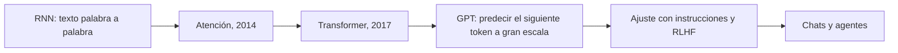

Al terminar esta fase podrás contar cómo se pasó de redes que traducían frases a modelos que generan texto coherente, y por qué una arquitectura de 2017, el [[glosario/transformer|Transformer]], está detrás de todos los LLM que usas. Es el bloque más histórico de la ruta: entender esta evolución te da criterio para leer noticias de IA sin que te vendan humo.

## Qué vas a ver

| Vídeo | Canal | Duración | Idioma | Profundidad |
|---|---|---|---|---|
| [Transformers y la llegada de GPT (1 de 2)](https://www.youtube.com/watch?v=aL-EmKuB078) | DotCSV | — | español | por encima |
| [Transformers y la llegada de GPT (2 de 2)](https://www.youtube.com/watch?v=xi94v_jl26U) | DotCSV | — | español | por encima |
| [Stable Diffusion y los modelos de difusión (2022)](https://www.youtube.com/watch?v=_0GzTdr-EYs) | DotCSV | — | español | extra |
| [Vaswani et al., 2017 · *Attention Is All You Need*](https://arxiv.org/abs/1706.03762) | artículo | — | inglés | extra |

Los títulos describen el tema de cada vídeo según la ruta del autor. «—» indica una duración sin confirmar: el tiempo de la lección es una estimación por lo bajo (10 minutos por cada vídeo de Transformers) más 10 minutos de lectura.

## Lo que importa

El autor describe este bloque como **el salto**. Antes había redes neuronales dedicadas a una sola tarea: una traducía, otra clasificaba imágenes. Con una arquitectura más compleja, el Transformer, llegaron los LLM; de ahí el chat con ChatGPT y, ahora, las herramientas de agentes. Igual que la fase 1, es una parte de cómo funciona la IA por dentro, poco práctica en el día a día: si no vas a crear modelos y vas a construir agentes con los que ya existen, míralo **por encima**.

La historia cabe en unos pocos pasos:

- **El problema de las RNN.** Una red recurrente lee el texto en orden y arrastra un resumen de lo leído. En frases largas ese resumen se degrada, y como cada paso depende del anterior no se puede paralelizar el entrenamiento.
- **La [[glosario/atencion|atención]].** Bahdanau, Cho y Bengio la propusieron en 2014 para traducción ([arXiv](https://arxiv.org/abs/1409.0473)): en lugar de depender de un resumen, el modelo mira directamente las partes de la entrada que más le importan en cada paso.
- **El Transformer.** Vaswani y otros quitaron la recurrencia y se quedaron solo con atención. Cada token mira a todos los demás a la vez, lo que permite entrenar en paralelo con muchos más datos.
- **GPT y la escala.** Los modelos GPT entrenan un Transformer a predecir el siguiente token sobre cantidades enormes de texto. GPT-3 mostró que con suficiente escala el modelo resuelve tareas nuevas a partir de unos pocos ejemplos en el prompt (Brown et al., 2020, [arXiv](https://arxiv.org/abs/2005.14165)), y las [[glosario/leyes-de-escalado|leyes de escalado]] describieron cómo mejora con más parámetros, datos y cómputo.
- **Del modelo base al asistente.** Un modelo preentrenado completa texto; para que siga instrucciones se ajusta con ejemplos y con preferencias humanas ([[glosario/rlhf|RLHF]]). Eso es lo que convirtió un predictor de texto en un chat útil.

Los modelos de difusión, como Stable Diffusion, son la otra gran rama generativa, sobre todo para imagen. Para la ruta son secundarios.

Dos consecuencias prácticas que conviene llevarse. La atención compara cada token con los demás, así que el coste crece con la longitud del contexto: por eso los tokens cuestan dinero y tiempo, y por eso la [[glosario/ventana-de-contexto|ventana de contexto]] tiene límite. Y que el modelo pueda mirar todo no significa que lo use igual de bien: la información en mitad de un contexto largo se aprovecha peor ([[glosario/lost-in-the-middle|lost in the middle]]). Lo verás de nuevo en RAG y en context engineering.

## Cómo verlo

1. **Los dos vídeos de Transformers seguidos.** Apunta solo tres cosas: qué limitaba a las RNN, qué hace la atención y por qué el Transformer escala.
2. **El artículo original, solo si te pica la curiosidad.** Lee el resumen y mira la figura de la arquitectura; no hace falta más.
3. **Stable Diffusion, al final y opcional.** Sirve para entender noticias de generación de imagen, no para construir agentes.
4. **Qué saltarte:** las comparativas entre modelos de la época. Han envejecido rápido; lo que no envejece es el mecanismo.

## Practícalo en MoreContext

- [[cursos/la-ia-por-dentro/07-de-las-rnn-al-transformer]]: el recorrido completo por escrito, de los embeddings de palabras a los modelos de razonamiento.
- [[roadmap/00-fundamentos/06-como-se-entrena-un-llm]]: preentrenamiento, ajuste con instrucciones y alineamiento, y qué significa cada etapa para quien construye.
- [[roadmap/00-fundamentos/03-ventana-de-contexto]]: el límite de la ventana visto desde la API.
- Glosario de la fase: [[glosario/embeddings]], [[glosario/preentrenamiento]], [[glosario/modelo-fundacional]].

## Ejercicio

> [!ejercicio] La línea del tiempo con consecuencias
> Dibuja una línea del tiempo con cinco hitos: RNN, atención, Transformer, GPT-3 y el ajuste con instrucciones. Junto a cada uno, escribe qué problema resolvió y una consecuencia que notas hoy al usar un LLM.
>
> Está bien si cada hito tiene un problema concreto (no «mejoró la IA»), si al menos una consecuencia habla del coste o del límite del contexto y si otra explica por qué un modelo base no sigue instrucciones igual que un chat.

> [!ejercicio]- Pistas
> Para GPT-3, piensa en qué hace que los ejemplos few-shot de tu prompt funcionen. Para el ajuste con instrucciones, compara pedir «resume esto» a un modelo que solo completa texto.

## Resumen

- Las RNN leían en orden y olvidaban; la atención permite mirar directamente lo relevante.
- El Transformer usa solo atención, se entrena en paralelo y escala: de ahí salen los GPT y los LLM actuales.
- Un modelo base predice texto; el ajuste con instrucciones y RLHF lo convierte en asistente.
- Si no vas a crear modelos, míralo por encima: lo que importa es su efecto en el coste y en el uso del contexto.

## Para seguir

- [[cursos/ruta-en-video/04-fase-3-llms-tokens-y-contexto]]
- [[cursos/la-ia-por-dentro/07-de-las-rnn-al-transformer]]
- [[glosario/transformer]]
