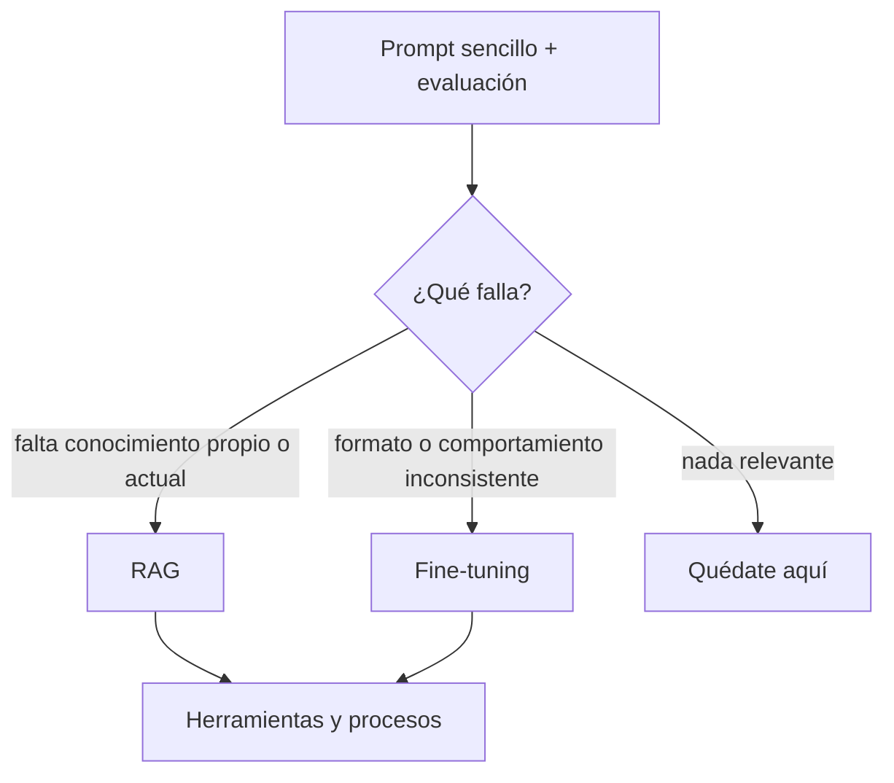

Al terminar esta fase sabrás explicar a un equipo cómo se usa un LLM para aportar valor en una empresa y qué nivel de personalización pide cada problema. Esta fase no tiene vídeo: es una lectura corta que resume la idea y te lleva al curso donde se desarrolla.

## Qué vas a ver

No hay vídeo en esta fase. El material es de lectura:

| Material | Dónde | Tiempo | Idioma | Profundidad |
|---|---|---|---|---|
| Esta lección | MoreContext | 10 min | español | a fondo |
| [[cursos/ia-en-la-empresa/index]] | MoreContext | ver la ficha del curso | español | a fondo |
| [[modelos/10-prompting-rag-o-fine-tuning]] | MoreContext | ver la página | español | a fondo |
| [*Optimizing LLM Accuracy*](https://developers.openai.com/api/docs/guides/optimizing-llm-accuracy) | OpenAI | — | inglés | extra |

## Lo que importa

El autor incluye esta fase por una razón: la mayoría usa la IA para programar o para hacer preguntas, pero las empresas la usan de más maneras. Una vez sabes qué es un LLM y cómo funciona, toca verlo con perspectiva general: no usarlo como todo el mundo, sino integrarlo en procesos y sistemas para que aporte valor. Es una introducción. Después viene todo el trabajo de construir esas integraciones y flujos, con código o con herramientas, montar la infraestructura y conectarlo todo, y hay mucha variedad de opciones para cada parte.

La idea de fondo: la IA aporta valor cuando un [[glosario/modelo-fundacional|modelo fundacional]] se combina con el conocimiento, los datos y los procesos propios de la organización. Un modelo general sabe qué es una factura; no sabe cómo se aprueba una factura en tu empresa. Esos procedimientos, la documentación privada, las librerías internas y las reglas de negocio son justo lo que diferencia a una empresa de otra que usa el mismo modelo.

Para incorporar ese conocimiento hay cuatro niveles:

| Nivel | Qué haces | Coste | Datos propios | Uso típico |
|---|---|---|---|---|
| Prompt engineering | Instrucciones y contexto bien diseñados sobre un modelo existente | bajo | no hacen falta | orientar respuestas y comportamiento |
| [[glosario/rag\|RAG]] | Buscar en tu documentación y meter lo relevante en el contexto | bajo o medio | sí | manuales, procedimientos, FAQ, políticas |
| [[glosario/fine-tuning\|Fine-tuning]] | Entrenar más un modelo con tus ejemplos | medio o alto | sí, un dataset y cómputo | estilo, formato, tareas muy específicas |
| Modelo propio | Entrenar un modelo base desde cero | muy alto | enormes | casos estratégicos muy concretos |

**Prompting cambia las instrucciones, RAG aporta conocimiento y fine-tuning adapta el comportamiento.** La pirámide no se lee como «cuanto más abajo, mejor»: cuanto más abajo, más inversión y más control. El objetivo es el nivel más sencillo que resuelva bien el problema, y el autor marca RAG como el nivel especialmente interesante para empresa.

Una guía de OpenAI llega a la misma conclusión con otra pregunta: ¿el fallo es de contexto o de comportamiento? Si al modelo le falta conocimiento, o lo tiene desactualizado, la palanca es RAG. Si el conocimiento está pero el formato, el tono o el razonamiento son inconsistentes, la palanca es fine-tuning. Y antes de ninguna de las dos, un prompt sencillo y un conjunto de evaluación para saber qué falla.

La arquitectura habitual suma piezas: LLM, más datos de la empresa, más RAG, más herramientas y APIs, integrado en un proceso que produce valor. Un ejemplo de los apuntes del autor: un empleado pregunta si un cliente puede devolver un producto. El sistema busca la política de devoluciones, consulta los datos del cliente y la fecha de compra, aplica las reglas y explica qué hacer a continuación. Eso ya no es chatear con una IA: es un sistema de decisión asistida conectado al conocimiento de la empresa.

La medida del éxito tampoco es «tener IA». Es reducir costes, ahorrar tiempo, mejorar la calidad, acelerar procesos o aumentar ingresos, y poder responder con un dato a la pregunta de qué ha mejorado en el negocio.

## Cómo verlo

1. **Lee esta lección y después la ficha de [[cursos/ia-en-la-empresa/index]].** El curso desarrolla cada nivel, cómo encontrar casos de uso, cómo medir y los errores típicos.
2. **Qué apuntar:** la frase de prompting, RAG y fine-tuning, y la pregunta de contexto frente a comportamiento.
3. **Qué saltarte por ahora:** el detalle técnico de RAG. Es la fase siguiente.

> [!aviso] El error más repetido
> «Vamos a hacer fine-tuning con todos nuestros documentos.» Para conocimiento que cambia, que hay que citar o que depende de permisos, casi siempre encaja mejor RAG: actualizas los documentos sin reentrenar nada.

## Practícalo en MoreContext

- [[cursos/ia-en-la-empresa/01-lo-que-un-modelo-no-sabe-de-tu-empresa]] y [[cursos/ia-en-la-empresa/02-la-piramide-de-personalizacion]]: la idea de esta fase, desarrollada.
- [[cursos/ia-en-la-empresa/03-donde-esta-el-valor]] y [[cursos/ia-en-la-empresa/04-medir-el-valor]]: encontrar casos de uso y medirlos.
- [[cursos/ia-en-la-empresa/05-errores-tipicos]] y [[cursos/ia-en-la-empresa/06-de-la-idea-al-piloto]]: qué evitar y un caso completo.
- [[patrones/02-llamada-aumentada]]: el bloque básico de todos estos sistemas, un modelo con recuperación, herramientas y memoria.
- [[sistemas/soporte-con-aprobacion-humana]]: un sistema de empresa completo, con herramientas y aprobación humana.

## Ejercicio

> [!ejercicio] Un caso de uso en una página
> Elige un proceso real de tu empresa o de una que conozcas (soporte, recursos humanos, ventas, ingeniería). Describe el problema, el conocimiento que el modelo no tiene, el nivel de la pirámide que usarías y por qué no el siguiente, y una métrica para saber si funciona.
>
> Está bien si el problema es concreto (con quién lo sufre y cuánto tiempo cuesta hoy), si justificas el nivel con la pregunta de contexto frente a comportamiento y si la métrica se puede medir antes y después.

> [!ejercicio]- Pistas
> Busca procesos con mucho texto, conocimiento disperso y decisiones repetidas. Métricas que suelen funcionar: tiempo de resolución, porcentaje de casos que se escalan a una persona, errores por revisión.

## Resumen

- El valor está en conectar un modelo general con el conocimiento y los procesos propios.
- Cuatro niveles: prompt, RAG, fine-tuning y modelo propio; más abajo es más caro, no mejor.
- Falta de conocimiento se resuelve con RAG; comportamiento inconsistente, con fine-tuning.
- El éxito se mide en el negocio, no en «tener IA».

## Para seguir

- [[cursos/ruta-en-video/06-fase-3-5-rag]]
- [[cursos/ia-en-la-empresa/index]]
- [[modelos/10-prompting-rag-o-fine-tuning]]
