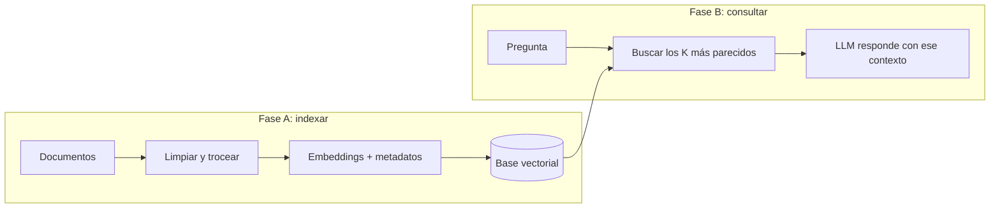

Al terminar esta fase sabrás cómo se conecta un LLM a documentos propios, qué piezas forman un sistema [[glosario/rag|RAG]] y dónde suele fallar. Tampoco hay vídeo: es una lectura que resume la idea y te deja en el nivel del roadmap y el curso donde lo construyes con código.

## Qué vas a ver

No hay vídeo en esta fase. El material es de lectura:

| Material | Dónde | Tiempo | Idioma | Profundidad |
|---|---|---|---|---|
| Esta lección | MoreContext | 10 min | español | a fondo |
| [[roadmap/30-contexto-y-rag/index]] | MoreContext | ver la ficha del nivel | español | a fondo |
| [[cursos/rag-a-fondo/index]] | MoreContext | ver la ficha del curso | español | por encima ahora; a fondo cuando lo necesites |
| [Lewis et al., 2020 · *Retrieval-Augmented Generation for Knowledge-Intensive NLP Tasks*](https://arxiv.org/abs/2005.11401) | artículo | — | inglés | extra |
| [Anthropic · *Introducing Contextual Retrieval*](https://www.anthropic.com/news/contextual-retrieval) | Anthropic | — | inglés | extra |

## Lo que importa

Para el autor este bloque es interesante e importante porque enseña a montar un sistema barato de mantener que personaliza un LLM con documentos o datos propios y privados. Si en tu empresa hay procedimientos, documentos o una librería interna bien documentada, un LLM general no sabe nada de eso. Con RAG puedes hacer que lo «sepa» y responda bien sobre ello, y es mucho más barato y sencillo que el [[glosario/fine-tuning|fine-tuning]]. A cambio, pide conocimientos de infraestructura: crear una base de datos, desplegar, interconectar piezas. Y aunque no vayas a construir uno mañana, conviene conocerlo: cuando te toque diseñar una solución de IA para una empresa, necesitas saber qué opciones hay para elegir requisitos, técnicas y la forma más adecuada de implementarla.

RAG resuelve una limitación concreta: el modelo no conoce tus datos internos ni lo que pasó después de su entrenamiento. La idea es buscar la información relevante, dársela al LLM como contexto y generar una respuesta basada en ella. Un RAG real no es meter un PDF en el prompt; tiene dos fases:

Las piezas que tienes que dominar:

- **[[glosario/chunking|Chunks]] y [[glosario/metadatos|metadatos]].** Un chunk es un fragmento manejable de un documento; los metadatos (autor, fecha, departamento, permisos) permiten filtrar antes de buscar.
- **[[glosario/embeddings|Embeddings]].** Un modelo de embeddings convierte un texto en un vector; textos con significado parecido quedan cerca.
- **Búsqueda por similitud.** La [[glosario/vector-store|base vectorial]] encuentra los vectores más cercanos a la pregunta, con métricas como la [[glosario/similitud-coseno|similitud coseno]].

En producción, un RAG básico se queda corto y aparecen tres refuerzos:

- **[[glosario/busqueda-hibrida|Búsqueda híbrida]] y [[glosario/reranking|reranking]]:** combinar búsqueda semántica con búsqueda por palabras clave ([[glosario/bm25|BM25]]) y reordenar los candidatos con un modelo para quedarte con los mejores.
- **Permisos en la recuperación ([[glosario/multi-tenant|multi-tenant]]):** la autorización se aplica al recuperar, con filtros de metadatos, para que nadie reciba fragmentos que no puede ver.
- **Contexto mínimo suficiente:** meter demasiado encarece, añade latencia y empeora la respuesta, porque el modelo aprovecha peor lo que queda en medio ([[glosario/lost-in-the-middle|lost in the middle]]).

**La regla de oro:** el error más común es creer que un RAG se arregla con un LLM mejor. Si la recuperación falla, el modelo recibe información equivocada y responde mal. Un buen RAG consigue que el modelo vea la información correcta, en el momento correcto, en el formato adecuado y respetando los permisos.

> [!consejo] Antes de montar un RAG, mide tu corpus
> Anthropic recomienda que, si tu base de conocimiento cabe en el contexto (del orden de 200.000 tokens, unas 500 páginas), la pongas entera en el prompt con prompt caching en lugar de construir un RAG. Por encima de ese tamaño, RAG.

## Cómo verlo

1. **Lee esta lección y la ficha del [[roadmap/30-contexto-y-rag/index|nivel 30]].** Ahí construyes cada pieza con código, en orden.
2. **Qué apuntar:** las dos fases, las tres piezas y la regla de oro.
3. **Qué dejar para más tarde:** los índices aproximados, el reindexado y los RAG con grafos. Están en [[cursos/rag-a-fondo/index]], que encaja mejor cuando ya tengas un RAG básico funcionando.

## Practícalo en MoreContext

- [[recetas/rag-minimo-viable]]: un RAG funcional en una tarde, para ver las dos fases en marcha.
- [[roadmap/30-contexto-y-rag/01-embeddings]], [[roadmap/30-contexto-y-rag/02-chunking]], [[roadmap/30-contexto-y-rag/03-busqueda-hibrida]], [[roadmap/30-contexto-y-rag/04-reranking]] y [[roadmap/30-contexto-y-rag/05-respuestas-con-citas]]: cada pieza, una lección.
- [[recetas/busqueda-hibrida-con-bm25]] y [[recetas/fusionar-rankings-con-rrf]]: la búsqueda híbrida con código.
- [[cursos/rag-a-fondo/07-permisos-y-multi-tenant]]: permisos aplicados en la recuperación.
- [[recetas/rag-local-con-pgvector]] y [[cursos/agentes-con-modelos-abiertos/05-rag-cien-por-cien-local]]: el mismo sistema sin salir de tu máquina.
- [[sistemas/rag-con-citas]] y [[plantillas/checklist-de-rag]]: la arquitectura completa y una lista para no olvidar nada.
- Cuando falle: [[problemas/el-rag-no-encuentra-el-documento]], [[problemas/el-rag-encuentra-pero-responde-mal]] y [[recetas/depurar-un-rag]].

## Ejercicio

> [!ejercicio] Diseña el RAG antes de programarlo
> Elige un conjunto de documentos real (la documentación de tu equipo, un manual, tus notas). En una página, decide: cómo los troceas, qué metadatos guardas, quién puede ver qué, cuántos fragmentos recuperas por pregunta y tres preguntas de prueba con el fragmento que debería salir para cada una.
>
> Está bien si el troceado respeta la estructura de los documentos, si al menos un metadato sirve para filtrar permisos, si justificas el número de fragmentos y si las tres preguntas te permiten saber si falla la recuperación o la generación.

> [!ejercicio]- Pistas
> Para separar los dos fallos: si el fragmento correcto no aparece entre los recuperados, el problema es de recuperación; si aparece y la respuesta es mala, es de generación. Antes de todo, calcula cuántos tokens ocupa tu corpus: quizá no necesites RAG.

## Resumen

- RAG busca información relevante y se la da al LLM como contexto; no cambia el modelo.
- Dos fases: indexar (trocear, embeddings, base vectorial) y consultar (buscar, inyectar, generar).
- En producción: búsqueda híbrida, reranking, permisos en la recuperación y contexto mínimo.
- Si la recuperación falla, cambiar de modelo no arregla nada.

## Para seguir

- [[cursos/ruta-en-video/07-fase-4-herramientas-para-programar]]
- [[roadmap/30-contexto-y-rag/index]]
- [[cursos/rag-a-fondo/index]]
