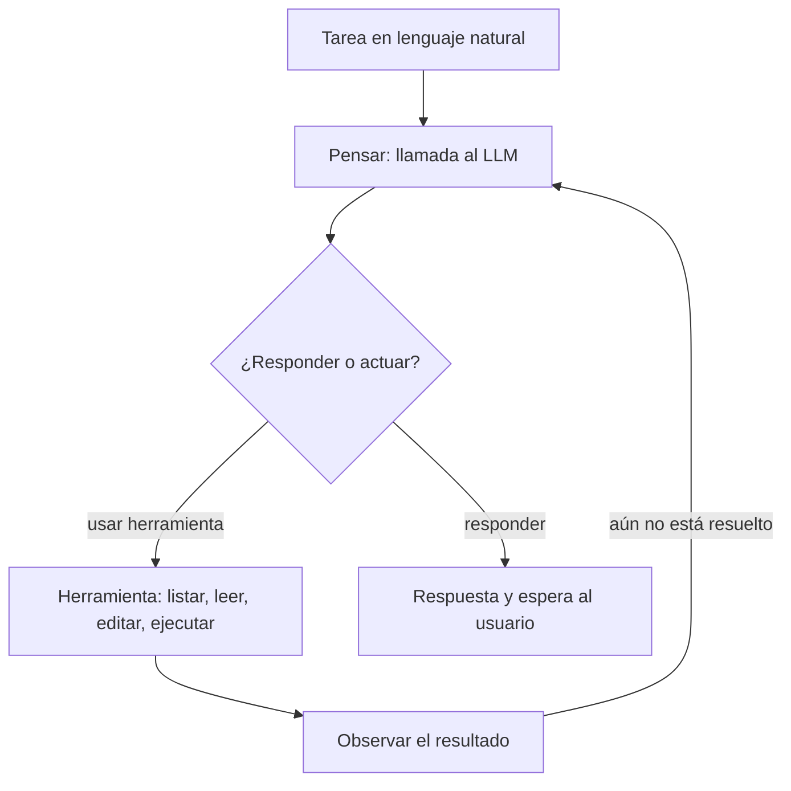

Al terminar esta fase sabrás qué es un [[glosario/agente|agente]], qué hace por dentro y qué lo distingue de un LLM o de un chat. Es el salto grande de la ruta: pasas de un sistema que responde a uno que actúa, usa herramientas, planifica, ejecuta comandos y edita archivos.

## Qué vas a ver

| Vídeo | Canal | Duración | Idioma | Profundidad |
|---|---|---|---|---|
| [Curso de IA para programadores: Claude Code (56:30–1:11:55)](https://www.youtube.com/watch?v=2aN_-m1uU4k) | midudev | 15 min | español | a fondo |
| [«Aprende a Programar con Agentes de IA desde CERO (Curso Completo Gratis)»](https://www.youtube.com/watch?v=H3gH_Fe6xvs) | MoureDev | — | español | a fondo |
| [Desarrollo con IA, día 1 (directo)](https://www.youtube.com/watch?v=GarWqdHzwac) | MoureDev | — | español | a fondo |
| [Desarrollo con IA, día 2: «Programa con agentes sin perder el control»](https://www.youtube.com/watch?v=irR8437xihg) | MoureDev | — | español | a fondo |
| [Desarrollo con IA, día 3: «Usa multiagentes para desarrollar mejor»](https://www.youtube.com/watch?v=kcSKbwVYXCg) | MoureDev | — | español | a fondo |

Títulos entre comillas: como los recoge el autor en su ruta; el resto describe el contenido. «—» indica una duración sin confirmar. El tiempo de la lección es una estimación por lo bajo: el tramo de midudev, 60 minutos por el curso completo y por cada día del directo, y 10 de lectura. Los directos suelen durar bastante más.

## Lo que importa

El autor dejó dos notas en esta fase. La primera explica el cambio. Antes había mucha intervención humana: ChatGPT en la web, y después el chat en el editor o las sugerencias de código, que por detrás no son más que una petición a una API con contexto de tu código. Un agente es otra cosa: un proceso que arranca de una tarea en lenguaje natural, describes lo que quieres y actúa para intentar conseguirlo.

Imagínalo como una caja negra con código que repite este bucle:



1. Recibe la tarea.
2. Piensa sobre ella enviando una petición a la API de un LLM.
3. Con esa respuesta decide si contesta con texto o si usa una herramienta.
4. Observa el resultado. Si la tarea no está resuelta, vuelve al paso 2; si lo está, espera al usuario.

Eso es el [[glosario/bucle-agentico|bucle agéntico]]. Sobre él se construye todo lo demás: herramientas locales o servidores remotos, flujos con varios agentes que hablan entre sí. El ejemplo del autor: le pides a Codex o a Claude Code «hazme una API en Java». El resultado de pensar es algo como «primero tengo que ver qué archivos hay en el proyecto». Con eso actúa: usa las herramientas que ya trae programadas (listar archivos, ejecutar comandos, leer, crear o borrar). Observa: ¿está hecha la API? Todavía no. Vuelve a pensar, y así hasta cumplir el objetivo. Este patrón de razonar y actuar se conoce como [[glosario/react|ReAct]] (Yao et al., 2022, [arXiv](https://arxiv.org/abs/2210.03629)); el diagrama original del autor era el de un agente ReAct de LangChain, una librería open source para construir agentes.

Si vas a programarlo, cada paso tiene su pieza en la API:

| Paso del bucle | Pieza en la API de Mensajes |
|---|---|
| Pensar | `client.messages.create(...)` con el historial y las herramientas |
| Decidir | `stop_reason`: `tool_use` si quiere actuar, `end_turn` si responde |
| Actuar | Tu código ejecuta la herramienta que pide el bloque `tool_use` |
| Observar | Devuelves un `tool_result` por cada `tool_use` y vuelves a llamar |

El autor lo resume como un cambio enorme: tienes una herramienta autónoma que razona. Lo hará mejor o peor y se podrá equivocar, pero con **buenas instrucciones** puede implementar tareas de código por sí sola. Por eso sigue siendo tan importante saber usar la IA y escribir buenos prompts. Pedir «haz que funcione» no sirve; hay que dar instrucciones buenas y detalladas:

```text title="Antes"
Haz que funcione el login.
```

```text title="Después"
El login de /api/login devuelve 500 cuando el email tiene mayúsculas.
Objetivo: que el email se compare sin distinguir mayúsculas.
Contexto: la consulta está en src/auth/repositorio.py; usamos PostgreSQL.
Restricciones: no cambies el esquema de la base de datos ni otros endpoints.
Verificación: añade un test con "Ana@Ejemplo.com" y ejecuta la suite completa.
```

Y por eso sigue siendo importante saber informática: si sabes, sabes qué pedir, y puedes describir al agente guías e instrucciones para que lo implemente de la mejor forma. Los LLM hacen muchas cosas, para bien y para mal; sin guías ni restricciones, hacen cosas que asumen que quieres y no quieres, o más de las que pediste. No basta con saber cómo funcionan los agentes: hay que entender cómo usarlos bien.

La segunda nota es sobre orden mental. Verás conceptos repetidos en varios vídeos; aun así, conviene verlos. Y conviene separar bien cada cosa en lugar de quedarse en «ha salido un modelo nuevo»:

| Tipo | Ejemplos |
|---|---|
| Empresa que crea modelos y herramientas | OpenAI, Anthropic |
| Modelo LLM | Una versión concreta de Claude Sonnet, Claude Opus o GPT |
| Concepto de los LLM | Token, contexto, herramienta |
| Herramienta agéntica que usa un LLM para resolver tareas | Codex, Claude Code, Claude Cowork |

Hasta aquí lo importante es entender qué es un agente, qué puede hacer, en qué se diferencia de un LLM o de un chat, y que sigues necesitando saber qué quieres construir. Flujos, MCP, skills y subagentes vienen ahora. Y una idea que conecta con la fase 3: el agente razona y decide con un LLM, y un LLM no da la respuesta correcta, da la más probable.

## Cómo verlo

1. **El tramo de Claude Code de midudev (56:30–1:11:55)**, después de repasar desde el minuto 29:20 la definición de agente que viste en la fase 4.
2. **El curso completo de MoureDev.** Va de lo básico de los agentes a los flujos con varios agentes; apunta cómo describe el bucle y qué herramientas usa.
3. **El directo de tres días, entero y en orden.** Es la recomendación más fuerte del autor en esta fase. El día 3 trata multiagentes: lo usarás también en la fase 8.
4. **Qué apuntar:** el bucle con tus palabras, las cuatro columnas de la tabla de tipos y tres ejemplos de instrucciones buenas que veas en los vídeos.
5. **Qué saltarte:** la configuración paso a paso de cada herramienta; la documentación oficial está más al día.

## Practícalo en MoreContext

- [[roadmap/40-primer-agente/01-que-es-un-agente]] y [[roadmap/40-primer-agente/02-el-bucle-agentico]]: el bucle escrito a mano con el SDK, tratando cada `stop_reason`.
- [[roadmap/40-primer-agente/03-condiciones-de-parada]] y [[roadmap/40-primer-agente/05-agente-con-varias-herramientas]]: límites de pasos y varias herramientas.
- [[roadmap/20-herramientas/01-ciclo-tool-use]]: el ciclo `tool_use` y `tool_result` desde cero.
- [[cursos/langchain-y-langgraph/03-tu-primer-agente-con-create-agent]]: el mismo bucle con LangChain, después de entenderlo a mano.
- [[roadmap/00-fundamentos/07-empresa-modelo-herramienta]]: la tabla de tipos ampliada, con ejercicios de clasificación.
- [[plantillas/prompt-de-sistema-de-agente]] y [[roadmap/10-prompting/01-instrucciones-claras]]: instrucciones para un agente con herramientas.
- [[patrones/01-workflows-vs-agentes]]: cuándo te basta un flujo fijo y no necesitas un agente.

## Ejercicio

> [!ejercicio] Traza un agente a mano
> Elige una tarea que darías a un agente de código (por ejemplo, «añade paginación al listado de usuarios»). Escribe la traza que esperas: cada vuelta del bucle con lo que piensa, la herramienta que usa, lo que observa y por qué sigue o para. Después reescribe la tarea como una instrucción con objetivo, contexto, restricciones y verificación.
>
> Está bien si la traza tiene al menos cuatro vueltas, si cada una termina en una decisión explícita (seguir o responder), si una vuelta incluye un error que el agente corrige y si tu instrucción final dice cómo se comprueba que la tarea está hecha.

> [!ejercicio]- Pistas
> Las primeras vueltas casi siempre son de exploración: listar archivos, leer el código relevante. El error típico es un test que falla tras el primer cambio; el agente lo observa y vuelve a pensar.

## Resumen

- Un agente repite un bucle: pensar con el LLM, decidir, actuar con herramientas y observar.
- Cada paso tiene su pieza en la API: llamada, `stop_reason`, herramienta y `tool_result`.
- La calidad depende de las instrucciones: saber informática es saber qué pedir.
- Separa empresa, modelo, concepto y herramienta para no liarte con las noticias.

## Para seguir

- [[cursos/ruta-en-video/09-fase-6-mcp]]
- [[roadmap/40-primer-agente/index]]
- [[blog/2026-10-19-haz-que-funcione-no-es-una-instruccion]]
