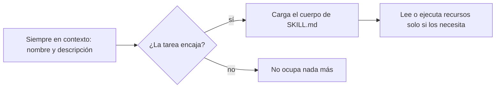

Al terminar esta fase sabrás qué es una [[glosario/skill|skill]], por qué no llena el contexto de tu agente y cómo encaja con MCP. Las skills son procedimientos reutilizables que un agente carga cuando los necesita: la evolución natural después de dominar agentes y MCP.

## Qué vas a ver

| Vídeo o curso | Canal | Duración | Idioma | Profundidad |
|---|---|---|---|---|
| [Curso de IA para programadores: MCP y Agent Skills, e IA en local (1:11:55–1:33:20)](https://www.youtube.com/watch?v=2aN_-m1uU4k) | midudev | 21 min | español | a fondo |
| [«Taller de Skills para Agentes de IA desde cero: Claude Code, OpenCode, Codex, Cursor...»](https://www.youtube.com/watch?v=UGh6q6rKVM4) | MoureDev | — | español | a fondo |
| [Introducción a Agent Skills](https://academy.claude.com/es/courses/introduction-to-agent-skills) | Anthropic Academy | — | inglés | a fondo |
| [NotebookLM para aprender con tus fuentes](https://www.youtube.com/watch?v=wxgwLTOh7wI) | sin confirmar | — | — | extra |

Títulos entre comillas: como los recoge el autor en su ruta; el resto describe el contenido. «—» indica una duración sin confirmar. El tiempo de la lección suma el tramo de midudev, una estimación por lo bajo de 60 minutos por el taller y por el curso de Anthropic, y 10 minutos de lectura.

## Lo que importa

La nota del autor en esta fase quedó a medias en su ruta, así que esta sección parte de su definición: **una skill es un procedimiento**, un archivo Markdown que explica en texto cómo hacer algo, y que puede ir acompañado de más recursos, como scripts, dentro de la misma carpeta.

En el formato abierto de Agent Skills, una skill es una carpeta con un `SKILL.md`. Ese archivo empieza con una cabecera YAML con dos campos obligatorios, `name` y `description`, y sigue con las instrucciones en Markdown. Junto a él pueden ir scripts, documentos de referencia o plantillas. La clave está en cómo se carga, la [[glosario/divulgacion-progresiva|divulgación progresiva]]:

Por eso puedes tener decenas de skills instaladas sin saturar el contexto: el agente solo ve unas líneas de cada una hasta que la tarea las pide. Un ejemplo del harness del autor: la skill `acceptance-criteria` explica el esquema y las reglas para escribir criterios de aceptación ejecutables; su descripción dice cuándo usarla, y el agente solo lee el procedimiento completo cuando le toca diseñar o revisar esos criterios.

**MCP y skills se complementan.** MCP le da al agente capacidades nuevas: herramientas para tocar un sistema que antes no alcanzaba. Una skill le da conocimiento procedimental: cómo hacer una tarea a tu manera con las herramientas que ya tiene. Si quieres que tu agente lea issues de tu repositorio, necesitas una herramienta (un servidor MCP o la CLI del servicio). Si quieres que las clasifique siguiendo los criterios de tu equipo, eso es una skill.

Dos datos de contexto. Agent Skills es un estándar abierto: el 22 de octubre de 2026 Anthropic lo donó a la Agentic AI Foundation de la Linux Foundation, donde también están MCP y AGENTS.md, y según Anthropic lo usan más de 70 plataformas. Y las skills son un riesgo de cadena de suministro: instalar una skill es meter instrucciones, y a veces scripts, en un agente que trabaja con tus permisos. Un estudio de Snyk de febrero de 2026 analizó 3.984 skills publicadas y encontró problemas críticos en el 13,4 % y 76 maliciosas confirmadas ([Snyk](https://snyk.io/blog/toxicskills-malicious-ai-agent-skills-clawhub/)).

> [!peligro] Lee una skill antes de instalarla
> Abre el `SKILL.md` y todos los scripts. Busca instrucciones que pidan ignorar otras reglas, enviar datos fuera, descargar código o tocar credenciales. Si no la entiendes entera, no la instales.

NotebookLM entra aquí como complemento, para usar la IA en tu propio aprendizaje: le subes tus fuentes (documentación, vídeos, apuntes) y responde basándose en ellas.

## Cómo verlo

1. **El tramo de midudev (1:11:55–1:33:20).** Primero la diferencia entre MCP y Agent Skills con ejemplos; después cómo ejecutar modelos y agentes en local. Apunta la diferencia con tus palabras.
2. **El taller de MoureDev.** Es un curso de skills para varias herramientas (Claude Code, OpenCode, Codex, Cursor), no solo para una. Fíjate en qué partes del formato son comunes.
3. **El curso de Anthropic Academy.** Completa el formato y las buenas prácticas.
4. **NotebookLM, opcional.** Útil si estudias con mucha documentación; el último tramo del curso de midudev (1:33:20) también lo enseña.
5. **Qué saltarte:** los catálogos de skills y sus cifras de descargas. Lo que importa es saber escribir y revisar una.

## Practícalo en MoreContext

- [[roadmap/50-skills/01-que-es-una-skill]] y [[roadmap/50-skills/02-anatomia-de-una-skill]]: qué es y qué no es una skill, y el formato exacto.
- [[roadmap/50-skills/03-carga-bajo-demanda]]: cómo funciona la divulgación progresiva y cuánto contexto ocupa cada nivel.
- [[roadmap/50-skills/04-escribir-tu-primera-skill]] y [[plantillas/skill]]: tu primera skill con procedimiento y un script.
- [[roadmap/50-skills/05-skills-en-equipo]]: compartir, versionar y no fiarse de skills ajenas.
- [[docs/claude-code/03-skills]]: dónde las busca Claude Code y qué campos extra admite.
- [[cursos/seguridad-y-prompt-injection/02-inyeccion-directa-e-indirecta]]: por qué una skill de terceros es una vía de inyección.
- [[recetas/apuntes-de-video-con-ia]]: un procedimiento del autor que funciona bien convertido en skill.

## Ejercicio

> [!ejercicio] Tu primera skill
> Elige un procedimiento que repites con tu agente (escribir un commit con tu formato, revisar un PR con tu checklist, generar un informe). Escríbelo como skill: carpeta, `SKILL.md` con `name` y `description` y las instrucciones, y un script si alguna parte es determinista. Pruébala con tres peticiones: dos en las que deba usarse y una en la que no.
>
> Está bien si la descripción dice qué hace y cuándo usarla, si el agente la carga en las dos peticiones que tocan y no en la tercera y si el script hace la parte que no conviene dejar al modelo.

> [!ejercicio]- Pistas
> Si el agente no la usa cuando debe, el problema casi siempre está en la descripción: añade las palabras que usarías al pedir la tarea. Si la usa cuando no toca, acota el «cuándo».

## Resumen

- Una skill es una carpeta con `SKILL.md` (nombre, descripción e instrucciones) y recursos opcionales.
- Se carga por divulgación progresiva: solo el nombre y la descripción ocupan contexto hasta que hace falta.
- MCP da capacidades; una skill da el procedimiento para usarlas a tu manera.
- Revisa cualquier skill ajena antes de instalarla: trabaja con tus permisos.

## Para seguir

- [[cursos/ruta-en-video/11-fase-8-multiagente-y-sdd]]
- [[roadmap/50-skills/index]]
- [[glosario/skill]]
