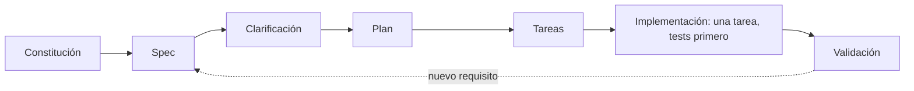

Al terminar esta fase sabrás trabajar con un agente a partir de una especificación acordada en lugar de improvisar prompts, y sabrás cuándo merece la pena repartir el trabajo entre varios agentes. Son dos saltos a la vez: de un agente con una tarea a varios coordinados, y del *vibe coding* a un flujo profesional.

## Qué vas a ver

| Vídeo o material | Canal | Duración | Idioma | Profundidad |
|---|---|---|---|---|
| [Curso de Spec-Driven Development desde cero (directo)](https://www.youtube.com/watch?v=5HaOxAAA5qI) | MoureDev | — | español | a fondo |
| [Repositorio «Hello SDD»](https://github.com/mouredev/hello-sdd) con las plantillas y el proyecto del curso | MoureDev | — | español | a fondo |
| [Desarrollo con IA, día 3: «Usa multiagentes para desarrollar mejor»](https://www.youtube.com/watch?v=kcSKbwVYXCg) | MoureDev | — | español | repaso (visto en la fase 5) |
| [«Hermes Agent + Claude Code = Arquitectura IA de 5.000€»](https://www.youtube.com/watch?v=Q4MSS9WuomQ) | BettaTech | — | español | a fondo |

El enlace al directo de SDD sale del propio repositorio, que avisa de que hay que ver el curso para entender su contenido. Títulos entre comillas: como los recoge el autor en su ruta o el repositorio. «—» indica una duración sin confirmar. El tiempo de la lección es una estimación por lo bajo: 60 minutos por el directo con su repositorio, 10 por el vídeo de BettaTech y 10 de lectura. El día 3 ya cuenta en la fase 5.

## Lo que importa

**Spec-Driven Development ([[glosario/sdd|SDD]])** es escribir una especificación antes del código y hacer que el agente trabaje contra ella. El curso de MoureDev lo enseña con un flujo completo, y su repositorio deja un artefacto por cada paso:

- **Constitución:** unos pocos principios del proyecto, cortos y verificables (stack, calidad, tests, límites).
- **Spec:** solo el qué y el por qué. Contexto, usuarios, historias, requisitos funcionales numerados, casos límite, lo que queda fuera de alcance y cuándo se considera terminado.
- **Clarificación:** el agente revisa la spec como un QA y señala ambigüedades sin resolverlas.
- **Plan y tareas:** módulos, datos y decisiones justificadas; después tareas pequeñas, cada una con su requisito y una línea de «hecho cuando».
- **Implementación:** una tarea cada vez, con los tests primero, y parar al acabar.
- **Validación:** recorrer los requisitos uno a uno con el test que cubre cada uno.
- **Cambio:** un requisito nuevo modifica primero la spec y después el código.

Los requisitos se escriben en **[[glosario/ears|EARS]]** (*Easy Approach to Requirements Syntax*, Mavin y otros, 2009), una sintaxis con pocos patrones fijos: «CUANDO ocurre un evento, EL SISTEMA hace algo», «SI se da una condición no deseada, ENTONCES EL SISTEMA responde así», «MIENTRAS se mantiene un estado, EL SISTEMA…» y requisitos permanentes. La ventaja es que cada frase se traduce casi directamente en un test. El repositorio incluye además un `AGENTS.md` de ejemplo para dar contexto al agente (con un `CLAUDE.md` que puede limitarse a importarlo) y una skill que entrevista al usuario y genera la spec.

SDD no es exclusivo de un curso: GitHub publicó Spec Kit en 2025 con un flujo parecido (constitución, especificar, planificar, tareas) y Kiro, de AWS, guarda los requisitos en EARS. La crítica más repetida también merece apuntarse: demasiados Markdown que revisar, y la misma ceremonia para un cambio pequeño que para uno grande. Escala la spec al tamaño del cambio.

**Multiagente.** El día 3 del directo y el vídeo de BettaTech enseñan a repartir trabajo entre agentes y a conectar piezas: un agente que orquesta y otros especializados. Antes de copiarlo, dos datos. Anthropic midió que su sistema multiagente de investigación consume del orden de 15 veces los tokens de un chat. Y la experiencia publicada en 2026 converge en una regla: varios agentes leyendo, investigando o revisando funcionan bien; varios agentes escribiendo a la vez sobre el mismo código, no. Un revisor con contexto limpio que no ha visto cómo se escribió el código es de los usos que más aportan.

> [!consejo] Spec y multiagente encajan
> Una spec con requisitos verificables es lo que permite repartir trabajo: cada subagente recibe una tarea acotada y un criterio para saber si la ha terminado, y un revisor independiente comprueba contra la misma spec.

## Cómo verlo

1. **El directo de SDD con el repositorio abierto.** Sigue cada fase y mira el artefacto que deja en el proyecto de ejemplo.
2. **Lee las plantillas, no las copies a ciegas.** La de spec y la tabla de prompts por fase son lo más reutilizable.
3. **El día 3 de MoureDev, si no lo viste en la fase 5.** Apunta cómo reparte el trabajo y qué pasa cuando dos agentes tocan lo mismo.
4. **El vídeo de BettaTech al final.** Es un ejemplo de arquitectura que conecta varias piezas; vuelve a él en la fase 9, porque en la práctica es una arquitectura de harness.

## Practícalo en MoreContext

- [[roadmap/70-flujos-con-especificacion/01-de-improvisar-a-especificar]] y [[roadmap/70-flujos-con-especificacion/02-requisitos-en-ears]]: el porqué del flujo y EARS con ejemplos.
- [[roadmap/70-flujos-con-especificacion/03-plan-y-tareas]], [[roadmap/70-flujos-con-especificacion/04-aceptacion-ejecutable]] y [[roadmap/70-flujos-con-especificacion/05-una-sola-puerta-humana]]: del plan a criterios que se ejecutan y a una sola aprobación humana.
- [[plantillas/spec-con-ears]], [[plantillas/agents-md]] y [[recetas/criterios-de-aceptacion-ejecutables]]: las piezas listas para usar.
- [[roadmap/60-multiagente/01-cuando-no-usar-multiagente]] y [[roadmap/60-multiagente/02-orquestador-y-subagentes]]: cuándo no y cómo sí.
- [[docs/claude-code/02-subagentes]] y [[plantillas/subagente]]: subagentes en Claude Code con un contrato claro.
- [[sistemas/harness-sdd-claude-code]]: el harness del autor, que combina SDD, subagentes y una sola puerta humana.

## Ejercicio

> [!ejercicio] Una spec pequeña en EARS
> Elige una funcionalidad pequeña de un proyecto tuyo. Escribe su spec: contexto en un párrafo, de cinco a ocho requisitos en EARS (al menos uno de evento, uno de condición no deseada y uno de estado), dos casos límite, una sección de fuera de alcance y el criterio de terminado. Después pide a un agente que la revise como QA sin resolver nada.
>
> Está bien si cada requisito se puede comprobar con un test, si el agente encuentra al menos una ambigüedad que corriges en la spec y si el fuera de alcance evita una ampliación que el agente habría hecho por su cuenta.

> [!ejercicio]- Pistas
> Un requisito como «el sistema debe ser rápido» no es comprobable; «CUANDO el usuario pide el listado, EL SISTEMA responde en menos de 300 ms con 1.000 registros» sí. Los casos límite típicos: vacíos, duplicados y datos mal formados.

## Resumen

- SDD: constitución, spec, clarificación, plan, tareas, implementación de una en una y validación.
- EARS da requisitos con pocos patrones fijos que se convierten en tests.
- Varios agentes compensan para leer, investigar y revisar; para escribir, mejor uno.
- Una spec con criterios verificables es lo que hace posible repartir y revisar.

## Para seguir

- [[cursos/ruta-en-video/12-fase-9-harness-engineering]]
- [[roadmap/70-flujos-con-especificacion/index]]
- [[roadmap/60-multiagente/index]]
