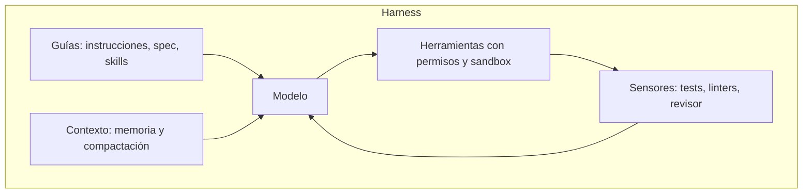

Al terminar esta fase sabrás qué es un [[glosario/harness|harness]] y por qué hoy se habla de diseñarlo como una disciplina propia. Es el concepto más reciente de la ruta y apenas hay vídeos en español que lo traten con ese nombre, así que esta lección se apoya más en lecturas y en el contenido de MoreContext.

## Qué vas a ver

| Vídeo o lectura | Autor | Duración | Idioma | Profundidad |
|---|---|---|---|---|
| [Vídeo que enlaza el autor como lo más cercano al tema](https://www.youtube.com/watch?v=q9Vaoz0hd0U) | sin confirmar | — | — | a fondo |
| [«Hermes Agent + Claude Code = Arquitectura IA de 5.000€»](https://www.youtube.com/watch?v=Q4MSS9WuomQ) | BettaTech | — | español | repaso (visto en la fase 8) |
| [*Effective harnesses for long-running agents*](https://www.anthropic.com/engineering/effective-harnesses-for-long-running-agents) | Anthropic, nov. 2025 | — | inglés | extra |
| [*Harness engineering: leveraging Codex in an agent-first world*](https://openai.com/index/harness-engineering/) | OpenAI, feb. 2026 | — | inglés | extra |
| [*The Anatomy of an Agent Harness*](https://www.langchain.com/blog/the-anatomy-of-an-agent-harness) | LangChain, mar. 2026 | — | inglés | extra |
| [*Harness engineering for coding agent users*](https://martinfowler.com/articles/harness-engineering.html) | Birgitta Böckeler, abr. 2026 | — | inglés | extra |

No se ha podido confirmar el título ni el canal del primer vídeo. «—» indica un dato sin confirmar. El tiempo de la lección es una estimación por lo bajo: 10 minutos por ese vídeo y 10 de lectura. El vídeo de BettaTech está en la fase 8; aquí se vuelve a él con otra mirada.

## Lo que importa

Un harness es todo el software que envuelve al modelo para convertirlo en un agente capaz de trabajar de verdad: la gestión de herramientas, los permisos, la memoria, el [[glosario/bucle-agentico|bucle agéntico]], la [[glosario/compactacion|compactación]] del contexto, los [[glosario/hook|hooks]] y el [[glosario/sandbox|sandbox]]. LangChain lo resume en una fórmula que se ha extendido: **agente = modelo + harness**. Todo lo que no es el modelo es harness.

La progresión que propone el autor ordena las tres disciplinas:

1. **Prompt engineering:** optimizar la instrucción individual.
2. **[[disciplinas/context-engineering|Context engineering]]:** construir de forma dinámica lo que entra en la ventana de contexto en cada paso (RAG, MCP, memoria). Anthropic lo definió en 2025 como elegir y mantener el conjunto óptimo de tokens en cada llamada.
3. **Harness engineering:** diseñar todo el entorno de ejecución del agente, una especie de sistema operativo del agente: herramientas, controles, verificación y orquestación.

El término se popularizó a principios de 2026: OpenAI publicó en febrero cómo un equipo construyó un producto con Codex sin escribir código a mano diseñando el entorno del agente, y LangChain y Birgitta Böckeler lo desarrollaron en los meses siguientes. Anthropic ya usaba la palabra en noviembre de 2025 para agentes de larga duración.

Böckeler da dos distinciones que ordenan el diseño. Las **guías** actúan antes (instrucciones, especificaciones, ejemplos) y los **sensores** después (tests, linters, revisiones). Y los sensores pueden ser **deterministas** (un test, un linter, el compilador: baratos y fiables) o **inferenciales** (un modelo que revisa o juzga: caros y no deterministas, para usarlos donde lo determinista no llega). Aquí encaja el argumento de BettaTech: usar herramientas deterministas junto a los agentes, como linters y tests automáticos, es la capa de verificación que un harness necesita. Y aquí encaja también lo de midudev: MCP y Agent Skills son, en la práctica, piezas de un harness (herramientas, contexto y procedimientos).

Un matiz con datos: el harness no siempre compensa. Un análisis publicado en martinfowler.com en octubre de 2026 comparó la misma tarea con y sin harness completo. Con un modelo de frontera, el harness multiplicó el coste sin mejorar la fiabilidad; con un modelo barato, la llevó de 3 aciertos de 10 a 10 de 10. Mide primero y añade piezas donde el modelo falla.

> [!nota] Para buscar más vídeos
> En YouTube, prueba con `harness engineering agentes IA` y `Claude Code harness explicado`. Es un tema que crece rápido: revisa los canales de la ruta cada pocas semanas.

## Cómo verlo

1. **El vídeo que enlaza el autor** con una pregunta en mente: ¿qué piezas, además del modelo, hacen que el agente funcione?
2. **Vuelve al vídeo de BettaTech de la fase 8** y señala cada pieza del harness que aparece aunque no use la palabra.
3. **Lee una de las cuatro lecturas.** Si solo vas a leer una, la de Böckeler da el marco más útil para quien usa agentes de código.
4. **Qué apuntar:** la lista de piezas, guías frente a sensores y la regla de medir antes de añadir.

## Practícalo en MoreContext

- [[roadmap/90-harness/01-que-es-un-harness]] y [[roadmap/90-harness/02-las-piezas-de-un-harness]]: el concepto y cada pieza, en general.
- [[roadmap/90-harness/03-permisos-y-hooks]] y [[recetas/hook-que-bloquea-comandos-peligrosos]]: fronteras deterministas que el modelo no puede saltarse.
- [[roadmap/90-harness/04-estado-coste-y-contexto]] y [[roadmap/90-harness/05-un-harness-minimo]]: estado, presupuesto y un harness mínimo construido paso a paso.
- [[cursos/harness-engineering/01-del-prompt-al-harness]]: el inicio del curso sobre el harness real del autor, para construir y adaptar el tuyo.
- [[docs/claude-code/04-hooks]] y [[docs/claude-code/06-permisos-y-sandbox]]: las piezas de harness de Claude Code.
- [[recetas/un-verify-para-toda-la-regresion]] y [[recetas/canario-de-contexto]]: un sensor determinista y un detector de contexto saturado.
- [[cursos/context-engineering/index]]: la disciplina intermedia de la progresión.

## Ejercicio

> [!ejercicio] Audita el harness que ya usas
> Toma la herramienta agéntica que usas (Claude Code, Codex, OpenCode u otra) y haz una tabla con las piezas del harness: instrucciones del proyecto, herramientas, permisos, hooks, sandbox, memoria, compactación y verificación. Para cada una, anota cómo está configurada hoy en tu proyecto y si es guía o sensor, determinista o inferencial.
>
> Está bien si identificas al menos una pieza que no tienes configurada, si propones un sensor determinista concreto para tu proyecto (un test, un linter, un script) y si explicas qué fallo repetido del agente evitaría.

> [!ejercicio]- Pistas
> Piensa en el último error que tu agente cometió dos veces. Casi siempre se convierte en una de estas tres cosas: una regla en las instrucciones, un hook que lo bloquea o un test que lo detecta.

## Resumen

- Agente = modelo + harness: todo lo que no es el modelo es harness.
- La progresión va de la instrucción (prompt) al contexto y al entorno completo (harness).
- Guías antes, sensores después; deterministas siempre que se pueda.
- El harness tiene coste: mide primero y añade piezas donde el modelo falla.

## Para seguir

- [[cursos/ruta-en-video/13-fase-10-sistemas-y-plataformas]]
- [[roadmap/90-harness/index]]
- [[cursos/harness-engineering/index]]
