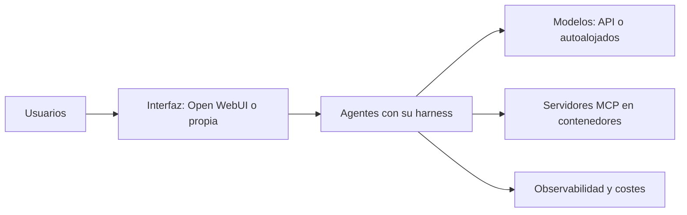

Al terminar esta fase tendrás un plan de estudio para pasar de usar agentes a diseñar plataformas de agentes a medida: escalables, robustas y operables. Es el perfil de AI engineer avanzado o arquitecto de IA. En la ruta original del autor esta fase es solo un esbozo, así que aquí se convierte en una guía que te lleva al contenido de MoreContext donde se construye cada parte.

## Qué vas a ver

No hay vídeos asignados a esta fase. El material es de MoreContext y de la documentación oficial de cada herramienta:

| Material | Para qué | Profundidad |
|---|---|---|
| [[sistemas/index]] | Arquitecturas completas de sistemas con agentes | a fondo |
| [[roadmap/100-produccion/index]] | Observabilidad, costes, latencia, seguridad y despliegue | a fondo |
| [[cursos/agentes-con-modelos-abiertos/index]] | Modelos de pesos abiertos en local o autoalojados | a fondo |
| [[docs/frameworks/01-elegir-framework]] | Cuándo usar el SDK del proveedor y cuándo un framework | por encima |
| [[herramientas/index]] | Fichas de cada pieza de infraestructura | por encima |

El tiempo de la lección son sus 10 minutos de lectura; cada curso o nivel enlazado tiene su propia estimación.

## Lo que importa

El autor resume el perfil en una línea: diseñar sistemas a medida, escalables y robustos, con plataforma propia o incluso framework propio, infraestructura y DevOps (Kubernetes, Terraform), una interfaz como Open WebUI que use tus propios agentes, y agentes y servidores MCP en contenedores. Cada pieza de esa frase es un bloque de estudio:

1. **Arquitectura del sistema.** Empieza por sistemas completos y por los patrones que los forman. Decide pronto si escribes el bucle con el SDK del proveedor, usas un framework open source como LangGraph o te apoyas en un harness ya hecho. Ese espectro (harness alojado, Agent SDK o API en bruto) ya está documentado por los proveedores.
2. **Modelos.** API comercial, modelo de pesos abiertos en tu servidor o una mezcla detrás de una pasarela. La decisión depende de privacidad, coste a tu volumen y capacidad de operar GPU.
3. **Interfaz.** [[herramientas/open-webui|Open WebUI]] es una interfaz de chat autoalojable que puede conectarse a modelos locales y a tus propios agentes; la alternativa es una interfaz propia.
4. **Herramientas como servicios.** Servidores MCP desplegados como contenedores. Con la especificación de MCP del 28 de julio de 2026 el protocolo no guarda sesión entre peticiones, así que un servidor se escala detrás de un balanceador normal; si necesitas estado, se pasa de forma explícita.
5. **Producción.** Trazas de cada llamada al modelo y a cada herramienta, coste por tarea, límites de tasa, despliegue y humano en el bucle para acciones con riesgo.
6. **Seguridad y aislamiento.** Agentes en contenedores o sandbox, mínimo privilegio en cada credencial y cuidado con combinar datos privados, contenido no fiable y salida al exterior.
7. **Infraestructura general.** Kubernetes, Terraform y CI/CD quedan fuera de MoreContext: apréndelos con su documentación oficial y aplícalos a las piezas anteriores.

> [!aviso] No empieces por la plataforma
> Una plataforma solo tiene sentido cuando ya tienes agentes que funcionan y que varias personas o equipos necesitan. Construye primero un sistema concreto, mídelo en producción y extrae la plataforma de lo que se repite.

## Cómo verlo

1. **Elige un sistema de MoreContext parecido a lo que quieres construir** y léelo entero: problema, diagrama, componentes, costes y riesgos.
2. **Completa el nivel 100 del roadmap** antes de pensar en infraestructura propia.
3. **Haz el curso de modelos abiertos** si la privacidad o el coste te empujan a autoalojar.
4. **Qué saltarte al principio:** frameworks propios. Casi siempre conviene empezar con el SDK o con un framework existente y escribir el tuyo solo cuando sepas exactamente qué te falta.

## Practícalo en MoreContext

- [[sistemas/asistente-100-local]]: un asistente con herramientas y RAG sin salir de tu servidor (modelo local, LangGraph, base vectorial y observabilidad autoalojada).
- [[sistemas/investigacion-multiagente]] y [[sistemas/soporte-con-aprobacion-humana]]: dos arquitecturas completas con orquestación y aprobación humana.
- [[sistemas/harness-sdd-olas]]: varias features en paralelo con aislamiento por worktree.
- [[cursos/agentes-con-modelos-abiertos/03-servir-modelos-en-produccion]] y [[cursos/agentes-con-modelos-abiertos/06-local-o-api]]: servir modelos y decidir entre local, autoalojado o API.
- [[docs/modelos-abiertos/03-apis-compatibles-y-litellm]], [[herramientas/vllm]], [[herramientas/ollama]] y [[herramientas/litellm]]: las piezas para servir y enrutar modelos.
- [[cursos/mcp-de-cero-a-servidor/04-seguridad-y-despliegue]]: desplegar servidores MCP remotos.
- [[roadmap/100-produccion/01-observabilidad-y-trazas]], [[recetas/trazas-con-langfuse]] y [[roadmap/100-produccion/06-despliegue]]: trazas y despliegue.
- [[cursos/seguridad-y-prompt-injection/04-permisos-y-sandbox]] y [[glosario/trifecta-letal]]: aislamiento y el riesgo de combinar capacidades.
- [[glosario/a2a]]: el protocolo para que agentes de sistemas distintos se comuniquen.

## Ejercicio

> [!ejercicio] La arquitectura de tu plataforma en una página
> Diseña una plataforma de agentes para un caso real (un equipo de soporte, un departamento, tu empresa). Dibuja las capas del diagrama de esta lección con las piezas concretas que elegirías y, para cada una, una frase que justifique la elección y una alternativa descartada.
>
> Está bien si justificas el modelo (API o autoalojado) con criterios de privacidad, coste y operación, si incluyes trazas y coste por tarea, si al menos una herramienta se expone por MCP en contenedor y si nombras qué acciones requieren aprobación humana.

> [!ejercicio]- Pistas
> Empieza por el sistema más pequeño que resuelve el caso y añade solo lo que tenga una razón. Si no sabes justificar una pieza, probablemente sobra en la primera versión.

## Resumen

- El perfil de arquitecto suma sistemas, modelos, interfaz, herramientas como servicios, producción y seguridad.
- Cada capa tiene su curso o nivel en MoreContext; la infraestructura general, su documentación oficial.
- MCP sin estado permite escalar servidores en contenedores detrás de un balanceador normal.
- Construye primero un sistema que funcione; la plataforma sale de lo que se repite.

## Para seguir

- [[cursos/ruta-en-video/14-ecosistema-y-estar-al-dia]]
- [[sistemas/index]]
- [[roadmap/100-produccion/index]]
