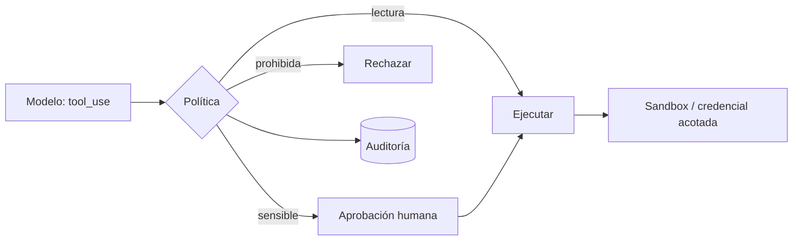

Al terminar tendrás una política de permisos explícita para tu agente, credenciales que no permiten más de lo necesario y un ejecutor de código aislado. Son las capas que limitan el daño **aunque todas las demás fallen**: si el agente solo puede leer, ningún ataque le hará borrar.

## La idea

La categoría de OWASP *Excessive Agency* (agencia excesiva) resume el problema: los agentes suelen tener más funcionalidad, más permisos y más autonomía de la que su tarea necesita. Cada exceso es daño potencial que no aporta nada. El [[glosario/minimo-privilegio|mínimo privilegio]] se aplica en tres niveles:

1. **Herramientas**: el agente solo ve las herramientas de su tarea.
2. **Credenciales**: cada herramienta usa credenciales con el alcance justo, y del usuario que pide la acción.
3. **Entorno**: el código que ejecuta el agente corre aislado del sistema anfitrión y de la red.

Y por encima, una **política de aprobación** decide qué acciones requieren a un [[glosario/humano-en-el-bucle|humano en el bucle]].



## Una política de permisos explícita

Clasifica cada herramienta por su efecto y decide el tratamiento. La política vive en código o configuración, versionada y revisada como cualquier otro control de acceso.

| Nivel | Ejemplos | Tratamiento |
|---|---|---|
| Lectura | buscar documentos, consultar un pedido | permitida; registrada |
| Escritura reversible | crear un borrador, añadir una etiqueta | permitida con registro; confirmación si el contexto está contaminado |
| Escritura irreversible o con dinero | enviar un correo, reembolsar, borrar | siempre confirmación con los argumentos exactos |
| Comunicación externa | peticiones a URLs arbitrarias, correos fuera del dominio | lista de permitidos; confirmación |
| Fuera de alcance | cambiar permisos, gestionar usuarios | la herramienta no existe para este agente |

```python title="politica.py"
import json, time
from dataclasses import dataclass

@dataclass(frozen=True)
class Regla:
    nivel: str                     # lectura | reversible | irreversible | externa
    limite_por_sesion: int = 50

POLITICA = {
    "buscar_pedidos":   Regla("lectura"),
    "crear_borrador":   Regla("reversible", 20),
    "crear_reembolso":  Regla("irreversible", 3),
    "enviar_correo":    Regla("irreversible", 5),
}

class Autorizador:
    def __init__(self, usuario_id: str, confirmar, contaminado=lambda: False):
        self.usuario_id = usuario_id
        self.confirmar = confirmar         # función(nombre, args) -> bool
        self.contaminado = contaminado     # el Guardia de la lección 3
        self.usos: dict[str, int] = {}

    def decidir(self, nombre: str, args: dict) -> tuple[bool, str]:
        regla = POLITICA.get(nombre)
        if regla is None:
            return self._registrar(nombre, args, False, "herramienta no permitida")
        if self.usos.get(nombre, 0) >= regla.limite_por_sesion:
            return self._registrar(nombre, args, False, "límite de usos alcanzado")
        necesita = regla.nivel in ("irreversible", "externa") or (
            regla.nivel == "reversible" and self.contaminado())
        if necesita and not self.confirmar(nombre, args):
            return self._registrar(nombre, args, False, "rechazada por el usuario")
        self.usos[nombre] = self.usos.get(nombre, 0) + 1
        return self._registrar(nombre, args, True, "")

    def _registrar(self, nombre, args, ok, motivo):
        with open("permisos.jsonl", "a", encoding="utf-8") as f:
            f.write(json.dumps({"t": time.time(), "usuario": self.usuario_id, "tool": nombre,
                                "args": args, "ok": ok, "motivo": motivo}, ensure_ascii=False) + "\n")
        return ok, motivo
```

La comprobación ocurre en tu código, antes de ejecutar, para cada `tool_use`. Si se rechaza, devuelves el motivo como `tool_result` con `is_error: True`. Pasar al modelo solo las herramientas de `POLITICA` hace que las demás ni siquiera existan para él. El sistema [[sistemas/soporte-con-aprobacion-humana]] aplica esta misma idea a un caso completo.

## Credenciales acotadas

La política decide qué herramienta se llama; las credenciales deciden qué puede hacer de verdad. Si la política tiene un fallo, las credenciales son la última barrera.

- **Usuario de base de datos de solo lectura** para las herramientas de consulta, y otro distinto, limitado a tablas concretas, para las de escritura.
- **Tokens del usuario, no de servicio.** Si el agente actúa en nombre de Ana, usa un token de Ana: verá lo que Ana ve. Una cuenta de servicio que lo ve todo convierte cualquier inyección en una fuga de toda la organización.
- **Alcance y caducidad cortos.** Tokens con los permisos mínimos (`repo:read`, no `admin`) y que caducan pronto.
- **Secretos fuera del contexto.** Las credenciales las usa tu código al ejecutar la herramienta; nunca aparecen en el prompt, en los argumentos ni en los resultados.
- **Filtros por fila en la herramienta.** `buscar_pedidos` añade `WHERE cliente_id = :usuario` en el servidor, no confía en un argumento que manda el modelo.

> [!peligro] El argumento `cliente_id` lo escribe el modelo
> Si una herramienta recibe el id del cliente como argumento, un ataque puede cambiarlo. La identidad del usuario sale de la sesión autenticada, nunca de lo que el modelo pone en `input`.

## Sandbox para ejecutar código

Cuando el agente ejecuta código (análisis de datos, agentes de código, [[glosario/uso-del-ordenador|uso del ordenador]]), ese código puede venir de una inyección. Ejecútalo en un [[glosario/sandbox|sandbox]]: un entorno sin acceso a tus archivos, tus credenciales ni tu red. Con Docker, una configuración restrictiva razonable:

```python title="sandbox.py"
import pathlib, subprocess, tempfile, uuid

IMAGEN = "python:3.12-slim"        # fija un digest en producción

def ejecutar_aislado(codigo: str, timeout_s: int = 20) -> dict:
    with tempfile.TemporaryDirectory() as tmp:
        trabajo = pathlib.Path(tmp)
        (trabajo / "main.py").write_text(codigo, encoding="utf-8")
        trabajo.chmod(0o755)                            # legible por el usuario sin privilegios
        (trabajo / "main.py").chmod(0o644)
        nombre = f"sandbox-{uuid.uuid4().hex[:8]}"
        cmd = [
            "docker", "run", "--rm", "--name", nombre,
            "--network", "none",                        # sin red: no hay exfiltración
            "--read-only",                              # sistema de archivos de solo lectura
            "--tmpfs", "/tmp:rw,size=64m",
            "--cap-drop", "ALL",
            "--security-opt", "no-new-privileges",
            "--pids-limit", "128",
            "--memory", "512m", "--cpus", "1",
            "--user", "65534:65534",                    # usuario sin privilegios
            "-v", f"{trabajo}:/trabajo:ro",
            "-w", "/trabajo",
            IMAGEN, "python", "main.py",
        ]
        try:
            r = subprocess.run(cmd, capture_output=True, text=True, timeout=timeout_s)
            return {"ok": r.returncode == 0, "stdout": r.stdout[-10_000:], "stderr": r.stderr[-5_000:]}
        except subprocess.TimeoutExpired:
            subprocess.run(["docker", "kill", nombre], capture_output=True)
            return {"ok": False, "stdout": "", "stderr": f"Tiempo agotado ({timeout_s} s)."}
```

Por qué cada opción:

- `--network none` corta el canal de salida más directo. Si el código necesita descargar paquetes, prepara una imagen con ellos; si necesita red, pasa por un proxy con lista de dominios permitidos.
- `--read-only`, `--tmpfs` y el volumen en `:ro` impiden que el código modifique nada fuera de `/tmp`.
- `--cap-drop ALL`, `no-new-privileges` y un usuario sin privilegios reducen lo que se puede hacer incluso con una vulnerabilidad.
- Límites de procesos, memoria, CPU y tiempo frenan bucles y bombas de procesos.
- Los comandos se pasan como lista, sin shell: el código del agente nunca se interpreta como comando del anfitrión.

Un contenedor comparte el núcleo con el anfitrión. Para código de origen desconocido a escala, valora aislamientos más fuertes (máquinas virtuales ligeras o servicios de ejecución gestionados). Para el uso del ordenador y del navegador, el aislamiento es obligatorio: ver [[cursos/uso-del-ordenador/04-seguridad-y-aislamiento]].

## Auditoría

Registra cada decisión de permisos (permitida o no, con motivo) y cada ejecución en sandbox. Cuando algo salga mal, la pregunta será «¿qué hizo el agente y quién lo autorizó?», y la respuesta tiene que estar en un registro, no en la memoria de nadie. Revisa periódicamente los rechazos: un pico suele indicar un ataque en curso o una política mal ajustada.

## Errores frecuentes

- **Una cuenta de servicio con todos los permisos** «para que funcione».
- **Confiar en argumentos de identidad** que escribe el modelo.
- **Ejecutar código del agente en la máquina del desarrollador** o en el servidor de la aplicación.
- **Contenedores con red abierta** y credenciales montadas.
- **Política implícita** repartida en `if` por el código en lugar de una tabla revisable.

## Ejercicio

> [!ejercicio] Proyecto del curso: el agente acotado
> Aplica a tu agente la política de permisos con niveles y límites, sustituye credenciales generales por credenciales acotadas (al menos una de solo lectura) y, si tu agente ejecuta código, pásalo por `ejecutar_aislado`. Después, ejecuta la batería de la lección 2 con las defensas de la lección 3 y estas.
>
> Está bien si ninguna herramienta fuera de la política es invocable, si un intento de leer `/etc/passwd` del anfitrión o de abrir una conexión de red desde el sandbox falla, si la identidad del usuario se toma de la sesión en todas las herramientas, si ningún ataque de la batería logra una acción prohibida y si `permisos.jsonl` registra todas las decisiones.

> [!ejercicio]- Pistas
> Para comprobar la red, ejecuta en el sandbox un `urllib.request.urlopen("https://example.com")`: debe fallar al resolver. Para la identidad, haz que el modelo pase un `cliente_id` ajeno en una prueba y verifica que la herramienta lo ignora.

## Resumen

- Mínimo privilegio en tres niveles: herramientas, credenciales y entorno.
- Una política explícita por niveles decide qué se ejecuta, qué se confirma y qué no existe.
- Credenciales del usuario, acotadas y fuera del contexto; la identidad sale de la sesión.
- Ejecuta código en un contenedor sin red, sin privilegios y con límites.
- Audita cada decisión para poder responder qué pasó y quién lo autorizó.

## Para seguir

- [[docs/seguridad/02-permisos-y-minimo-privilegio]]
- [[cursos/uso-del-ordenador/04-seguridad-y-aislamiento]]
- [[disciplinas/seguridad]]
