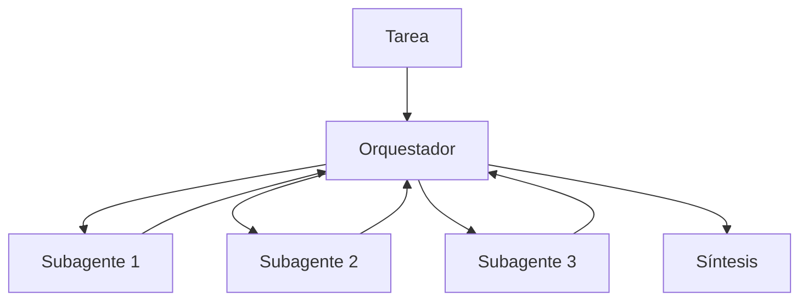
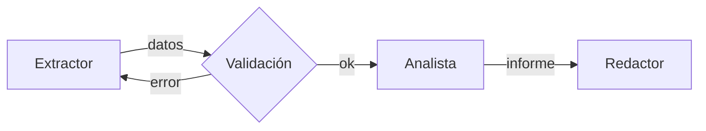
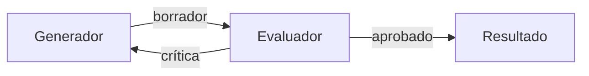

Al terminar esta lección sabrás reconocer las tres arquitecturas multiagente que cubren casi todos los casos reales, qué forma de tarea encaja con cada una y qué precio pagas por ellas. Tendrás un esqueleto de código de cada una para empezar.

## La idea

Un sistema multiagente reparte una tarea entre varias llamadas al modelo con roles, instrucciones y a veces herramientas distintas. La pregunta de diseño es **cómo fluye la información entre ellas**: quién decide qué se hace, quién ve qué y quién tiene la última palabra.

Antes de elegir, recuerda la regla del roadmap: cada agente adicional multiplica coste, latencia y puntos de fallo ([[roadmap/60-multiagente/01-cuando-no-usar-multiagente]]). Una arquitectura multiagente se justifica cuando la tarea tiene una de estas tres formas: **partes independientes** que se pueden hacer a la vez, **etapas** con entradas y salidas distintas, o un resultado que **mejora con crítica** independiente.

## Orquestador y trabajadores

Un agente principal analiza la tarea, la divide en subtareas que decide en tiempo de ejecución, lanza un subagente por cada una y sintetiza los resultados. Es el patrón [[patrones/06-orquestador-trabajadores]] llevado a agentes completos, cada uno con su propio bucle y herramientas.



Es la arquitectura del sistema de investigación que describe Anthropic en *[How we built our multi-agent research system](https://www.anthropic.com/engineering/multi-agent-research-system)* (13 jun. 2025): un agente líder planifica la investigación y lanza subagentes que buscan en paralelo, cada uno con su propia [[glosario/ventana-de-contexto|ventana de contexto]]. El artículo explica que la ventaja viene de ahí: cada subagente explora una parte con un contexto limpio y devuelve solo lo importante, así que el sistema en conjunto procesa mucha más información de la que cabría en un solo contexto.

**Encaja** con tareas amplias y paralelizables: investigar un tema desde varios ángulos, revisar muchos documentos, comparar opciones. **Falla** cuando las subtareas dependen mucho unas de otras o necesitan compartir contexto en todo momento. El propio artículo señala que la mayoría de tareas de programación encajan peor que la investigación por este motivo: hay menos trabajo realmente paralelizable y los agentes necesitan coordinarse sobre el mismo código. Cognition llega a la misma conclusión desde los agentes de código: funcionan los subagentes que aportan lectura e inteligencia, no los que escriben en paralelo ([[radar/2026-10-28-multiagente-un-solo-escritor]]).

## Pipeline

Una cadena fija de agentes especializados: la salida de uno es la entrada del siguiente. Extraer, luego clasificar, luego redactar. Es el [[patrones/03-encadenado|encadenado]] con agentes en cada etapa y comprobaciones entre ellas.



**Encaja** cuando las etapas son conocidas de antemano y cada una se beneficia de instrucciones, herramientas o incluso modelo propios. Su gran ventaja es que se depura etapa a etapa: puedes evaluar cada salida intermedia por separado. **Falla** cuando el orden de los pasos depende de lo que se encuentre; ahí necesitas un orquestador que decida. Y los errores se propagan: si la primera etapa se equivoca, las demás trabajan sobre algo falso, así que valida entre etapas.

## Evaluador y debate

Un agente genera y otro critica con un criterio explícito; el primero corrige y se repite hasta pasar o agotar intentos. Es [[patrones/07-evaluador-optimizador]]. La variante de debate pone a dos o más agentes a defender posiciones o soluciones distintas y a un tercero a decidir.



**Encaja** cuando hay un criterio de calidad claro que se puede comprobar mejor de lo que se puede cumplir a la primera: una traducción con glosario obligatorio, código que debe pasar una revisión de seguridad, un texto con requisitos. **Falla** con criterios vagos («mejóralo»), porque el evaluador aprueba todo o critica sin fin. Un evaluador del mismo modelo con el mismo contexto tiende a compartir los puntos ciegos del generador; dale un contexto distinto (solo el resultado y la rúbrica) y, si puedes, una comprobación con código.

## Comparación

| Arquitectura | Forma de la tarea | Quién decide los pasos | Coste | Punto débil |
|---|---|---|---|---|
| Orquestador-trabajadores | Partes independientes, número variable | El orquestador, en ejecución | Alto (muchos agentes, cada uno con su contexto) | Subtareas mal definidas, duplicación |
| Pipeline | Etapas fijas y conocidas | Tú, en el diseño | Medio, predecible | Errores que se propagan |
| Evaluador / debate | Calidad verificable con un criterio | El bucle crítica-corrección | Medio-alto, según iteraciones | Criterio vago, puntos ciegos compartidos |

Se combinan: un orquestador cuyos trabajadores son pipelines, o un pipeline con un evaluador al final. Empieza por la más simple que resuelva el problema y añade piezas cuando una medida te diga que hacen falta ([[patrones/09-elegir-patron]]).

## Los tres esqueletos

Las tres arquitecturas sobre una misma función `llamar`. En la vida real cada `llamar` sería un agente con su bucle y herramientas; aquí se simplifica para ver la topología.

```python title="arquitecturas.py"
import asyncio, json
import anthropic

MODEL = "claude-sonnet-5-5"
client = anthropic.AsyncAnthropic()

PLAN = {"type": "object", "properties": {"subtareas": {"type": "array", "items": {"type": "string"}}},
        "required": ["subtareas"], "additionalProperties": False}

async def llamar(system: str, prompt: str, max_tokens: int = 2048, esquema: dict | None = None) -> str:
    extra = {"output_config": {"format": {"type": "json_schema", "schema": esquema}}} if esquema else {}
    resp = await client.messages.create(model=MODEL, max_tokens=max_tokens, system=system,
                                        messages=[{"role": "user", "content": prompt}], **extra)
    if resp.stop_reason not in ("end_turn", "stop_sequence"):
        raise RuntimeError(f"stop_reason {resp.stop_reason}")  # max_tokens, refusal…
    return "".join(b.text for b in resp.content if b.type == "text")

async def orquestador(pregunta: str, max_subtareas: int = 4) -> str:
    plan = await llamar("Divide la pregunta en 2-4 subpreguntas independientes.", pregunta, esquema=PLAN)
    subtareas = json.loads(plan)["subtareas"][:max_subtareas]  # el esquema fija la forma; el tope, tu código
    hallazgos = await asyncio.gather(*[
        llamar("Investiga solo esta subpregunta. Devuelve hallazgos con su fuente.", s)
        for s in subtareas])
    bloques = "\n".join(f"<hallazgo>{h}</hallazgo>" for h in hallazgos)
    return await llamar("Sintetiza una respuesta a partir de los hallazgos.",
                        f"<pregunta>{pregunta}</pregunta>\n{bloques}")

async def pipeline(documento: str) -> str:
    datos = await llamar("Extrae fechas, importes y partes en JSON.", documento)
    json.loads(datos)  # validación entre etapas: falla pronto si no es JSON
    analisis = await llamar("Señala riesgos en estos datos.", datos)
    return await llamar("Redacta un informe de media página para dirección.", analisis)

async def evaluador(encargo: str, rubrica: str, max_rondas: int = 3) -> str:
    borrador = await llamar("Redacta según el encargo.", encargo)
    for _ in range(max_rondas):
        veredicto = await llamar(
            f"Evalúa con esta rúbrica:\n{rubrica}\nPrimera línea: APROBADO o RECHAZADO. "
            "Después, solo los fallos concretos.", borrador)
        if veredicto.startswith("APROBADO"):
            return borrador
        borrador = await llamar("Corrige el borrador según la crítica.",
                                f"<borrador>{borrador}</borrador>\n<critica>{veredicto}</critica>")
    return borrador  # sin aprobar: márcalo para revisión humana

if __name__ == "__main__":
    print(asyncio.run(orquestador("¿Qué opciones hay para cachear respuestas de un LLM?")))
```

El plan del orquestador llega con [[glosario/salida-estructurada|salida estructurada]] (`output_config.format`): el JSON cumple el esquema y no hay que adivinar si viene envuelto en texto. El número máximo de subtareas lo impone tu código, porque el esquema no admite `maxItems` arbitrarios. Observa también que el evaluador solo ve el borrador y la rúbrica, nunca el razonamiento del generador. Y que cada esqueleto tiene un límite: número de subtareas, validación entre etapas, número de rondas. Sin límites, un sistema multiagente puede gastar sin parar.

> [!consejo] El orquestador también puede ser código
> Si las subtareas son siempre las mismas, no necesitas un modelo que las decida. Un orquestador escrito en Python es más barato, predecible y fácil de probar. Reserva el orquestador-modelo para cuando la división dependa del contenido.

## Con LangGraph y con el OpenAI Agents SDK

Las tres topologías tienen traducción directa en los frameworks abiertos. Lo que cambia es quién escribe el bucle: en LangGraph declaras nodos y aristas, y el *runtime* se encarga de ejecutar en paralelo, guardar el estado y reanudar.

| Arquitectura | [[herramientas/langgraph\|LangGraph]] | [[herramientas/openai-agents-sdk\|OpenAI Agents SDK]] |
|---|---|---|
| Orquestador-trabajadores | Un nodo planificador y `Send("trabajador", {...})` por subtarea; un reductor (`Annotated[list, operator.add]`) junta los resultados ([[recetas/map-reduce-con-send]]) | El orquestador usa a los especialistas como herramientas con `agente.as_tool()` y conserva el control |
| Pipeline | Aristas fijas `add_edge` entre nodos, con un nodo de validación entre etapas | Llamadas sucesivas a `Runner.run` desde tu código |
| Evaluador / debate | Un ciclo: el evaluador devuelve `Command(goto=...)` y decide si se vuelve a generar o se termina | Un bucle en tu código, o un `output_guardrail` que rechaza la salida |

Los *handoffs* del Agents SDK son otra cosa: el agente activo cede la conversación a otro (se exponen al modelo como una herramienta `transfer_to_<nombre>`) y ya no vuelve. Sirven para triaje entre especialistas, no para un orquestador que tiene que sintetizar al final ([[docs/frameworks/06-openai-agents-sdk]]).

El evaluador con LangGraph, con el veredicto como salida estructurada y el límite de rondas en el estado:

```python tab="LangGraph" title="evaluador_langgraph.py"
from typing import Literal, TypedDict

from langchain.chat_models import init_chat_model
from langgraph.graph import END, START, StateGraph
from langgraph.types import Command
from pydantic import BaseModel

MODEL = "anthropic:claude-sonnet-5-5"
MAX_RONDAS = 3


class Veredicto(BaseModel):
    aprobado: bool
    fallos: list[str]


class Estado(TypedDict, total=False):
    encargo: str
    rubrica: str
    borrador: str
    critica: str
    rondas: int


def construir(modelo=None):
    llm = modelo or init_chat_model(MODEL, max_tokens=2048)
    juez = llm.with_structured_output(Veredicto, method="json_schema")  # salidas estructuradas, sin forzar herramientas

    def generar(state: Estado):
        if state.get("critica"):
            prompt = (f"Corrige el borrador según la crítica.\n<borrador>{state['borrador']}</borrador>\n"
                      f"<critica>{state['critica']}</critica>")
        else:
            prompt = f"Redacta según el encargo.\n<encargo>{state['encargo']}</encargo>"
        return {"borrador": llm.invoke(prompt).text, "rondas": state.get("rondas", 0) + 1}

    def evaluar(state: Estado) -> Command[Literal["generar", "__end__"]]:
        # el juez solo ve la rúbrica y el borrador, no el historial del generador
        v = juez.invoke(f"Evalúa con esta rúbrica:\n{state['rubrica']}\n<borrador>{state['borrador']}</borrador>")
        critica = "\n".join(v.fallos)
        if v.aprobado or state["rondas"] >= MAX_RONDAS:
            return Command(goto=END, update={"critica": "" if v.aprobado else critica})
        return Command(goto="generar", update={"critica": critica})

    g = StateGraph(Estado)
    g.add_node("generar", generar)
    g.add_node("evaluar", evaluar)
    g.add_edge(START, "generar")
    g.add_edge("generar", "evaluar")
    return g.compile()


if __name__ == "__main__":
    final = construir().invoke({"encargo": "Traduce al inglés: «Pulsa Guardar».",
                                "rubrica": "Usa el glosario: Guardar = Save."})
    print(final["borrador"], "| sin aprobar" if final["critica"] else "| aprobado")
```

`Command` junta en un solo valor la actualización del estado y el siguiente nodo, así que la decisión de seguir o parar vive en el evaluador y no en una función de enrutado aparte. La anotación `Command[Literal[...]]` le dice a LangGraph a qué nodos puede saltar, para dibujar y validar el grafo. Lo que el framework no hace por ti es lo importante: la rúbrica, el límite de rondas y qué ve el juez siguen siendo decisiones tuyas.

## Errores frecuentes

- **Elegir por moda.** Varios agentes no son más inteligentes que uno; solo reparten contexto y trabajo.
- **Pipeline sin validación entre etapas.** El error de la etapa 1 aparece en la etapa 3 y parece culpa de la 3.
- **Evaluador sin criterio.** Si no puedes escribir la rúbrica, no hay evaluador posible.

## Ejercicio

> [!ejercicio] Elige y justifica
> Para estas tres tareas, elige arquitectura y justifica en dos frases: (a) resumir 200 contratos y listar cláusulas de penalización; (b) convertir una transcripción en acta, tareas y correo de seguimiento; (c) traducir documentación técnica respetando un glosario. Implementa la que te parezca más útil con el esqueleto anterior.
> Está bien si: cada elección menciona la forma de la tarea (paralelizable, por etapas, verificable), indica un límite (subtareas, rondas o validación) y la implementación registra `usage` de cada llamada para comparar el coste con un agente único.

> [!ejercicio]- Pistas
> (a) es paralelizable por documento; (b) tiene etapas fijas; (c) tiene un criterio verificable. Para el coste, suma `resp.usage.input_tokens + resp.usage.output_tokens` en `llamar`.

## Resumen

- Tres arquitecturas cubren casi todo: orquestador-trabajadores, pipeline y evaluador o debate.
- Elige por la forma de la tarea: partes independientes, etapas fijas o calidad verificable.
- El orquestador gana con tareas amplias y paralelizables; pierde cuando todo depende de todo.
- Valida entre etapas y da al evaluador un contexto distinto y una rúbrica concreta.
- Pon límites en cada arquitectura y mide el coste frente a un solo agente.

## Para seguir

- [[cursos/sistemas-multiagente/02-disenar-subagentes]]
- [[sistemas/investigacion-multiagente]]
- [[roadmap/60-multiagente/05-coste-de-multiplicar-agentes]]
- [[cursos/langchain-y-langgraph/08-multiagente-con-langgraph]]
