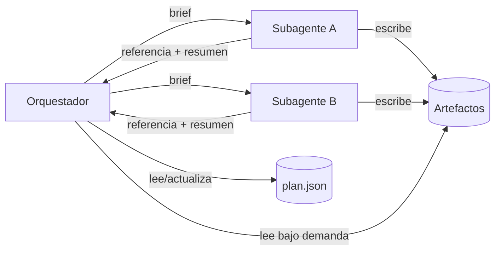

Al terminar esta lección sabrás dónde guardar el estado de un sistema multiagente para que no se pierda, no se corrompa y no inunde el contexto del orquestador. Construirás un almacén de artefactos sencillo que es la base de la coordinación entre agentes.

## La idea

En un sistema multiagente hay tres tipos de información que conviene separar:

- **El plan**: qué hay que hacer, qué está hecho y qué falta. Lo mantiene el orquestador.
- **Los artefactos**: lo que produce cada subagente (hallazgos, documentos, código).
- **El contexto de trabajo**: lo que cada agente tiene en su ventana ahora mismo.

El error habitual es que todo viva en el tercero. El orquestador recibe los resultados completos de diez subagentes en su historial, su contexto se llena, el plan del principio queda enterrado y, si la ejecución se corta, se pierde todo. **El contexto es memoria de trabajo, volátil y cara. El estado duradero va fuera**, en archivos o en una base de datos.



## Referencias en lugar de contenido

El artículo de Anthropic *[How we built our multi-agent research system](https://www.anthropic.com/engineering/multi-agent-research-system)* describe dos ideas que aplican aquí. La primera: los subagentes pueden guardar su salida en un sistema externo y pasar al coordinador solo referencias ligeras, en lugar de hacer que todo pase por el agente líder; así se evita el efecto «teléfono escacharrado» de resumir y volver a resumir, y se ahorran tokens. La segunda: el agente líder guarda su plan en una memoria externa, porque si el contexto supera el límite se trunca, y el plan tiene que sobrevivir.

En la práctica, cada subagente devuelve algo así:

```json
{"ref": "artefactos/7f3a.json", "resumen": "4 proveedores con búsqueda híbrida; 1 sin verificar", "n_hallazgos": 4}
```

El orquestador decide con el resumen y lee el artefacto completo solo cuando le hace falta, por ejemplo al sintetizar. Es el mismo principio de recuperación bajo demanda que verás en [[cursos/context-engineering/02-que-meter-y-que-no]].

## Un solo escritor por recurso

Cuando varios agentes escriben en el mismo sitio a la vez aparecen los problemas clásicos de concurrencia: dos subagentes editan el mismo archivo, uno pisa al otro y nadie se entera. La solución más simple es estructural: **cada recurso tiene un único escritor**.

- Cada subagente escribe solo sus propios artefactos, con un identificador único.
- Solo el orquestador escribe el plan.
- Si dos agentes necesitan modificar lo mismo (por ejemplo, el mismo archivo de código), no los lances en paralelo. Serialízalos o divide el recurso.

Esto explica por qué la investigación se paraleliza bien y la edición de código no tanto: buscar es leer, y la lectura no entra en conflicto. Cognition lo resume en *[Multi-Agents: What's Actually Working](https://cognition.com/blog/multi-agents-working)* (abr. 2026): las escrituras van por un solo hilo y los agentes adicionales aportan inteligencia, no acciones ([[radar/2026-10-28-multiagente-un-solo-escritor]]).

Hay una alternativa sin orquestador cuando las tareas son muchas e independientes: que cada agente **reclame** la suya. En el experimento de Nicholas Carlini con 16 instancias de Claude escribiendo un compilador de C (*[Building a C compiler with a team of parallel Claudes](https://www.anthropic.com/engineering/building-c-compiler)*, feb. 2026), cada agente tomaba una tarea creando un archivo de bloqueo en una carpeta compartida y sincronizaba por git. Funciona si un verificador muy bueno (allí, los tests y un compilador de referencia) reparte fallos distintos a cada agente. En código, cada agente en su propio [[glosario/worktree|worktree]] ([[recetas/features-en-paralelo-con-worktrees]]).

## El almacén de artefactos

```python title="estado.py"
import json, os, pathlib, tempfile, uuid
from datetime import datetime, timezone

class Almacen:
    def __init__(self, raiz: str = "ejecucion"):
        self.raiz = pathlib.Path(raiz)
        (self.raiz / "artefactos").mkdir(parents=True, exist_ok=True)

    def _escribir_atomico(self, ruta: pathlib.Path, datos: dict) -> None:
        # escribir en temporal y renombrar: nadie lee un archivo a medio escribir
        fd, tmp = tempfile.mkstemp(dir=ruta.parent, suffix=".tmp")
        with os.fdopen(fd, "w", encoding="utf-8") as f:
            json.dump(datos, f, ensure_ascii=False, indent=2)
        os.replace(tmp, ruta)

    def guardar_artefacto(self, autor: str, contenido: dict) -> str:
        ref = f"artefactos/{uuid.uuid4().hex[:8]}.json"
        self._escribir_atomico(self.raiz / ref, {
            "autor": autor, "creado": datetime.now(timezone.utc).isoformat(),
            "contenido": contenido})
        return ref

    def leer(self, ref: str) -> dict:
        ruta = (self.raiz / ref).resolve()
        if not ruta.is_relative_to(self.raiz.resolve()):
            raise ValueError("referencia fuera del almacén")
        return json.loads(ruta.read_text(encoding="utf-8"))

    # solo el orquestador llama a estos dos
    def guardar_plan(self, plan: dict) -> None:
        self._escribir_atomico(self.raiz / "plan.json", plan)

    def cargar_plan(self) -> dict | None:
        p = self.raiz / "plan.json"
        return json.loads(p.read_text(encoding="utf-8")) if p.exists() else None
```

Y así lo usa el orquestador, combinado con el subagente de la lección anterior:

```python title="orquestador.py"
import asyncio
from estado import Almacen
from subagente import Brief, ejecutar_subagente

almacen = Almacen("ejecucion/2026-09-29-vectores")

async def trabajar(tarea_id: str, brief: Brief, tools, handlers) -> dict:
    entrega = await ejecutar_subagente(brief, tools, handlers)
    ref = almacen.guardar_artefacto(autor=tarea_id, contenido=entrega)
    return {"tarea": tarea_id, "ref": ref, "n_hallazgos": len(entrega["hallazgos"]),
            "lagunas": entrega["lagunas"][:300]}

async def ejecutar(plan: dict, tools, handlers) -> dict:
    pendientes = [t for t in plan["tareas"] if t["estado"] == "pendiente"]
    resultados = await asyncio.gather(
        *[trabajar(t["id"], Brief(**t["brief"]), tools, handlers) for t in pendientes],
        return_exceptions=True)
    for t, r in zip(pendientes, resultados):
        if isinstance(r, Exception):
            t["estado"], t["error"] = "fallida", str(r)
        else:
            t["estado"], t["resultado"] = "hecha", r
    almacen.guardar_plan(plan)  # el plan sobrevive aunque el proceso muera después
    return plan
```

Gracias a que el plan marca cada tarea como `pendiente`, `hecha` o `fallida`, si el proceso se cae a mitad, al relanzarlo solo se ejecutan las pendientes. Y un fallo en un subagente no tumba a los demás (`return_exceptions=True`); queda registrado en el plan para que el orquestador decida si reintenta.

## Idempotencia y reintentos

Un subagente que falla a mitad puede haber hecho parte del trabajo. Si lo reintentas, no debería duplicar efectos. Para tareas de lectura (buscar, analizar) basta con descartar el artefacto parcial. Para tareas con efectos (crear un ticket, escribir en una base de datos), usa una clave de idempotencia derivada del identificador de la tarea y comprueba si ya existe antes de actuar. Los reintentos de red los tienes en [[recetas/reintentos-y-limites-de-tasa]].

## Con LangGraph

LangGraph resuelve dos piezas de esta lección en el *runtime*. Los **reductores** del estado hacen de «un solo escritor»: cada trabajador devuelve su parte y `operator.add` las concatena, así que nadie sobrescribe a nadie. Y el **[[glosario/checkpointer|checkpointer]]** guarda el estado al final de cada superpaso bajo un `thread_id`, que es el `plan.json` de arriba sin escribirlo tú. El reparto en paralelo es `Send`, un mensaje por subtarea hacia el mismo nodo:

```python tab="LangGraph" title="orquestador_langgraph.py"
import operator
from typing import Annotated, TypedDict

from langgraph.graph import END, START, StateGraph
from langgraph.types import Send


class Estado(TypedDict):
    tareas: list[dict]                          # [{"id": "t1", "brief": {...}}, ...]
    refs: Annotated[list[dict], operator.add]   # cada trabajador añade la suya; nadie pisa a nadie


class EstadoTarea(TypedDict):                   # lo que recibe cada trabajador vía Send
    tarea: dict


def construir(lanzar_subagente, almacen, checkpointer=None):
    def repartir(state: Estado):
        return [Send("trabajar", {"tarea": t}) for t in state["tareas"]]

    def trabajar(state: EstadoTarea):
        t = state["tarea"]
        entrega = lanzar_subagente(t["brief"])                    # dict con hallazgos y lagunas
        ref = almacen.guardar_artefacto(autor=t["id"], contenido=entrega)
        return {"refs": [{"tarea": t["id"], "ref": ref, "n_hallazgos": len(entrega["hallazgos"])}]}

    g = StateGraph(Estado)
    g.add_node("trabajar", trabajar)
    g.add_conditional_edges(START, repartir, ["trabajar"])
    g.add_edge("trabajar", END)
    return g.compile(checkpointer=checkpointer)
```

```python nocheck title="uso (fragmento)"
from langgraph.checkpoint.sqlite import SqliteSaver

config = {"configurable": {"thread_id": "2026-09-29-vectores"}}
with SqliteSaver.from_conn_string("ejecucion/grafo.db") as cp:
    grafo = construir(lanzar_subagente, almacen, cp)
    try:
        grafo.invoke({"tareas": tareas, "refs": []}, config)
    except Exception:
        grafo.invoke(None, config)  # reanuda: solo se repiten las tareas que fallaron
```

Probado con un subagente falso que falla en una de tres tareas: la primera ejecución lanza la excepción, y `invoke(None, config)` desde otro proceso con el mismo archivo relanza **solo** la tarea fallida y conserva las referencias de las otras dos. Es [[glosario/ejecucion-duradera|ejecución duradera]]: el *checkpointer* guarda también lo que ya escribieron los trabajadores que terminaron. `lanzar_subagente` puede ser el subagente de [[cursos/sistemas-multiagente/02-disenar-subagentes]] o su versión con `create_agent`; si un nodo es un grafo compilado, LangGraph lo trata como subgrafo y su estado queda dentro del mismo *checkpoint*. Lo que el framework no decide es lo importante: qué va en el estado compartido (referencias y resúmenes, no artefactos enteros) y quién escribe cada recurso. Más en [[cursos/langchain-y-langgraph/08-multiagente-con-langgraph]] y [[recetas/reanudar-un-agente-tras-un-reinicio]].

> [!consejo] Empieza con archivos
> Un directorio con JSON por artefacto y un `plan.json` resuelve la mayoría de sistemas y se inspecciona con un editor. Pasa a una base de datos cuando necesites concurrencia real entre procesos, consultas o varias máquinas.

## Errores frecuentes

- **Todo por el contexto del orquestador.** Se llena, pierde el plan y cada resumen de resumen pierde detalle.
- **Escrituras concurrentes sobre el mismo recurso.** Los conflictos aparecen raramente y por eso cuestan tanto de diagnosticar.
- **Plan solo en memoria.** Una caída a la hora tres obliga a empezar de cero.
- **Referencias sin validar.** Si un agente puede pedir `../../secretos`, tu almacén es una vía de escape. Valida las rutas.

## Ejercicio

> [!ejercicio] Reanudar tras una caída
> Monta el orquestador con el almacén y tres tareas. Haz que una de ellas lance una excepción la primera vez. Ejecuta, comprueba el `plan.json`, corrige el fallo y vuelve a ejecutar.
> Está bien si: tras la primera ejecución el plan tiene dos tareas `hecha` y una `fallida` con su error; la segunda ejecución solo lanza la tarea fallida; y el contexto del orquestador contiene referencias y resúmenes, nunca el contenido completo de los artefactos.

> [!ejercicio]- Pistas
> Para que la segunda ejecución reintente, cambia el filtro a `estado in ("pendiente", "fallida")`. Para la síntesis final, lee los artefactos con `almacen.leer(ref)` justo antes de la llamada de síntesis.

## Resumen

- Separa plan, artefactos y contexto de trabajo; el estado duradero vive fuera del contexto.
- Los subagentes escriben artefactos y devuelven referencias con un resumen corto.
- Un único escritor por recurso evita conflictos sin necesidad de bloqueos.
- Guarda el plan con estados por tarea para poder reanudar.
- Escritura atómica, rutas validadas y claves de idempotencia para los efectos.

## Para seguir

- [[cursos/sistemas-multiagente/04-depurar-sistemas-multiagente]]
- [[cursos/context-engineering/04-contexto-para-agentes-largos]]
- [[docs/contexto/04-memoria]]
