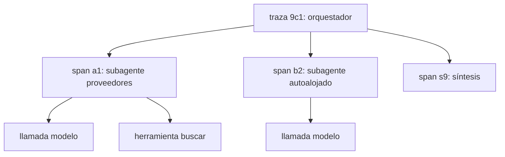

Al terminar esta lección podrás reconstruir qué hizo cada agente de una ejecución, en qué orden y con qué información, y volver a ejecutar una parte concreta con los mismos datos para encontrar el fallo. Sin esto, depurar un sistema multiagente es adivinar.

## La idea

Depurar un agente ya es difícil: el mismo prompt puede tomar caminos distintos. Con varios agentes se suma otro problema: el síntoma aparece en un sitio y la causa está en otro. La respuesta final omite un dato porque la síntesis lo descartó, o porque el subagente no lo encontró, o porque su brief no lo pedía. Necesitas ver la [[glosario/trayectoria|trayectoria]] de cada agente y cómo se conectan.

El artículo de Anthropic *[How we built our multi-agent research system](https://www.anthropic.com/engineering/multi-agent-research-system)* lo resume desde la experiencia: los agentes toman decisiones dinámicas y no son deterministas entre ejecuciones, así que depurar es más difícil, y añadir trazado completo en producción les permitió diagnosticar por qué fallaban y corregirlo de forma sistemática. Dos herramientas resuelven la mayor parte: **trazas enlazadas** y **reproducción**.

## Trazas enlazadas

Cada evento que registras lleva tres identificadores: `traza_id` (la ejecución completa), `span_id` (este agente o esta llamada) y `padre_id` (quién lo lanzó). Con eso reconstruyes el árbol de la ejecución.



Qué registrar en cada llamada al modelo: agente, paso, `stop_reason`, herramientas pedidas con sus argumentos, `usage` y duración. En cada herramienta: nombre, argumentos, resultado (recortado) y si fue error. Y al lanzar un subagente, el brief completo: es el primer sitio donde mirar cuando un subagente hace algo raro.

```python title="traza.py"
import json, time, uuid, contextvars, pathlib

_span_actual = contextvars.ContextVar("span_actual", default=None)

class Trazador:
    def __init__(self, ruta: str = "trazas.jsonl"):
        self.ruta = pathlib.Path(ruta)
        self.traza_id = uuid.uuid4().hex[:8]

    def evento(self, tipo: str, **datos) -> None:
        reg = {"t": time.time(), "traza_id": self.traza_id, "span_id": _span_actual.get(),
               "tipo": tipo, **datos}
        with self.ruta.open("a", encoding="utf-8") as f:
            f.write(json.dumps(reg, ensure_ascii=False, default=str) + "\n")

    def span(self, agente: str, **datos):
        trazador = self
        class _Span:
            def __enter__(self_):
                self_.padre = _span_actual.get()
                self_.id = uuid.uuid4().hex[:8]
                self_.token = _span_actual.set(self_.id)
                trazador.evento("inicio", agente=agente, padre_id=self_.padre, **datos)
                return self_
            def __exit__(self_, tipo_exc, exc, tb):
                trazador.evento("fin", agente=agente, error=repr(exc) if exc else None)
                _span_actual.reset(self_.token)
        return _Span()

tr = Trazador()

def registrar_respuesta(agente: str, paso: int, resp) -> None:
    tr.evento("modelo", agente=agente, paso=paso, stop_reason=resp.stop_reason,
              herramientas=[{"name": b.name, "input": b.input}
                            for b in resp.content if b.type == "tool_use"],
              usage=resp.usage.model_dump())
```

Se usa envolviendo cada subagente: `with tr.span("subagente-proveedores", brief=asdict(brief)): ...`. Como `contextvars` se copia en cada tarea de `asyncio`, los subagentes lanzados con `asyncio.gather` dentro del span del orquestador heredan su `padre_id` correctamente.

Un archivo JSONL se filtra con cualquier herramienta. Para producción, el mismo modelo de datos es el de OpenTelemetry: traza, *span* y padre. Sus [[glosario/convenciones-genai-otel|convenciones semánticas GenAI]] definen *spans* `invoke_agent` (un agente), `chat` (una llamada al modelo) y `execute_tool` (una herramienta), y atributos como `gen_ai.provider.name`. Siguen en estado *Development* y desde junio de 2026 viven en su propio repositorio (`open-telemetry/semantic-conventions-genai`), así que fija la versión que uses. El SDK `anthropic` 2.3 ya emite un *span* `anthropic.messages.create` cuando hay un proveedor de OpenTelemetry registrado: si además creas tu *span* `chat`, no sumes los tokens dos veces. Plataformas abiertas como [[herramientas/langfuse|Langfuse]] leen ese formato ([[recetas/trazas-con-langfuse]], [[docs/produccion/01-observabilidad]]).

## Reproducir una ejecución

Un fallo que no puedes repetir no lo puedes arreglar con confianza. Las respuestas del modelo varían, pero buena parte de la variación viene del entorno: una búsqueda devuelve resultados distintos hoy que ayer. La técnica: **graba las respuestas de las herramientas y reprodúcelas**.

```python title="grabadora.py"
import hashlib, json, pathlib

class Grabadora:
    """modo='grabar' ejecuta y guarda; modo='reproducir' devuelve lo guardado."""
    def __init__(self, ruta: str, modo: str = "grabar"):
        self.ruta, self.modo = pathlib.Path(ruta), modo
        self.cinta = json.loads(self.ruta.read_text()) if self.ruta.exists() else {}

    def _clave(self, nombre: str, entrada: dict) -> str:
        return hashlib.sha256(f"{nombre}:{json.dumps(entrada, sort_keys=True)}".encode()).hexdigest()[:16]

    def envolver(self, nombre: str, funcion):
        async def envuelta(**entrada):
            clave = self._clave(nombre, entrada)
            if self.modo == "reproducir":
                if clave not in self.cinta:
                    raise KeyError(f"{nombre}({entrada}) no está grabada")
                return self.cinta[clave]
            salida = await funcion(**entrada)
            self.cinta[clave] = salida
            self.ruta.write_text(json.dumps(self.cinta, ensure_ascii=False))
            return salida
        return envuelta
```

Con las herramientas grabadas y el brief guardado en la traza, puedes relanzar solo el subagente sospechoso con el mismo brief y el mismo entorno. Si el fallo se repite, cambia una cosa (el brief, la descripción de una herramienta, el modelo) y compara. Si se repite a veces, ejecútalo diez veces y cuenta: estás ante un problema de fiabilidad, y la herramienta adecuada es una eval ([[cursos/evals-para-agentes/index]]).

Guarda también la versión exacta del modelo y de los prompts de cada ejecución. Sin eso, «ayer funcionaba» no se puede comprobar.

## Con LangGraph

Si el sistema está hecho con LangGraph, el árbol de la ejecución te lo da el *runtime*. `stream(..., subgraphs=True)` emite cada actualización con su **ruta de espacios de nombres**: una tupla vacía para el grafo raíz y `("trabajar:<id>",)` para lo que pasa dentro de cada trabajador lanzado con `Send`, con un identificador distinto por tarea. Es el `padre_id` sin escribirlo:

```python nocheck title="arbol_langgraph.py (fragmento)"
config = {"configurable": {"thread_id": "depuracion-1"}}
for ruta, actualizacion in grafo.stream(entrada, config, stream_mode="updates", subgraphs=True):
    print("/".join(ruta) or "(raíz)", "->", list(actualizacion))

for punto in grafo.get_state_history(config):  # cada checkpoint, del más reciente al primero
    print(punto.config["configurable"]["checkpoint_id"], punto.next)
```

```text
# salida de ejemplo
trabajar:d9fcbd39-… -> ['model']
trabajar:9980ea1d-… -> ['model']
trabajar:d9fcbd39-… -> ['tools']
(raíz) -> ['trabajar']
(raíz) -> ['trabajar']
```

Probado con el orquestador de [[cursos/sistemas-multiagente/03-coordinacion-y-estado]] y subagentes de `create_agent` con modelos falsos: cada trabajador aparece con su propio espacio de nombres y sus pasos de modelo y herramientas intercalados con los del otro, como pasa en paralelo. Con `get_state_history` vuelves a cualquier *checkpoint* y puedes relanzar desde ahí con la misma entrada, que es la reproducción de esta lección aplicada al estado del grafo. Lo que no te da es la grabación de las herramientas externas: la `Grabadora` sigue haciendo falta si el entorno cambia entre ejecuciones.

## Fallos típicos y dónde mirar

| Síntoma | Causa probable | Dónde mirar en la traza |
|---|---|---|
| Dos subagentes devuelven lo mismo | Briefs sin límites explícitos | Eventos `inicio` de ambos: campo `limites` |
| Un subagente agota sus pasos | Parada vaga o herramienta que devuelve poco | Últimos eventos `modelo`: búsquedas repetidas con pequeñas variaciones |
| La respuesta final omite un hallazgo | Síntesis con demasiado contexto o resumen pobre | Artefacto del subagente frente a lo que recibió la síntesis |
| Coste disparado en preguntas simples | Orquestador lanza demasiados subagentes | Número de spans hijos por traza frente a complejidad de la pregunta ([[recetas/coste-por-subagente]]) |
| Datos inventados en la síntesis | Subagente sin evidencia o síntesis que rellena huecos | Campo `fuente` de los hallazgos y `lagunas` |
| Fallo intermitente | Variación del entorno o del modelo | Reproducir con la grabadora |

Una pauta útil: **busca el primer evento donde la información deja de ser correcta**. Si el subagente encontró el dato y la síntesis no lo usó, el problema está en la síntesis. Si el subagente nunca lo buscó, mira su brief. Si lo buscó y la herramienta no lo devolvió, mira la herramienta.

> [!aviso] Trazas con datos sensibles
> Las trazas contienen briefs, resultados de herramientas y a veces datos de usuarios. Trátalas como datos de producción: acceso restringido, retención limitada y sin secretos en claro.

## Errores frecuentes

- **Trazar solo el orquestador.** Ves el síntoma y nunca la causa.
- **Registrar sin enlazar.** Mil eventos sin `padre_id` son una lista, no un árbol.
- **Depurar con ejecuciones nuevas cada vez.** Cambia el entorno y no sabes si tu arreglo funcionó o tuviste suerte.
- **Arreglar el prompt de la síntesis cuando el fallo está en un brief.** Sigue la información hacia atrás.

## Ejercicio

> [!ejercicio] Encontrar el fallo en la traza
> Instrumenta el sistema de las lecciones anteriores con `Trazador` y `Grabadora`. Introduce un fallo a propósito: quita el campo `limites` del brief de uno de los subagentes. Ejecuta en modo grabar, luego escribe un script que lea `trazas.jsonl` y muestre el árbol de spans con tokens por agente.
> Está bien si: el árbol muestra orquestador, subagentes y síntesis con su padre correcto; puedes señalar en la traza el hallazgo duplicado y el brief que lo causó; y tras restaurar `limites` y reproducir con la cinta grabada, la duplicación desaparece.

> [!ejercicio]- Pistas
> Agrupa los eventos por `span_id` y construye el árbol con `padre_id` del evento `inicio`. Para los tokens, suma `usage.input_tokens + usage.output_tokens` de los eventos `modelo` de cada span.

## Resumen

- En multiagente el síntoma y la causa suelen estar en agentes distintos.
- Traza cada agente con `traza_id`, `span_id` y `padre_id`, y guarda el brief.
- Graba las respuestas de herramientas para reproducir una ejecución y aislar el fallo.
- Busca el primer punto donde la información deja de ser correcta.
- Los fallos intermitentes se miden con evals, no con una ejecución suelta.

## Para seguir

- [[roadmap/100-produccion/01-observabilidad-y-trazas]]
- [[roadmap/80-evals/04-evals-de-trayectoria]]
- [[sistemas/investigacion-multiagente]]
- [[recetas/analisis-de-errores-de-trazas]]
