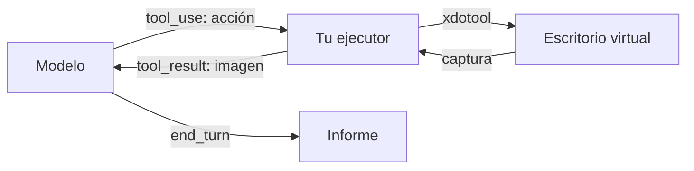

Al terminar esta lección entenderás qué pasa en cada paso cuando un modelo «usa un ordenador» y tendrás un ejecutor mínimo que traduce sus peticiones en clics y pulsaciones dentro de un escritorio virtual. Verás que el mecanismo es el mismo bucle de herramientas de siempre, con imágenes en lugar de texto.

## La idea

El modelo no controla nada directamente. Ve una captura de pantalla, decide una acción («haz clic en las coordenadas 412, 230», «escribe este texto», «pulsa Intro») y la pide con un bloque `tool_use`. **Tu código** ejecuta esa acción en un entorno que controlas, toma una captura nueva y la devuelve como [[glosario/tool-result|tool_result]]. El modelo mira el resultado y decide la siguiente acción.



Es el [[glosario/bucle-agentico|bucle agéntico]] con una herramienta especial. Lo que cambia es la naturaleza de la información: en lugar de JSON o texto, el modelo razona sobre píxeles. Eso lo hace general (sirve para cualquier aplicación con interfaz gráfica) y también lento, caro en tokens (cada captura es una imagen) y más propenso a errores que una llamada a una API.

## Quién hace qué

| Pieza | Responsable | Qué hace |
|---|---|---|
| Definición de la herramienta | Proveedor del modelo | Tipo versionado de herramienta que el modelo ya sabe usar; tú solo indicas parámetros como el tamaño de la pantalla |
| Decidir la acción | Modelo | Interpreta la captura y elige acción y coordenadas |
| Ejecutar la acción | Tu código | Mueve el ratón, teclea, hace capturas, dentro del entorno |
| Entorno | Tú | Máquina virtual o contenedor con un escritorio virtual |
| Límites y seguridad | Tú | Qué acciones se permiten, qué red hay, cuándo parar |

La herramienta de uso del ordenador es una herramienta **definida por el proveedor**: no escribes su `input_schema`, porque el modelo se ha entrenado con ella. La declaras con un tipo que incluye una versión, y según el modelo puede requerir una cabecera beta. Esos nombres cambian con cada generación de modelos, así que no los copies de ningún tutorial, tampoco de este: tómalos de la [documentación oficial](https://platform.claude.com/docs) para el modelo que uses. Las acciones típicas son capturar pantalla, mover el ratón, hacer clic, escribir texto, pulsar combinaciones de teclas y desplazar; la lista exacta también depende de la versión.

## El entorno

Necesitas un escritorio que el agente pueda ver y manejar sin tocar el tuyo. Lo habitual es un contenedor con:

- un servidor X virtual (por ejemplo `Xvfb`) con una resolución modesta; la documentación del proveedor recomienda tamaños concretos, porque las capturas grandes se reducen y las coordenadas pierden precisión;
- un gestor de ventanas ligero y las aplicaciones que el agente usará (un navegador, una hoja de cálculo);
- `xdotool` para ratón y teclado, y una utilidad de capturas como `scrot`.

La lección [[cursos/uso-del-ordenador/04-seguridad-y-aislamiento]] explica cómo restringir ese contenedor. Para esta lección basta con que no sea tu máquina.

## El ejecutor de acciones

Este ejecutor corre dentro del contenedor (o se comunica con él) y traduce cada acción a comandos. Valida todo lo que llega: coordenadas dentro de la pantalla y solo acciones conocidas.

```python title="ejecutor.py"
import base64, subprocess, time

ANCHO, ALTO = 1024, 768  # el mismo tamaño que declaras en la herramienta
ENV = {"DISPLAY": ":1"}

def _x(*args: str) -> None:
    subprocess.run(["xdotool", *args], env=ENV, check=True, timeout=10)

def captura() -> dict:
    subprocess.run(["scrot", "-o", "/tmp/pantalla.png"], env=ENV, check=True, timeout=10)
    with open("/tmp/pantalla.png", "rb") as f:
        datos = base64.b64encode(f.read()).decode()
    return {"type": "image", "source": {"type": "base64", "media_type": "image/png", "data": datos}}

def _coordenadas(entrada: dict) -> tuple[int, int]:
    x, y = entrada["coordinate"]
    if not (0 <= x < ANCHO and 0 <= y < ALTO):
        raise ValueError(f"coordenadas fuera de pantalla: {x},{y}")
    return int(x), int(y)

def ejecutar_accion(entrada: dict) -> list[dict]:
    accion = entrada["action"]
    if accion == "screenshot":
        pass
    elif accion == "mouse_move":
        _x("mousemove", *map(str, _coordenadas(entrada)))
    elif accion in ("left_click", "right_click", "double_click"):
        if "coordinate" in entrada:
            _x("mousemove", *map(str, _coordenadas(entrada)))
        boton = "3" if accion == "right_click" else "1"
        _x("click", "--repeat", "2" if accion == "double_click" else "1", boton)
    elif accion == "type":
        _x("type", "--delay", "30", "--", entrada["text"])
    elif accion == "key":
        _x("key", "--", entrada["text"])  # p. ej. "Return" o "ctrl+l"
    else:
        raise ValueError(f"acción no soportada por este ejecutor: {accion}")
    time.sleep(0.5)  # margen mínimo para que la interfaz reaccione; la lección 3 lo mejora
    return [captura()]
```

Fíjate en lo que devuelve: una lista con un bloque `image`. El `content` de un `tool_result` puede ser texto o una lista de bloques, incluidas imágenes en base64. Así el modelo ve el efecto de su acción en el siguiente paso.

## El bucle

```python title="bucle_ordenador.py"
import json
import anthropic
from ejecutor import ejecutar_accion

MODEL = "claude-sonnet-5-5"
client = anthropic.Anthropic()

# Tipo versionado de la herramienta, parámetros de pantalla y cabecera beta (si hace falta):
# cópialos de la documentación oficial para tu modelo. Cambian entre versiones.
CONFIG = json.load(open("herramienta_ordenador.json"))

def agente(tarea: str, max_pasos: int = 30) -> str:
    messages = [{"role": "user", "content": tarea}]
    for _ in range(max_pasos):
        resp = client.beta.messages.create(
            model=MODEL, max_tokens=2048, tools=[CONFIG["herramienta"]],
            betas=CONFIG.get("betas", []), messages=messages)
        messages.append({"role": "assistant", "content": resp.content})
        if resp.stop_reason == "end_turn":
            return "".join(b.text for b in resp.content if b.type == "text")
        if resp.stop_reason == "pause_turn":
            continue
        if resp.stop_reason != "tool_use":
            raise RuntimeError(f"stop_reason inesperado: {resp.stop_reason}")
        resultados = []
        for b in resp.content:
            if b.type != "tool_use":
                continue
            try:
                contenido, error = ejecutar_accion(b.input), False
            except Exception as e:
                contenido, error = f"Error: {e}", True
            resultados.append({"type": "tool_result", "tool_use_id": b.id,
                               "content": contenido, "is_error": error})
        messages.append({"role": "user", "content": resultados})
    raise RuntimeError("Límite de pasos alcanzado.")
```

Es el mismo bucle que usas para cualquier agente: [[glosario/stop-reason|stop_reason]] tratado caso a caso, un `tool_result` por cada `tool_use` y un límite de pasos. La diferencia está en el contenido (imágenes) y en el entorno.

> [!aviso] Las capturas llenan el contexto
> Cada captura ocupa bastantes tokens, y en 30 pasos acumulas 30 imágenes. Aplica lo que viste en [[cursos/context-engineering/03-compactacion-y-memoria]]: conserva solo las últimas capturas y sustituye las antiguas por un marcador de texto.

## Errores frecuentes

- **Resolución alta.** Las capturas se reducen antes de llegar al modelo y los clics caen desplazados. Usa el tamaño recomendado y declara el mismo en la herramienta.
- **No devolver captura tras actuar.** El modelo actúa a ciegas y supone que todo fue bien.
- **Copiar el tipo de herramienta de un ejemplo antiguo.** La API lo rechaza o usas una versión que no corresponde a tu modelo.
- **Ejecutar en tu escritorio «solo para probar».** Basta un clic mal colocado.

## Ejercicio

> [!ejercicio] Un escritorio que obedece
> Levanta un contenedor con `Xvfb`, un gestor de ventanas, Firefox o Chromium, `xdotool` y `scrot`. Conecta el ejecutor y el bucle, con la configuración de la herramienta copiada de la documentación oficial. Pide: «Abre el navegador, ve a la página local http://localhost:8000 y dime el título que aparece».
> Está bien si: el agente completa la tarea en menos de 15 pasos, cada `tool_result` contiene una imagen, y al pedir una acción con coordenadas fuera de pantalla el ejecutor devuelve `is_error` y el agente se corrige.

> [!ejercicio]- Pistas
> Sirve una página estática con `python -m http.server 8000` dentro del mismo contenedor. Si los clics fallan, comprueba que `ANCHO` y `ALTO` coinciden con la resolución de `Xvfb` y con la declarada en la herramienta.

## Resumen

- El modelo ve capturas y pide acciones; tu código las ejecuta y devuelve una captura nueva.
- La herramienta la define el proveedor con un tipo versionado: tómalo de la documentación oficial.
- El entorno es tuyo: un escritorio virtual aislado con resolución modesta.
- Valida cada acción y devuelve imágenes como bloques dentro del `tool_result`.
- Cuida el contexto: las capturas son caras.

## Para seguir

- [[cursos/uso-del-ordenador/02-navegador-o-api]]
- [[docs/herramientas/04-uso-del-ordenador]]
- [[roadmap/40-primer-agente/03-condiciones-de-parada]]
