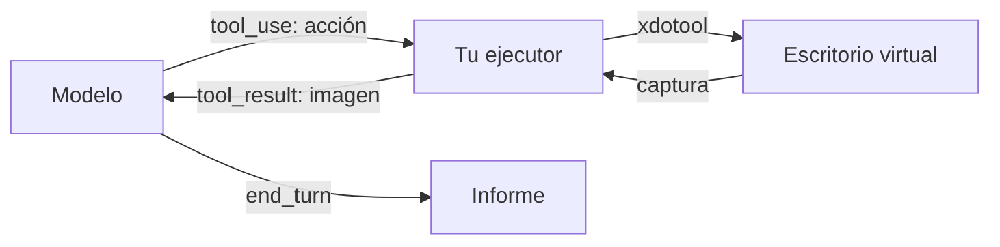

Al terminar esta lección entenderás qué pasa en cada paso cuando un modelo «usa un ordenador» y tendrás un ejecutor mínimo que traduce sus peticiones en clics y pulsaciones dentro de un escritorio virtual. Verás que el mecanismo es el mismo bucle de herramientas de siempre, con imágenes en lugar de texto.

## La idea

El modelo no controla nada directamente. Ve una captura de pantalla, decide una acción («haz clic en las coordenadas 412, 230», «escribe este texto», «pulsa Intro») y la pide con un bloque `tool_use`. **Tu código** ejecuta esa acción en un entorno que controlas, toma una captura nueva y la devuelve como [[glosario/tool-result|tool_result]]. El modelo mira el resultado y decide la siguiente acción.



Es el [[glosario/bucle-agentico|bucle agéntico]] con una herramienta especial. Lo que cambia es la naturaleza de la información: en lugar de JSON o texto, el modelo razona sobre píxeles. Eso lo hace general (sirve para cualquier aplicación con interfaz gráfica) y también lento, caro en tokens (cada captura es una imagen) y más propenso a errores que una llamada a una API.

## Quién hace qué

| Pieza | Responsable | Qué hace |
|---|---|---|
| Definición de la herramienta | Proveedor del modelo | *Toolset* versionado que el modelo ya sabe usar; tú solo eliges qué acciones activas |
| Decidir la acción | Modelo | Interpreta la captura y elige acción y coordenadas |
| Ejecutar la acción | Tu código | Mueve el ratón, teclea, hace capturas, dentro del entorno |
| Entorno | Tú | Máquina virtual o contenedor con un escritorio virtual |
| Límites y seguridad | Tú | Qué acciones se permiten, qué red hay, cuándo parar |

La herramienta de uso del ordenador es una herramienta **definida por el proveedor**: no escribes su `input_schema`, porque el modelo se ha entrenado con ella. En la API de Claude es hoy un [[glosario/toolset|toolset]] de cliente, disponible sin cabecera beta. Tiene tres rasgos que lo distinguen de una herramienta normal:

- **Una sola entrada en `tools`, sin `name` y sin tamaño de pantalla.** Declara la familia entera (17 acciones): capturar, mover el ratón, hacer clic (izquierdo, derecho, central, doble, triple), arrastrar, escribir, pulsar teclas, desplazar, esperar y ampliar una zona. Todas vienen activadas; con `configs` desactivas las que tu ejecutor no implementa y el modelo ni las ve.
- **Cada acción llega como su propio `tool_use`.** El `name` del bloque es la acción (`left_click`, `type`, `screenshot`…), el campo `toolset_name` vale `"computer"` y la entrada trae solo sus argumentos (`coordinate`, `text`). Cada `tool_result` debe repetir `"toolset_name": "computer"`; si falta, la API rechaza la petición.
- **Varias acciones en un turno forman un lote.** Por ejemplo, clic, escribir y captura. Se ejecutan en orden, no en paralelo, y si una falla no ejecutas las siguientes (cada una recibe igualmente su `tool_result` con error).
- **No admite** `strict`, `input_examples` ni un `tool_choice` que la fuerce.

El sufijo de versión del tipo cambia con las generaciones de modelos. Los tipos antiguos (una herramienta `computer` con un campo `action` y el tamaño de pantalla declarado, con cabecera beta) siguen existiendo para modelos anteriores, así que no copies la configuración de un tutorial viejo: compruébala en la [documentación oficial](https://platform.claude.com/docs) para el modelo que uses. El navegador tiene un *toolset* equivalente, que verás en [[cursos/uso-del-ordenador/02-navegador-o-api]].

## El entorno

Necesitas un escritorio que el agente pueda ver y manejar sin tocar el tuyo. Lo habitual es un contenedor con:

- un servidor X virtual (por ejemplo `Xvfb`) con una resolución modesta; las coordenadas que pide el modelo están en píxeles de la captura que le devuelves, y la API no reduce por ti una imagen que supere sus límites: la rechaza;
- un gestor de ventanas ligero y las aplicaciones que el agente usará (un navegador, una hoja de cálculo);
- `xdotool` para ratón y teclado, y una utilidad de capturas como `scrot`.

La lección [[cursos/uso-del-ordenador/04-seguridad-y-aislamiento]] explica cómo restringir ese contenedor. Para esta lección basta con que no sea tu máquina.

## El ejecutor de acciones

Este ejecutor corre dentro del contenedor (o se comunica con él) y traduce cada acción a comandos. Valida todo lo que llega: coordenadas dentro de la pantalla y solo acciones conocidas.

```python title="ejecutor.py"
import base64, subprocess, time

ANCHO, ALTO = 1024, 768  # resolución de Xvfb: las capturas que devuelves tienen este tamaño
ENV = {"DISPLAY": ":1"}

def _x(*args: str) -> None:
    subprocess.run(["xdotool", *args], env=ENV, check=True, timeout=10)

def captura() -> dict:
    subprocess.run(["scrot", "-o", "/tmp/pantalla.png"], env=ENV, check=True, timeout=10)
    with open("/tmp/pantalla.png", "rb") as f:
        datos = base64.b64encode(f.read()).decode()
    return {"type": "image", "source": {"type": "base64", "media_type": "image/png", "data": datos}}

def _coordenadas(entrada: dict) -> tuple[int, int]:
    x, y = entrada["coordinate"]
    if not (0 <= x < ANCHO and 0 <= y < ALTO):
        raise ValueError(f"coordenadas fuera de pantalla: {x},{y}")
    return int(x), int(y)

def ejecutar_accion(accion: str, entrada: dict) -> list[dict]:
    """accion es el name del tool_use (left_click, type…); entrada, sus argumentos."""
    if accion == "screenshot":
        return [captura()]
    if accion == "mouse_move":
        _x("mousemove", *map(str, _coordenadas(entrada)))
    elif accion in ("left_click", "right_click", "double_click"):
        if "coordinate" in entrada:
            _x("mousemove", *map(str, _coordenadas(entrada)))
        boton = "3" if accion == "right_click" else "1"
        _x("click", "--repeat", "2" if accion == "double_click" else "1", boton)
    elif accion == "type":
        _x("type", "--delay", "30", "--", entrada["text"])
    elif accion == "key":
        _x("key", "--", entrada["text"])  # p. ej. "Return" o "ctrl+l"
    else:
        raise ValueError(f"acción no soportada por este ejecutor: {accion}")
    time.sleep(0.5)  # margen mínimo para que la interfaz reaccione; la lección 3 lo mejora
    return [{"type": "text", "text": "OK"}]
```

Fíjate en lo que devuelve. `screenshot` devuelve una lista con un bloque `image`: el `content` de un `tool_result` puede ser texto o una lista de bloques, incluidas imágenes en base64. Las demás acciones basta con que respondan `OK`; para ver el efecto, el modelo pide una captura, a menudo como última acción del mismo lote.

## El bucle

```python title="bucle_ordenador.py"
import anthropic
from ejecutor import ejecutar_accion

MODEL = "claude-sonnet-5-5"
client = anthropic.Anthropic()

# Toolset de uso del ordenador (versión vigente en oct. 2026: compruébala en la documentación).
# Desactiva con configs las acciones que tu ejecutor no implementa: el modelo no las verá.
NO_IMPLEMENTADAS = ["triple_click", "middle_click", "left_click_drag", "left_mouse_down",
                    "left_mouse_up", "hold_key", "scroll", "wait", "zoom", "cursor_position"]
ORDENADOR = {"type": "computer_toolset_20260801",
             "configs": {n: {"enabled": False} for n in NO_IMPLEMENTADAS}}

def argumentos(b) -> dict:
    # según el tipo de bloque, el SDK da la entrada como dict o como modelo
    return b.input if isinstance(b.input, dict) else b.input.model_dump(exclude_none=True)

def agente(tarea: str, max_pasos: int = 30) -> str:
    messages = [{"role": "user", "content": tarea}]
    for _ in range(max_pasos):
        resp = client.messages.create(model=MODEL, max_tokens=2048, tools=[ORDENADOR],
                                      messages=messages)
        messages.append({"role": "assistant", "content": resp.content})
        if resp.stop_reason == "end_turn":
            return "".join(b.text for b in resp.content if b.type == "text")
        if resp.stop_reason == "refusal":
            return "El modelo ha rechazado continuar."
        if resp.stop_reason == "pause_turn":
            continue
        if resp.stop_reason != "tool_use":
            raise RuntimeError(f"stop_reason inesperado: {resp.stop_reason}")
        resultados, fallo = [], False
        for b in resp.content:  # un lote: en orden, y se para en el primer fallo
            if b.type != "tool_use":
                continue
            del_toolset = getattr(b, "toolset_name", None) == "computer"
            if fallo:
                contenido, error = "Not executed: an earlier computer action in this turn failed.", True
            else:
                try:
                    if not del_toolset:
                        raise ValueError(f"herramienta desconocida: {b.name}")
                    contenido, error = ejecutar_accion(b.name, argumentos(b)), False
                except Exception as e:
                    contenido, error, fallo = f"Error: {e}", True, True
            r = {"type": "tool_result", "tool_use_id": b.id, "content": contenido, "is_error": error}
            if del_toolset:
                r["toolset_name"] = "computer"  # obligatorio en los resultados del toolset
            resultados.append(r)
        messages.append({"role": "user", "content": resultados})
    raise RuntimeError("Límite de pasos alcanzado.")
```

Es el mismo bucle que usas para cualquier agente: [[glosario/stop-reason|stop_reason]] tratado caso a caso, un `tool_result` por cada `tool_use` y un límite de pasos. La diferencia está en el contenido (imágenes), en que el nombre de cada `tool_use` es la acción, en que los lotes se ejecutan en orden y en el entorno. El texto de las acciones no ejecutadas es el que da la documentación para este *toolset*.

> [!aviso] Las capturas llenan el contexto
> Cada captura ocupa bastantes tokens, y en 30 pasos acumulas 30 imágenes. Aplica lo que viste en [[cursos/context-engineering/03-compactacion-y-memoria]]: conserva solo las últimas capturas y sustituye las antiguas por un marcador de texto.

## Errores frecuentes

- **Resolución alta.** Una captura que supera los límites de imagen de la API se rechaza. Si la reduces tú, las coordenadas que pida el modelo están en la escala reducida y tienes que reescalarlas antes de hacer clic; con una resolución modesta te ahorras ese paso.
- **Responder solo al primer bloque del lote.** Cada `tool_use` necesita su `tool_result`; un bucle que lee solo el primero falla en la llamada siguiente.
- **Olvidar `toolset_name` en el resultado.** La API rechaza el `tool_result` de una acción del *toolset* que no lo repite.
- **Copiar el tipo de herramienta de un ejemplo antiguo.** La API lo rechaza o usas una versión que no corresponde a tu modelo. Con los tipos antiguos la acción va en `input["action"]`; con el *toolset*, en el `name` del bloque.
- **Dejar activadas acciones que no implementas.** El modelo las pedirá y tu ejecutor fallará. Desactívalas con `configs`.
- **Ejecutar en tu escritorio «solo para probar».** Basta un clic mal colocado.

## Ejercicio

> [!ejercicio] Un escritorio que obedece
> Levanta un contenedor con `Xvfb`, un gestor de ventanas, Firefox o Chromium, `xdotool` y `scrot`. Conecta el ejecutor y el bucle, con la configuración de la herramienta copiada de la documentación oficial. Pide: «Abre el navegador, ve a la página local http://localhost:8000 y dime el título que aparece».
> Está bien si: el agente completa la tarea en menos de 15 pasos, cada `tool_result` de `screenshot` contiene una imagen, y al pedir una acción con coordenadas fuera de pantalla el ejecutor devuelve `is_error` y el agente se corrige.

> [!ejercicio]- Pistas
> Sirve una página estática con `python -m http.server 8000` dentro del mismo contenedor. Si los clics fallan, comprueba que `ANCHO` y `ALTO` coinciden con la resolución de `Xvfb` y que la captura no se reescala antes de enviarla.

## Resumen

- El modelo ve capturas y pide acciones; tu código las ejecuta y devuelve una captura nueva.
- La herramienta la define el proveedor: hoy un *toolset* versionado en el que cada acción llega como su propio `tool_use`; activa solo las que implementas.
- El entorno es tuyo: un escritorio virtual aislado con resolución modesta.
- Valida cada acción, ejecuta los lotes en orden y devuelve las capturas como bloques de imagen dentro del `tool_result`, con su `toolset_name`.
- Cuida el contexto: las capturas son caras.

## Para seguir

- [[cursos/uso-del-ordenador/02-navegador-o-api]]
- [[docs/herramientas/04-uso-del-ordenador]]
- [[roadmap/40-primer-agente/03-condiciones-de-parada]]
