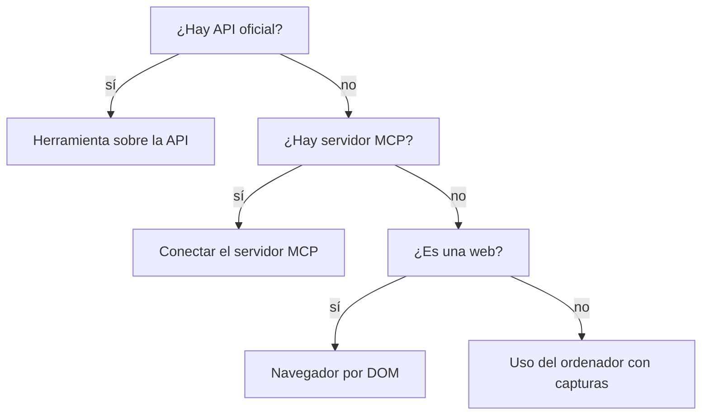

Al terminar esta lección sabrás decidir, para una tarea concreta, si tu agente debe usar una API, un servidor MCP, un navegador controlado por código o el uso del ordenador con capturas. Y tendrás un juego de herramientas de navegador que lee la página como texto, más rápido y fiable que mirar píxeles.

## La idea

El uso del ordenador puede con casi todo, y por eso es tentador. Pero cada vez que el agente hace clic en unas coordenadas está resolviendo con visión un problema que, si existiera una API, sería una línea de código. **Prefiere siempre el escalón más alto disponible** y baja solo cuando el de arriba no existe o no se puede usar.



## La escalera

| Escalón | Qué ve el agente | Fiabilidad | Coste por paso | Mantenimiento |
|---|---|---|---|---|
| API | JSON con campos definidos | Alta | Bajo | Bajo: contrato estable y versionado |
| Servidor [[glosario/mcp|MCP]] | Herramientas ya descritas | Alta, según el servidor | Bajo | Lo mantiene otro (revisa quién) |
| Navegador por DOM | Texto y estructura de la página | Media | Medio | Se rompe si cambia el HTML |
| Uso del ordenador | Capturas de pantalla | Media-baja | Alto (imágenes) | Se rompe si cambia el aspecto |

Además de fiabilidad y coste, la seguridad empeora al bajar. Con una API defines exactamente qué operaciones existen. Con un navegador, el agente lee contenido de terceros que puede contener instrucciones inyectadas, y puede hacer cualquier cosa que haga un usuario con esa sesión ([[cursos/uso-del-ordenador/04-seguridad-y-aislamiento]]).

## Cuándo bajar de escalón

Razones válidas para usar navegador o uso del ordenador:

- **No hay API** o la que hay no cubre la operación (muchas aplicaciones internas y heredadas).
- **La API existe pero no tienes acceso**: requiere un contrato o permisos que no puedes conseguir.
- **La tarea es visual**: comprobar cómo se ve una página, probar un flujo de interfaz, revisar un diseño.
- **Es un prototipo** para validar si la automatización tiene valor antes de invertir en una integración.

Razones que no lo son: «es más rápido de montar» (lo es el primer día, no el décimo), o «así no tengo que leer la documentación de la API». Y si puedes escribir el flujo como pasos fijos con Playwright sin modelo, a menudo es mejor un *script* que un agente ([[patrones/01-workflows-vs-agentes]]).

## Navegador por DOM

Entre la API y los píxeles hay un escalón muy útil: controlar un navegador con código y darle al modelo **texto** en lugar de capturas. El modelo pide «haz clic en el botón Enviar» y tu herramienta lo localiza por su texto o su rol accesible. Ventajas: menos tokens, sin errores de coordenadas y resultados que puedes comprobar.

```python tab="Python" title="navegador.py"
from urllib.parse import urlparse
from playwright.sync_api import sync_playwright

DOMINIOS_PERMITIDOS = {"localhost", "intranet-pruebas.ejemplo.com"}
MAX_TEXTO = 6000

pw = sync_playwright().start()
navegador = pw.chromium.launch(headless=True)
pagina = navegador.new_context().new_page()  # contexto nuevo: sin cookies ni sesiones tuyas

def ir_a(url: str) -> str:
    if urlparse(url).hostname not in DOMINIOS_PERMITIDOS:
        raise ValueError(f"dominio no permitido: {url}")
    pagina.goto(url, wait_until="domcontentloaded", timeout=15000)
    return leer_pagina()

def leer_pagina() -> str:
    texto = pagina.locator("body").inner_text()
    enlaces = pagina.get_by_role("link").all_inner_texts()[:40]
    botones = pagina.get_by_role("button").all_inner_texts()[:40]
    return (f"URL: {pagina.url}\nTítulo: {pagina.title()}\n"
            f"Botones: {botones}\nEnlaces: {enlaces}\n"
            f"<contenido_pagina>\n{texto[:MAX_TEXTO]}\n</contenido_pagina>")

def pulsar(texto: str) -> str:
    pagina.get_by_role("button", name=texto).or_(pagina.get_by_role("link", name=texto)).first.click(timeout=5000)
    pagina.wait_for_load_state("domcontentloaded")
    return leer_pagina()

def rellenar(etiqueta: str, valor: str) -> str:
    pagina.get_by_label(etiqueta).fill(valor, timeout=5000)
    return f"Campo «{etiqueta}» rellenado."

HANDLERS = {"ir_a": ir_a, "leer_pagina": leer_pagina, "pulsar": pulsar, "rellenar": rellenar}
S = {"type": "string"}
TOOLS = [
    {"name": "ir_a", "description": "Abre una URL de un dominio permitido y devuelve el texto de la página.",
     "input_schema": {"type": "object", "properties": {"url": S}, "required": ["url"]}},
    {"name": "leer_pagina", "description": "Devuelve el texto, botones y enlaces de la página actual.",
     "input_schema": {"type": "object", "properties": {}}},
    {"name": "pulsar", "description": "Pulsa un botón o enlace por su texto visible exacto.",
     "input_schema": {"type": "object", "properties": {"texto": S}, "required": ["texto"]}},
    {"name": "rellenar", "description": "Rellena un campo de formulario identificado por su etiqueta visible.",
     "input_schema": {"type": "object", "properties": {"etiqueta": S, "valor": S},
                      "required": ["etiqueta", "valor"]}},
]
```

```ts tab="TypeScript" title="navegador.ts"
import { chromium } from "playwright";

const DOMINIOS_PERMITIDOS = new Set(["localhost", "intranet-pruebas.ejemplo.com"]);
const navegador = await chromium.launch({ headless: true });
const pagina = await (await navegador.newContext()).newPage();

export async function leerPagina(): Promise<string> {
  const texto = await pagina.locator("body").innerText();
  const botones = (await pagina.getByRole("button").allInnerTexts()).slice(0, 40);
  return `URL: ${pagina.url()}\nTítulo: ${await pagina.title()}\nBotones: ${JSON.stringify(botones)}\n` +
    `<contenido_pagina>\n${texto.slice(0, 6000)}\n</contenido_pagina>`;
}

export async function irA(url: string): Promise<string> {
  if (!DOMINIOS_PERMITIDOS.has(new URL(url).hostname)) throw new Error(`dominio no permitido: ${url}`);
  await pagina.goto(url, { waitUntil: "domcontentloaded", timeout: 15000 });
  return leerPagina();
}

export async function pulsar(texto: string): Promise<string> {
  await pagina.getByRole("button", { name: texto }).or(pagina.getByRole("link", { name: texto })).first().click({ timeout: 5000 });
  await pagina.waitForLoadState("domcontentloaded");
  return leerPagina();
}
```

Estas herramientas se conectan al mismo bucle agéntico de siempre ([[cursos/agentes-de-codigo/01-como-trabaja-un-agente-de-codigo]] tiene uno completo). Tres detalles importan. El contexto de navegador es nuevo, sin tus cookies. La lista de dominios se comprueba en la herramienta, no en el prompt. Y el contenido de la página va dentro de una etiqueta para marcarlo como dato ajeno.

Localizar por rol y texto visible (`get_by_role`, `get_by_label`) es más robusto que por selectores CSS, que cambian con cada rediseño. Si una página no tiene etiquetas accesibles, el DOM se vuelve difícil de usar y es cuando el uso del ordenador con capturas empieza a compensar.

> [!consejo] Combina escalones
> Un agente puede tener una herramienta de API para lo que la API cubre y una de navegador para el resto. Describe en cada herramienta cuándo usarla («usa `crear_pedido` siempre que puedas; `pulsar` solo para pantallas sin API») y el modelo elegirá la más alta disponible.

## Errores frecuentes

- **Ir directo a capturas.** Pagas imágenes por algo que el DOM te daba en texto.
- **Devolver el HTML completo.** Miles de tokens de marcado. Devuelve el texto visible y los elementos accionables.
- **Selectores CSS frágiles en las herramientas.** Usa roles y etiquetas accesibles.
- **No buscar una API antes.** Muchas aplicaciones tienen una que nadie había mirado.

## Ejercicio

> [!ejercicio] El mismo flujo, dos escalones
> Monta una aplicación web local sencilla con un formulario (puedes generarla con cualquier framework). Resuelve la tarea «crea un contacto con nombre y correo y confirma que aparece en la lista» dos veces: con las herramientas DOM de esta lección y con el uso del ordenador de la anterior.
> Está bien si: ambas versiones completan la tarea; tienes una tabla con pasos, tokens totales (`usage`) y tiempo de cada versión; y puedes justificar en dos frases qué escalón usarías en producción para esta aplicación.

> [!ejercicio]- Pistas
> Para que la comparación sea justa, usa la misma instrucción y el mismo límite de pasos. Si la aplicación tuviera una API REST, añade una tercera fila con una herramienta sobre ella.

## Resumen

- Escalera: API, MCP, navegador por DOM, uso del ordenador. Empieza arriba.
- Bajar cuesta fiabilidad, tokens, mantenimiento y seguridad.
- Razones válidas para bajar: no hay API, no hay acceso, la tarea es visual o es un prototipo.
- El navegador por DOM da texto en lugar de píxeles: más barato y verificable.
- Comprueba dominios en la herramienta, usa un contexto de navegador limpio y marca el contenido como dato.

## Para seguir

- [[cursos/uso-del-ordenador/03-fiabilidad]]
- [[cursos/mcp-de-cero-a-servidor/02-usar-servidores-existentes]]
- [[disciplinas/diseno-de-herramientas]]
