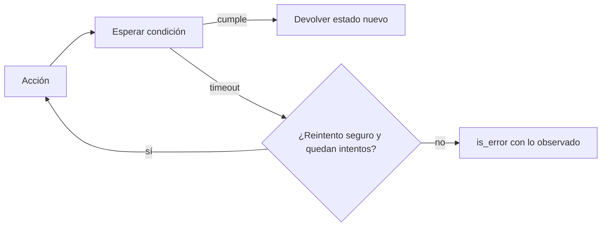

Al terminar esta lección tus herramientas de navegador y de escritorio dejarán de «disparar y olvidar»: cada acción comprobará que tuvo efecto, esperará a lo que tenga que esperar, reintentará con límite y avisará al modelo cuando algo no cambió. Son los cambios que convierten una demo en algo que puedes dejar funcionando.

## La idea

Una interfaz es un entorno inestable. Las páginas cargan a ritmos distintos, aparecen diálogos inesperados, un botón está deshabilitado medio segundo, un clic cae justo cuando la página se reorganiza. Un humano lo corrige sin pensar porque mira antes y después. El agente necesita que sus herramientas hagan lo mismo.

Cuatro principios:

1. **Verifica cada acción.** No supongas que el clic funcionó: comprueba el estado esperado y díselo al modelo.
2. **Espera a condiciones, no a tiempos.** «Espera a que aparezca la tabla» en lugar de «espera 3 segundos».
3. **Reintenta con límite** y solo lo que es seguro reintentar.
4. **Detecta cuando no avanzas.** La misma pantalla tres veces seguidas es un bucle.



## Verificar y devolver lo observado

La herramienta debe devolver qué cambió, no solo «hecho». En el navegador, el modelo puede pasar una condición de éxito: el texto que debería aparecer o la URL a la que debería llegar.

```python title="acciones_fiables.py"
import hashlib, time
from playwright.sync_api import TimeoutError as PWTimeout
from navegador import pagina, leer_pagina

def huella() -> str:
    return hashlib.sha256((pagina.url + pagina.locator("body").inner_text()).encode()).hexdigest()[:12]

def pulsar_y_verificar(texto: str, espera_texto: str | None = None,
                       intentos: int = 2, timeout_ms: int = 8000) -> str:
    antes = huella()
    ultimo_error = None
    for intento in range(1, intentos + 1):
        try:
            boton = pagina.get_by_role("button", name=texto).or_(pagina.get_by_role("link", name=texto)).first
            boton.wait_for(state="visible", timeout=timeout_ms)
            boton.click(timeout=timeout_ms)
            if espera_texto:
                pagina.get_by_text(espera_texto).first.wait_for(state="visible", timeout=timeout_ms)
            else:
                pagina.wait_for_load_state("networkidle", timeout=timeout_ms)
            if huella() == antes:
                return "AVISO: la página no cambió tras pulsar. Revisa si el botón era el correcto.\n" + leer_pagina()
            return f"OK (intento {intento}).\n" + leer_pagina()
        except PWTimeout as e:
            ultimo_error = e
            time.sleep(1.5 * intento)  # espera creciente antes de reintentar
    raise RuntimeError(f"Sin éxito tras {intentos} intentos: {ultimo_error}. Estado actual:\n{leer_pagina()}")
```

Ojo: si el clic funcionó pero la verificación agotó el tiempo, el reintento vuelve a pulsar. Para botones con efecto (enviar, crear) llama con `intentos=1` y deja la decisión al modelo, como verás en la tabla siguiente.

Fíjate en tres cosas. El aviso de «la página no cambió» es información para el modelo, no un error. El error final incluye el estado actual de la página, para que el modelo decida con datos. Y la espera usa condiciones de Playwright (`wait_for`, `wait_for_load_state`) con tiempo máximo; `networkidle` puede no llegar en páginas con conexiones permanentes, así que prefiere `espera_texto` cuando sepas qué debe aparecer.

En el uso del ordenador con capturas, el equivalente es comparar la captura antes y después. Si los bytes son idénticos tras un clic, la acción no tuvo efecto visible: devuélvelo como texto junto a la imagen.

Con los *toolsets* del proveedor (lecciones 1 y 2) las acciones las define el proveedor y las elige el modelo, pero la verificación sigue siendo de tu ejecutor. Los dos traen una acción `wait` con una duración en segundos: ponle tu propio tope y, después de esperar, comprueba el estado en lugar de suponer que la página ya cargó. En el de navegador, las referencias a elementos (`[ref_7]`) caducan al navegar o al redibujarse la página: si llega una referencia vieja, devuelve un error que pida leer la página otra vez en lugar de hacer clic en lo que ocupe ahora ese sitio.

## Qué se puede reintentar

Reintentar es seguro solo si repetir la acción no causa un efecto distinto. Navegar, leer, abrir un menú: sí. Pulsar «Pagar», «Enviar» o «Crear»: no sin comprobar antes.

| Acción | ¿Reintento automático? | Antes de repetir |
|---|---|---|
| Navegar, leer, desplazar | Sí | Nada |
| Abrir menú, cambiar pestaña | Sí | Nada |
| Rellenar un campo | Sí | Vaciarlo (con `fill` ya se sobrescribe) |
| Enviar formulario, crear registro | No | Comprobar si el registro ya existe |
| Pagar, borrar, enviar correo | Nunca | Aprobación humana ([[cursos/uso-del-ordenador/04-seguridad-y-aislamiento]]) |

Para las acciones con efecto, haz la herramienta **idempotente** por diseño: antes de crear un contacto, busca si ya existe uno con ese correo; si existe, devuélvelo en lugar de crear otro. Así un reintento, del modelo o tuyo, no duplica nada.

## Estados explícitos

Un flujo largo (iniciar sesión, buscar, rellenar, confirmar) es más fiable si sabes en qué paso estás. Declara los estados del flujo y deja que una herramienta los compruebe con señales concretas de la página: un texto, una URL, un elemento.

```python title="estados.py"
from navegador import pagina

ESTADOS = {
    "login": lambda: pagina.get_by_label("Contraseña").count() > 0,
    "panel": lambda: "/panel" in pagina.url,
    "formulario": lambda: pagina.get_by_role("button", name="Guardar contacto").count() > 0,
    "confirmado": lambda: pagina.get_by_text("Contacto guardado").count() > 0,
}

def donde_estoy() -> str:
    actuales = [nombre for nombre, cumple in ESTADOS.items() if cumple()]
    return f"Estados detectados: {actuales or ['desconocido']}. URL: {pagina.url}"
```

Ofrecida como herramienta, `donde_estoy` le da al modelo una forma barata de orientarse tras un imprevisto, sin leer la página entera. También te sirve a ti: si en la traza ves «desconocido», sabes dónde se perdió.

## Detectar bucles

Un agente atascado repite: pulsa el mismo botón, vuelve a la misma página, toma la misma captura. Detéctalo en el bucle, no confíes en que el modelo se dé cuenta.

```python title="detector.py"
from collections import deque

class DetectorBucles:
    def __init__(self, ventana: int = 6, max_repeticiones: int = 3):
        self.recientes = deque(maxlen=ventana)
        self.max = max_repeticiones

    def registrar(self, accion: str, entrada: dict, huella_estado: str) -> str | None:
        clave = (accion, str(sorted(entrada.items())), huella_estado)
        self.recientes.append(clave)
        if self.recientes.count(clave) >= self.max:
            return ("Has repetido la misma acción en el mismo estado varias veces sin avanzar. "
                    "Prueba otro enfoque o termina explicando dónde te has atascado.")
        return None
```

Cuando `registrar` devuelve un mensaje, añádelo como texto al `tool_result` de esa acción. Si el bucle continúa después del aviso, corta la ejecución. El síntoma general, fuera del navegador, está en [[problemas/el-agente-repite-la-misma-herramienta]]. Y deja el error de la acción fallida en el contexto: verlo es lo que evita que el modelo repita lo mismo ([[cursos/context-engineering/02-que-meter-y-que-no]]). Junto con el límite de pasos ([[roadmap/40-primer-agente/03-condiciones-de-parada]]), evita que una pantalla inesperada consuma todo el presupuesto.

> [!aviso] Diálogos inesperados
> *Banners* de cookies, avisos de sesión caducada, ventanas de «¿quieres salir?». Son la causa más común de bloqueos. Ciérralos en tu código cuando los conozcas (un manejador de diálogos en Playwright, un clic previo en el banner) en lugar de dejar que el modelo los descubra en cada ejecución.

## Medir la fiabilidad

Una ejecución que funciona no demuestra nada. Ejecuta el mismo flujo muchas veces y cuenta: tasa de éxito, pasos medios, reintentos, avisos de bucle. Guarda la [[glosario/trayectoria|trayectoria]] de cada ejecución para ver dónde fallan las que fallan ([[roadmap/80-evals/04-evals-de-trayectoria]]). Esa tasa es la que decide si el flujo puede ir a producción o necesita supervisión.

## Errores frecuentes

- **`sleep` fijos.** Demasiado cortos fallan en días lentos; demasiado largos hacen el agente eterno.
- **Herramientas que devuelven «OK» sin comprobar.** El modelo construye sobre algo que no pasó.
- **Reintentar envíos.** Dos pedidos, dos correos, dos cargos.
- **Sin detector de bucles.** El límite de pasos llega tarde y caro.

## Ejercicio

> [!ejercicio] Un flujo que aguanta imprevistos
> Sobre la aplicación de la lección anterior, añade dos imprevistos: un retraso aleatorio de 0 a 4 segundos al guardar y un diálogo que aparece la mitad de las veces. Sustituye `pulsar` por `pulsar_y_verificar`, añade `donde_estoy` como herramienta y el detector de bucles. Haz que crear contacto sea idempotente.
> Está bien si: en 10 ejecuciones seguidas la tarea se completa al menos 9 veces, nunca se crea un contacto duplicado, y en las trazas puedes señalar al menos un reintento y un aviso de «la página no cambió» o de bucle.

> [!ejercicio]- Pistas
> Para el diálogo, registra `pagina.on("dialog", lambda d: d.dismiss())` si es nativo, o cierra el elemento con un clic previo si es HTML. Para la idempotencia, busca por correo en la lista antes de pulsar «Guardar contacto».

## Resumen

- Cada acción verifica su efecto y devuelve el estado observado.
- Espera a condiciones con tiempo máximo; nunca a tiempos fijos.
- Reintenta con límite solo lo que es seguro repetir; haz idempotentes las acciones con efecto.
- Estados explícitos y detector de bucles para orientarse y no atascarse.
- Mide la fiabilidad con muchas ejecuciones, no con una.

## Para seguir

- [[cursos/uso-del-ordenador/04-seguridad-y-aislamiento]]
- [[recetas/reintentos-y-limites-de-tasa]]
- [[cursos/evals-para-agentes/index]]
- [[problemas/el-agente-no-para]]
