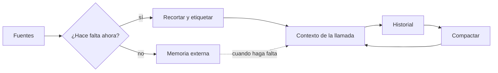

*Context engineering* es el trabajo de decidir qué ve el modelo en cada llamada: instrucciones, herramientas, documentos, historial y resultados intermedios. El [[glosario/prompt|prompt]] es una parte. La disciplina abarca todo lo que acaba dentro de la [[glosario/ventana-de-contexto|ventana de contexto]], quién lo pone ahí y cuándo sale.

## Qué es

Un modelo no recuerda nada entre llamadas. Todo lo que sabe de tu tarea es lo que le mandas en esa petición. En una llamada suelta eso es un prompt. En un [[glosario/agente|agente]] que da veinte vueltas al [[glosario/bucle-agentico|bucle agéntico]], el contexto crece con cada [[glosario/tool-result|resultado de herramienta]], y alguien tiene que decidir qué se queda, qué se resume y qué se descarta.

Anthropic lo resume así en [Effective context engineering for AI agents](https://www.anthropic.com/engineering/effective-context-engineering-for-ai-agents) (2025): el contexto es un recurso finito y hay que buscar el conjunto más pequeño de [[glosario/token|tokens]] con mucha señal que maximice la probabilidad del resultado que quieres.

Las piezas que gestionas:

| Pieza | Pregunta que te haces |
|---|---|
| [[glosario/prompt-de-sistema|Prompt de sistema]] | ¿Están las reglas fijas y nada más? |
| Definiciones de herramientas | ¿Cada herramienta se justifica? ¿Las descripciones son claras? |
| Documentos recuperados | ¿Son los relevantes o los primeros que salieron? |
| Historial | ¿Qué parte sigue haciendo falta? |
| Resultados de herramientas | ¿Devuelven lo necesario o un volcado entero? |
| [[glosario/memoria|Memoria]] | ¿Qué se guarda fuera y cuándo se vuelve a cargar? |

## Por qué importa

Más contexto no significa mejor respuesta. Con contextos largos el modelo atiende peor a la información enterrada en medio: lo documentan Liu et al. en [Lost in the Middle](https://arxiv.org/abs/2307.03172) (2023). Además, cada token cuesta dinero y [[glosario/latencia|latencia]] en cada vuelta del bucle, porque reenvías el historial completo.

Los fallos de contexto se disfrazan de fallos del modelo. El agente «se olvida» de una regla porque quedó a 80 000 tokens de distancia. Llama a la herramienta equivocada porque tiene dos con descripciones casi iguales. Inventa un dato porque el documento correcto no entró en la recuperación. Cambiar de modelo no arregla nada de eso.

## Prácticas concretas

- **Trata el contexto como un presupuesto.** Mide cuántos tokens ocupa cada pieza con `client.messages.count_tokens(...)` antes de añadir nada. Lo explica [[cursos/context-engineering/01-el-contexto-como-presupuesto]].
- **Pon lo estable delante y lo variable detrás.** Herramientas y sistema primero, conversación después. Así aprovechas el [[glosario/prompt-caching|prompt caching]], que cachea el prefijo en orden `tools` → `system` → `messages`.
- **Documentos largos arriba, pregunta al final.** Envuelve cada documento en etiquetas (`<documento id="3">…</documento>`) para que el modelo pueda citarlo. Más detalle en [[modelos/07-documentos-largos]].
- **Recupera en vez de cargarlo todo.** Si el corpus no cabe holgado, usa [[glosario/rag|RAG]] o deja que el agente busque con herramientas cuando lo necesite.
- **Recorta los resultados de herramientas.** Devuelve los campos útiles, pagina las listas y trunca con un aviso («mostrando 20 de 340; usa `pagina=2`»). Ver [[disciplinas/diseno-de-herramientas]].
- **Compacta cuando el historial crece.** Resume las vueltas antiguas en un estado breve (decisiones, datos confirmados, pendientes) y descarta el detalle. Es la [[glosario/compactacion|compactación]].
- **Saca trabajo a [[glosario/subagente|subagentes]].** Una búsqueda que lee cincuenta páginas puede devolver al agente principal un resumen de diez líneas. El ruido se queda en el contexto del subagente.
- **Guarda notas fuera del contexto.** Un archivo `NOTAS.md` o una herramienta de memoria que el agente lee al empezar sobrevive a la compactación.

## Señales de que lo haces mal

- Pegas «por si acaso» el manual entero en el prompt de sistema.
- El agente rinde bien en las primeras vueltas y empeora a partir de la décima.
- No sabes cuántos tokens ocupa cada parte de tu petición.
- Una herramienta devuelve JSON de 30 000 tokens y nadie lo ha mirado.
- Tienes quince herramientas y el modelo confunde dos de ellas a menudo.
- El coste por tarea sube sin que hayas cambiado nada (el historial crece sin control).
- La solución a cada fallo es «añadir otra frase al prompt».

> [!aviso] El contexto también es superficie de ataque
> Todo lo que entra en el contexto puede contener instrucciones. Una página web o un correo recuperado puede intentar dar órdenes al modelo. Lee [[disciplinas/seguridad]].

## Cómo empezar mañana

1. Coge una traza real de tu agente y apunta cuántos tokens ocupa cada pieza: sistema, herramientas, historial, resultados.
2. Marca la pieza más grande y pregúntate qué parte usó de verdad el modelo para responder.
3. Recorta esa pieza a la mitad y repite tu [[glosario/conjunto-de-evaluacion|conjunto de evaluación]]. Si la calidad no baja, has ganado coste y latencia.
4. Reordena la petición para que lo estable vaya delante y activa el caché ([[recetas/recortar-costes-con-prompt-caching]]).

## Para seguir

- [[cursos/context-engineering/index]]: el curso completo.
- [[cursos/context-engineering/03-compactacion-y-memoria]]
- [[blog/2026-09-28-el-contexto-es-un-presupuesto]]
