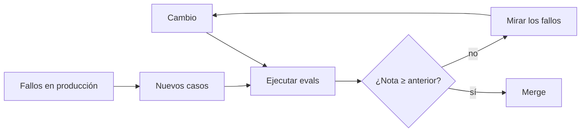

Hacer [[glosario/evals|evals]] es tener un conjunto de casos, una forma de puntuarlos y la costumbre de ejecutarlos cada vez que cambias algo. Como disciplina, significa que ninguna decisión sobre prompts, modelos o herramientas se toma «porque parece que va mejor».

## Qué es

Una eval tiene tres piezas:

1. **Casos**: entradas reales o realistas, con lo que esperas que pase. Es tu [[glosario/conjunto-de-evaluacion|conjunto de evaluación]].
2. **Grader**: la forma de puntuar cada salida. Puede ser código (¿el JSON valida?, ¿la categoría coincide?), un [[glosario/modelo-juez|modelo juez]] con una rúbrica o una persona.
3. **Ejecución**: un script que pasa todos los casos, agrega la nota y la compara con la anterior.

En agentes también importa el camino. Una eval de [[glosario/trayectoria|trayectoria]] mira qué herramientas llamó el agente, en qué orden y cuántas vueltas dio, además de la respuesta final. Lo trata [[roadmap/80-evals/04-evals-de-trayectoria]].

## Por qué importa

Los modelos generan texto con variación. Un cambio en el prompt que arregla un caso puede romper otros tres que no estás mirando. Sin evals solo te enteras cuando un usuario se queja.

Las evals también te dejan cambiar de modelo con datos. Cuando sale uno nuevo o quieres bajar a uno más barato, ejecutas la suite y comparas. Sin ella, la decisión es una apuesta. Es el método que propone [[modelos/05-elegir-modelo-por-tarea]]: empieza por el más capaz, mide y baja de nivel mientras la nota aguante.

## Prácticas concretas

- **Empieza con 20 casos, no con 2 000.** Veinte casos bien elegidos, sacados de uso real, ya cazan las regresiones gordas. La suite crecerá sola con cada fallo que encuentres.
- **Cada bug de producción se convierte en un caso.** Antes de arreglarlo, añádelo a la suite y comprueba que falla. Después, que pasa.
- **Usa código siempre que puedas.** Comparar una categoría, validar un esquema o comprobar que una cita existe es barato, rápido y determinista. Reserva el modelo juez para lo que el código no puede medir (tono, completitud, fidelidad). Ver [[roadmap/80-evals/03-codigo-o-modelo-juez]].
- **Calibra al juez con humanos.** Puntúa a mano 30 salidas, compáralas con las del juez y ajusta la rúbrica hasta que coincidan. Zheng et al. ([MT-Bench y Chatbot Arena](https://arxiv.org/abs/2306.05685), 2023) describen sesgos del juez, como preferir respuestas largas o la primera opción.
- **Mira los fallos, no solo la media.** Un 92 % puede esconder que todos los casos en catalán fallan. Agrupa por etiqueta.
- **Repite los casos inestables.** Si un caso pasa a veces, ejecútalo 3 o 5 veces y mide la tasa de acierto.
- **Mete las evals en CI.** Un umbral mínimo que bloquea el merge. Receta: [[recetas/evals-de-regresion-en-ci]].
- **Versiona los casos con el código.** Un archivo `evals/casos.jsonl` en el repositorio, revisado en cada PR como cualquier test.

## Señales de que lo haces mal

- Pruebas un cambio de prompt con tres ejemplos en el playground y lo subes.
- Nadie sabe decir qué porcentaje de casos resuelve el sistema hoy.
- La suite de evals lleva meses sin un caso nuevo.
- El modelo juez da 9/10 a todo.
- Las evals tardan una hora y por eso nadie las ejecuta.
- Optimizas la nota de la eval y los usuarios siguen quejándose de lo mismo (tus casos no se parecen a la realidad).

> [!consejo] Escribe las evals antes del prompt
> Si no sabes qué casos debe resolver, tampoco sabes qué prompt escribir. Lo argumenta [[blog/2026-09-10-evals-antes-que-prompts]].

## Cómo empezar mañana

1. Exporta 20 entradas reales de tus logs. Si no tienes producción, escríbelas con alguien que conozca el dominio.
2. Para cada una, escribe en una línea qué debería pasar.
3. Escribe un grader de código para lo que se pueda comprobar con código, y deja el resto para una rúbrica ([[recetas/modelo-juez-con-rubrica]]).
4. Ejecuta, guarda la nota en un archivo y conviértela en tu línea base.
5. A partir de ahí, ningún cambio entra sin ejecutar la suite.

## Para seguir

- [[roadmap/80-evals/index]]: el nivel del roadmap.
- [[cursos/evals-para-agentes/index]]: evals específicas de agentes.
- [[docs/evals/02-modelo-como-juez]]
