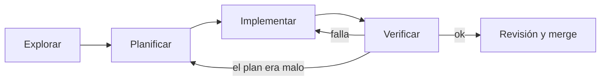

Explorar, planificar, implementar, verificar es un ciclo para cualquier tarea no trivial con un agente de código. Primero el agente entiende el terreno, luego propone un plan que tú apruebas, después lo ejecuta y al final demuestra que funciona. Cada fase tiene una salida concreta y no se pasa a la siguiente sin ella.

## Qué es

| Fase | Qué hace el agente | Qué sale | Qué haces tú |
|---|---|---|---|
| **Explorar** | Lee código, docs y tests relacionados. No edita nada | Un resumen de cómo funciona hoy | Corriges lo que haya entendido mal |
| **Planificar** | Propone los pasos, archivos y riesgos | Un plan escrito | Lo apruebas o lo cambias |
| **Implementar** | Edita siguiendo el plan, paso a paso | Un diff | Revisas cada paso |
| **Verificar** | Ejecuta tests, linter, el caso que falla | Evidencia: salida de comandos | Compruebas contra los criterios |



El curso de agentes de código lo desarrolla en [[cursos/agentes-de-codigo/03-explorar-planificar-implementar-verificar]].

## Por qué importa

Si pides directamente «arregla el bug del login», el agente suele lanzarse a editar el primer archivo que parece relevante. A veces acierta. Otras arregla el síntoma en el sitio equivocado, duplica una función que ya existía o rompe algo que no ha leído.

Separar las fases cambia dónde se detectan los errores. Un malentendido en la exploración se corrige con una frase. El mismo malentendido descubierto en revisión obliga a tirar un diff de 300 líneas. Y la verificación explícita evita el «ya está» sin pruebas.

## Prácticas concretas

- **Prohíbe editar en la exploración.** Dilo literal: «No modifiques ningún archivo todavía. Lee y explícame cómo funciona X». Si tu herramienta tiene un modo de solo lectura o de plan, úsalo.
- **Pide que la exploración cite archivos y líneas.** Así puedes comprobar dos o tres afirmaciones en un minuto.
- **El plan va por escrito y numerado.** Archivos que toca, qué cambia en cada uno, qué tests añade, qué riesgos ve. Si tienes una [[disciplinas/spec-primero|spec]], el plan la referencia.
- **Ajusta el esfuerzo de razonamiento a la fase.** La planificación es donde más rinde dejar pensar al modelo. Ver [[modelos/04-dejar-pensar-al-modelo]].
- **Implementa por pasos del plan.** Un paso, su verificación, siguiente paso. Si el plan tiene seis pasos, no hace falta revisar los seis de golpe.
- **Escribe primero el test que falla** cuando arreglas un bug. Verificar es ver ese test pasar de rojo a verde.
- **Verificar es ejecutar.** Tests, tipos, linter y, si aplica, el comando que reproduce el caso real. Pide que el agente te pegue la salida.
- **Vuelve a planificar si la realidad no encaja.** Si en la implementación aparece algo que el plan no preveía, para y actualiza el plan antes de seguir.

> [!consejo] Para tareas pequeñas, comprime
> Un cambio de una línea no necesita cuatro fases formales. El ciclo rinde en tareas de más de unos minutos, en código que no conoces o cuando el error sería caro.

## Señales de que lo haces mal

- El primer mensaje del agente ya contiene un diff.
- No sabrías decir qué plan siguió el agente.
- La verificación es «parece que funciona» o «lo he probado mentalmente».
- El agente descubre a mitad de implementación que la función que necesitaba ya existía.
- Los tests se ejecutan al final de todo, una sola vez, y fallan cinco cosas a la vez.

## Cómo empezar mañana

En tu próxima tarea, usa estos cuatro mensajes, uno por fase:

```text
1. Explora: lee el código relacionado con <tarea>. No edites nada. Resume
   cómo funciona hoy, con archivo:línea, y dime qué dudas tienes.
2. Planifica: propón un plan numerado (archivos, cambios, tests, riesgos).
   No edites todavía.
3. Implementa el paso 1 del plan y ejecuta los tests afectados.
4. Verifica: ejecuta la suite completa y el linter, pega la salida y
   comprueba cada criterio de aceptación.
```

Repite el tercero por cada paso del plan. Después, revisa el diff completo antes de abrir el PR ([[disciplinas/cambios-pequenos-y-revisables]]).

## Para seguir

- [[cursos/agentes-de-codigo/01-como-trabaja-un-agente-de-codigo]]
- [[disciplinas/pair-programming-con-agentes]]
- [[cursos/agentes-de-codigo/04-revisar-y-confiar]]
