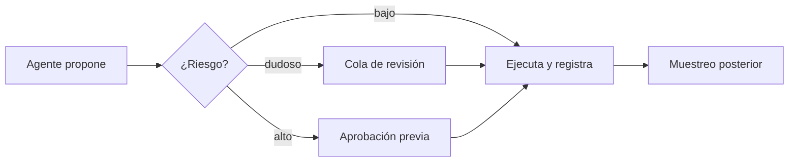

Trabajar con [[glosario/humano-en-el-bucle|humano en el bucle]] significa que el agente hace el trabajo y una persona decide en los puntos donde un error sale caro. La pregunta de diseño es dónde, con qué información y con qué coste de atención para quien revisa.

## Qué es

Hay tres formas de meter a una persona en el flujo:

| Forma | Cuándo interviene | Ejemplo |
|---|---|---|
| **Aprobación previa** | Antes de una acción concreta | Confirmar un reembolso de 240 € |
| **Revisión por excepción** | Solo en casos dudosos o fuera de umbral | Extracción con un campo de baja confianza |
| **Supervisión posterior** | Después, sobre una muestra | Revisar 20 respuestas al día al azar |

Se combinan. Un agente de soporte puede responder solo a dudas de envío (supervisión por muestreo), pedir aprobación para reembolsos (aprobación previa) y pasar a una persona los clientes enfadados (excepción). Es lo que describe [[sistemas/soporte-con-aprobacion-humana]].

## Por qué importa

Los modelos se equivocan y pueden ser manipulados ([[disciplinas/seguridad]]). Para muchas acciones da igual: una respuesta mejorable se corrige en el siguiente mensaje. Para otras no: un pago, un correo a un cliente, un borrado. Ahí una persona es el control más fiable que tienes.

Pero la atención humana es cara y se agota. Si pides aprobación para todo, la gente aprueba sin leer y el control desaparece aunque siga en el diagrama. Poner al humano en el sitio justo forma parte del diseño tanto como el prompt.

## Prácticas concretas

- **Clasifica las acciones por riesgo.** Lectura, escritura reversible, escritura irreversible, afecta a terceros. Solo las dos últimas piden aprobación por defecto.
- **Aplica la regla en código.** La decisión de pedir aprobación la toma tu aplicación según la herramienta y sus argumentos, nunca el modelo. Receta: [[recetas/aprobacion-humana-antes-de-actuar]].
- **Enseña lo necesario para decidir.** La acción exacta, sus argumentos, por qué la propone el agente y qué datos usó. Un botón «Aprobar» sin contexto no sirve.
- **Permite editar, no solo aprobar o rechazar.** Corregir el importe o el texto del correo es más útil que rechazar y que el agente vuelva a empezar.
- **Devuelve el rechazo al agente.** Si una persona rechaza, el agente recibe un `tool_result` con el motivo y puede proponer otra cosa.
- **Usa umbrales.** Reembolsos de menos de 20 € automáticos; por encima, aprobación. Ajusta el umbral mirando datos, no a ojo.
- **Mide la revisión.** Tasa de rechazos, tiempo por decisión, ediciones. Si nadie rechaza nunca, o el umbral es demasiado bajo o la gente no está mirando.
- **Convierte las correcciones en casos de eval.** Cada rechazo o edición dice algo que el agente hizo mal. Llévalo a tu [[glosario/conjunto-de-evaluacion|conjunto de evaluación]].

> [!peligro] Acciones irreversibles
> Pagos, borrados, envíos a terceros y cambios de permisos llevan aprobación humana hasta que tengas datos que justifiquen automatizarlos. Y aun entonces, con límites en código.

## Señales de que lo haces mal

- El agente decide cuándo pedir permiso («si crees que es arriesgado, pregunta»).
- La pantalla de aprobación muestra «¿Ejecutar `reembolsar`?» y nada más.
- Los revisores aprueban cientos de acciones al día en segundos cada una.
- Un rechazo detiene la tarea entera sin explicación para el agente.
- Nadie revisa nunca lo que el agente hace solo, ni por muestreo.
- Has añadido revisión humana a todo y el sistema ya no ahorra tiempo a nadie.

## Cómo empezar mañana

1. Lista las herramientas de tu agente y clasifícalas en las cuatro categorías de riesgo.
2. Para las de escritura irreversible, intercepta la llamada antes de ejecutarla y pide confirmación en la interfaz o por consola.
3. Muestra en la confirmación los argumentos completos y el último mensaje del agente que la justifica.
4. Registra cada decisión (aprobada, editada, rechazada y motivo) junto a la [[disciplinas/observabilidad|traza]] de la tarea.

## Para seguir

- [[docs/agentes/03-humano-en-el-bucle]]
- [[roadmap/100-produccion/05-humano-en-el-bucle]]
- [[disciplinas/ux-de-agentes]]
