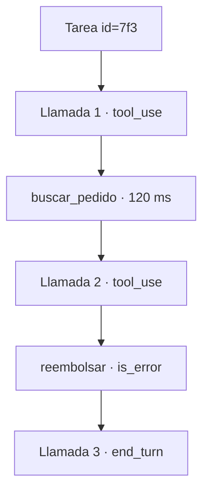

La [[glosario/observabilidad|observabilidad]] de un sistema con modelos es la capacidad de responder, después de los hechos, a tres preguntas: qué vio el modelo, qué decidió y qué pasó al ejecutarlo. Si no puedes reconstruir una ejecución paso a paso, no puedes depurarla ni mejorarla.

## Qué es

En software clásico registras peticiones, errores y métricas. En un [[glosario/agente|agente]] eso no basta, porque el mismo código puede tomar caminos distintos según lo que decida el modelo. Necesitas una **traza**: el registro ordenado de cada paso de una ejecución.

Una traza útil guarda, por cada llamada al modelo:

| Campo | Para qué |
|---|---|
| Petición completa (sistema, mensajes, herramientas) | Reproducir el caso |
| Respuesta y `stop_reason` | Saber por qué paró. Ver [[glosario/stop-reason]] |
| `usage` (entrada, salida, caché) | Coste por paso y por tarea |
| Latencia | Encontrar el paso lento |
| Versión del prompt y del modelo | Comparar antes y después de un cambio |

Y por cada herramienta: nombre, argumentos, resultado (o un resumen si es enorme), si fue error (`is_error`) y cuánto tardó. Todo colgado de un identificador de tarea para poder ver la ejecución entera.



## Por qué importa

Cuando un usuario dice «el agente me ha contestado una barbaridad», la traza te dice si el modelo tuvo el dato correcto y lo ignoró, si la herramienta devolvió basura o si el documento no llegó a recuperarse. Cada caso se arregla en un sitio distinto. Sin traza, adivinas.

La traza también es la materia prima de tus [[disciplinas/evals|evals]]: los fallos reales que encuentras se convierten en casos de prueba. Y es la única forma seria de controlar costes, porque el gasto de un agente depende de cuántas vueltas da, y eso solo se ve ejecución a ejecución.

## Prácticas concretas

- **Traza desde el primer día.** Aunque sea un JSONL por tarea en disco. Es mucho más barato que añadirla después de un incidente.
- **Un id por tarea, un id por paso.** Propágalos a los logs de tus herramientas y servicios para cruzar información.
- **Guarda `usage` en cada respuesta.** Incluye `cache_read_input_tokens` y `cache_creation_input_tokens` para saber si el caché funciona ([[recetas/recortar-costes-con-prompt-caching]]).
- **Registra las versiones.** Hash del prompt de sistema, nombre del modelo, versión de las definiciones de herramientas. Si cambias algo, lo verás en la traza.
- **Mide por tarea, no solo por llamada.** Vueltas por tarea, coste por tarea, tiempo hasta respuesta, tasa de errores de herramienta. Son las métricas que se mueven cuando algo se rompe.
- **Alerta sobre síntomas propios de agentes.** Tareas que llegan al límite de pasos, `stop_reason` igual a `max_tokens`, `refusal` o `model_context_window_exceeded`, la misma herramienta llamada cinco veces seguidas con los mismos argumentos.
- **Protege los datos.** Las trazas contienen lo que escriben los usuarios. Enmascara datos personales, limita quién las lee y define cuánto tiempo se guardan.
- **Usa estándares si ya los tienes.** Si tu empresa usa OpenTelemetry, emite cada llamada como un *span* con las [[glosario/convenciones-genai-otel|convenciones GenAI]] (abajo). Si no, empieza con JSONL y una herramienta sencilla para leerlo.

Un esqueleto mínimo para registrar cada llamada:

```python title="traza.py"
import json, os, time, uuid

os.makedirs("trazas", exist_ok=True)

def llamar_con_traza(client, tarea_id: str, **kwargs):
    inicio = time.monotonic()
    resp = client.messages.create(**kwargs)
    registro = {
        "tarea": tarea_id,
        "paso": str(uuid.uuid4()),
        "modelo": kwargs["model"],
        "stop_reason": resp.stop_reason,
        "usage": resp.usage.model_dump(),
        "ms": round((time.monotonic() - inicio) * 1000),
        "herramientas": [b.name for b in resp.content if b.type == "tool_use"],
    }
    with open(f"trazas/{tarea_id}.jsonl", "a", encoding="utf-8") as f:
        f.write(json.dumps(registro, ensure_ascii=False) + "\n")
    return resp
```

### Con OpenTelemetry y sus convenciones GenAI

OpenTelemetry tiene convenciones semánticas para IA generativa: nombres de *span* y atributos `gen_ai.*` que entienden los *backends* de trazas. Siguen en estado *Development* (pueden cambiar entre versiones, así que fija la de tu instrumentación) y desde junio de 2026 viven en su propio repositorio, [`open-telemetry/semantic-conventions-genai`](https://github.com/open-telemetry/semantic-conventions-genai). El árbol típico de un agente es un *span* `invoke_agent` por tarea, con hijos `chat` por cada llamada al modelo y `execute_tool` por cada herramienta. Dos detalles de la versión actual: el proveedor va en `gen_ai.provider.name` (sustituye a `gen_ai.system`) y el contenido de *prompts* y respuestas se captura solo si lo activas, por privacidad.

El SDK `anthropic` 2.3 ya emite su propio *span* `chat` por llamada en cuanto registras un proveedor de OpenTelemetry, con modelo, `stop_reason` y tokens. Tú añades el del agente y los de las herramientas:

```python title="traza_otel.py"
from opentelemetry import trace
from opentelemetry.exporter.otlp.proto.http.trace_exporter import OTLPSpanExporter
from opentelemetry.sdk.trace import TracerProvider
from opentelemetry.sdk.trace.export import BatchSpanProcessor

proveedor = TracerProvider()
proveedor.add_span_processor(BatchSpanProcessor(OTLPSpanExporter()))   # OTEL_EXPORTER_OTLP_ENDPOINT
trace.set_tracer_provider(proveedor)       # con esto, el SDK anthropic ya emite un span "chat" por llamada
tracer = trace.get_tracer("agente-soporte")

def agente_con_trazas(tarea_id: str, ejecutar_agente, pregunta: str):
    atributos = {"gen_ai.operation.name": "invoke_agent", "gen_ai.agent.name": "soporte",
                 "gen_ai.conversation.id": tarea_id}
    with tracer.start_as_current_span("invoke_agent soporte", attributes=atributos):
        return ejecutar_agente(pregunta)      # las llamadas al modelo cuelgan de este span

def herramienta_con_traza(nombre: str, tool_use_id: str, funcion, **args):
    atributos = {"gen_ai.operation.name": "execute_tool", "gen_ai.tool.name": nombre,
                 "gen_ai.tool.call.id": tool_use_id}
    with tracer.start_as_current_span(f"execute_tool {nombre}", attributes=atributos) as span:
        try:
            return funcion(**args)
        except Exception as e:
            span.set_attribute("error.type", type(e).__name__)   # el is_error del tool_result
            raise
```

Lo probé con un exportador en memoria y el simulador de la API: las dos llamadas al modelo y la herramienta (que falló, con su `error.type`) cuelgan del mismo `invoke_agent`. Si además creas tus propios *spans* `chat`, apaga los del SDK (`anthropic.Anthropic(open_telemetry=False)`) para no contar los tokens dos veces. El detalle de atributos está en [[docs/produccion/04-opentelemetry-genai]].

¿Dónde mirar las trazas? Por OTLP llegan a cualquier *backend*. [[herramientas/langfuse|Langfuse]] se puede autoalojar y su SDK es MIT (revisa el `LICENSE` del servidor antes de montarlo en una empresa); [[herramientas/arize-phoenix|Phoenix]] tiene licencia Elastic 2.0, que deja ver el código pero no es una licencia OSI; LangSmith es comercial. Comparativa en [[docs/modelos-abiertos/07-observabilidad-abierta]] y receta en [[recetas/trazas-con-langfuse]].

## Señales de que lo haces mal

- Para depurar un fallo, intentas reproducirlo a mano porque no tienes registro.
- Sabes el gasto mensual total pero no el coste medio por tarea.
- Los logs dicen «error en el agente» sin indicar en qué paso ni con qué herramienta.
- No puedes decir qué versión del prompt estaba activa cuando ocurrió un incidente.
- Las trazas guardan datos personales en claro y cualquiera del equipo puede leerlas.

> [!consejo] Lee trazas cada semana
> Elige diez ejecuciones al azar y léelas enteras. Encontrarás vueltas inútiles, herramientas mal usadas y prompts ignorados que ninguna métrica agregada te mostraría. Cómo hacerlo: [[blog/2026-07-15-como-leer-una-traza]].

## Cómo empezar mañana

1. Envuelve tu llamada al modelo con una función como `llamar_con_traza` y escribe un JSONL por tarea.
2. Añade el registro de cada herramienta (nombre, argumentos, `is_error`, milisegundos).
3. Calcula una vez al día tres números: coste medio por tarea, vueltas medias y tasa de errores de herramienta.
4. Lee diez trazas y apunta el primer problema que veas. Ese es tu siguiente arreglo.

## Para seguir

- [[roadmap/100-produccion/01-observabilidad-y-trazas]]
- [[roadmap/40-primer-agente/06-depurar-con-trazas]]
- [[docs/produccion/02-costes-y-limites]]
- [[recetas/analisis-de-errores-de-trazas]]: qué hacer con las trazas una vez que las tienes.
