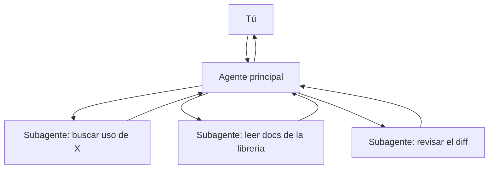

Esta forma de trabajar consiste en usar tu conversación principal con el agente como [[glosario/orquestador|orquestador]] y delegar en [[glosario/subagente|subagentes]] las tareas que generan mucho ruido: buscar en un repositorio grande, leer documentación, revisar un diff con otros ojos. Cada subagente trabaja con su propio contexto y te devuelve solo la conclusión.

## Qué es

Muchas herramientas de agentes de código y de investigación permiten lanzar subagentes: instancias con un encargo concreto, un contexto limpio y, a veces, herramientas limitadas. El patrón técnico está en [[patrones/06-orquestador-trabajadores]] y en [[roadmap/60-multiagente/02-orquestador-y-subagentes]]. Aquí va cómo usarlo cuando trabajas.

La idea es de [[disciplinas/context-engineering|context engineering]]. Si tu agente principal lee cuarenta archivos para encontrar dónde se valida un token, esos cuarenta archivos se quedan en su contexto el resto de la sesión. Si lo hace un subagente, al principal solo le llega «la validación está en `auth/middleware.py`, función `verificar_jwt`, línea 88; también se llama desde `api/ws.py`».

## Por qué importa

El contexto del agente principal es tu recurso más escaso en una sesión larga. Cuando se llena, el agente pierde detalles de lo que acordasteis al principio y trabaja peor. Delegar las búsquedas lo mantiene limpio.

También ganas tiempo con el paralelismo: tres investigaciones independientes a la vez en lugar de una detrás de otra. Anthropic describe cómo lo aplica a investigación en [How we built our multi-agent research system](https://www.anthropic.com/engineering/multi-agent-research-system) (2025), donde también señala el coste: varios agentes gastan bastantes más tokens que uno.

## Prácticas concretas

- **Delega lo que produce mucho contexto y poca conclusión.** Búsquedas, lectura de documentación, inventarios («lista todos los sitios donde se escribe en la tabla `pedidos`»).
- **Escribe el encargo como para alguien que no sabe nada.** El subagente no ha visto tu conversación. Dile el objetivo, dónde buscar, qué formato debe tener la respuesta y cuándo parar.
- **Pide un formato de vuelta corto.** «Responde con una lista de archivo:línea y una frase por cada uno. Máximo 15 entradas.» Lo trata [[roadmap/60-multiagente/03-pasar-contexto-entre-agentes]].
- **Lanza en paralelo solo lo independiente.** Si la tarea B necesita el resultado de A, van en serie.
- **Usa un subagente como revisor.** Un contexto limpio que no ha escrito el código detecta cosas que el autor da por buenas. Pásale el diff y la [[disciplinas/spec-primero|spec]], no la conversación.
- **Limita las herramientas del subagente.** Un explorador solo necesita leer. Si no puede editar, no puede romper nada.
- **No delegues la decisión.** El subagente investiga y recomienda. Tú y el agente principal decidís.

> [!aviso] Multiplicar agentes multiplica el gasto
> Cada subagente arranca con su propio contexto y lo paga. Para una búsqueda de un archivo, una llamada directa es más barata y rápida. Ver [[roadmap/60-multiagente/05-coste-de-multiplicar-agentes]].

## Señales de que lo haces mal

- Lanzas subagentes para tareas que el agente principal resolvería con una búsqueda.
- Los subagentes devuelven tres pantallas de texto y el contexto principal se llena igual.
- El subagente vuelve con algo irrelevante porque el encargo decía «mira lo de la autenticación».
- Dos subagentes editan los mismos archivos a la vez y se pisan.
- Aceptas la conclusión de un subagente sin comprobar ni una de sus referencias.
- No sabes cuánto gasta una sesión con subagentes frente a una sin ellos.

## Cómo empezar mañana

1. En tu próxima sesión larga, identifica la primera búsqueda amplia («¿dónde se usa…?», «¿cómo funciona…?») y delégala a un subagente con un formato de respuesta acotado.
2. Al terminar un cambio, lanza un subagente revisor con el diff y la spec, y pídele una lista de problemas ordenada por gravedad.
3. Compara el tamaño del contexto principal al final de la sesión con el de una sesión parecida sin subagentes.

## Para seguir

- [[roadmap/60-multiagente/01-cuando-no-usar-multiagente]]
- [[roadmap/60-multiagente/04-paralelismo]]
- [[cursos/sistemas-multiagente/02-disenar-subagentes]]
- [[radar/2026-07-14-subagentes-para-buscar]]
