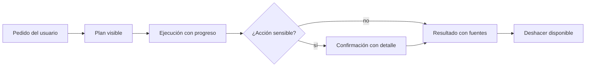

La UX de agentes es el diseño de la relación entre una persona y un sistema que actúa por ella. Un chat responde y espera. Un [[glosario/agente|agente]] trabaja varios minutos, toma decisiones y cambia cosas en el mundo. El usuario necesita saber qué está pasando, poder pararlo y confiar en lo que entrega.

## Qué es

Cinco preguntas que tu interfaz tiene que responder sin que el usuario las haga:

| Pregunta del usuario | Lo que diseñas |
|---|---|
| ¿Qué está haciendo? | **Transparencia**: pasos visibles, herramientas usadas, fuentes |
| ¿Cuánto le falta? | **Progreso**: estado, pasos completados, tiempo |
| ¿Va a hacer algo que no quiero? | **Confirmaciones** antes de lo importante |
| ¿Y si se equivoca? | **Deshacer**: revertir, borradores, papelera |
| ¿Qué puedo esperar de él? | **Expectativas**: qué sabe hacer, qué no, con qué fiabilidad |

## Por qué importa

Un agente que trabaja en silencio durante tres minutos parece colgado. Uno que actúa sin avisar da miedo, y la gente deja de usarlo o lo usa solo para cosas triviales. Uno que promete más de lo que hace pierde la confianza al primer fallo.

La fiabilidad percibida depende tanto de la interfaz como del modelo. Un agente algo menos preciso, con buenas confirmaciones y un botón de deshacer, suele ser más útil que uno que acierta un poco más pero no deja ver ni corregir nada.

## Prácticas concretas

### Transparencia

- Muestra los pasos en lenguaje humano: «Buscando pedidos de Ana López», no `crm_search({"q":...})`. Traduce cada `tool_use` a una frase.
- Enseña las fuentes. Si el agente afirma algo a partir de un documento, enlaza el fragmento ([[roadmap/30-contexto-y-rag/05-respuestas-con-citas]]).
- Separa lo que el agente **hizo** de lo que **propone**. «He encontrado 3 facturas duplicadas» frente a «Propongo anular estas 3».

### Progreso

- Empieza a mostrar algo en menos de un segundo. Con [[glosario/streaming|streaming]] el texto aparece mientras se genera ([[recetas/streaming-de-respuestas]]).
- En tareas largas, enseña un plan con casillas que se van marcando. Si el agente replanifica, que se vea.
- Permite parar en cualquier momento, y que parar sea seguro: el agente termina el paso en curso y deja el estado consistente. Si el estado vive en un *[[glosario/checkpointer|checkpointer]]*, parar también puede significar reanudar mañana donde lo dejó ([[recetas/reanudar-un-agente-tras-un-reinicio]]).

### Confirmaciones

- Pide confirmación antes de lo irreversible o lo que afecta a terceros: pagar, enviar, borrar, publicar. Ver [[disciplinas/humano-en-el-bucle]].
- Muestra **exactamente** lo que va a pasar: destinatario, importe, texto del correo. «¿Confirmas la acción?» no informa de nada.
- No pidas confirmación para todo. Si cada lectura requiere un clic, el usuario aprueba sin mirar y la confirmación deja de proteger. Anthropic midió que sus usuarios aprobaban en torno al 93 % de las peticiones de permiso de Claude Code y respondió con un *sandbox* que reduce cuántas hacen falta ([*How we contain Claude across products*](https://www.anthropic.com/engineering/how-we-contain-claude), mayo de 2026): menos preguntas, mejor elegidas.

### Deshacer

- Prefiere acciones reversibles: borradores en vez de envíos, archivar en vez de borrar, una rama en vez de un commit en `main`.
- Guarda lo necesario para revertir cada acción (estado anterior, id de la operación) y ofrece «Deshacer» durante un tiempo razonable.
- Cuando algo no se puede deshacer, dilo en la confirmación.

### Expectativas

- Di qué sabe hacer el agente y qué no, con ejemplos, en el primer contacto.
- Cuando no sabe o no puede, que lo diga y proponga una salida («No tengo acceso a facturas anteriores a 2024. ¿Te paso con contabilidad?»). Lo mismo cuando el modelo rechaza una petición (`stop_reason: "refusal"`): enséñalo como un final explicado, no como un error genérico ([[recetas/fallback-ante-rechazos]]).
- No disfraces la incertidumbre. Si una extracción tiene campos dudosos, márcalos para revisión en lugar de rellenarlos con confianza.

## Señales de que lo haces mal

- Los usuarios preguntan «¿sigue funcionando?» o recargan la página.
- Las confirmaciones dicen «¿Continuar?» sin decir qué va a pasar.
- La tasa de aprobación de confirmaciones es prácticamente del 100 % y el tiempo de decisión es de un segundo: nadie las lee.
- No hay forma de parar una tarea en marcha.
- El agente siempre responde con el mismo tono seguro, acierte o no.
- Los usuarios solo le encargan tareas que podrían hacer a mano en un minuto, porque no se fían para más.

> [!consejo] Diseña el fallo primero
> Antes de pulir el camino feliz, decide qué ve el usuario cuando una herramienta falla, cuando el agente no sabe seguir y cuando se acaba el presupuesto de pasos. Esos momentos deciden si vuelve.

## Cómo empezar mañana

1. Haz la lista de acciones de tu agente y marca cuáles son irreversibles o afectan a terceros. Esas llevan confirmación con detalle.
2. Traduce cada herramienta a una frase de progreso legible y muéstrala mientras se ejecuta.
3. Activa streaming en la respuesta final si aún no lo tienes.
4. Elige una acción irreversible y conviértela en reversible (borrador, papelera, rama).

## Para seguir

- [[sistemas/soporte-con-aprobacion-humana]]
- [[docs/agentes/03-humano-en-el-bucle]]
- [[docs/produccion/03-latencia]]
- [[sistemas/agente-de-voz]]: la UX cuando no hay pantalla.
