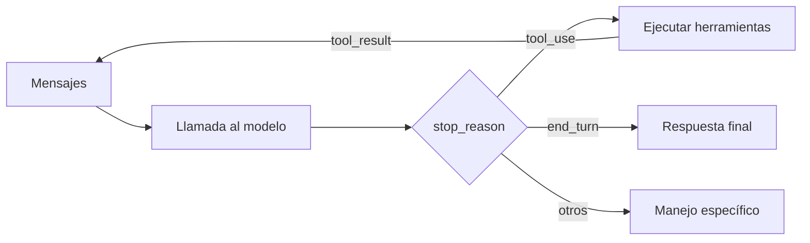

El [[glosario/bucle-agentico|bucle agéntico]] es el código que llama al modelo, ejecuta las herramientas que pide, le devuelve los resultados y repite hasta que el modelo da la tarea por terminada o salta un límite. Todo [[glosario/agente|agente]] es, por debajo, este bucle. El modelo decide qué hacer en cada paso; tu código decide cuándo parar, qué se ejecuta y con qué permisos.

## Anatomía del bucle



Cada vuelta tiene tres partes:

1. **Llamar al modelo** con el historial completo, el [[glosario/prompt-de-sistema|prompt de sistema]] y la lista de herramientas.
2. **Leer `stop_reason`**, el campo que dice por qué el modelo dejó de generar. Es la única fuente fiable para decidir el siguiente paso. No mires si hay texto o no: mira este campo.
3. **Actuar**: ejecutar herramientas y volver, devolver la respuesta, o tratar el caso especial.

El historial crece en cada vuelta. El mensaje `assistant` se añade tal cual llegó (con sus bloques `text`, `tool_use` y, si hay razonamiento, `thinking`), y después un mensaje `user` con un [[glosario/tool-result|tool_result]] por cada `tool_use`.

## Valores de stop_reason y qué hacer con cada uno

| `stop_reason` | Qué significa | Qué hace tu bucle |
|---|---|---|
| `end_turn` | El modelo terminó su turno de forma natural. | Salir del bucle y devolver el texto. |
| `tool_use` | El modelo pide ejecutar una o más herramientas. | Ejecutar cada `tool_use`, devolver todos los `tool_result` en un único mensaje `user` y volver a llamar. |
| `max_tokens` | Se alcanzó el límite de [[glosario/max-tokens|max_tokens]] a mitad de respuesta. | La respuesta está cortada. Si había un `tool_use` incompleto, no lo ejecutes. Sube el límite o pide continuar; cuenta los reintentos. |
| `stop_sequence` | Apareció una de tus `stop_sequences`. | Tratarlo como fin controlado. `resp.stop_sequence` dice cuál. |
| `pause_turn` | El servidor pausó un turno largo, típico con [[docs/herramientas/03-herramientas-del-servidor|herramientas del lado del servidor]]. | Añadir la respuesta tal cual como mensaje `assistant` y volver a llamar con las mismas `tools` para que continúe. No añadas un mensaje `user` nuevo. |
| `refusal` | El modelo se niega a continuar por motivos de seguridad. Llega con HTTP 200 y `stop_details.category` (`cyber`, `bio`, `general_harms`…). | No reintentes en bucle. Registra la categoría, devuelve un mensaje claro al usuario y termina, o pasa a un modelo de respaldo. |
| `model_context_window_exceeded` | La entrada más la salida no caben en la ventana de contexto; la respuesta se cortó al llenarla. | Compacta o recorta el historial antes de seguir: la siguiente llamada tampoco cabrá. |

Con la compactación en el servidor y `pause_after_compaction`, aparece además `compaction` (beta). El detalle de cada caso, con los rechazos y los *fallbacks*, está en [[docs/fundamentos/06-motivos-de-parada-y-rechazos]].

> [!aviso] El caso que más se olvida
> Un bucle que solo distingue `tool_use` de «lo demás» trata un `max_tokens` como respuesta final y entrega texto cortado. Maneja cada valor de forma explícita y lanza un error ante uno desconocido.

## Ejemplo completo

Un agente mínimo con una herramienta, límite de pasos y manejo de todos los `stop_reason`:

```python tab="Python" title="agente.py"
import anthropic

MODEL = "claude-sonnet-5-5"
MAX_PASOS = 10
client = anthropic.Anthropic()

TOOLS = [{
    "name": "buscar_docs",
    "description": "Busca en la documentación interna. Devuelve hasta 5 fragmentos con su título.",
    "input_schema": {
        "type": "object",
        "properties": {"consulta": {"type": "string", "description": "Términos de búsqueda"}},
        "required": ["consulta"],
    },
}]

def buscar_docs(consulta: str) -> str:
    return f"Sin resultados para «{consulta}»"  # sustituye por tu buscador

HERRAMIENTAS = {"buscar_docs": buscar_docs}

def ejecutar(bloque) -> dict:
    try:
        salida = HERRAMIENTAS[bloque.name](**bloque.input)
        return {"type": "tool_result", "tool_use_id": bloque.id, "content": salida}
    except Exception as e:  # el error vuelve al modelo, no rompe el bucle
        return {"type": "tool_result", "tool_use_id": bloque.id,
                "content": f"Error: {e}", "is_error": True}

def agente(pregunta: str) -> str:
    mensajes = [{"role": "user", "content": pregunta}]
    for _ in range(MAX_PASOS):
        resp = client.messages.create(
            model=MODEL, max_tokens=2048, tools=TOOLS, messages=mensajes,
            system="Responde con la documentación interna. Si no encuentras nada, dilo.",
        )
        mensajes.append({"role": "assistant", "content": resp.content})

        if resp.stop_reason == "end_turn" or resp.stop_reason == "stop_sequence":
            return "".join(b.text for b in resp.content if b.type == "text")
        if resp.stop_reason == "tool_use":
            resultados = [ejecutar(b) for b in resp.content if b.type == "tool_use"]
            mensajes.append({"role": "user", "content": resultados})
        elif resp.stop_reason == "pause_turn":
            continue  # el historial ya tiene la respuesta: se vuelve a llamar
        elif resp.stop_reason == "max_tokens":
            raise RuntimeError("Respuesta cortada: sube max_tokens o divide la tarea")
        elif resp.stop_reason == "refusal":
            return "No puedo ayudar con esta petición."
        elif resp.stop_reason == "model_context_window_exceeded":
            raise RuntimeError("Contexto lleno: compacta o recorta el historial")
        else:
            raise RuntimeError(f"stop_reason desconocido: {resp.stop_reason}")
    raise RuntimeError(f"Sin terminar tras {MAX_PASOS} pasos")
```

```ts tab="TypeScript" title="agente.ts"
import Anthropic from "@anthropic-ai/sdk";

const MODEL = "claude-sonnet-5-5";
const MAX_PASOS = 10;
const client = new Anthropic();

const tools: Anthropic.Tool[] = [{
  name: "buscar_docs",
  description: "Busca en la documentación interna. Devuelve hasta 5 fragmentos con su título.",
  input_schema: {
    type: "object",
    properties: { consulta: { type: "string", description: "Términos de búsqueda" } },
    required: ["consulta"],
  },
}];

async function buscarDocs(input: { consulta: string }): Promise<string> {
  return `Sin resultados para «${input.consulta}»`; // sustituye por tu buscador
}

async function ejecutar(b: Anthropic.ToolUseBlock): Promise<Anthropic.ToolResultBlockParam> {
  try {
    const salida = await buscarDocs(b.input as { consulta: string });
    return { type: "tool_result", tool_use_id: b.id, content: salida };
  } catch (e) {
    return { type: "tool_result", tool_use_id: b.id, content: `Error: ${e}`, is_error: true };
  }
}

export async function agente(pregunta: string): Promise<string> {
  const messages: Anthropic.MessageParam[] = [{ role: "user", content: pregunta }];
  for (let paso = 0; paso < MAX_PASOS; paso++) {
    const resp = await client.messages.create({ model: MODEL, max_tokens: 2048, tools, messages });
    messages.push({ role: "assistant", content: resp.content });

    switch (resp.stop_reason) {
      case "end_turn":
      case "stop_sequence":
        return resp.content.flatMap((b) => (b.type === "text" ? [b.text] : [])).join("");
      case "tool_use": {
        const usos = resp.content.filter((b): b is Anthropic.ToolUseBlock => b.type === "tool_use");
        messages.push({ role: "user", content: await Promise.all(usos.map(ejecutar)) });
        break;
      }
      case "pause_turn":
        break; // volver a llamar con el mismo historial
      case "max_tokens":
        throw new Error("Respuesta cortada: sube max_tokens o divide la tarea");
      case "refusal":
        return "No puedo ayudar con esta petición.";
      case "model_context_window_exceeded":
        throw new Error("Contexto lleno: compacta o recorta el historial");
      default:
        throw new Error(`stop_reason desconocido: ${resp.stop_reason}`);
    }
  }
  throw new Error(`Sin terminar tras ${MAX_PASOS} pasos`);
}
```

Fíjate en tres detalles. Los resultados de herramienta van todos en el mismo mensaje `user`, uno por cada `tool_use` y con su `tool_use_id`. Los errores de la herramienta se devuelven al modelo con `is_error` para que pueda corregir, en vez de lanzar una excepción que mata al agente. Y el límite de pasos convierte un bucle infinito en un error que puedes ver.

## Herramientas en paralelo

En una sola respuesta el modelo puede pedir varias herramientas. Puedes ejecutarlas a la vez (el ejemplo en TypeScript usa `Promise.all`) siempre que sean independientes. Si el orden importa o una herramienta tiene efectos secundarios, ejecútalas en secuencia o desactiva el paralelismo con `disable_parallel_tool_use` dentro de [[glosario/tool-choice|tool_choice]]. En cualquier caso, devuelve **todos** los resultados juntos y antes de cualquier texto tuyo.

## Límites que todo bucle necesita

Un agente sin límites puede gastar sin parar. Pon al menos estos:

| Límite | Para qué | Valor de partida |
|---|---|---|
| Pasos máximos | Cortar bucles en los que el modelo no avanza. | Entre 10 y 30 según la tarea; mide y ajusta. |
| Tokens acumulados | Poner techo al gasto de una tarea. | Suma en cada vuelta `usage.input_tokens`, `usage.output_tokens` y los dos campos de caché (`cache_creation_input_tokens`, `cache_read_input_tokens`). Si quieres que el modelo sepa cuánto le queda, añade `output_config.task_budget` (beta, orientativo: no corta nada). |
| Tiempo total | Evitar tareas colgadas. | El que tolere tu usuario. |
| Errores seguidos | Parar si la misma herramienta falla una y otra vez. | 3 errores consecutivos. |

Cuando salte un límite, no tires el trabajo: devuelve lo conseguido hasta entonces y deja claro que la tarea quedó a medias. La lección [[roadmap/40-primer-agente/03-condiciones-de-parada]] desarrolla cómo elegir estos valores, y [[problemas/el-agente-no-para]] cubre el caso en que no saltan.

Para que el agente entregue un resultado estructurado al final, no fuerces una herramienta `entregar` con `tool_choice`: en Opus 5.5, Sonnet 5.5 y Fable 5.1 da 400. Haz la última llamada con `output_config.format` ([[recetas/entregar-resultado-sin-forzar-herramienta]]).

## Razonamiento dentro del bucle

En los modelos 5.x el razonamiento es adaptativo aunque no lo pidas, así que la respuesta puede traer bloques `thinking` (vacíos por defecto, con su firma) antes de los `tool_use`. Añade `resp.content` completo al historial, sin filtrar ni editar esos bloques: el modelo los necesita para seguir su propio hilo entre una herramienta y la siguiente. El detalle está en [[docs/prompting/04-razonamiento]].

## Con LangGraph

El mismo bucle como grafo de LangGraph (MIT): un nodo que llama al modelo, un nodo que ejecuta herramientas y una arista condicional que decide si se vuelve al modelo o se termina.

```python title="agente_lg.py"
from langchain.chat_models import init_chat_model
from langchain.messages import SystemMessage
from langchain.tools import tool
from langgraph.graph import END, START, MessagesState, StateGraph
from langgraph.prebuilt import ToolNode, tools_condition

MODEL = "anthropic:claude-sonnet-5-5"
MAX_PASOS = 10

@tool
def buscar_docs(consulta: str) -> str:
    """Busca en la documentación interna. Devuelve hasta 5 fragmentos con su título."""
    return f"Sin resultados para «{consulta}»"  # sustituye por tu buscador

TOOLS = [buscar_docs]
SYSTEM = SystemMessage("Responde con la documentación interna. Si no encuentras nada, dilo.")
llm = init_chat_model(MODEL, max_tokens=2048).bind_tools(TOOLS)

def modelo(state: MessagesState):
    return {"messages": [llm.invoke([SYSTEM, *state["messages"]])]}

g = StateGraph(MessagesState)
g.add_node("modelo", modelo)
g.add_node("tools", ToolNode(TOOLS))
g.add_edge(START, "modelo")
g.add_conditional_edges("modelo", tools_condition)  # ¿hay tool_calls? → "tools"; si no → END
g.add_edge("tools", "modelo")
agente = g.compile()

salida = agente.invoke(
    {"messages": [("user", "¿Cómo se configura el SSO?")]},
    config={"recursion_limit": 2 * MAX_PASOS + 1},  # cada vuelta son dos pasos del grafo
)
print(salida["messages"][-1].text)
```

Lo que esconde el framework: la conversión de bloques (`tool_use` pasa a ser `AIMessage.tool_calls` y `tool_result` un `ToolMessage`), el reparto de resultados y el historial. Lo que **no** hace por ti: tratar cada `stop_reason` (`tools_condition` solo mira si hay `tool_calls`; un corte por `max_tokens` termina el grafo como si fuera una respuesta, así que revisa `response_metadata["stop_reason"]`), poner un límite útil (el `recursion_limit` por defecto es muy alto; al superarlo lanza `GraphRecursionError`) y devolver los errores al modelo (el `ToolNode` solo captura los de argumentos inválidos). A cambio te da *checkpointer*, interrupciones y *streaming*. La versión de alto nivel es `create_agent` de LangChain ([[docs/herramientas/01-uso-de-herramientas]]); referencia completa en [[docs/frameworks/05-langgraph]] y comparativa en [[docs/frameworks/01-elegir-framework]].

## Errores frecuentes

- **Olvidar un `tool_result`**. Si el modelo pidió tres herramientas y devuelves dos, la API rechaza la petición. Uno por cada `tool_use`, siempre.
- **Mezclar texto antes de los resultados**. En el mensaje `user` de respuesta, los `tool_result` van primero.
- **Reconstruir el mensaje `assistant` a mano**. Cópialo entero de `resp.content`; si eliminas bloques, rompes la correlación de IDs.
- **No registrar nada**. Sin trazas no sabrás por qué el agente dio veinte vueltas. Mira [[docs/produccion/01-observabilidad]].
- **Dar herramientas de escritura sin control**. Antes de borrar, pagar o enviar, aplica [[docs/agentes/03-humano-en-el-bucle]].

## Ver también

- [[docs/herramientas/01-uso-de-herramientas]]: el ciclo `tool_use` → `tool_result` en detalle.
- [[docs/agentes/02-subagentes]]: cuando un bucle no basta.
- [[patrones/08-agente-autonomo]]: el patrón y cuándo usarlo.
- [[roadmap/40-primer-agente/06-depurar-con-trazas]]: cómo leer lo que hizo tu agente.
- [[docs/frameworks/03-claude-agent-sdk]]: el bucle de Claude Code como biblioteca, ya hecho.
- [[docs/agentes/04-managed-agents]]: el bucle alojado por Anthropic.
