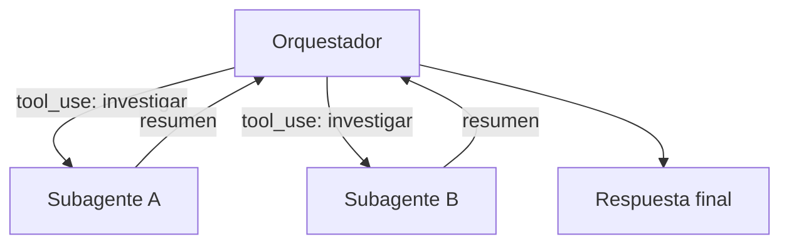

Un [[glosario/subagente|subagente]] es un agente que otro agente lanza para resolver una parte de la tarea. Tiene su propio [[glosario/prompt-de-sistema|prompt de sistema]], sus propias herramientas y, sobre todo, **su propia [[glosario/ventana-de-contexto|ventana de contexto]]**. Trabaja, y devuelve al agente principal (el [[glosario/orquestador|orquestador]]) solo un resumen del resultado.

## Para qué sirve

El motivo principal es el contexto. Un agente que investiga lee muchas páginas, prueba búsquedas que no llevan a nada y acumula resultados intermedios. Todo eso ocupa contexto y distrae al modelo en los pasos siguientes. Si delegas cada línea de investigación en un subagente, el orquestador recibe una síntesis limpia y su contexto se mantiene corto.

Hay tres casos en los que encaja bien:

- **Subtareas independientes que pueden ir en paralelo.** Investigar cinco proveedores, revisar diez archivos, buscar en tres fuentes. Cada subagente trabaja por su lado y el tiempo total se acerca al de la subtarea más lenta.
- **Exploración ruidosa.** Búsquedas con muchos callejones sin salida, donde solo importa la conclusión.
- **Especialización.** Un subagente con herramientas y prompt muy concretos (por ejemplo, solo lectura de la base de datos) en lugar de un agente con veinte herramientas.

Anthropic describe este diseño en [How we built our multi-agent research system](https://www.anthropic.com/engineering/multi-agent-research-system) (2025): un agente principal planifica, lanza subagentes de búsqueda en paralelo y sintetiza.

## Cómo se implementa

La forma más simple: el subagente es **una herramienta más** del orquestador. Cuando el orquestador la llama, tu código ejecuta un bucle agéntico completo con otro prompt y otras herramientas, y devuelve su respuesta final como `tool_result`.



```python tab="Python" title="subagentes.py"
import anthropic
from concurrent.futures import ThreadPoolExecutor

MODEL = "claude-sonnet-5-5"
client = anthropic.Anthropic()

PROMPT_SUBAGENTE = """Investigas una sola pregunta concreta.
Usa las herramientas que tienes. Cuando termines, responde con:
- Conclusión en 3–5 frases.
- Fuentes consultadas (una por línea).
- Lo que no pudiste confirmar.
No incluyas resultados intermedios."""

TOOLS_BUSQUEDA: list = []        # definiciones de las herramientas del subagente
FUNCIONES_BUSQUEDA: dict = {}    # nombre -> función de Python

def bucle(system: str, tools: list, funciones: dict, tarea: str, max_pasos: int = 8) -> str:
    """Bucle agéntico compacto (versión completa en docs/agentes/01-el-bucle-agentico)."""
    mensajes = [{"role": "user", "content": tarea}]
    for _ in range(max_pasos):
        resp = client.messages.create(model=MODEL, max_tokens=2048, system=system,
                                      tools=tools, messages=mensajes)
        mensajes.append({"role": "assistant", "content": resp.content})
        if resp.stop_reason == "end_turn":
            return "".join(b.text for b in resp.content if b.type == "text")
        if resp.stop_reason == "pause_turn":
            continue
        if resp.stop_reason != "tool_use":
            raise RuntimeError(f"El subagente paró con {resp.stop_reason}")
        mensajes.append({"role": "user", "content": [
            {"type": "tool_result", "tool_use_id": b.id, "content": str(funciones[b.name](**b.input))}
            for b in resp.content if b.type == "tool_use"
        ]})
    raise RuntimeError("El subagente agotó sus pasos")

TOOL_INVESTIGAR = {
    "name": "investigar",
    "description": ("Lanza un subagente que investiga UNA pregunta acotada y devuelve "
                    "una conclusión con fuentes. Úsala para preguntas independientes entre sí. "
                    "Describe la pregunta con todo el contexto necesario: el subagente no ve esta conversación."),
    "input_schema": {
        "type": "object",
        "properties": {"pregunta": {"type": "string"}},
        "required": ["pregunta"],
    },
}

def ejecutar_investigaciones(bloques) -> list[dict]:
    """Ejecuta en paralelo todos los tool_use 'investigar' de una respuesta."""
    def uno(b):
        try:
            texto = bucle(PROMPT_SUBAGENTE, TOOLS_BUSQUEDA, FUNCIONES_BUSQUEDA, b.input["pregunta"])
            return {"type": "tool_result", "tool_use_id": b.id, "content": texto}
        except Exception as e:
            return {"type": "tool_result", "tool_use_id": b.id,
                    "content": f"El subagente falló: {e}", "is_error": True}
    with ThreadPoolExecutor(max_workers=5) as pool:
        return list(pool.map(uno, bloques))
```

En el bucle del orquestador, cuando `stop_reason` es `tool_use`, pasas los bloques `investigar` a `ejecutar_investigaciones` y devuelves la lista entera en un único mensaje `user`.

Tres decisiones de diseño se ven en el código:

1. **La descripción de la herramienta dice que el subagente no ve la conversación.** Es el fallo más común: el orquestador delega «investiga lo anterior» y el subagente no sabe qué es «lo anterior». Obliga a que cada encargo sea autocontenido.
2. **El subagente tiene un formato de salida fijo.** El orquestador recibe siempre lo mismo y le cuesta menos combinar resultados.
3. **Los fallos vuelven como `is_error`.** Un subagente caído no tumba al orquestador; este decide si reintenta o sigue sin ese dato.

## Qué pasar al subagente

El encargo es el único contexto que tendrá. Incluye:

| Elemento | Ejemplo |
|---|---|
| Objetivo concreto | «Averigua si la librería X admite exportar a Parquet.» |
| Por qué se pide | «Lo usaremos para elegir entre X e Y.» |
| Límites | «Solo documentación oficial; máximo 5 búsquedas.» |
| Formato de vuelta | El que fija su prompt de sistema. |

La lección [[roadmap/60-multiagente/03-pasar-contexto-entre-agentes]] trata este traspaso con más detalle.

## Coste y riesgos

> [!aviso] Multiplicar agentes multiplica tokens
> Cada subagente repite prompt de sistema, definiciones de herramientas y su propio historial. Un sistema con subagentes consume bastante más tokens que un agente único para la misma pregunta. Mide antes de adoptarlo: [[roadmap/60-multiagente/05-coste-de-multiplicar-agentes]].

Otros riesgos:

- **Trabajo duplicado.** Dos subagentes investigan lo mismo porque los encargos se solapan. Pide al orquestador que planifique la división antes de lanzar.
- **Errores que se esconden.** El resumen del subagente puede sonar seguro aunque no encontrara nada. Por eso el formato pide «lo que no pudiste confirmar».
- **Depuración más difícil.** Necesitas trazas enlazadas: cada subagente con un identificador que apunte a la llamada del orquestador. Ver [[docs/produccion/01-observabilidad]].
- **Límites de tasa.** Lanzar muchos subagentes a la vez puede provocar errores 429. Limita la concurrencia (el `max_workers` del ejemplo) y aplica reintentos: [[docs/produccion/02-costes-y-limites]].

## Cuándo no usar subagentes

Si las subtareas dependen unas de otras, si todas necesitan el mismo contexto compartido o si la tarea cabe con holgura en un solo agente, un subagente añade coste y puntos de fallo sin ganar nada. Empieza con un único bucle y divide solo cuando veas el contexto saturado o un cuello de botella claro. [[roadmap/60-multiagente/01-cuando-no-usar-multiagente]] repasa las señales.

## Ver también

- [[patrones/06-orquestador-trabajadores]]: el patrón general.
- [[cursos/sistemas-multiagente/02-disenar-subagentes]]: diseño detallado de subagentes.
- [[sistemas/investigacion-multiagente]]: un sistema completo con esta arquitectura.
- [[disciplinas/orquestador-y-subagentes]]: cómo trabajar así en el día a día.
