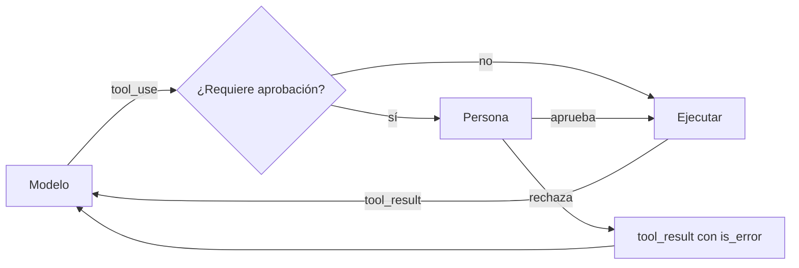

**[[glosario/humano-en-el-bucle|Humano en el bucle]]** es el diseño en el que el agente se detiene en ciertos puntos y espera a que una persona apruebe, corrija o rechace lo que va a hacer. Se usa para las acciones con consecuencias: mover dinero, enviar mensajes en nombre de alguien, borrar datos, cambiar permisos. El modelo propone; la persona decide.

## Dónde poner los puntos de aprobación

No todo necesita aprobación. Si pides permiso para cada búsqueda, el usuario aprobará sin leer y el control desaparece. Clasifica cada herramienta por su riesgo:

| Tipo de acción | Ejemplos | Política |
|---|---|---|
| Lectura | buscar pedidos, leer documentación, consultar el tiempo | Ejecutar sin preguntar. |
| Escritura reversible | crear un borrador, añadir una etiqueta, abrir una propuesta de cambio | Ejecutar y registrar; mostrar al usuario lo hecho. |
| Escritura con impacto | enviar un correo a un cliente, modificar un pedido | Pedir aprobación mostrando el contenido exacto. |
| Irreversible o con dinero | reembolsar, pagar, borrar, desplegar | Aprobación obligatoria, idealmente con un segundo control. |

La política vive en tu código, asociada a cada herramienta. No la dejes en el prompt («pide permiso antes de reembolsar»): el modelo puede saltársela por error o porque un texto inyectado se lo pida. Ver [[docs/seguridad/02-permisos-y-minimo-privilegio]].

## Cómo encaja en el bucle

La aprobación se coloca entre el `tool_use` del modelo y la ejecución real.



Cuando la persona rechaza, **no cortes el bucle sin más**. Devuelve un `tool_result` con `is_error: True` y el motivo. El modelo lo lee y puede proponer otra cosa, preguntar al usuario o terminar explicando que no se hizo.

```python tab="Python" title="aprobacion.py"
REQUIERE_APROBACION = {"reembolsar", "enviar_correo"}  # la política vive en el código

def pedir_aprobacion(nombre: str, args: dict) -> tuple[bool, str]:
    """En consola. En una web, esto es un botón y el bucle espera (ver más abajo)."""
    print(f"\nEl agente quiere ejecutar {nombre} con:\n{args}")
    r = input("¿Aprobar? [s/N] o escribe un motivo de rechazo: ").strip()
    return (True, "") if r.lower() == "s" else (False, r or "Sin motivo")

def ejecutar_con_control(bloque, funciones: dict) -> dict:
    if bloque.name in REQUIERE_APROBACION:
        ok, motivo = pedir_aprobacion(bloque.name, bloque.input)
        if not ok:
            return {"type": "tool_result", "tool_use_id": bloque.id, "is_error": True,
                    "content": f"La persona rechazó la acción. Motivo: {motivo}. "
                               "No la reintentes sin preguntar antes al usuario."}
    try:
        salida = funciones[bloque.name](**bloque.input)
        return {"type": "tool_result", "tool_use_id": bloque.id, "content": str(salida)}
    except Exception as e:
        return {"type": "tool_result", "tool_use_id": bloque.id,
                "content": f"Error: {e}", "is_error": True}
```

```ts tab="TypeScript" title="aprobacion.ts"
import Anthropic from "@anthropic-ai/sdk";

const REQUIERE_APROBACION = new Set(["reembolsar", "enviar_correo"]);
type Aprobador = (nombre: string, args: unknown) => Promise<{ ok: boolean; motivo?: string }>;
type Funciones = Record<string, (args: any) => Promise<unknown>>;

export async function ejecutarConControl(
  b: Anthropic.ToolUseBlock, funciones: Funciones, aprobar: Aprobador,
): Promise<Anthropic.ToolResultBlockParam> {
  if (REQUIERE_APROBACION.has(b.name)) {
    const { ok, motivo } = await aprobar(b.name, b.input);
    if (!ok) {
      return { type: "tool_result", tool_use_id: b.id, is_error: true,
        content: `La persona rechazó la acción. Motivo: ${motivo ?? "sin motivo"}. ` +
                 "No la reintentes sin preguntar antes al usuario." };
    }
  }
  try {
    const salida = await funciones[b.name](b.input);
    return { type: "tool_result", tool_use_id: b.id, content: String(salida) };
  } catch (e) {
    return { type: "tool_result", tool_use_id: b.id, content: `Error: ${e}`, is_error: true };
  }
}
```

Si el modelo pidió varias herramientas en la misma respuesta y solo una necesita aprobación, ejecuta las demás y devuelve todos los resultados juntos cuando la persona haya decidido. La regla de un `tool_result` por cada `tool_use` no cambia.

## Aprobaciones que tardan: guardar el estado

En consola, `input()` bloquea y ya está. En una aplicación real la persona puede tardar minutos u horas, y no puedes tener un proceso esperando. La solución es tratar el bucle como una máquina de estados que se puede guardar:

1. Al llegar a un `tool_use` que requiere aprobación, guarda en tu base de datos el historial de mensajes completo, los `tool_use` pendientes y los resultados ya calculados.
2. Termina la petición y notifica a la persona (interfaz, correo, Slack).
3. Cuando decida, carga el estado, construye los `tool_result` que faltan y continúa el bucle con una llamada nueva.

El historial de mensajes es todo el estado que necesita el modelo. Si lo guardas íntegro (incluidos los bloques `thinking`, que en los modelos 5.x aparecen aunque no pidas razonamiento), retomar horas después funciona igual que seguir en el momento.

## Con LangChain y LangGraph

En los frameworks, la pausa y el estado guardado vienen hechos. `HumanInTheLoopMiddleware` de LangChain pausa el agente antes de las herramientas que elijas; por debajo es un `interrupt()` de LangGraph, así que necesita un *checkpointer* y un `thread_id`, y se reanuda con `Command(resume=…)`:

```python title="aprobacion_lc.py"
from langchain.agents import create_agent
from langchain.agents.middleware import HumanInTheLoopMiddleware
from langchain.chat_models import init_chat_model
from langchain.tools import tool
from langgraph.checkpoint.memory import InMemorySaver  # en producción: SqliteSaver o PostgresSaver
from langgraph.types import Command

MODEL = "anthropic:claude-sonnet-5-5"

@tool
def reembolsar(pedido_id: str, importe_eur: float) -> str:
    """Emite un reembolso. Acción irreversible."""
    return f"Reembolso de {importe_eur} € emitido para {pedido_id}."

agente = create_agent(
    init_chat_model(MODEL, max_tokens=2048),
    tools=[reembolsar],
    middleware=[HumanInTheLoopMiddleware(
        interrupt_on={"reembolsar": {"allowed_decisions": ["approve", "edit", "reject"]}},
    )],
    checkpointer=InMemorySaver(),
)
config = {"configurable": {"thread_id": "ticket-123"}}  # el mismo para pausar y reanudar
salida = agente.invoke({"messages": [("user", "Devolvedme el pedido P-1001, llegó roto.")]}, config, version="v2")

while salida.interrupts:  # en pausa: aquí iría tu interfaz
    peticion = salida.interrupts[0].value
    decisiones = [{"type": "reject", "message": "El supervisor no aprueba este reembolso."}
                  for _ in peticion["action_requests"]]  # una decisión por acción, en orden
    salida = agente.invoke(Command(resume={"decisions": decisiones}), config, version="v2")
print(salida.value["messages"][-1].text)
```

Un rechazo vuelve al modelo como un `ToolMessage` de error, igual que el `is_error` del código a mano; `edit` ejecuta los argumentos editados. Con `SqliteSaver` o `PostgresSaver`, el proceso puede terminar y la reanudación llegar horas después desde otro. Si escribes el grafo tú, el mismo control es un nodo que llama a `interrupt()` antes del nodo de herramientas; ojo: al reanudar, ese nodo **se ejecuta otra vez desde el principio**, así que lo anterior al `interrupt` debe ser idempotente. Recetas: [[recetas/aprobacion-humana-con-langgraph]] y [[problemas/langgraph-no-reanuda-tras-interrupt]]; lección: [[cursos/langchain-y-langgraph/07-humano-en-el-bucle-con-interrupt]]. En Pydantic AI el equivalente es `requires_approval=True` con `DeferredToolRequests`, y en el OpenAI Agents SDK, `needs_approval=True`. En Claude Code, los permisos `ask` y los hooks `PreToolUse` cumplen este papel: [[docs/claude-code/06-permisos-y-sandbox]].

> [!peligro] Aprueba lo que se ejecuta, no lo que se describe
> Muestra a la persona los argumentos exactos del `tool_use` (importe, destinatario, texto del correo) y ejecuta esos mismos argumentos. Si enseñas un resumen escrito por el modelo, la persona aprueba la descripción y tu código ejecuta otra cosa.

## Diseñar la pantalla de aprobación

La calidad de la aprobación depende de lo que ve la persona:

- **Qué se va a hacer**, con los datos exactos y en lenguaje claro.
- **Por qué**: el razonamiento breve del agente o el mensaje del usuario que lo motivó.
- **Qué pasa si aprueba** y si la acción se puede deshacer.
- **Tres salidas**: aprobar, rechazar con motivo y editar los argumentos antes de aprobar.

Si la persona edita los argumentos, ejecuta los editados y díselo al modelo en el `tool_result` («Se ejecutó con importe 40 € en lugar de 60 €»). Si no, el modelo seguirá razonando con datos falsos. Más ideas de diseño en [[disciplinas/ux-de-agentes]].

## Errores frecuentes

- **Fatiga de aprobación**: pedir permiso para todo. La gente acaba pulsando «sí» sin mirar. Reserva la aprobación para lo irreversible y acota el resto con permisos y *sandbox*.
- **Política en el prompt**: el control debe estar en el código que ejecuta la herramienta.
- **Rechazo silencioso**: cortar el bucle sin devolver `tool_result`. El historial queda inválido y no puedes continuar.
- **No registrar quién aprobó**: guarda persona, momento y argumentos aprobados. Lo necesitarás para auditar.

## Ver también

- [[recetas/aprobacion-humana-antes-de-actuar]]: la receta paso a paso.
- [[sistemas/soporte-con-aprobacion-humana]]: un sistema completo con aprobaciones.
- [[disciplinas/humano-en-el-bucle]]: la forma de trabajar.
- [[docs/agentes/01-el-bucle-agentico]]: el bucle sobre el que se monta todo esto.
- [[recetas/puerta-humana-con-comandos]] y [[glosario/puerta-humana]]: una sola aprobación en un flujo con especificación.
