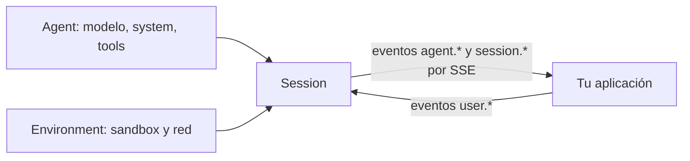

**Claude Managed Agents** es el *[[glosario/harness|harness]]* alojado de Anthropic: un agente ya construido y configurable que **corre en la infraestructura de Anthropic**, con su bucle, sus herramientas y su *[[glosario/sandbox|sandbox]]*. Tú no escribes el [[glosario/bucle-agentico|bucle agéntico]]: defines un agente (modelo, instrucciones, herramientas), un entorno donde ejecuta, abres una sesión y hablas con ella por eventos. Encaja con tareas largas y asíncronas en las que no quieres mantener tu propio bucle, *sandbox* ni capa de ejecución.

Está en **beta** desde el 8 abr. 2026 (cabecera `managed-agents-2026-04-01`, que el SDK pone solo). El aviso corto está en [[radar/2026-10-29-harness-alojado-managed-agents]].

## Cuándo usarlo

La [documentación del Agent SDK](https://code.claude.com/docs/en/agent-sdk) compara cuatro formas de construir con Claude. Aquí van ordenadas de más control a menos trabajo (el orden y la columna «Quién ejecuta el bucle» son de esta página):

| Opción | Quién ejecuta el bucle | Úsala cuando |
|---|---|---|
| API de Mensajes (SDK cliente) | Tu código | Quieres control total del bucle, del contexto y de cada herramienta ([[docs/agentes/01-el-bucle-agentico]]) |
| [[docs/frameworks/03-claude-agent-sdk\|Claude Agent SDK]] | Tu proceso, con el bucle de Claude Code | Quieres el harness de Claude Code (archivos, bash, hooks, subagentes) dentro de tu aplicación |
| Claude Code (CLI) | Tu máquina | Uso interactivo de un agente de código |
| **Managed Agents** | **Anthropic**, en su *sandbox* o en uno tuyo | No quieres operar ejecución ni *sandbox*; tareas largas, asíncronas o programadas |

Lo que ganas: no mantienes contenedores, colas ni reintentos, y tienes memoria, despliegues programados y multiagente hechos. Lo que pierdes: control fino del contexto, portabilidad a otros proveedores y algunas funciones de la API (abajo). Si tu agente es un [[glosario/workflow|workflow]] de tres pasos, no necesitas nada de esto ([[patrones/01-workflows-vs-agentes]]).

## Las cuatro piezas



| Pieza | Qué es | Recurso del SDK |
|---|---|---|
| **Agent** | Modelo, prompt de sistema, herramientas, servidores MCP y *skills*. Versionado | `client.beta.agents` |
| **Environment** | El *sandbox*: en la nube (`cloud`) o autoalojado (`self_hosted`). Red `unrestricted` o `limited` con `allowed_hosts` (y, aparte, `allow_package_managers` para PyPI o npm y `allow_mcp_servers`) | `client.beta.environments` |
| **Session** | Una instancia en ejecución de un agente en un entorno | `client.beta.sessions` |
| **Events** | Lo que envías y recibes, por SSE | `client.beta.sessions.events` (`send`, `stream`, `list`) |

**Eventos que envías:** `user.message`, `user.interrupt`, `user.tool_confirmation`, `user.tool_result`, `user.custom_tool_result`, `user.define_outcome` y `system.message` (el equivalente al [[docs/contexto/06-mensajes-de-sistema-a-mitad-de-conversacion|mensaje de sistema intermedio]]).

**Eventos que recibes**, entre otros: `agent.message`, `agent.thinking`, `agent.tool_use`, `agent.tool_result`, `agent.mcp_tool_use`, `session.status_running` y **`session.status_idle`**, que lleva un `stop_reason` con uno de estos tipos (según los tipos del SDK 2.3.0): `end_turn`, `requires_action` (con los `event_ids` que esperan respuesta), `budget_reached`, `refusal` y `retries_exhausted`. Es el equivalente al [[docs/fundamentos/06-motivos-de-parada-y-rechazos|motivo de parada]] de la API.

## Herramientas y permisos

Las herramientas integradas llegan en un único *[[glosario/toolset|toolset]]*:

```json
{"type": "agent_toolset_20260401",
 "default_config": {"permission_policy": {"type": "always_allow"}},
 "configs": [{"name": "bash", "permission_policy": {"type": "always_ask"}}]}
```

Incluye `bash`, `read`, `write`, `edit`, `glob`, `grep`, `web_fetch` y `web_search`. `default_config` y cada entrada de `configs` aceptan `enabled` y `permission_policy`:

| Política | Qué pasa |
|---|---|
| `always_allow` | Se ejecuta sin preguntar |
| `always_ask` | La sesión se queda en `session.status_idle` con `requires_action`; respondes con `user.tool_confirmation` (`allow` o `deny`, con `deny_message` opcional) |
| `auto` | Un clasificador decide (desde el 10 sep. 2026) |

Además puedes declarar herramientas propias (`type: custom`; sus nombres no pueden empezar por `mcp__` ni `ant__`), que tu aplicación ejecuta y devuelve con `user.custom_tool_result`, y servidores MCP con el [[docs/herramientas/07-mcp-desde-la-api|conector MCP]]; las credenciales OAuth se guardan en *vaults* (`client.beta.vaults`). El *advisor* y el multiagente van en el bloque `multiagent` del agente. Los *toolsets* de uso del ordenador y del navegador **no** están disponibles.

> [!peligro] El sandbox es suyo, las consecuencias son tuyas
> Un agente con `bash` y red abierta puede descargar y ejecutar lo que lea. Usa red `limited` con la lista mínima de `allowed_hosts`, `always_ask` para lo que escribe fuera del *sandbox* y nada de credenciales que no necesite. Una lista blanca de dominios también es una capacidad: [[docs/seguridad/02-permisos-y-minimo-privilegio]].

## Memoria, dreams y despliegues

- **Memoria** (23 abr. 2026, beta `agent-memory-2026-07-22`): almacenes de memoria (`client.beta.memory_stores`) que el agente lee y escribe entre sesiones. Conceptos en [[docs/contexto/04-memoria]].
- **Dreams** (vista previa de investigación, `dreaming-2026-04-21`): un trabajo asíncrono que revisa un almacén de memoria junto con 1 a 100 transcripciones, fusiona duplicados, sustituye lo obsoleto y produce **un almacén nuevo sin tocar el original**. Así puedes comparar y decidir si lo adoptas.
- **Despliegues programados** (9 jun. 2026): `deployments` y `deployment_runs` lanzan sesiones con un cron.
- **Otras funciones de 2026**: multiagente y *outcomes* (`user.define_outcome`, 6 may.), *sandboxes* autoalojados (19 may.), *skills* cargadas desde GitHub, `inference_geo`, *workflows* dinámicos (beta `multiagent_20261001`, 9 oct.) y restricciones de dominio para la web.
- **Creación declarativa**: `ant apply agente.md entorno.yaml`. El agente es un Markdown con frontmatter (`name`, `model`, `tools`) y el prompt en el cuerpo; el CLI guarda los IDs en `claude-lock.json`, que conviene versionar.

## Presupuesto y precio

Cada sesión admite un tope de gasto (desde el 7 ago. 2026):

```json
{"budget": {"type": "limit", "max_list_cost": {"amount": "125", "currency": "USD"}}}
```

Al alcanzarlo, la sesión se detiene con `stop_reason` de tipo `budget_reached`.

**Precio** (según la [página de precios](https://platform.claude.com/docs/en/about-claude/pricing), consultada el 29 oct. 2026): **$0,08 por hora de sesión**, medida al milisegundo y solo mientras la sesión está en `running`, **más los tokens** a la tarifa normal del modelo, sin descuento de Batch. Una sesión parada esperando tu confirmación no suma horas, pero cada vuelta del agente sí gasta tokens, así que mide las dos partes. Compruébalo antes de presupuestar, porque cambia.

## Ejemplo completo

Primero, el ejemplo mínimo de la documentación (no ejecutado aquí: necesita cuenta con acceso a la beta):

```python nocheck title="sesion_minima.py"
session = client.beta.sessions.create(agent=agent.id, environment_id=environment.id, title="Demo")
with client.beta.sessions.events.stream(session.id) as stream:
    client.beta.sessions.events.send(session.id, events=[{"type": "user.message",
        "content": [{"type": "text", "text": "Genera fibonacci.txt con los 20 primeros números"}]}])
    for event in stream:
        if event.type == "agent.message":
            print("".join(b.text for b in event.content if b.type == "text"))
        elif event.type == "session.status_idle":
            break
```

Y la versión completa: crea el entorno y el agente, pone presupuesto a la sesión, pide confirmación para `bash` y responde a `requires_action` en lugar de cortar en el primer `session.status_idle`.

```python title="managed_agent.py"
import anthropic

MODEL = "claude-sonnet-5-5"
client = anthropic.Anthropic()   # el SDK añade la cabecera managed-agents-2026-04-01

entorno = client.beta.environments.create(
    name="python-con-pypi",
    config={"type": "cloud", "networking": {"type": "limited", "allow_package_managers": True, "allowed_hosts": []}},
)
agente = client.beta.agents.create(
    name="analista",
    model=MODEL,
    system="Eres un analista de datos. Trabaja en /workspace y deja los resultados en archivos.",
    tools=[{
        "type": "agent_toolset_20260401",
        "default_config": {"permission_policy": {"type": "always_allow"}},
        "configs": [{"name": "bash", "permission_policy": {"type": "always_ask"}},   # bash, con confirmación
                    {"name": "web_search", "enabled": False}],
    }],
)
sesion = client.beta.sessions.create(
    agent=agente.id, environment_id=entorno.id, title="Fibonacci",
    budget={"type": "limit", "max_list_cost": {"amount": "5", "currency": "USD"}},
)

def aprobar(nombre: str, entrada: dict) -> bool:
    return nombre != "bash" or "rm " not in str(entrada.get("command", ""))

pendientes: dict[str, tuple[str, dict]] = {}

def confirmar(tool_use_id: str) -> dict:
    nombre, entrada = pendientes.get(tool_use_id, ("", {}))
    evento = {"type": "user.tool_confirmation", "tool_use_id": tool_use_id, "result": "allow"}
    if not aprobar(nombre, entrada):
        evento.update(result="deny", deny_message="Borrar archivos no está permitido.")
    return evento

with client.beta.sessions.events.stream(sesion.id) as stream:
    client.beta.sessions.events.send(sesion.id, events=[{"type": "user.message",
        "content": [{"type": "text", "text": "Genera fibonacci.txt con los 20 primeros números"}]}])
    for evento in stream:
        if evento.type == "agent.message":
            print("".join(b.text for b in evento.content if b.type == "text"))
        elif evento.type == "agent.tool_use":
            pendientes[evento.id] = (evento.name, evento.input)
        elif evento.type == "session.status_idle":
            motivo = evento.stop_reason
            if motivo.type != "requires_action":
                print("fin:", motivo.type)       # end_turn, budget_reached, refusal, retries_exhausted
                break
            client.beta.sessions.events.send(sesion.id, events=[confirmar(i) for i in motivo.event_ids])
```

**Qué está verificado y qué no.** No se ha ejecutado contra la API. Sí se comprobó con `anthropic` 2.3.0 que existen todos los métodos y parámetros (`environments.create(config=…)`, `agents.create(tools=…)`, `sessions.create(budget=…)`, `events.stream`, `events.send`), que los campos de los eventos son los que usa el código (`agent.tool_use` con `id`, `name` e `input`; `session.status_idle` con `stop_reason.event_ids`) y, con un transporte falso, que las tres llamadas de creación van a `/v1/environments`, `/v1/agents` y `/v1/sessions` con la cabecera `managed-agents-2026-04-01`. La aprobación por subcadena (`"rm "`) es un ejemplo: en producción, decide con reglas explícitas o con un humano ([[docs/agentes/03-humano-en-el-bucle]]).

## Limitaciones

| Aspecto | Estado |
|---|---|
| Estado | Beta (desde 8 abr. 2026); varias funciones en vista previa |
| ZDR e HIPAA | **No apto** |
| Salidas estructuradas (`output_config.format`) | No disponibles: valida el resultado tú, por ejemplo pidiendo un archivo JSON y comprobándolo |
| *Toolsets* de ordenador y navegador | No disponibles |
| Descuento de Batch | No aplica |
| Portabilidad | Ligado a Anthropic. El mismo agente con otro proveedor exige reescribir el bucle |

## Errores frecuentes

- **Cortar en el primer `session.status_idle`.** Con `always_ask`, la sesión se para esperando tu confirmación; mira `stop_reason.type`.
- **Sesiones sin `budget`.** Un agente atascado sigue gastando tokens.
- **Red `unrestricted` por comodidad.** Empieza con `limited` y añade hosts cuando falten.
- **Esperar salidas estructuradas.** Aquí no existen; pide un archivo y valídalo.
- **Usarlo para datos con ZDR.** No está cubierto.
- **Editar el agente en la consola y perder la configuración.** Usa la creación declarativa y versiona `claude-lock.json`.

## Ver también

- [[docs/frameworks/03-claude-agent-sdk]]: el harness de Claude Code en tu proceso.
- [[roadmap/90-harness/01-que-es-un-harness]]: qué piezas te da hecho un harness.
- [[sistemas/agente-de-larga-duracion]]: un agente que trabaja horas, construido a mano.
- [[glosario/managed-agents]].
