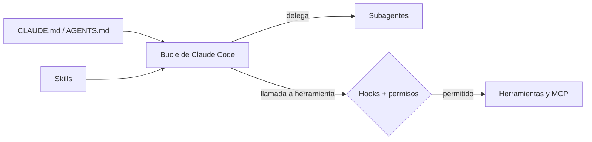

Claude Code es el agente de código de Anthropic: un bucle agéntico con herramientas para leer, editar y ejecutar en tu repositorio. Se puede ver de dos formas, y este grupo sirve para las dos. Como **[[glosario/harness|harness]] listo para usar**, ya trae bucle, herramientas, gestión de contexto, permisos y sandbox. Como **plataforma**, expone casi todo lo que hace falta para construir tu propio harness encima: memoria del proyecto, subagentes, skills, hooks, servidores MCP, plugins y un modo sin interfaz para scripts y CI. El mismo motor se usa como biblioteca con el Claude Agent SDK ([[docs/frameworks/03-claude-agent-sdk]]).

Los datos de esta referencia corresponden a Claude Code v2.1.312 (27 de octubre de 2026). Cambia cada semana: ante la duda, la fuente es code.claude.com/docs.

## Artículos

| Artículo | Para qué lo consultas |
|---|---|
| [[docs/claude-code/01-memoria-claude-md-y-agents-md]] | Qué instrucciones lee siempre el agente, en qué orden y cómo conviven `CLAUDE.md` y `AGENTS.md` |
| [[docs/claude-code/02-subagentes]] | Definir subagentes en `.claude/agents/`, sus campos y cuándo delegar |
| [[docs/claude-code/03-skills]] | Ubicaciones, frontmatter e invocación de skills en Claude Code |
| [[docs/claude-code/04-hooks]] | Los 33 eventos, la entrada y la salida de un hook, y cómo bloquear o medir |
| [[docs/claude-code/05-comandos-y-plugins]] | Comandos propios, plugins y marketplaces |
| [[docs/claude-code/06-permisos-y-sandbox]] | Reglas `allow`, `ask` y `deny`, modos de permisos y sandbox de Bash |
| [[docs/claude-code/07-mcp-en-claude-code]] | Añadir servidores MCP, sus alcances, permisos y coste en contexto |
| [[docs/claude-code/08-modo-headless-y-ci]] | `claude -p`, salida JSON, `--bare` y un job de CI |
| [[docs/claude-code/09-workflows-equipos-y-segundo-plano]] | Sesiones en segundo plano, worktrees, dynamic workflows y equipos de agentes |

## Un harness real como hilo conductor

Casi todos los artículos usan como ejemplo el harness del autor: una sesión principal que orquesta cuatro subagentes (explorer, designer, builder y reviewer), con dieciséis skills, dos comandos de decisión humana, un hook `PreToolUse` de seguridad (`guard.py`) y un hook `SubagentStop` que registra el coste de cada subagente (`ledger.py`). Verás sus archivos reales, lo que hacen y por qué. El curso [[cursos/harness-engineering/index]] lo desmonta pieza a pieza y el sistema completo está en [[sistemas/harness-sdd-claude-code]].

> [!consejo] Por dónde empezar
> Si acabas de instalarlo, lee memoria y permisos: con un buen `CLAUDE.md` y unas reglas `deny` razonables cubres la mayor parte del valor. Hooks, workflows y equipos tienen sentido cuando ya sabes qué quieres automatizar.

## Ver también

- [[roadmap/90-harness/index]]: qué es un harness y cómo se construye, sin depender de una herramienta.
- [[roadmap/50-skills/index]]: el nivel del roadmap dedicado a skills.
- [[cursos/agentes-de-codigo/index]]: cómo trabajar con un agente de código en el día a día.
