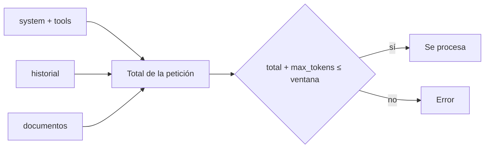

La [[glosario/ventana-de-contexto|ventana de contexto]] es el **número máximo de [[glosario/token|tokens]] que el modelo puede manejar en una petición**, sumando todo lo que envías (sistema, herramientas, historial, documentos) y lo que genera. Es un límite duro: si te pasas, la petición falla. Y es también un presupuesto: aunque quepa, cada token cuesta dinero y [[glosario/latencia|latencia]], y el exceso de material irrelevante empeora la respuesta.

El tamaño exacto depende del modelo y cambia con cada generación. Consulta el vigente en la [documentación oficial](https://platform.claude.com/docs). La lección [[roadmap/00-fundamentos/03-ventana-de-contexto]] explica el concepto desde cero.

## Qué ocupa la ventana

| Componente | Cuenta como | Notas |
|---|---|---|
| `system` | Entrada | Se envía en cada llamada. Candidato a [[docs/contexto/02-prompt-caching]]. |
| `tools` (definiciones) | Entrada | Cada herramienta suma su nombre, descripción y esquema. |
| `messages` (historial) | Entrada | Crece con cada turno, incluidos `tool_use` y `tool_result`. |
| Imágenes y documentos | Entrada | Pueden ocupar mucho; depende del tamaño. |
| Bloques `thinking` anteriores | Entrada (según el modelo) | Algunos modelos descartan el razonamiento de turnos previos del cómputo. |
| Respuesta, razonamiento incluido | Salida | Limitada por `max_tokens`; también tiene que caber en la ventana. |



## Medir antes de enviar

No adivines: cuenta. El endpoint de recuento devuelve los tokens de entrada que tendría una petición sin ejecutarla.

```python tab="Python" title="contar.py"
import anthropic

MODEL = "claude-sonnet-5-5"
client = anthropic.Anthropic()

mensajes = [{"role": "user", "content": open("contrato.txt", encoding="utf-8").read() + "\n\nResume las cláusulas de rescisión."}]

recuento = client.messages.count_tokens(model=MODEL, system="Eres un asistente jurídico.", messages=mensajes)
print("tokens de entrada:", recuento.input_tokens)
```

```ts tab="TypeScript" title="contar.ts"
import { readFileSync } from "node:fs";
import Anthropic from "@anthropic-ai/sdk";

const MODEL = "claude-sonnet-5-5";
const client = new Anthropic();

const contrato = readFileSync("contrato.txt", "utf-8");
const recuento = await client.messages.countTokens({
  model: MODEL,
  system: "Eres un asistente jurídico.",
  messages: [{ role: "user", content: `${contrato}\n\nResume las cláusulas de rescisión.` }],
});
console.log("tokens de entrada:", recuento.input_tokens);
```

En producción, registra además `usage.input_tokens` y `usage.output_tokens` de cada respuesta. Te dirán cómo crece el contexto a lo largo de una conversación o de un agente.

## Estrategias para el historial

En un chat o un [[glosario/agente|agente]] el historial crece en cada turno. Antes de llegar al límite tienes que decidir qué sale.

| Estrategia | Cómo | Pierdes | Úsala cuando |
|---|---|---|---|
| Ventana deslizante | Conserva los últimos N turnos | Lo antiguo, entero | Conversaciones donde lo reciente es lo que importa |
| Compactación ([[glosario/compactacion]]) | Resume lo antiguo en un bloque de texto y sustitúyelo | Detalle | Agentes largos que necesitan recordar decisiones |
| Recorte de resultados | Sustituye `tool_result` antiguos y grandes por una nota («resultado de buscar X: 40 filas, ya procesado») | El dato crudo | Agentes que leen archivos o consultas grandes |
| Memoria externa | Guarda hechos en un almacén y recupéralos cuando hagan falta | Nada, si la recuperación funciona | Información que debe sobrevivir a la sesión: [[docs/contexto/04-memoria]] |
| Subagentes | Delega una subtarea con contexto propio y recibe solo el resumen | El detalle de la subtarea | Búsquedas amplias: [[docs/agentes/02-subagentes]] |

Al recortar, respeta la estructura: **no separes un `tool_use` de su `tool_result`**. Si eliminas uno, elimina el otro, o la petición fallará.

```python title="ventana_deslizante.py"
def recortar(historial: list[dict], max_turnos: int) -> list[dict]:
    """Conserva los últimos turnos sin dejar un tool_result huérfano al principio."""
    recorte = historial[-max_turnos:]
    while recorte and not (recorte[0]["role"] == "user" and isinstance(recorte[0]["content"], str)):
        recorte = recorte[1:]  # empieza siempre por un mensaje de usuario con texto
    return recorte
```

## Contexto largo frente a recuperación

Que quepa un documento entero no significa que debas meterlo. Con [[glosario/contexto-largo|contextos largos]] la calidad puede caer para la información situada en mitad del texto (Liu et al., 2023, [*Lost in the Middle*](https://arxiv.org/abs/2307.03172)), y pagas todos esos tokens en cada pregunta.

| Situación | Mejor opción |
|---|---|
| Un documento que cabe y se consulta varias veces | Contexto completo con caché |
| Una colección grande o que cambia | [[docs/contexto/03-rag]] |
| Pregunta que necesita relacionar partes lejanas de un documento | Contexto completo, documento arriba y pregunta al final |

Pautas de colocación en [[modelos/07-documentos-largos]]. Más discusión en [[radar/2026-09-22-contexto-largo-no-sustituye-recuperacion]].

## Errores frecuentes

- **No contar `max_tokens`.** La entrada cabe, pero entrada más salida no.
- **Herramientas con descripciones o esquemas enormes.** Pagas por ellas en cada llamada, las use el modelo o no.
- **Historial que nunca se recorta.** El agente funciona en pruebas cortas y falla en la sesión de dos horas.
- **Recortar rompiendo pares `tool_use` / `tool_result`.** Error 400.
- **Meterlo todo porque cabe.** Más contexto irrelevante, peores respuestas. Ver [[cursos/context-engineering/02-que-meter-y-que-no]].

## Ver también

- [[glosario/ventana-de-contexto]], [[glosario/contexto-largo]] y [[glosario/compactacion]].
- [[cursos/context-engineering/03-compactacion-y-memoria]]: técnicas de compactación.
- [[docs/contexto/02-prompt-caching]]: abaratar el prefijo que se repite.
- [[blog/2026-09-28-el-contexto-es-un-presupuesto]].
