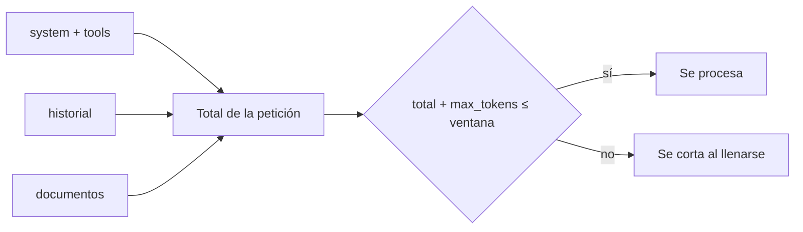

La [[glosario/ventana-de-contexto|ventana de contexto]] es el **número máximo de [[glosario/token|tokens]] que el modelo puede manejar en una petición**, sumando todo lo que envías (sistema, herramientas, historial, documentos) y lo que genera. Es un límite duro. Y es también un presupuesto: aunque quepa, cada token cuesta dinero y [[glosario/latencia|latencia]], y el exceso de material irrelevante empeora la respuesta.

El tamaño exacto depende del modelo y cambia con cada generación. En octubre de 2026, los modelos actuales de Claude (Opus 5.5, Sonnet 5.5, Haiku 5.5 y Fable 5.1) tienen **1M de tokens de contexto** sin cabecera beta y hasta 128k de salida; algunos modelos anteriores siguen en 200k. Consulta el vigente en la [documentación oficial](https://platform.claude.com/docs). En modelos abiertos, la ventana real la fija el servidor, no el modelo (ver más abajo). La lección [[roadmap/00-fundamentos/03-ventana-de-contexto]] explica el concepto desde cero.

## Qué ocupa la ventana

| Componente | Cuenta como | Notas |
|---|---|---|
| `system` | Entrada | Se envía en cada llamada. Candidato a [[docs/contexto/02-prompt-caching]]. |
| `tools` (definiciones) | Entrada | Cada herramienta suma su nombre, descripción y esquema. |
| `messages` (historial) | Entrada | Crece con cada turno, incluidos `tool_use` y `tool_result`. |
| Imágenes y documentos | Entrada | Pueden ocupar mucho; depende del tamaño. |
| Bloques `thinking` anteriores | Entrada (según el modelo) | Algunos modelos descartan el razonamiento de turnos previos del cómputo. |
| Respuesta, razonamiento incluido | Salida | Limitada por `max_tokens`; también tiene que caber en la ventana. |



## Qué pasa al llenarla

| Caso | Qué devuelve la API de Claude |
|---|---|
| La entrada sola no cabe en la ventana | Error 400: recorta antes de enviar. |
| La entrada cabe, pero entrada + `max_tokens` no | La API acepta la petición y genera hasta llenar la ventana; termina con `stop_reason: "model_context_window_exceeded"`. |
| La petición pesa demasiado (imágenes, PDF) | 413 por tamaño en bytes (128 MB como máximo desde octubre de 2026; hasta 600 imágenes o páginas). |

`model_context_window_exceeded` es una señal para tu bucle, no un error HTTP: la respuesta está incompleta y la próxima llamada no cabrá. Compacta o recorta antes de seguir ([[docs/fundamentos/06-motivos-de-parada-y-rechazos]]).

## Medir antes de enviar

No adivines: cuenta. El endpoint de recuento devuelve los tokens de entrada que tendría una petición sin ejecutarla.

```python tab="Python" title="contar.py"
import anthropic

MODEL = "claude-sonnet-5-5"
client = anthropic.Anthropic()

mensajes = [{"role": "user", "content": open("contrato.txt", encoding="utf-8").read() + "\n\nResume las cláusulas de rescisión."}]

recuento = client.messages.count_tokens(model=MODEL, system="Eres un asistente jurídico.", messages=mensajes)
print("tokens de entrada:", recuento.input_tokens)
```

```ts tab="TypeScript" title="contar.ts"
import { readFileSync } from "node:fs";
import Anthropic from "@anthropic-ai/sdk";

const MODEL = "claude-sonnet-5-5";
const client = new Anthropic();

const contrato = readFileSync("contrato.txt", "utf-8");
const recuento = await client.messages.countTokens({
  model: MODEL,
  system: "Eres un asistente jurídico.",
  messages: [{ role: "user", content: `${contrato}\n\nResume las cláusulas de rescisión.` }],
});
console.log("tokens de entrada:", recuento.input_tokens);
```

En producción, registra además `usage.input_tokens` y `usage.output_tokens` de cada respuesta. Te dirán cómo crece el contexto a lo largo de una conversación o de un agente.

## Estrategias para el historial

En un chat o un [[glosario/agente|agente]] el historial crece en cada turno. Antes de llegar al límite tienes que decidir qué sale.

| Estrategia | Cómo | Pierdes | Úsala cuando |
|---|---|---|---|
| Ventana deslizante | Conserva los últimos N turnos | Lo antiguo, entero | Conversaciones donde lo reciente es lo que importa |
| Compactación ([[glosario/compactacion]]) | Resume lo antiguo en un bloque de texto y sustitúyelo | Detalle | Agentes largos que necesitan recordar decisiones |
| Compactación en el servidor | `context_management` con `compact_20260112` (beta): la API resume al pasar un umbral y devuelve un bloque `compaction` que reenvías | Detalle | Bucles largos donde no quieres escribir el resumen tú |
| Recorte de resultados | Sustituye `tool_result` antiguos y grandes por una nota («resultado de buscar X: 40 filas, ya procesado») | El dato crudo | Agentes que leen archivos o consultas grandes |
| Limpieza en el servidor | `clear_tool_uses_20250919` y `clear_thinking_20251015` (beta) borran resultados de herramientas y razonamiento antiguos | El dato crudo | Lo mismo que el recorte, sin código propio |
| Memoria externa | Guarda hechos en un almacén y recupéralos cuando hagan falta | Nada, si la recuperación funciona | Información que debe sobrevivir a la sesión: [[docs/contexto/04-memoria]] |
| Subagentes | Delega una subtarea con contexto propio y recibe solo el resumen | El detalle de la subtarea | Búsquedas amplias: [[docs/agentes/02-subagentes]] |

Las dos variantes en el servidor están en [[docs/contexto/05-compactacion-y-limpieza-en-el-servidor]]. Al recortar en tu código, respeta la estructura: **no separes un `tool_use` de su `tool_result`**. Si eliminas uno, elimina el otro, o la petición fallará.

```python title="ventana_deslizante.py"
def recortar(historial: list[dict], max_turnos: int) -> list[dict]:
    """Conserva los últimos turnos sin dejar un tool_result huérfano al principio."""
    recorte = historial[-max_turnos:]
    while recorte and not (recorte[0]["role"] == "user" and isinstance(recorte[0]["content"], str)):
        recorte = recorte[1:]  # empieza siempre por un mensaje de usuario con texto
    return recorte
```

## Contexto largo frente a recuperación

Que quepa un documento entero no significa que debas meterlo. Con [[glosario/contexto-largo|contextos largos]] la calidad puede caer para la información situada en mitad del texto (Liu et al., 2023, [*Lost in the Middle*](https://arxiv.org/abs/2307.03172)) y, en general, a medida que crece la entrada ([[glosario/context-rot|context rot]]: Chroma, 2025, [*Context Rot*](https://www.trychroma.com/research/context-rot)). Y pagas todos esos tokens en cada pregunta. Que la ventana sea de 1M no cambia esto.

| Situación | Mejor opción |
|---|---|
| Un documento que cabe y se consulta varias veces | Contexto completo con caché |
| Una colección grande o que cambia | [[docs/contexto/03-rag]] |
| Pregunta que necesita relacionar partes lejanas de un documento | Contexto completo, documento arriba y pregunta al final |

Ningún enfoque gana siempre: la comparación de RAG y contexto largo depende del modelo y de la tarea (ver [[docs/contexto/03-rag#RAG o contexto largo|RAG o contexto largo]]). Pautas de colocación en [[modelos/07-documentos-largos]]. Más discusión en [[radar/2026-09-22-contexto-largo-no-sustituye-recuperacion]].

## Con modelos abiertos

En un modelo local, la ventana efectiva la decide el servidor de inferencia. Ollama, por ejemplo, usa por defecto un contexto pequeño (depende de la memoria de la máquina y de la versión) y **trunca en silencio** lo que no cabe: el agente pierde el prompt de sistema o las primeras herramientas sin ningún error. Fija el contexto tú (`num_ctx` en la petición o en el Modelfile; para agentes, al menos 64k si la máquina lo permite) y compruébalo con `ollama ps`. Más contexto también significa más memoria para la KV cache. Ver [[docs/modelos-abiertos/01-ollama]] y [[modelos/12-inferencia-local]].

## Errores frecuentes

- **No contar `max_tokens`.** La entrada cabe, pero entrada más salida no: la respuesta acaba en `model_context_window_exceeded`.
- **Confiar en el contexto por defecto de un servidor local.** Trunca sin avisar.
- **Herramientas con descripciones o esquemas enormes.** Pagas por ellas en cada llamada, las use el modelo o no.
- **Historial que nunca se recorta.** El agente funciona en pruebas cortas y falla en la sesión de dos horas.
- **Recortar rompiendo pares `tool_use` / `tool_result`.** Error 400.
- **Meterlo todo porque cabe.** Más contexto irrelevante, peores respuestas. Ver [[cursos/context-engineering/02-que-meter-y-que-no]].

## Ver también

- [[glosario/ventana-de-contexto]], [[glosario/contexto-largo]] y [[glosario/compactacion]].
- [[cursos/context-engineering/03-compactacion-y-memoria]]: técnicas de compactación.
- [[docs/contexto/02-prompt-caching]]: abaratar el prefijo que se repite.
- [[docs/contexto/05-compactacion-y-limpieza-en-el-servidor]]: compactar y limpiar sin código propio.
- [[problemas/contexto-saturado-en-sesiones-largas]]: síntomas de un contexto saturado y cómo arreglarlo.
- [[blog/2026-09-28-el-contexto-es-un-presupuesto]].
