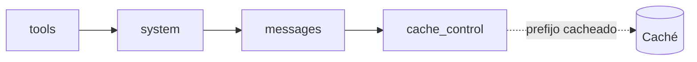

El [[glosario/prompt-caching|prompt caching]] permite **reutilizar el procesamiento de un prefijo de la petición** que se repite entre llamadas: el prompt de sistema, las definiciones de herramientas, un documento largo o el historial de una conversación. La primera llamada escribe ese prefijo en caché; las siguientes que empiezan exactamente igual lo leen. Leer de caché cuesta mucho menos que procesar la entrada normal y reduce la latencia; escribir cuesta algo más que la entrada normal.

Consulta los multiplicadores de precio vigentes en la [documentación oficial](https://platform.claude.com/docs): cambian y dependen del modelo (en los modelos actuales, la lectura es más barata que en los anteriores). La lección [[roadmap/100-produccion/02-costes-y-prompt-caching]] lo enseña en contexto; la receta [[recetas/recortar-costes-con-prompt-caching]] va directa al grano.

## Cómo funciona



El prefijo se forma **siempre en este orden: `tools` → `system` → `messages`**. Un punto de corte (`cache_control`) marca hasta dónde se cachea. Si cambia cualquier cosa antes del punto de corte, la caché de ese punto deja de servir:

- Cambiar las **herramientas** invalida toda la caché.
- Cambiar `system` invalida `system` y todo lo que va detrás, pero no `tools`.
- Cambiar `tool_choice`, añadir imágenes o cambiar el `effort` de nivel superior invalida la parte de `messages`.
- Lo que **no** rompe el prefijo: las herramientas con `defer_loading: true` (no forman parte de él) y los mensajes `role: "system"` a mitad de conversación ([[docs/contexto/06-mensajes-de-sistema-a-mitad-de-conversacion]]).

| Concepto | Valor |
|---|---|
| Marcador | `"cache_control": {"type": "ephemeral"}` en un bloque |
| Puntos de corte | Hasta 4 por petición |
| Caché automática | `cache_control` en el nivel superior de la petición: coloca el punto de corte en el último bloque cacheable y lo mueve según crece la conversación. **Ocupa uno de los 4** |
| Alcance hacia atrás | Cada punto de corte busca coincidencias como mucho 20 bloques hacia atrás (los `tool_use` o `tool_result` consecutivos cuentan como uno) |
| TTL por defecto | 5 minutos, se renueva cada vez que se lee |
| TTL largo | `{"type": "ephemeral", "ttl": "1h"}` |
| Tamaño mínimo | 512 tokens en los modelos actuales (más en algunos anteriores); por debajo, no se cachea (sin error) |
| Precalentar | `max_tokens: 0` escribe la caché sin generar nada (no vale con `stream`, salidas estructuradas, `tool_choice` forzado ni Batch) |
| Coincidencia | Exacta, byte a byte, del prefijo |

## Dónde poner los puntos de corte

| Bloque | Cuándo marcarlo |
|---|---|
| Última herramienta de `tools` | Muchas herramientas o esquemas grandes que no cambian |
| Último bloque de `system` | Prompt de sistema largo y estable (lo habitual) |
| Un documento en el primer mensaje `user` | Varias preguntas sobre el mismo documento |
| Último bloque del último mensaje | Conversaciones y agentes: cachea el historial que crece |

Pon lo estable delante y lo variable detrás. Si el prompt de sistema lleva la fecha de hoy al principio, ningún prefijo coincidirá mañana; si lleva la hora exacta, no coincidirá nunca.

## Ejemplo completo

Varias preguntas sobre el mismo manual. La primera llamada escribe en caché; las siguientes leen.

```python tab="Python" title="cache.py"
import anthropic

MODEL = "claude-sonnet-5-5"
client = anthropic.Anthropic()

MANUAL = open("manual.txt", encoding="utf-8").read()  # por encima del mínimo cacheable

def preguntar(pregunta: str):
    resp = client.messages.create(
        model=MODEL,
        max_tokens=512,
        system=[
            {"type": "text", "text": "Respondes dudas sobre el manual adjunto. Cita la sección."},
            {"type": "text", "text": f"<manual>{MANUAL}</manual>", "cache_control": {"type": "ephemeral"}},
        ],
        messages=[{"role": "user", "content": pregunta}],
    )
    u = resp.usage
    print(f"entrada={u.input_tokens} escritura={u.cache_creation_input_tokens} lectura={u.cache_read_input_tokens}")
    return "".join(b.text for b in resp.content if b.type == "text")

preguntar("¿Cómo se restablece la configuración de fábrica?")
preguntar("¿Qué significa el piloto rojo intermitente?")
```

```ts tab="TypeScript" title="cache.ts"
import { readFileSync } from "node:fs";
import Anthropic from "@anthropic-ai/sdk";

const MODEL = "claude-sonnet-5-5";
const client = new Anthropic();

const MANUAL = readFileSync("manual.txt", "utf-8");

async function preguntar(pregunta: string): Promise<string> {
  const resp = await client.messages.create({
    model: MODEL,
    max_tokens: 512,
    system: [
      { type: "text", text: "Respondes dudas sobre el manual adjunto. Cita la sección." },
      { type: "text", text: `<manual>${MANUAL}</manual>`, cache_control: { type: "ephemeral" } },
    ],
    messages: [{ role: "user", content: pregunta }],
  });
  const u = resp.usage;
  console.log(`entrada=${u.input_tokens} escritura=${u.cache_creation_input_tokens} lectura=${u.cache_read_input_tokens}`);
  return resp.content.map((b) => (b.type === "text" ? b.text : "")).join("");
}

await preguntar("¿Cómo se restablece la configuración de fábrica?");
await preguntar("¿Qué significa el piloto rojo intermitente?");
```

```text
# salida de ejemplo
entrada=21 escritura=18450 lectura=0
entrada=19 escritura=0 lectura=18450
```

### Caché de una conversación

En un chat o un agente, marca el último bloque del último mensaje en cada llamada. Cada turno lee el prefijo del turno anterior y escribe solo lo nuevo.

```python
def con_cache(historial: list[dict]) -> list[dict]:
    copia = [dict(m) for m in historial]
    ultimo = copia[-1]
    bloques = ultimo["content"]
    if isinstance(bloques, str):
        bloques = [{"type": "text", "text": bloques}]
    bloques = [dict(b) for b in bloques]
    bloques[-1]["cache_control"] = {"type": "ephemeral"}
    ultimo["content"] = bloques
    return copia
```

Si prefieres no gestionarlo a mano, la caché automática (`cache_control` en el nivel superior de la petición) coloca el punto de corte por ti. En un agente largo, si el historial crece más de 20 bloques entre dos llamadas, añade un punto de corte intermedio: el punto móvil solo mira 20 bloques atrás.

### Con LangChain

En LangChain, `AnthropicPromptCachingMiddleware` (de `langchain_anthropic.middleware`) añade la caché automática y marca el bloque `system` en cada llamada del agente:

```python title="cache_lc.py"
from langchain.agents import create_agent
from langchain.chat_models import init_chat_model
from langchain_anthropic.middleware import AnthropicPromptCachingMiddleware

MODEL = "anthropic:claude-sonnet-5-5"
agente = create_agent(
    init_chat_model(MODEL, max_tokens=1024),
    tools=[],
    system_prompt="Respondes dudas sobre el manual adjunto. Cita la sección.",
    middleware=[AnthropicPromptCachingMiddleware(ttl="5m")],
)
```

Con un modelo local no hay caché que se facture aparte: algunos servidores de inferencia reutilizan por su cuenta la [[glosario/kv-cache|KV cache]] de prefijos repetidos (consulta la documentación del tuyo), y la API compatible con Anthropic de Ollama no implementa *prompt caching*.

## Leer `usage`

| Campo | Qué es |
|---|---|
| `cache_creation_input_tokens` | Tokens escritos en caché en esta llamada (precio de escritura); el desglose por TTL va en `cache_creation.ephemeral_5m_input_tokens` y `ephemeral_1h_input_tokens` |
| `cache_read_input_tokens` | Tokens leídos de caché (precio reducido) |
| `input_tokens` | Tokens de entrada **después** del último punto de corte, a precio normal |

La entrada total de la petición es la suma de los tres. Para saber si la caché funciona, mira la proporción de `cache_read_input_tokens` sobre esa suma a lo largo del día. Si es cercana a cero en un flujo repetitivo, algo está rompiendo el prefijo.

## Por qué no acierta la caché

| Síntoma | Causa probable |
|---|---|
| `cache_creation` en cada llamada, `cache_read` siempre 0 | Algo cambia antes del punto de corte: fecha, id de petición, orden de herramientas, JSON serializado con claves en distinto orden |
| Ni escritura ni lectura | El prefijo no llega al mínimo de tokens del modelo, o falta `cache_control` |
| Acierta a ratos | Las llamadas están separadas más que el TTL. Usa `"ttl": "1h"` o agrupa el trabajo |
| Deja de acertar tras un cambio | Cambiaste herramientas o `system`: todo lo posterior se invalida |
| Peticiones en paralelo sin lecturas | La caché está disponible cuando termina la primera respuesta; lanza una primero (o precalienta con `max_tokens: 0`) y el resto después |
| Agente largo que deja de leer | El historial nuevo supera los 20 bloques de alcance del punto de corte. Añade uno intermedio |

### Diagnóstico de caché

No hace falta adivinar. Con `diagnostics` (GA), la API compara la petición con una anterior y te dice qué cambió:

```python title="diagnostico.py"
import anthropic

MODEL = "claude-sonnet-5-5"
client = anthropic.Anthropic()
SISTEMA = [{"type": "text", "text": "Respondes dudas sobre el manual…", "cache_control": {"type": "ephemeral"}}]

primera = client.messages.create(model=MODEL, max_tokens=512, system=SISTEMA,
                                 messages=[{"role": "user", "content": "¿Cómo se reinicia?"}])
segunda = client.messages.create(
    model=MODEL, max_tokens=512, system=SISTEMA,
    messages=[{"role": "user", "content": "¿Qué indica el piloto rojo?"}],
    diagnostics={"previous_message_id": primera.id},  # compárala con la anterior
)
if segunda.diagnostics and segunda.diagnostics.cache_miss_reason:
    print(segunda.diagnostics.cache_miss_reason.type)  # p. ej. "system_changed"
```

Los motivos posibles son `model_changed`, `system_changed`, `tools_changed`, `messages_changed`, `previous_message_not_found` y `unavailable`, junto con `cache_missed_input_tokens`. La receta [[recetas/diagnosticar-fallos-de-cache]] los interpreta uno por uno, y [[problemas/la-cache-no-se-aprovecha]] recoge los síntomas más comunes.
## Errores frecuentes

- **Datos variables arriba.** Nombre de la persona, fecha u hora en `system` antes del documento.
- **Herramientas generadas en orden distinto** en cada llamada (por ejemplo, a partir de un `set`). Ordénalas.
- **Cachear lo que se usa una vez.** Pagas la escritura y nunca lees. Solo compensa si el prefijo se repite dentro del TTL.
- **Copiar multiplicadores de precio** de un artículo. Consulta la documentación vigente.
- **Cambiar el `effort` o las herramientas entre turnos** para ajustar el agente. Rompe el prefijo; usa mensajes `system` intermedios o `defer_loading`.
- **No registrar `usage`.** Sin esos campos no sabes si la caché funciona.

## Ver también

- [[docs/prompting/01-prompt-de-sistema]]: el prompt de sistema, el candidato natural.
- [[docs/produccion/02-costes-y-limites]]: la caché dentro de la estrategia de costes.
- [[recetas/recortar-costes-con-prompt-caching]].
- [[glosario/prompt-caching]].
