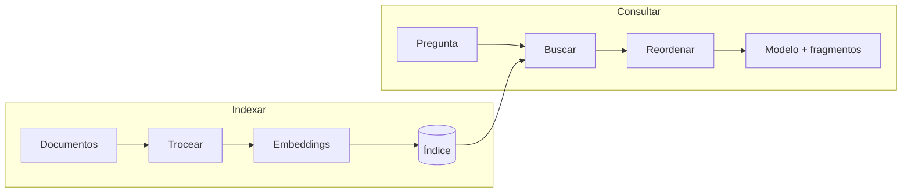

[[glosario/rag|RAG]] (*Retrieval-Augmented Generation*) es la técnica de **buscar los fragmentos relevantes de tus documentos en el momento de la pregunta e incluirlos en el prompt**, para que el modelo responda con esa información y no solo con lo que aprendió en su entrenamiento. Se describió en Lewis et al., 2020, [*Retrieval-Augmented Generation for Knowledge-Intensive NLP Tasks*](https://arxiv.org/abs/2005.11401). Es la forma estándar de dar al modelo conocimiento privado, extenso o que cambia.

Este artículo es la referencia de las piezas. El aprendizaje paso a paso está en [[roadmap/30-contexto-y-rag/index]] y en el curso [[cursos/rag-a-fondo/index]].

## Las dos fases



| Fase | Cuándo | Pasos |
|---|---|---|
| Indexación | Una vez, y cada vez que cambian los documentos | Limpiar, trocear ([[glosario/chunking]]), calcular [[glosario/embeddings]], guardar con metadatos |
| Consulta | En cada pregunta | Buscar, opcionalmente reordenar, construir el prompt, generar, verificar |

## Componentes

| Componente | Qué hace | Referencia |
|---|---|---|
| Troceado (*chunking*) | Divide documentos en fragmentos con sentido propio | [[roadmap/30-contexto-y-rag/02-chunking]], [[recetas/trocear-documentos]] |
| Embeddings | Convierte texto en vectores comparables | [[roadmap/30-contexto-y-rag/01-embeddings]] |
| [[glosario/vector-store]] | Guarda vectores y busca los más cercanos | [[glosario/similitud-coseno]] |
| Búsqueda léxica | Coincidencia de palabras exactas con [[glosario/bm25]] | [[roadmap/30-contexto-y-rag/03-busqueda-hibrida]] |
| [[glosario/busqueda-hibrida]] | Combina vectorial y léxica | [[recetas/busqueda-hibrida-con-bm25]] |
| [[glosario/reranking]] | Reordena los candidatos con un modelo más preciso | [[roadmap/30-contexto-y-rag/04-reranking]] |
| Generación con citas | Responde citando fragmentos y se abstiene si no hay base | [[roadmap/30-contexto-y-rag/05-respuestas-con-citas]] |

Anthropic no ofrece un modelo de embeddings propio: usa el proveedor que prefieras. Mezclar embeddings de modelos distintos en el mismo índice no funciona; si cambias de modelo, reindexa.

## Parámetros que más influyen

| Parámetro | Efecto | Cómo ajustarlo |
|---|---|---|
| Tamaño del fragmento | Pequeño: preciso pero sin contexto. Grande: más contexto, más ruido | Empieza por párrafos o secciones naturales del documento y mide |
| Solapamiento | Evita cortar una idea entre dos fragmentos | Una o dos frases suelen bastar |
| `k` (fragmentos recuperados) | Más `k`: más cobertura, más tokens y más ruido | Recupera de más y reordena a menos |
| Metadatos | Permiten filtrar (fecha, producto, idioma) antes de buscar | Guarda origen, sección y fecha en cada fragmento |
| Contexto del fragmento | Un fragmento suelto puede ser ambiguo («el plazo es de 30 días») | Añade al fragmento una frase que lo sitúe: [[glosario/recuperacion-contextual]] |

La [[glosario/recuperacion-contextual|recuperación contextual]] consiste en anteponer a cada fragmento un breve contexto generado a partir del documento completo antes de indexarlo. Anthropic la describe en [*Introducing Contextual Retrieval*](https://www.anthropic.com/news/contextual-retrieval) (2024).

## Ejemplo completo

Un RAG mínimo en memoria. `embed()` es abstracta: conéctala a tu proveedor.

```python tab="Python" title="rag.py"
import math
import anthropic

MODEL = "claude-sonnet-5-5"
client = anthropic.Anthropic()

def embed(textos: list[str]) -> list[list[float]]:
    """Usa el proveedor de embeddings que prefieras."""
    raise NotImplementedError

def coseno(a: list[float], b: list[float]) -> float:
    num = sum(x * y for x, y in zip(a, b))
    return num / (math.sqrt(sum(x * x for x in a)) * math.sqrt(sum(y * y for y in b)))

# Indexación (una vez)
FRAGMENTOS = [
    {"id": "dev-1", "fuente": "politicas.md#devoluciones", "texto": "Las devoluciones se aceptan hasta 30 días después de la entrega."},
    {"id": "env-1", "fuente": "politicas.md#envios", "texto": "Los envíos peninsulares tardan entre 48 y 72 horas laborables."},
]
VECTORES = embed([f["texto"] for f in FRAGMENTOS])

def recuperar(pregunta: str, k: int = 4) -> list[dict]:
    q = embed([pregunta])[0]
    puntuados = sorted(zip(FRAGMENTOS, VECTORES), key=lambda fv: coseno(q, fv[1]), reverse=True)
    return [f for f, _ in puntuados[:k]]

def responder(pregunta: str) -> str:
    fragmentos = recuperar(pregunta)
    contexto = "\n".join(
        f'<fragmento id="{f["id"]}" fuente="{f["fuente"]}">{f["texto"]}</fragmento>' for f in fragmentos
    )
    resp = client.messages.create(
        model=MODEL,
        max_tokens=600,
        system=(
            "Responde solo con la información de <fragmentos>. Cita el id entre corchetes, p. ej. [dev-1]. "
            "Si los fragmentos no contienen la respuesta, di que no lo sabes."
        ),
        messages=[{"role": "user", "content": f"<fragmentos>\n{contexto}\n</fragmentos>\n\nPregunta: {pregunta}"}],
    )
    return "".join(b.text for b in resp.content if b.type == "text")
```

```ts tab="TypeScript" title="rag.ts"
import Anthropic from "@anthropic-ai/sdk";

const MODEL = "claude-sonnet-5-5";
const client = new Anthropic();

type Fragmento = { id: string; fuente: string; texto: string };

async function embed(textos: string[]): Promise<number[][]> {
  // Usa el proveedor de embeddings que prefieras.
  throw new Error("No implementado");
}

function coseno(a: number[], b: number[]): number {
  const num = a.reduce((s, x, i) => s + x * b[i], 0);
  const na = Math.sqrt(a.reduce((s, x) => s + x * x, 0));
  const nb = Math.sqrt(b.reduce((s, x) => s + x * x, 0));
  return num / (na * nb);
}

const FRAGMENTOS: Fragmento[] = [
  { id: "dev-1", fuente: "politicas.md#devoluciones", texto: "Las devoluciones se aceptan hasta 30 días después de la entrega." },
  { id: "env-1", fuente: "politicas.md#envios", texto: "Los envíos peninsulares tardan entre 48 y 72 horas laborables." },
];
const VECTORES = await embed(FRAGMENTOS.map((f) => f.texto));

async function recuperar(pregunta: string, k = 4): Promise<Fragmento[]> {
  const [q] = await embed([pregunta]);
  return FRAGMENTOS.map((f, i) => ({ f, s: coseno(q, VECTORES[i]) }))
    .sort((a, b) => b.s - a.s)
    .slice(0, k)
    .map((x) => x.f);
}

async function responder(pregunta: string): Promise<string> {
  const fragmentos = await recuperar(pregunta);
  const contexto = fragmentos
    .map((f) => `<fragmento id="${f.id}" fuente="${f.fuente}">${f.texto}</fragmento>`)
    .join("\n");
  const resp = await client.messages.create({
    model: MODEL,
    max_tokens: 600,
    system:
      "Responde solo con la información de <fragmentos>. Cita el id entre corchetes, p. ej. [dev-1]. " +
      "Si los fragmentos no contienen la respuesta, di que no lo sabes.",
    messages: [{ role: "user", content: `<fragmentos>\n${contexto}\n</fragmentos>\n\nPregunta: ${pregunta}` }],
  });
  return resp.content.map((b) => (b.type === "text" ? b.text : "")).join("");
}
```

Para producción faltan tres cosas: un índice persistente, búsqueda híbrida con reordenado y **verificar las citas** (que cada id citado exista entre los recuperados y que el texto lo respalde). Todo eso está en [[sistemas/rag-con-citas]].

## RAG como herramienta

En lugar de recuperar siempre antes de llamar al modelo, puedes darle una herramienta `buscar_docs` y dejar que decida cuándo y qué buscar, incluso varias veces con consultas distintas. Es más flexible y más caro; encaja en agentes ([[docs/herramientas/01-uso-de-herramientas]]). El RAG fijo es más predecible y fácil de evaluar.

## Errores frecuentes

- **Evaluar solo la respuesta final.** Mide por separado si la recuperación trae el fragmento correcto y si el modelo lo usa bien: [[cursos/rag-a-fondo/04-evaluar-un-rag]].
- **Solo búsqueda vectorial.** Falla con códigos, nombres propios y términos exactos. Añade [[glosario/bm25|BM25]].
- **Fragmentos sin contexto ni metadatos.** El modelo recibe «el plazo es de 30 días» sin saber de qué.
- **No permitir la abstención.** Si el prompt no dice qué hacer cuando no hay base, el modelo rellena: [[glosario/alucinacion]].
- **Indexar una vez y olvidarse.** Los documentos cambian; el índice también debe cambiar.
- **Tratar los documentos como confiables.** Un documento indexado puede contener instrucciones: [[docs/seguridad/01-prompt-injection]].

## Ver también

- [[cursos/rag-a-fondo/01-anatomia-de-un-rag]]: anatomía completa.
- [[sistemas/rag-con-citas]]: arquitectura con verificación y abstención.
- [[docs/contexto/01-ventana-de-contexto]]: cuándo basta con meter el documento entero.
- [[glosario/rag]], [[glosario/grounding]] y [[glosario/embeddings]].
