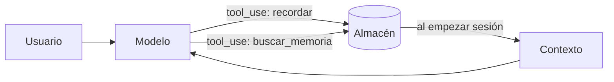

La [[glosario/memoria|memoria]] de una aplicación con modelos es **la información que guardas fuera de la ventana de contexto y vuelves a introducir cuando hace falta**. El modelo no recuerda nada entre llamadas: lo que llamamos memoria es tu código decidiendo qué escribir en un almacén (archivo, base de datos, índice) y qué leer de él en cada sesión. Bien hecha, permite que un asistente recuerde preferencias y que un agente retome una tarea de horas. Mal hecha, llena el contexto de ruido o de datos que no debería conservar.

La lección [[roadmap/30-contexto-y-rag/06-memoria-entre-sesiones]] lo construye paso a paso.

## Tipos de memoria

| Tipo | Dónde vive | Dura | Ejemplo |
|---|---|---|---|
| De trabajo | El historial de `messages` | Una sesión | Lo que se ha dicho en esta conversación |
| Compactada | Un resumen que sustituye historial antiguo | Una sesión larga | «Hasta ahora: se revisaron 12 archivos, el fallo está en `pagos.py`» |
| Semántica (hechos) | Almacén externo, por usuario | Indefinida | «Prefiere respuestas en inglés», «su empresa usa PostgreSQL» |
| Episódica | Almacén externo | Indefinida o con caducidad | Resumen de la sesión del martes y lo que quedó pendiente |
| De tarea | Archivo de estado o notas del agente | Lo que dure la tarea | Plan, pasos hechos, siguiente paso |

La memoria de trabajo y la compactación se tratan en [[docs/contexto/01-ventana-de-contexto]] y en [[glosario/compactacion]]. Este artículo se centra en la memoria que **sobrevive a la sesión**.

## Cómo se escribe y se lee



Hay tres estrategias de escritura, combinables:

| Estrategia | Cómo | Ventaja | Riesgo |
|---|---|---|---|
| El modelo decide | Herramienta `recordar` que el modelo llama cuando detecta algo útil | Guarda en el momento, con contexto | Guarda de más o de menos según la descripción |
| Extracción al cerrar | Al terminar la sesión, una llamada aparte extrae los hechos que conviene conservar | Controlable, revisable | Coste de una llamada extra |
| Explícita | La persona dice «recuerda que…» o edita sus preferencias | Máximo control | Depende de que la persona lo haga |

Y dos de lectura:

| Estrategia | Cómo | Úsala cuando |
|---|---|---|
| Carga al inicio | Metes las memorias del usuario en `system` o en el primer mensaje | Pocas memorias, siempre relevantes |
| Búsqueda bajo demanda | Herramienta `buscar_memoria`; el modelo consulta cuando lo necesita | Muchas memorias; recuperación como en [[docs/contexto/03-rag]] |

## Ejemplo completo

Memoria por usuario en un archivo JSON, con dos herramientas. Las memorias existentes se cargan al empezar.

```python tab="Python" title="memoria.py"
import json, pathlib, datetime
import anthropic

MODEL = "claude-sonnet-5-5"
MAX_PASOS = 6
MAX_MEMORIAS = 50
client = anthropic.Anthropic()

TOOLS = [
    {
        "name": "recordar",
        "description": (
            "Guarda un hecho duradero sobre el usuario o su proyecto (preferencias, decisiones, contexto estable). "
            "No guardes datos sensibles (salud, contraseñas, datos bancarios) ni detalles de una sola conversación."
        ),
        "input_schema": {
            "type": "object",
            "properties": {"hecho": {"type": "string", "description": "Una frase autocontenida"}},
            "required": ["hecho"],
        },
    },
    {
        "name": "olvidar",
        "description": "Borra una memoria por su número cuando el usuario lo pide o cuando ha quedado obsoleta.",
        "input_schema": {
            "type": "object",
            "properties": {"numero": {"type": "integer"}},
            "required": ["numero"],
        },
    },
]

def ruta(usuario: str) -> pathlib.Path:
    return pathlib.Path("memorias") / f"{usuario}.json"

def cargar(usuario: str) -> list[dict]:
    p = ruta(usuario)
    return json.loads(p.read_text(encoding="utf-8")) if p.exists() else []

def guardar(usuario: str, memorias: list[dict]) -> None:
    ruta(usuario).parent.mkdir(exist_ok=True)
    ruta(usuario).write_text(json.dumps(memorias[-MAX_MEMORIAS:], ensure_ascii=False, indent=1), encoding="utf-8")

def ejecutar(usuario: str, nombre: str, args: dict) -> str:
    memorias = cargar(usuario)
    if nombre == "recordar":
        memorias.append({"hecho": args["hecho"], "fecha": datetime.date.today().isoformat()})
        guardar(usuario, memorias)
        return "Guardado."
    if nombre == "olvidar":
        i = args["numero"] - 1
        if not 0 <= i < len(memorias):
            raise IndexError(f"No existe la memoria {args['numero']}")
        memorias.pop(i)
        guardar(usuario, memorias)
        return "Borrado."
    raise ValueError(f"Herramienta desconocida: {nombre}")

def sistema(usuario: str) -> str:
    lineas = "\n".join(f"{n}. {m['hecho']} ({m['fecha']})" for n, m in enumerate(cargar(usuario), 1))
    return (
        "Eres un asistente técnico. Usa las memorias si son relevantes; no las menciones si no vienen al caso.\n"
        f"<memorias>\n{lineas or 'Sin memorias.'}\n</memorias>"
    )

def turno(usuario: str, mensajes: list[dict]) -> str:
    for _ in range(MAX_PASOS):
        resp = client.messages.create(
            model=MODEL, max_tokens=1024, system=sistema(usuario), tools=TOOLS, messages=mensajes
        )
        mensajes.append({"role": "assistant", "content": resp.content})
        if resp.stop_reason != "tool_use":
            return "".join(b.text for b in resp.content if b.type == "text")
        resultados = []
        for b in resp.content:
            if b.type != "tool_use":
                continue
            try:
                resultados.append({"type": "tool_result", "tool_use_id": b.id, "content": ejecutar(usuario, b.name, b.input)})
            except Exception as e:
                resultados.append({"type": "tool_result", "tool_use_id": b.id, "content": f"Error: {e}", "is_error": True})
        mensajes.append({"role": "user", "content": resultados})
    return "[límite de pasos]"

print(turno("ana", [{"role": "user", "content": "Trabajo siempre con TypeScript y Node 24. ¿Cómo leo un JSON?"}]))
```

```ts tab="TypeScript" title="memoria.ts"
import { existsSync, mkdirSync, readFileSync, writeFileSync } from "node:fs";
import Anthropic from "@anthropic-ai/sdk";

const MODEL = "claude-sonnet-5-5";
const MAX_PASOS = 6;
const MAX_MEMORIAS = 50;
const client = new Anthropic();

type Memoria = { hecho: string; fecha: string };

const TOOLS: Anthropic.Tool[] = [
  {
    name: "recordar",
    description:
      "Guarda un hecho duradero sobre el usuario o su proyecto (preferencias, decisiones, contexto estable). " +
      "No guardes datos sensibles (salud, contraseñas, datos bancarios) ni detalles de una sola conversación.",
    input_schema: {
      type: "object",
      properties: { hecho: { type: "string", description: "Una frase autocontenida" } },
      required: ["hecho"],
    },
  },
  {
    name: "olvidar",
    description: "Borra una memoria por su número cuando el usuario lo pide o cuando ha quedado obsoleta.",
    input_schema: { type: "object", properties: { numero: { type: "integer" } }, required: ["numero"] },
  },
];

const ruta = (u: string) => `memorias/${u}.json`;
const cargar = (u: string): Memoria[] => (existsSync(ruta(u)) ? JSON.parse(readFileSync(ruta(u), "utf-8")) : []);
function guardar(u: string, m: Memoria[]) {
  mkdirSync("memorias", { recursive: true });
  writeFileSync(ruta(u), JSON.stringify(m.slice(-MAX_MEMORIAS), null, 1), "utf-8");
}

function ejecutar(u: string, nombre: string, args: any): string {
  const memorias = cargar(u);
  if (nombre === "recordar") {
    memorias.push({ hecho: args.hecho, fecha: new Date().toISOString().slice(0, 10) });
    guardar(u, memorias);
    return "Guardado.";
  }
  if (nombre === "olvidar") {
    const i = args.numero - 1;
    if (i < 0 || i >= memorias.length) throw new Error(`No existe la memoria ${args.numero}`);
    memorias.splice(i, 1);
    guardar(u, memorias);
    return "Borrado.";
  }
  throw new Error(`Herramienta desconocida: ${nombre}`);
}

function sistema(u: string): string {
  const lineas = cargar(u).map((m, n) => `${n + 1}. ${m.hecho} (${m.fecha})`).join("\n");
  return (
    "Eres un asistente técnico. Usa las memorias si son relevantes; no las menciones si no vienen al caso.\n" +
    `<memorias>\n${lineas || "Sin memorias."}\n</memorias>`
  );
}

async function turno(u: string, mensajes: Anthropic.MessageParam[]): Promise<string> {
  for (let paso = 0; paso < MAX_PASOS; paso++) {
    const resp = await client.messages.create({
      model: MODEL, max_tokens: 1024, system: sistema(u), tools: TOOLS, messages: mensajes,
    });
    mensajes.push({ role: "assistant", content: resp.content });
    if (resp.stop_reason !== "tool_use") {
      return resp.content.map((b) => (b.type === "text" ? b.text : "")).join("");
    }
    const resultados: Anthropic.ToolResultBlockParam[] = [];
    for (const b of resp.content) {
      if (b.type !== "tool_use") continue;
      try {
        resultados.push({ type: "tool_result", tool_use_id: b.id, content: ejecutar(u, b.name, b.input) });
      } catch (e) {
        resultados.push({ type: "tool_result", tool_use_id: b.id, content: `Error: ${e}`, is_error: true });
      }
    }
    mensajes.push({ role: "user", content: resultados });
  }
  return "[límite de pasos]";
}

console.log(await turno("ana", [{ role: "user", content: "Trabajo siempre con TypeScript y Node 24. ¿Cómo leo un JSON?" }]));
```

Dos detalles de diseño: el prompt de sistema cambia cuando cambian las memorias, así que **pon el bloque de memorias después del punto de caché** si cacheas el resto ([[docs/contexto/02-prompt-caching]]). Y el tope `MAX_MEMORIAS` evita que el contexto crezca sin límite; con muchas memorias, cambia la carga al inicio por una búsqueda.

Algunos proveedores ofrecen herramientas de memoria ya definidas. Consulta la [documentación oficial](https://platform.claude.com/docs) si prefieres no mantener la tuya.

## Memoria de tarea en agentes largos

Para un agente que trabaja horas, la memoria más útil es un **archivo de estado** que el propio agente actualiza: objetivo, plan, pasos completados, decisiones y siguiente paso. Si el contexto se compacta o la sesión se reinicia, leer ese archivo basta para retomar. Ver [[cursos/context-engineering/04-contexto-para-agentes-largos]] y [[radar/2026-07-28-agentes-de-larga-duracion]].

## Errores frecuentes

- **Guardarlo todo.** La memoria se llena de detalles irrelevantes que el modelo luego intenta usar. Describe en la herramienta qué merece guardarse.
- **Sin forma de borrar ni corregir.** Las preferencias cambian; las memorias contradictorias confunden. Ofrece `olvidar` y fecha cada memoria.
- **Datos personales sin control.** Lo que guardas es responsabilidad tuya: informa, permite ver y borrar, y no guardes datos sensibles.
- **Memoria envenenada.** Un documento o una web con instrucciones puede llevar al modelo a guardar una «preferencia» maliciosa que afecte a sesiones futuras. Trata la memoria como entrada no confiable: [[docs/seguridad/01-prompt-injection]].
- **Mezclar usuarios.** La memoria va siempre aislada por usuario (y por organización, si aplica).

## Ver también

- [[roadmap/30-contexto-y-rag/06-memoria-entre-sesiones]]: la lección.
- [[cursos/context-engineering/03-compactacion-y-memoria]]: compactación y memoria juntas.
- [[patrones/02-llamada-aumentada]]: la memoria como parte de la llamada aumentada.
- [[glosario/memoria]] y [[glosario/compactacion]].
