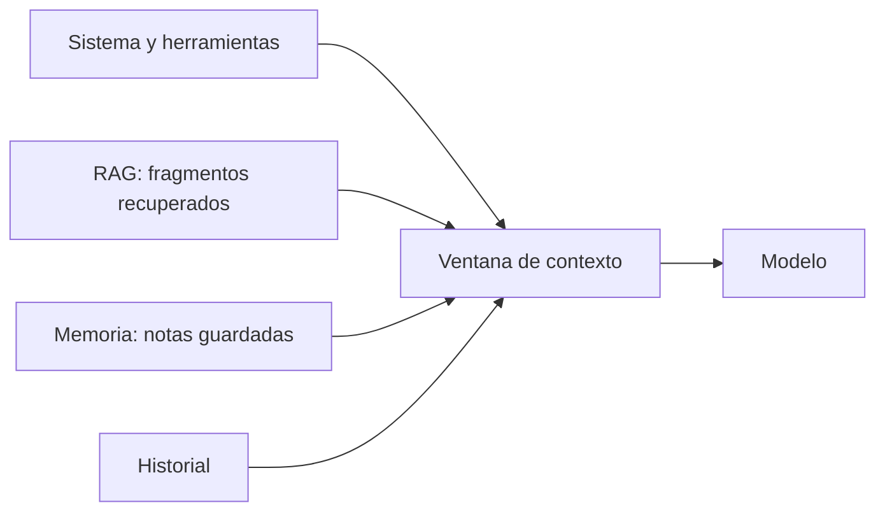

El modelo solo sabe lo que hay en la petición. Este grupo documenta **cómo decidir qué entra en el contexto, cuánto cuesta y cómo traer lo que falta**: los límites de la ventana, la caché que abarata el prefijo repetido, la recuperación de documentos y la memoria que sobrevive entre conversaciones.

## Artículos

| Artículo | Para qué lo consultas |
|---|---|
| [[docs/contexto/01-ventana-de-contexto]] | Qué cuenta, cómo medirla, qué pasa al llenarla y cómo recortar el historial. |
| [[docs/contexto/02-prompt-caching]] | `cache_control`, TTL, orden del prefijo, campos de `usage` y por qué la caché no acierta. |
| [[docs/contexto/03-rag]] | Indexar, recuperar e inyectar fragmentos; RAG frente a contexto largo; técnicas recientes; fallos típicos. |
| [[docs/contexto/04-memoria]] | Guardar y recuperar información entre sesiones: herramientas propias, la herramienta de memoria de Anthropic y el *store* de LangGraph. |
| [[docs/contexto/05-compactacion-y-limpieza-en-el-servidor]] | Compactar el historial y limpiar resultados o razonamiento antiguos en el servidor. |
| [[docs/contexto/06-mensajes-de-sistema-a-mitad-de-conversacion]] | Cambiar instrucciones, herramientas o esfuerzo a mitad de un agente sin romper la caché. |

## Cómo se relaciona con el resto

- Para **aprender** embeddings, chunking, búsqueda híbrida y memoria con ejercicios, sigue [[roadmap/30-contexto-y-rag/index]].
- Para profundizar en recuperación, el curso [[cursos/rag-a-fondo/index]]. Para el contexto como disciplina, [[disciplinas/context-engineering]] y el curso [[cursos/context-engineering/index]].
- Un sistema completo que junta todo esto: [[sistemas/rag-con-citas]].
- Para bases vectoriales y embeddings abiertos, [[docs/modelos-abiertos/05-bases-vectoriales]] y [[docs/modelos-abiertos/04-embeddings-y-rerankers]].

> [!consejo] Menos contexto suele ser mejor contexto
> Llenar la ventana «por si acaso» encarece cada llamada y diluye lo importante. Mete lo que la tarea necesita y nada más.
