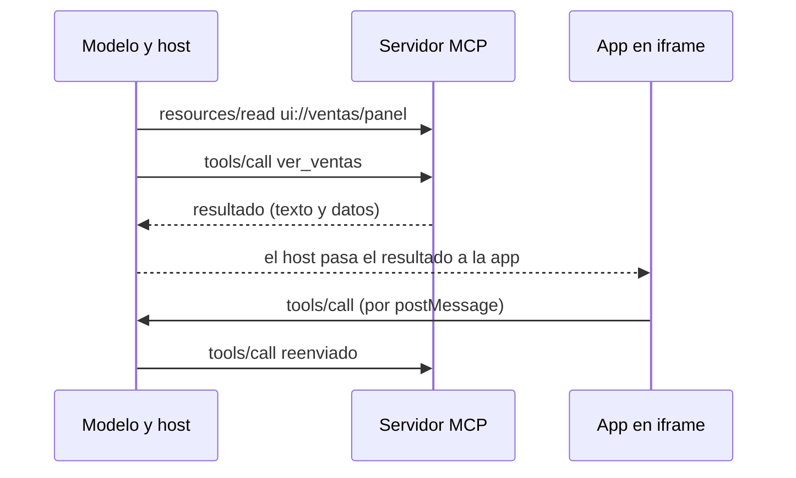

Una **extensión de MCP** es una pieza opcional que añade capacidades fuera del núcleo del protocolo: interfaces gráficas, tareas largas, descubrimiento por HTTP o mecanismos de autorización. Desde la revisión `2026-07-28` ([[docs/estandares/01-mcp-2026-07-28]]) se negocian en un campo `extensions` de las capacidades, evolucionan a su ritmo y **siempre están desactivadas por defecto**. Esta página recorre cómo funcionan y las tres que más te van a afectar: MCP Apps, Tasks y Server Cards. Al final, el registro oficial de servidores.

Fuente principal: [Extensions Overview](https://modelcontextprotocol.io/docs/extensions/overview.md) de modelcontextprotocol.io.

## Cómo se nombran y se negocian

Cada extensión tiene un identificador `{prefijo}/{nombre}`. Las oficiales usan `io.modelcontextprotocol` (por ejemplo `io.modelcontextprotocol/ui`) y viven en repositorios `ext-*` de la organización de GitHub del proyecto. Si escribes una propia, usa como prefijo un dominio tuyo al revés (`com.ejemplo/mi-extension`).

Como el protocolo ya no tiene saludo inicial, la negociación va por petición:

- **El cliente** declara las extensiones que soporta dentro de `_meta["io.modelcontextprotocol/clientCapabilities"].extensions`, en cada petición.
- **El servidor** declara las suyas en la respuesta de `server/discover`, en `capabilities.extensions`.

```json title="El cliente anuncia que sabe pintar MCP Apps"
{
  "jsonrpc": "2.0",
  "id": 1,
  "method": "tools/call",
  "params": {
    "name": "ver_ventas",
    "arguments": {"region": "norte"},
    "_meta": {
      "io.modelcontextprotocol/protocolVersion": "2026-07-28",
      "io.modelcontextprotocol/clientCapabilities": {
        "extensions": {"io.modelcontextprotocol/ui": {"mimeTypes": ["text/html;profile=mcp-app"]}}
      },
      "io.modelcontextprotocol/clientInfo": {"name": "mi-host", "version": "1.0.0"}
    }
  }
}
```

Cada extensión define el esquema de su objeto de ajustes; un objeto vacío significa «sin ajustes». La regla que más importa es la **degradación elegante**: si una parte soporta la extensión y la otra no, la que la soporta vuelve al comportamiento del núcleo o rechaza la petición si sin la extensión no puede funcionar. Un servidor con herramientas que pintan interfaz debe seguir devolviendo un texto útil para los clientes que no la entienden.

Las extensiones oficiales pasan por un proceso formal (un SEP del tipo *Extensions Track*, con al menos una implementación de referencia en un SDK oficial). Las experimentales viven en repositorios `experimental-ext-*` y deben indicarlo en su nombre y su README. Un cambio incompatible exige un identificador nuevo (`…/mi-extension-v2`).

| Extensión | Identificador | Para qué |
|---|---|---|
| MCP Apps | `io.modelcontextprotocol/ui` | Interfaces HTML interactivas dentro de la conversación |
| Tasks | `io.modelcontextprotocol/tasks` | Operaciones largas con un *handle* duradero y sondeo |
| Skills over MCP | `io.modelcontextprotocol/skills` | Descubrir [[glosario/skill|skills]] y leer sus archivos como recursos |
| OAuth Client Credentials | `io.modelcontextprotocol/oauth-client-credentials` | Autenticación máquina a máquina, sin login interactivo |
| Enterprise-Managed Authorization | `io.modelcontextprotocol/enterprise-managed-authorization` | Control de acceso centralizado con el proveedor de identidad de la empresa |
| Server Cards | (en `experimental-ext-server-card`) | Describir un servidor remoto antes de conectar |

Qué cliente soporta cada una cambia a menudo: consulta la [matriz de soporte](https://modelcontextprotocol.io/extensions/client-matrix.md), que mantiene la comunidad.

## MCP Apps: interfaces dentro de la conversación

Con [MCP Apps](https://modelcontextprotocol.io/extensions/apps/overview.md) una herramienta puede devolver, además de datos, una **interfaz HTML interactiva** (un gráfico, un formulario, un visor de PDF) que el host pinta en línea. Funciona combinando dos primitivas que ya conoces: una herramienta y un recurso.



1. La descripción de la herramienta lleva `_meta.ui.resourceUri` apuntando a un recurso `ui://`. El host puede precargarlo antes de que el modelo llame a la herramienta.
2. El recurso contiene una página HTML, normalmente con su JavaScript y su CSS empaquetados. Si necesita cargar algo externo, declara los orígenes en `_meta.ui.csp`; si necesita micrófono o cámara, los pide en `permissions`.
3. El host la pinta en un **iframe aislado** (*sandbox*): la app no puede leer el DOM de la página, ni sus *cookies*, ni navegar por ella.
4. App y host hablan por `postMessage` con un dialecto de JSON-RPC: algunos métodos son los de MCP (`tools/call`), otros son propios con prefijo `ui/` (`ui/initialize`). La app puede pedir llamadas a herramientas, enviar mensajes y actualizar el contexto del modelo, siempre con lo que el host le permita.

Según la página oficial, hoy lo soportan Claude, Claude Desktop, GitHub Copilot en VS Code, Microsoft 365 Copilot, Goose, Postman, MCPJam y Archestra.AI. El SDK es `@modelcontextprotocol/ext-apps` (su clase `App` es una comodidad: puedes implementar el protocolo de `postMessage` a mano). Para el lado del host existen `@mcp-ui/client` (componentes React) y el módulo *App Bridge* del SDK.

**Cuándo compensa**: explorar datos con muchas dimensiones, configurar algo con decenas de opciones, ver medios (PDF, 3D), paneles que se actualizan solos y flujos de revisión elemento a elemento. Si tu caso no gana nada por vivir dentro de la conversación, una web normal es más sencilla.

> [!peligro] Una app es código de terceros dentro de tu host
> El iframe aislado protege la página del host, pero la app puede pedir llamadas a herramientas y meter texto en el contexto del modelo. Si eres host, limita qué herramientas puede invocar cada app y trata lo que devuelve como cualquier resultado de herramienta: puede traer [[glosario/inyeccion-de-prompt|inyecciones]]. Más en [[docs/seguridad/04-mcp-y-skills-de-terceros]].

## Tasks: operaciones que tardan

Un pipeline de CI, un procesamiento por lotes o una aprobación humana pueden tardar minutos. Mantener la conexión abierta choca con los tiempos máximos de clientes e intermediarios. La extensión [Tasks](https://modelcontextprotocol.io/extensions/tasks/overview.md) permite al servidor devolver un **handle duradero** en lugar del resultado:

1. El cliente declara `io.modelcontextprotocol/tasks` en sus capacidades por petición; el servidor, en `server/discover`.
2. Ante una petición larga, el servidor responde `resultType: "task"` (un `CreateTaskResult`) con `taskId`, estado inicial, `ttlMs` y `pollIntervalMs`. La tarea debe quedar guardada antes de responder.
3. El cliente sondea con `tasks/get`, respetando `pollIntervalMs`.
4. Si la tarea pasa a `input_required`, la respuesta de `tasks/get` trae `inputRequests` y el cliente contesta con `tasks/update`.
5. Al terminar, `completed` trae en `result` lo que habría devuelto la llamada síncrona; `failed` trae el error JSON-RPC en `error`.
6. `tasks/cancel` pide cancelar. Es cooperativo: el servidor lo reconoce, pero la tarea puede acabar en otro estado terminal.

| Estado | Significado | ¿Terminal? |
|---|---|---|
| `working` | En curso | No |
| `input_required` | Necesita datos del cliente; mira `inputRequests` | No |
| `completed` | Terminada; el resultado va en `result` | Sí |
| `failed` | Error durante la ejecución; detalle en `error` | Sí |
| `cancelled` | Cancelada | Sí |

Respecto a la versión experimental anterior, el rediseño elimina el método bloqueante `tasks/result` y `tasks/list`, añade `tasks/update` y deja que **el servidor decida** por petición si crea una tarea. Si el servidor lo soporta, puede enviar `notifications/tasks` por `subscriptions/listen` y el cliente deja de sondear.

Dos reglas para no romper nada: el servidor **nunca** devuelve una tarea a un cliente que no declaró la extensión, y el cliente **guarda los `taskId` de forma duradera** para seguir sondeando tras un reinicio. Es el mismo principio que los *handles* del núcleo: el estado tiene nombre y sobrevive a la conexión.

## Server Cards: saber de un servidor antes de conectar

`server/discover` solo sirve cuando ya sabes dónde conectar. Las **Server Cards** cubren el paso anterior: un documento estático, público y cacheable que describe un servidor **remoto**. Lleva su identidad (`name`, `version`, `description`, y opcionalmente `title`, `icons`, `repository`, `websiteUrl`), sus *endpoints* de transporte con cabeceras y plantillas de variables, y las versiones del protocolo que admite.

El diseño está en el [SEP-2127](https://modelcontextprotocol.io/seps/2127-mcp-server-cards.md), de tipo *Extensions Track* y en estado *Final*. El formato detallado vive en el repositorio `experimental-ext-server-card`. Lo esencial:

- La ubicación recomendada es `<url-de-streamable-http>/server-card`, aunque la tarjeta puede estar en cualquier URI.
- Para descubrir todos los servidores de un dominio se usa un *AI Catalog* en `/.well-known/ai-catalog.json`, que enlaza o incrusta tarjetas.
- **No lista herramientas, recursos ni prompts.** Lo que expone un servidor puede cambiar por usuario o configuración, así que eso se sigue pidiendo en vivo con `tools/list`. Tampoco anuncia capacidades ni extensiones.
- Si la tarjeta y `server/discover` no coinciden, gana `server/discover`.
- Es pública: nada de credenciales, topología interna ni datos de usuario. Sírvela por HTTPS.

Sirve para autoconfigurar un IDE al darle un dominio, para que los registros indexen servidores rastreando dominios y para enseñar información sin abrir cada conexión. Hay implementaciones experimentales en los SDK de Python y Go: compruébalo en el repositorio antes de depender de ellas.

## El registro oficial (vista previa)

[registry.modelcontextprotocol.io](https://modelcontextprotocol.io/registry/about.md) es el registro central de metadatos de servidores MCP públicos. Está **en vista previa**: puede haber cambios incompatibles o borrados de datos antes de su versión general.

- **Guarda metadatos, no código.** Cada entrada es un `server.json` con un nombre único, dónde está el servidor (paquete de npm o PyPI, imagen Docker, URL remota), cómo ejecutarlo y datos de descubrimiento. El código sigue en npm, PyPI o Docker Hub.
- **Espacios de nombres verificados.** Los nombres siguen el formato DNS inverso (`io.github.usuario/servidor`, `com.ejemplo/servidor`) y solo puede publicar quien demuestra la propiedad de la cuenta de GitHub o del dominio.
- **No es para que los hosts lo consuman directamente.** Está pensado para agregadores (*marketplaces*) que lo leen cada cierto tiempo y añaden curación o valoraciones. Los hosts deberían usar esos agregadores, que exponen la misma API (hay una especificación OpenAPI que cualquier registro puede implementar).
- **No escanea seguridad**: delega en los registros de paquetes y en los agregadores. Que un servidor esté en el registro no dice nada de si es seguro.
- **No admite servidores privados.** Para los internos, monta tu propio registro con la misma API.

## Errores frecuentes

- **Dar por hecho que el host soporta una extensión.** Comprueba las capacidades en cada petición y devuelve siempre contenido de texto útil.
- **Devolver una tarea sin que el cliente la haya pedido.** El cliente no sabrá qué hacer con `resultType: "task"`.
- **Guardar los `taskId` solo en memoria** en el cliente: tras un reinicio pierdes el trabajo.
- **Usar la Server Card como fuente de verdad** de las herramientas o para decisiones de acceso.
- **Instalar desde el registro sin revisar.** El registro verifica quién publica, no qué hace el código.

## Ver también

- [[docs/estandares/01-mcp-2026-07-28]]: el núcleo sin estado sobre el que se apoyan las extensiones.
- [[docs/estandares/04-agent-skills-y-agents-md]]: el formato que transporta Skills over MCP.
- [[docs/herramientas/02-mcp]] y [[cursos/mcp-de-cero-a-servidor/04-seguridad-y-despliegue]].
- [[docs/claude-code/07-mcp-en-claude-code]].
