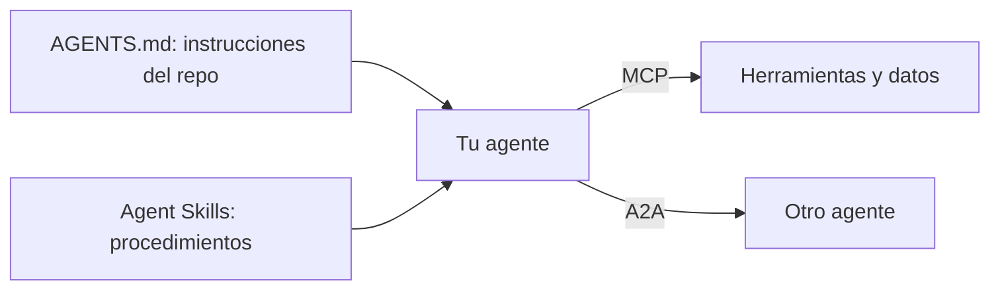

Un agente útil necesita cuatro cosas que no vienen en el modelo: **herramientas y datos**, **otros agentes** en los que delegar, **procedimientos** para tareas concretas e **instrucciones del proyecto** en el que trabaja. Para cada una hay hoy un formato abierto, independiente del proveedor, que te permite escribir la pieza una vez y usarla desde varios clientes. Este grupo documenta esos cuatro estándares: qué cambia en ellos, cómo son por dentro y cuándo usar cada uno.

## La casa común: la Agentic AI Foundation

Los cuatro están alojados en la [Agentic AI Foundation](https://aaif.io) (AAIF), una iniciativa de la Linux Foundation que se presenta como una fundación «neutral and open» para el desarrollo abierto de agentes. Según Anthropic, la cofundó en 2025 junto con Block y OpenAI. Además de estos estándares, la fundación aloja proyectos como goose (un agente abierto), agentgateway y Agent Router (pasarelas), Open Responses (un formato de API común entre proveedores), OpenEnv (entornos para entrenar agentes) y OpenSandbox.

Que un estándar esté en una fundación neutral importa en la práctica: ninguna empresa puede cambiarlo sola, las propuestas pasan por un proceso público y es razonable apostar por él en un proyecto que vaya a durar años.

## Cuándo cada uno

| Necesitas… | Estándar | Lo que intercambias |
|---|---|---|
| Que tu agente use una base de datos, una API o un sistema interno | [[glosario/mcp|MCP]] | Herramientas, recursos y prompts de un servidor |
| Encargar una tarea entera a un agente que no controlas | [[glosario/a2a|A2A]] | Tareas con estado, mensajes y artefactos |
| Enseñar a tu agente un procedimiento que solo hace falta a veces | Agent Skills | Una carpeta con `SKILL.md`, scripts y referencias |
| Dar a cualquier agente de código las reglas de tu repositorio | [[glosario/agents-md|AGENTS.md]] | Un archivo Markdown en la raíz |

Las fronteras son claras. MCP y A2A son **protocolos**: definen mensajes que viajan entre procesos. Agent Skills y AGENTS.md son **formatos de archivo**: definen qué lee el agente desde disco o desde un servidor. Se combinan sin problema: un agente de código lee el AGENTS.md del repositorio, activa una *skill* para preparar la *release*, llama por MCP al sistema de tickets y delega por A2A la revisión legal a un agente de otro equipo.

## Artículos

- [[docs/estandares/01-mcp-2026-07-28]]. La revisión que quita el saludo `initialize` y las sesiones: `_meta` por petición, `server/discover`, MRTR, caché de listas, deprecaciones y cómo migrar un servidor con estado a *handles*. Léelo si mantienes un servidor o un cliente MCP.
- [[docs/estandares/02-extensiones-mcp]]. Cómo se negocian las extensiones y qué aportan MCP Apps (interfaces en un iframe aislado), Tasks (operaciones largas con sondeo) y Server Cards, más el registro oficial en vista previa.
- [[docs/estandares/03-a2a]]. A2A 1.0: Agent Card, estados de una tarea, operaciones, *bindings*, la cabecera `A2A-Version` y un agente mínimo con `a2a-sdk`, con la tabla de cuándo A2A y cuándo MCP.
- [[docs/estandares/04-agent-skills-y-agents-md]]. La especificación de `SKILL.md`, la divulgación progresiva, la donación a la AAIF y AGENTS.md frente a `CLAUDE.md`.

## Cómo se relaciona con el resto

- La **introducción a MCP** (arquitectura, primitivas, tu primer servidor) está en [[docs/herramientas/02-mcp]] y en el curso [[cursos/mcp-de-cero-a-servidor/index]]. Para usar servidores remotos desde la API: [[docs/herramientas/07-mcp-desde-la-api]].
- Para **aprender a escribir skills** con ejercicios, el nivel [[roadmap/50-skills/index]]. Cómo las usa Claude Code: [[docs/claude-code/03-skills]].
- La memoria de Claude Code y su lectura de AGENTS.md: [[docs/claude-code/01-memoria-claude-md-y-agents-md]].
- Antes de repartir trabajo entre agentes, [[roadmap/60-multiagente/01-cuando-no-usar-multiagente]].

> [!aviso] Estándar abierto no significa seguro
> Un servidor MCP, un agente A2A o una *skill* de terceros es código o texto ajeno que entra en tu agente. Revísalos como cualquier dependencia: [[docs/seguridad/04-mcp-y-skills-de-terceros]].
