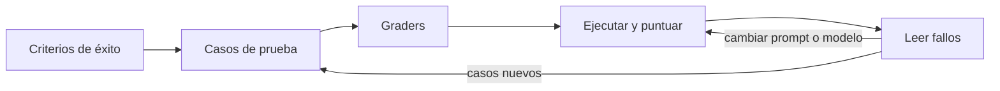

Una **eval** es una prueba repetible que mide si un sistema con modelos hace bien su trabajo: un conjunto de entradas, una forma de puntuar cada salida y un agregado que comparas entre versiones. Diseñarla bien consiste en decidir qué significa «bien» para tu caso antes de tocar el prompt. Las [[glosario/evals|evals]] cumplen el papel de los tests en el software clásico, con una diferencia: la salida varía entre ejecuciones y muchas veces no hay una única respuesta correcta.

## El proceso



### 1. Escribe criterios de éxito medibles

«Que responda bien» no se puede medir. Traduce la intención a criterios concretos:

| Intención vaga | Criterio medible |
|---|---|
| Que clasifique bien los tickets | La categoría coincide con la etiqueta humana en el 95 % de los casos del conjunto. |
| Que no se invente cosas | Cada afirmación de la respuesta está respaldada por un fragmento citado. |
| Que el tono sea adecuado | Un juez con rúbrica puntúa el tono como «profesional» en al menos 4 de 5. |
| Que el agente no gaste de más | Resuelve la tarea en 8 pasos o menos. |

Los umbrales los pones tú según lo que tu producto necesita. Lo importante es que existan antes de empezar a iterar, para no moverlos a conveniencia.

### 2. Construye el [[glosario/conjunto-de-evaluacion|conjunto de prueba]]

Las mejores fuentes de casos, por orden:

1. **Tráfico real**: preguntas de usuarios, tickets, documentos que de verdad procesa tu sistema.
2. **Fallos conocidos**: cada error reportado se convierte en un caso. Así no vuelve.
3. **Casos límite escritos a mano**: entradas vacías, idiomas mezclados, peticiones fuera de alcance, intentos de [[glosario/inyeccion-de-prompt|inyección]].
4. **Casos sintéticos** generados con un modelo, revisados por una persona antes de entrar.

Empieza con 20–50 casos bien elegidos. Un conjunto pequeño que cubre los tipos de entrada importantes es más útil que mil casos parecidos entre sí. Para cada caso guarda la entrada, la salida esperada o los criterios que debe cumplir, y una etiqueta de tipo para poder ver resultados por categoría. La lección [[roadmap/80-evals/02-conjunto-de-prueba]] profundiza en esto.

### 3. Elige un grader por criterio

Un grader es lo que puntúa una salida. Hay tres tipos y conviene usar el más simple que funcione:

| Grader | Úsalo para | Ventajas | Limitaciones |
|---|---|---|---|
| Código | Coincidencia exacta, JSON válido, campos presentes, regex, llamadas a herramientas esperadas | Rápido, barato, determinista | Solo mide lo que se puede comprobar mecánicamente |
| [[glosario/modelo-juez]] | Tono, fidelidad a las fuentes, completitud, utilidad | Escala a criterios subjetivos | Cuesta tokens, tiene sesgos, hay que calibrarlo |
| Humano | Calibrar los otros dos, casos ambiguos, decisiones finales | Es la referencia | Lento y caro |

Muchos criterios que parecen subjetivos se pueden convertir en código. «Que cite la fuente» se comprueba buscando el identificador del documento en la respuesta. Haz esa conversión siempre que puedas. Para lo que no se puede, lee [[docs/evals/02-modelo-como-juez]].

## Un arnés mínimo

```python tab="Python" title="evals.py"
import json
import anthropic

MODEL = "claude-sonnet-5-5"
client = anthropic.Anthropic()

SYSTEM = ("Clasifica el ticket en una categoría: facturacion, envio, devolucion u otro. "
          "Responde solo con la categoría.")

CASOS = [  # en la práctica, cárgalos de un archivo JSONL versionado
    {"id": "t1", "tipo": "claro", "entrada": "No me ha llegado el pedido 4411", "esperado": "envio"},
    {"id": "t2", "tipo": "claro", "entrada": "Me cobrasteis dos veces", "esperado": "facturacion"},
    {"id": "t3", "tipo": "ambiguo", "entrada": "Quiero devolverlo y que me reembolséis", "esperado": "devolucion"},
]

def sistema(entrada: str) -> str:
    resp = client.messages.create(model=MODEL, max_tokens=20, system=SYSTEM,
                                  messages=[{"role": "user", "content": entrada}])
    return "".join(b.text for b in resp.content if b.type == "text").strip().lower()

def grader(salida: str, caso: dict) -> bool:
    return salida == caso["esperado"]

def evaluar() -> None:
    resultados = []
    for caso in CASOS:
        salida = sistema(caso["entrada"])
        resultados.append({**caso, "salida": salida, "ok": grader(salida, caso)})
    aciertos = sum(r["ok"] for r in resultados)
    print(f"Aciertos: {aciertos}/{len(resultados)}")
    for r in resultados:
        if not r["ok"]:
            print(json.dumps(r, ensure_ascii=False))  # lee siempre los fallos

if __name__ == "__main__":
    evaluar()
```

```text
# salida de ejemplo
Aciertos: 2/3
{"id": "t3", "tipo": "ambiguo", "entrada": "Quiero devolverlo y que me reembolséis", "esperado": "devolucion", "salida": "facturacion", "ok": false}
```

El arnés tiene cuatro piezas separadas a propósito: los casos, el sistema bajo prueba, el grader y el informe. Así puedes cambiar el prompt o el modelo sin tocar lo demás, y añadir graders nuevos sin reescribir el bucle.

## Medir agentes

En un agente no basta con mirar la respuesta final. Mide también la [[glosario/trayectoria|trayectoria]]: qué herramientas llamó, en qué orden, cuántos pasos dio y cuántos tokens gastó. Dos agentes pueden acertar la respuesta y uno haberlo hecho en 4 pasos y el otro en 25. Guarda la traza completa de cada caso de eval; es lo que leerás cuando algo falle. Ver [[roadmap/80-evals/04-evals-de-trayectoria]].

## La variabilidad

La misma entrada puede dar salidas distintas. Para decisiones importantes:

- Ejecuta cada caso varias veces y mira la tasa de acierto, no un único resultado.
- Compara versiones sobre el mismo conjunto y en las mismas condiciones.
- Desconfía de diferencias pequeñas en conjuntos pequeños: dos aciertos más en 30 casos pueden ser ruido.

> [!consejo] Lee los fallos, no solo el número
> El agregado te dice si vas mejor o peor. Los fallos individuales te dicen por qué. Dedica más tiempo a lo segundo.

## Errores frecuentes

- **Iterar el prompt sin conjunto fijo**: cada prueba se hace con casos distintos y no puedes comparar.
- **Conjunto contaminado**: copiar los casos de prueba como ejemplos *[[glosario/few-shot|few-shot]]* en el prompt. La eval sale perfecta y no mide nada.
- **Solo casos fáciles**: si todo pasa al 100 %, el conjunto no está buscando los límites.
- **No versionar**: guarda casos, prompts y resultados en el repositorio para poder comparar con versiones anteriores.

## Ver también

- [[docs/evals/02-modelo-como-juez]]: graders con modelo.
- [[recetas/evals-de-regresion-en-ci]]: ejecutar esto en cada cambio.
- [[roadmap/80-evals/01-por-que-evals]]: la motivación, paso a paso.
- [[cursos/evals-para-agentes/01-que-medir]]: qué medir en un agente.
