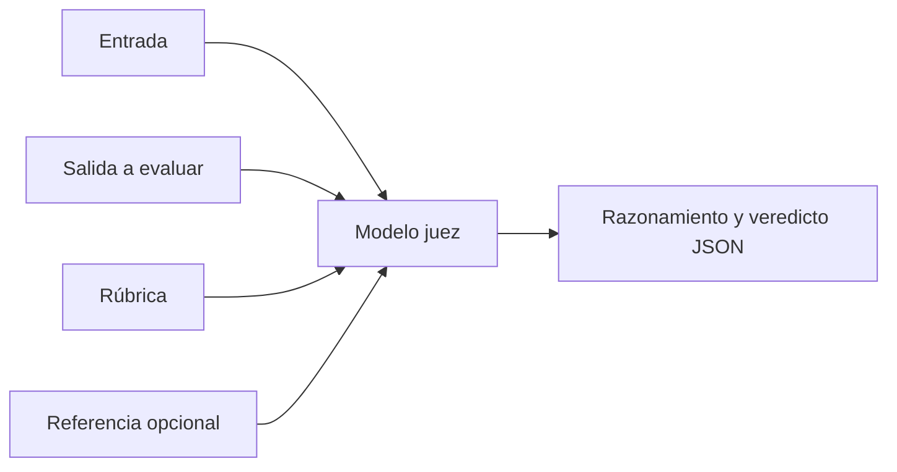

Un **[[glosario/modelo-juez|modelo juez]]** es un modelo de lenguaje que puntúa la salida de otro sistema siguiendo una rúbrica. Lo usas como grader en tus [[glosario/evals|evals]] cuando el criterio no se puede comprobar con código: fidelidad a las fuentes, tono, completitud, si una explicación es correcta. Bien calibrado, te deja evaluar cientos de casos en minutos. Mal calibrado, te da números que parecen precisos y no significan nada.

## Cuándo usarlo

Úsalo después de descartar un grader de código. Pregúntate primero si el criterio se puede convertir en una comprobación mecánica: ¿aparece el identificador de la fuente?, ¿el JSON tiene los campos?, ¿se llamó a la herramienta correcta? Si la respuesta es no, el juez es la opción razonable.

Encaja bien en:

- **Fidelidad**: ¿cada afirmación está respaldada por el contexto recuperado? Muy útil en [[glosario/rag|RAG]].
- **Cumplimiento de instrucciones**: ¿respetó el formato, la longitud, lo que no debía decir?
- **Comparación por pares**: ¿la versión A responde mejor que la B a esta pregunta?
- **Calidad subjetiva acotada**: tono, claridad, si la respuesta resuelve lo que se preguntó.

## Anatomía de un buen juez



### La rúbrica

Es la parte que más importa. Una buena rúbrica:

- **Evalúa un criterio por llamada.** Un juez que puntúa a la vez fidelidad, tono y longitud mezcla todo. Haz un juez por criterio.
- **Prefiere escalas cortas o binarias.** «Cumple / no cumple» es más estable que una escala de 1 a 10. Si necesitas grados, usa 3–5 niveles con una descripción de cada uno.
- **Describe cada nivel con ejemplos concretos** de qué lo hace merecer esa nota.
- **Incluye la referencia cuando la tengas**: la respuesta esperada o los documentos fuente. Juzgar contra una referencia es mucho más fiable que juzgar en abstracto.

### Razonar antes del veredicto

Pide al juez que escriba su análisis antes de la nota. En un esquema JSON, pon el campo de razonamiento **antes** que el veredicto: el modelo genera en orden y así la nota se apoya en el análisis. Además, cuando revises discrepancias, el razonamiento te dirá por qué puntuó así. Pide un análisis breve y concreto (afirmaciones y respaldo), no que vuelque su razonamiento paso a paso: con los modelos 5.x ya razona por dentro, y pedir el razonamiento en la salida puede disparar rechazos.

### Estabilizar al juez sin `temperature`

En la API de Claude ya no existe `temperature` (versión `2026-10-21`), así que «juez con `temperature=0`» no es una opción. La estabilidad sale de otras piezas:

- **Salida estructurada** con un `enum` cerrado para el veredicto.
- **Rúbrica cerrada** y binaria siempre que puedas, con una salida «no se puede determinar» para casos sin información suficiente, en lugar de forzar una nota.
- **Modelo y esfuerzo fijos**: el ID completo del modelo y el `effort` explícito, registrados con cada resultado.
- **Varias muestras y voto** en los casos que importan: tres llamadas y mayoría.

## Ejemplo completo

Un juez de fidelidad con salida estructurada garantizada por esquema:

```python tab="Python" title="juez.py"
import json
import anthropic

MODEL = "claude-sonnet-5-5"
client = anthropic.Anthropic()

RUBRICA = """Evalúas si una respuesta es FIEL a los documentos fuente.
- "fiel": todas las afirmaciones de la respuesta aparecen o se deducen directamente de los documentos.
- "parcial": la mayoría está respaldada, pero hay al menos un detalle que no aparece en los documentos.
- "infiel": alguna afirmación central contradice los documentos o no tiene respaldo.
No juzgues el estilo ni la longitud. Solo la fidelidad.
Primero enumera las afirmaciones y busca el respaldo de cada una; después decide."""

ESQUEMA = {
    "type": "object",
    "properties": {
        "analisis": {"type": "string"},
        "afirmaciones_sin_respaldo": {"type": "array", "items": {"type": "string"}},
        "veredicto": {"type": "string", "enum": ["fiel", "parcial", "infiel"]},
    },
    "required": ["analisis", "afirmaciones_sin_respaldo", "veredicto"],
    "additionalProperties": False,
}

def juzgar(documentos: str, pregunta: str, respuesta: str) -> dict:
    contenido = (f"<documentos>\n{documentos}\n</documentos>\n"
                 f"<pregunta>{pregunta}</pregunta>\n"
                 f"<respuesta_a_evaluar>\n{respuesta}\n</respuesta_a_evaluar>")
    resp = client.messages.create(
        model=MODEL, max_tokens=4096, system=RUBRICA,
        messages=[{"role": "user", "content": contenido}],
        output_config={"format": {"type": "json_schema", "schema": ESQUEMA}, "effort": "medium"},
    )
    if resp.stop_reason != "end_turn":  # cortado o rechazado: no hay JSON válido que leer
        raise RuntimeError(f"El juez no terminó: {resp.stop_reason}")
    texto = "".join(b.text for b in resp.content if b.type == "text")
    veredicto = json.loads(texto)
    if veredicto["veredicto"] not in ("fiel", "parcial", "infiel"):  # valida igualmente
        raise ValueError(f"Veredicto inesperado: {veredicto}")
    return veredicto
```

```ts tab="TypeScript" title="juez.ts"
import Anthropic from "@anthropic-ai/sdk";

const MODEL = "claude-sonnet-5-5";
const client = new Anthropic();
const RUBRICA = "…"; // la misma rúbrica que en Python

const ESQUEMA = {
  type: "object",
  properties: {
    analisis: { type: "string" },
    afirmaciones_sin_respaldo: { type: "array", items: { type: "string" } },
    veredicto: { type: "string", enum: ["fiel", "parcial", "infiel"] },
  },
  required: ["analisis", "afirmaciones_sin_respaldo", "veredicto"],
  additionalProperties: false,
};

export async function juzgar(documentos: string, pregunta: string, respuesta: string) {
  const resp = await client.messages.create({
    model: MODEL, max_tokens: 4096, system: RUBRICA,
    messages: [{ role: "user", content:
      `<documentos>\n${documentos}\n</documentos>\n<pregunta>${pregunta}</pregunta>\n` +
      `<respuesta_a_evaluar>\n${respuesta}\n</respuesta_a_evaluar>` }],
    output_config: { format: { type: "json_schema", schema: ESQUEMA }, effort: "medium" },
  });
  if (resp.stop_reason !== "end_turn") throw new Error(`El juez no terminó: ${resp.stop_reason}`);
  const texto = resp.content.flatMap((b) => (b.type === "text" ? [b.text] : [])).join("");
  return JSON.parse(texto) as { analisis: string; afirmaciones_sin_respaldo: string[]; veredicto: string };
}
```

```text
# salida de ejemplo
{"analisis": "La respuesta afirma dos cosas: (1) el plazo de devolución es de 30 días, respaldado por el documento 2; (2) el envío de vuelta es gratuito, que no aparece en ningún documento.",
 "afirmaciones_sin_respaldo": ["El envío de vuelta es gratuito"],
 "veredicto": "parcial"}
```

Las etiquetas XML separan con claridad qué es fuente, qué es pregunta y qué es lo que se evalúa. Eso evita que el juez confunda la respuesta con los documentos. Las [[glosario/salida-estructurada|salidas estructuradas]] garantizan el formato; tu código sigue validando el contenido.

## Calibrar: ¿el juez piensa como tú?

Un juez sin calibrar es una opinión más. Antes de fiarte de él:

1. Etiqueta a mano 30–100 casos con el mismo criterio que usa el juez, con veredictos binarios (pasa o falla) y casos de los dos tipos.
2. Ejecuta el juez sobre esos casos. Separa los que usas para ajustar la rúbrica de los que usas para medirla, o te engañarás.
3. Mide la coincidencia por separado en cada clase: la **tasa de verdaderos positivos** (de los que pasan según la persona, cuántos aprueba el juez) y la **de verdaderos negativos** (de los que fallan, cuántos suspende). Un porcentaje global alto puede esconder un juez que lo aprueba todo. Y, sobre todo, **lee los desacuerdos**: suelen revelar que la rúbrica es ambigua.
4. Ajusta la rúbrica y repite hasta que la coincidencia te parezca suficiente para tu uso.
5. Vuelve a calibrar cuando cambies el modelo juez o la rúbrica.

El procedimiento completo, con la corrección de la tasa observada, está en [[recetas/validar-un-modelo-juez]]. El problema de fondo, que los criterios cambian al ver las salidas, lo describen Shankar et al., 2024, [*Who Validates the Validators?*](https://arxiv.org/abs/2404.12272).

> [!aviso] El juez también es un sistema que evaluar
> Si el juez cambia, tus números cambian aunque el sistema evaluado siga igual. Fija el modelo y la versión de la rúbrica, y regístralos junto a cada resultado.

## Sesgos conocidos

[Zheng et al. (2023)](https://arxiv.org/abs/2306.05685) estudiaron modelos como jueces y describieron varios sesgos. Los más relevantes en la práctica:

| Sesgo | Qué pasa | Mitigación |
|---|---|---|
| Posición | En comparaciones por pares, el juez tiende a favorecer una posición. | Evalúa cada par dos veces intercambiando el orden; si el veredicto cambia, cuéntalo como empate. |
| Verbosidad | Las respuestas más largas parecen mejores. | Di en la rúbrica que la longitud no puntúa; evalúa la longitud aparte con código. |
| Autopreferencia | Un modelo puede favorecer textos parecidos a los que él mismo genera. | Calibra con etiquetas humanas; considera un juez de otra familia de modelos para comparaciones. |
| Razonamiento limitado | En matemáticas o lógica, el juez puede aceptar una respuesta errónea bien presentada. | Dale la respuesta de referencia y pídele que compare contra ella. |

## Errores frecuentes

- **Escalas largas sin anclas**: «puntúa de 1 a 10» da números inestables.
- **Varios criterios en un juez**: no sabrás qué falló.
- **Usar la salida del juez como verdad sin calibrar**.
- **Juez más débil que el sistema evaluado** en tareas difíciles: no detecta errores sutiles y tiende a inflar las notas. Pasa a menudo al usar un modelo local pequeño como juez para ahorrar. Para el juez, usa un modelo al menos tan capaz como el evaluado, salvo que tu calibración diga que uno más pequeño basta ([[docs/modelos-abiertos/08-evals-abiertas]]).
- **Copiar `temperature=0` de un ejemplo antiguo**: con el SDK 2.x da `TypeError`.

## Ver también

- [[recetas/modelo-juez-con-rubrica]]: la receta paso a paso.
- [[docs/evals/01-disenar-evals]]: dónde encaja el juez en una eval.
- [[cursos/evals-para-agentes/03-graders]]: código, modelo y humano.
- [[modelos/03-formato-y-salidas-estructuradas]]: cómo garantizar el JSON.
- [[biblioteca/llm-as-a-judge]]: el artículo de Zheng et al., comentado.
