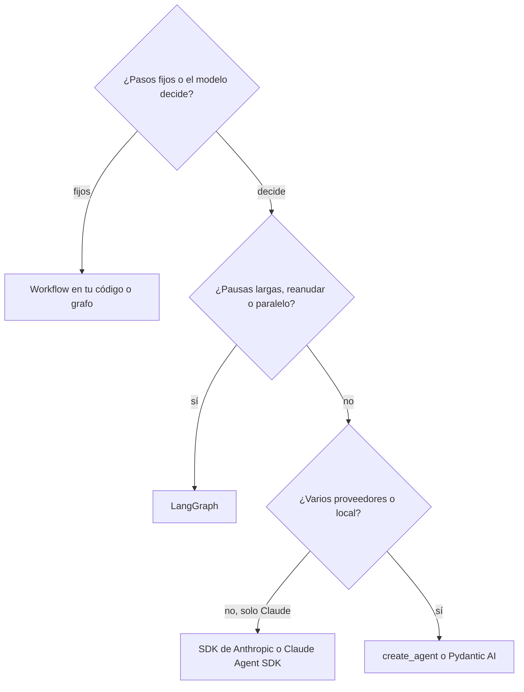

Elegir framework es elegir **quién escribe qué parte del agente**. Con el SDK del proveedor escribes tú el bucle, los límites, los reintentos y la persistencia. Con un [[glosario/framework-de-agentes|framework]] esas piezas vienen hechas y tú escribes la configuración. Ninguna opción es mejor en abstracto: la buena es la que te deja ver y cambiar lo que tu caso necesita, con el menor número de piezas que no entiendes.

Esta página da los criterios, un árbol de decisión y una tabla de las opciones principales. Si aún no has escrito un bucle agéntico a mano, hazlo antes ([[roadmap/40-primer-agente/02-el-bucle-agentico]]): sin eso no sabrás qué te esconde cada framework.

## Las cuatro familias

1. **SDK del proveedor** (`anthropic`, y para Claude Code como librería el [[docs/frameworks/03-claude-agent-sdk|Claude Agent SDK]]). Llamas a la API y escribes el bucle. Cero abstracción y acceso inmediato a lo nuevo del proveedor.
2. **Frameworks de bucle**: [[docs/frameworks/04-langchain|LangChain]] (`create_agent`), [[docs/frameworks/07-pydantic-ai|Pydantic AI]], el [[docs/frameworks/06-openai-agents-sdk|OpenAI Agents SDK]], el AI SDK de Vercel en TypeScript. El bucle modelo → herramientas → respuesta ya está escrito; añades límites, aprobación o salida tipada con configuración.
3. **Grafos con estado**: [[docs/frameworks/05-langgraph|LangGraph]], y en menor medida `pydantic-graph` o los Workflows de [[docs/frameworks/08-llamaindex|LlamaIndex]]. Dibujas los pasos y el framework guarda el estado en cada uno, para pausar, reanudar y paralelizar.
4. **Alto nivel y harnesses**: [[docs/frameworks/10-deep-agents|Deep Agents]], CrewAI y similares ([[docs/frameworks/09-otros-frameworks]]). Traen opiniones fuertes: archivos virtuales, subagentes, roles. Rápidos de arrancar y con más texto que no escribes tú.

## Ocho criterios

| Criterio | La pregunta | Qué mirar |
|---|---|---|
| **Control** | ¿Puedo cambiar cualquier paso del bucle? | Si el framework te deja envolver la llamada al modelo y la de cada herramienta (middleware, hooks, nodos) |
| **Depuración** | ¿Veo exactamente qué se envió al modelo y qué volvió? | Si puedes imprimir los mensajes completos y escribir pruebas con un [[glosario/modelo-simulado\|modelo simulado]] |
| **Lock-in** | ¿Qué me cuesta irme? | Licencia del código, qué parte es servicio de pago, valores por defecto que apuntan a una nube |
| **Ecosistema** | ¿Hay integraciones para lo que uso? | Proveedores de modelos, almacenes vectoriales, MCP, observabilidad |
| **Lenguaje** | ¿Existe en mi stack? | Python, TypeScript o ambos ([[docs/frameworks/11-agentes-en-typescript]]) |
| **Durabilidad** | ¿Sobrevive a una caída o a una aprobación de tres días? | Checkpoints por paso, reanudación por `thread_id`, integración con Temporal o similar ([[glosario/ejecucion-duradera]]) |
| **Multiagente** | ¿Necesito varios agentes? | Handoffs, agentes como herramientas, subagentes con contexto propio ([[glosario/handoff]], [[glosario/subagente]]) |
| **Coste de la abstracción** | ¿Cuánto me añade en tokens, en sorpresas y en mantenimiento? | Texto de sistema que inyecta, valores por defecto, ritmo de versiones |

## Árbol de decisión

Léelo con cuatro matices. Primero, la pregunta de arriba es la que más pesa: si los pasos son fijos, es un [[glosario/workflow|workflow]] y tres funciones bien escritas suelen ganar a cualquier framework ([[patrones/01-workflows-vs-agentes]]). Segundo, «solo Claude» no obliga al SDK: un framework te sigue ahorrando código si necesitas su middleware. Tercero, el Claude Agent SDK es la opción si tu agente se parece a un agente de código (archivos, terminal, búsqueda) y aceptas sus términos comerciales. Cuarto, si la tarea es larga y abierta (investigar, analizar un repositorio), sube un escalón a Deep Agents y mide el coste por turno.

## Comparativa

| Opción | Licencia | Parte comercial aparte | Fuerte en | Cuidado con |
|---|---|---|---|---|
| SDK de Anthropic | Apache-2.0 | La API | Control total, novedades de la API el primer día | Escribes tú límites, reintentos y persistencia |
| Claude Agent SDK | Términos comerciales de Anthropic | La API | El harness de Claude Code en tu proceso | Solo Claude; `allowed_tools` aprueba, no limita |
| LangChain | MIT | LangSmith | Middleware listo: límites, aprobación, resumen, caché | Excepciones de herramienta rompen el agente; `max_tokens` por defecto enorme |
| LangGraph | MIT | Agent Server (Elastic-2.0) y LangSmith | Estado, pausas, reanudación, paralelismo | `recursion_limit` por defecto de 10 007 |
| Deep Agents | MIT (beta) | Managed Deep Agents en LangSmith | Tareas largas con archivos y subagentes | Coste por turno; cambios entre versiones menores |
| OpenAI Agents SDK | MIT | Panel de trazas de OpenAI | Handoffs y guardrails con pocas ideas | Trazas a OpenAI por defecto; Claude vía LiteLLM |
| Pydantic AI | MIT | Logfire (opcional) | Salida tipada, dependencias, pruebas sin API | Menos integraciones que LangChain |
| LlamaIndex | MIT | LlamaCloud, LlamaParse | Ingesta y RAG | Embedding por defecto de OpenAI |
| AI SDK (TS) | Apache-2.0 | AI Gateway de Vercel | Productos web con streaming | Un solo paso sin `stopWhen` |

Cada fila tiene su página en este grupo con el detalle y un ejemplo ejecutado. Los nombres equivalentes de cada pieza están en [[docs/frameworks/02-equivalencias]].

## El coste de la abstracción

Lo que se observó al instalar y ejecutar estos frameworks en octubre de 2026, y que no sale en ningún README:

- **Valores por defecto que no ves.** `ChatAnthropic` sin `max_tokens` usa el máximo del modelo; el OpenAI Agents SDK manda las trazas a OpenAI; smolagents ejecuta código del modelo con un ejecutor que su propio README dice que no es un sandbox; Strands usa Bedrock si no pasas modelo; LangChain deja que una excepción de herramienta corte el agente.
- **Texto que no escribes.** El middleware y los harnesses añaden instrucciones de sistema y definiciones de herramientas a cada llamada. Deep Agents redujo el suyo en la 0.7 precisamente por coste.
- **Ritmo de cambio.** LangChain sacó dos versiones menores (1.3 y 1.4) entre mayo y octubre de 2026 con APIs nuevas. Deep Agents quitó `write_todos` de los valores por defecto en una versión menor. Fija versiones y lee los *changelogs*.
- **Restricciones del proveedor que el framework no sabe.** Con Claude Opus 5.5 y Sonnet 5.5 no se pueden forzar herramientas; los atajos de salida estructurada que fuerzan una herramienta (`ToolStrategy` en LangChain, `with_structured_output` sin `method="json_schema"`) fallan ([[recetas/entregar-resultado-sin-forzar-herramienta]]).

Con un framework sigues ganando tiempo; solo conviene leer qué hace por ti antes de confiarle producción.

## Cómo reducir el lock-in

- **Pasa instancias explícitas del modelo** (`ChatAnthropic(model=…, max_tokens=…)`, `anthropic("…")` en el AI SDK) en lugar de cadenas que resuelve una pasarela.
- **Exporta trazas con OpenTelemetry** a un backend tuyo ([[docs/produccion/04-opentelemetry-genai]]) en vez de depender del panel del framework.
- **Guarda el estado en tu base de datos** (un `PostgresSaver` que controlas, por ejemplo), no en un servicio gestionado, salvo decisión consciente.
- **Mantén la lógica de negocio fuera del framework**: las herramientas son funciones normales que se pueden llamar desde cualquier bucle.
- **Escribe pruebas de trayectoria con modelos simulados** ([[recetas/probar-agentes-sin-api]]). Si un día cambias de framework, la misma prueba te dice si el nuevo se comporta igual.

## Una prueba de una tarde

Antes de comprometerte, construye el mismo agente pequeño (dos herramientas, una de ellas con aprobación) con el SDK y con el framework candidato, y comprueba cinco cosas:

1. ¿Puedes imprimir los mensajes exactos que se envían al modelo?
2. ¿Qué pasa cuando una herramienta lanza una excepción?
3. ¿Dónde pones un tope de pasos y de gasto, y qué ocurre al alcanzarlo?
4. ¿Cómo se pausa para aprobación y se reanuda tras reiniciar el proceso?
5. ¿Puedes escribir una prueba sin API que fije la trayectoria?

Si alguna respuesta es «no lo sé» después de una tarde, ese framework te va a costar más de lo que ahorra en tu caso.

## Ver también

- [[docs/frameworks/02-equivalencias]]: el diccionario de piezas.
- [[cursos/langchain-y-langgraph/index]]: aprender LangChain y LangGraph a partir del bucle a mano.
- [[blog/2026-10-28-sdk-o-framework]]: el criterio del autor, en primera persona.
- [[patrones/09-elegir-patron]]: antes del framework, el patrón.
