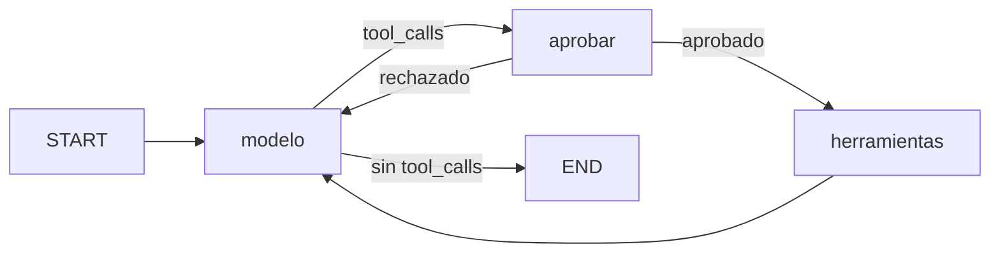

**LangGraph** es un runtime de [[glosario/grafo-de-estado|grafos con estado]] para agentes y workflows: nodos que son funciones, aristas fijas o condicionales y un estado tipado que se fusiona con reductores. Cada paso se puede guardar con un [[glosario/checkpointer|checkpointer]], y por eso un grafo se puede pausar, reanudar días después, volver atrás en su historial o recuperarse de una caída. Es la base de `create_agent` de [[docs/frameworks/04-langchain|LangChain]] y de [[docs/frameworks/10-deep-agents|Deep Agents]]. Esta referencia es de `langgraph` 1.2.18 (26 de octubre de 2026), con licencia **MIT**.

Úsalo directamente cuando necesitas controlar cada paso: workflows con pasos fijos y pasos agénticos mezclados, aprobaciones que tardan, paralelismo o ciclos de revisión. Si tu agente es «modelo → herramientas → respuesta», `create_agent` ya es ese grafo y te ahorras escribirlo.

## Modelo mental



- Cada **nodo** recibe el estado y devuelve una actualización parcial (un dict con las claves que cambia).
- Un **reductor** decide cómo se combina esa actualización: `add_messages` añade mensajes al historial; `operator.add` concatena listas; sin reductor, el valor nuevo pisa al anterior.
- La ejecución avanza por **superpasos**. Al final de cada uno, el checkpointer guarda el estado bajo un `thread_id`.

Es el [[patrones/01-workflows-vs-agentes|workflow o agente]] que ya conoces, dibujado: las aristas condicionales son tus `if`, y el ciclo modelo ⇄ herramientas es el bucle agéntico.

## API esencial

| Pieza | Import y firma |
|---|---|
| Grafo | `from langgraph.graph import StateGraph, START, END, MessagesState, add_messages` · `StateGraph(state_schema, context_schema=None)` |
| Nodo | `add_node(nombre, fn, *, destinations=None, retry_policy=None, cache_policy=None, timeout=None, defer=False)` |
| Aristas | `add_edge(a, b)` · `add_conditional_edges(origen, fn, path_map)` |
| Compilar | `compile(checkpointer=None, *, store=None, interrupt_before=None, interrupt_after=None)` |
| Herramientas | `from langgraph.prebuilt import ToolNode, tools_condition` (paquete `langgraph-prebuilt`) |
| Control | `from langgraph.types import Command, Send, interrupt, RetryPolicy, CachePolicy` |
| Ejecución | `invoke(input, config, *, context=None, stream_mode=…, durability=…, version="v1" \| "v2")` · `stream(...)` |

Tres piezas de control que conviene distinguir:

- **`Command(goto=…, update=…, resume=…)`**: un nodo lo devuelve para actualizar el estado y decidir el siguiente nodo a la vez. Declara los destinos posibles en `add_node(..., destinations=(...))` para que el grafo se pueda dibujar.
- **`Send(nodo, entrada)`**: lanza una ejecución de `nodo` con su propia entrada. Una lista de `Send` es un *fan-out* en paralelo.
- **`interrupt(valor)`**: pausa el grafo y entrega `valor` a quien lo llamó. Se reanuda con `Command(resume=respuesta)` en el mismo `thread_id`.

## Ejemplo: bucle con aprobación y estado en disco

El agente de soporte de [[sistemas/soporte-con-aprobacion-humana]] como grafo: un nodo `aprobar` se interpone entre el modelo y las herramientas sensibles, y `SqliteSaver` guarda el estado para reanudar aunque el proceso se reinicie.

```python title="grafo_aprobacion.py"
from langchain.chat_models import init_chat_model
from langchain.messages import SystemMessage, ToolMessage
from langchain.tools import tool
from langgraph.checkpoint.sqlite import SqliteSaver
from langgraph.graph import END, START, MessagesState, StateGraph
from langgraph.prebuilt import ToolNode
from langgraph.types import Command, interrupt

MODEL = "anthropic:claude-sonnet-5-5"     # local: "ollama:qwen3"
SENSIBLES = {"reembolsar"}                # herramientas que necesitan aprobación


@tool
def ver_pedido(pedido_id: str) -> str:
    """Devuelve estado e importe de un pedido por su id (formato P-NNNN)."""
    return '{"id": "%s", "estado": "entregado", "importe_eur": 49.90}' % pedido_id


@tool
def reembolsar(pedido_id: str, importe_eur: float) -> str:
    """Emite un reembolso. Acción irreversible: solo tras confirmar el pedido con ver_pedido."""
    return f"Reembolso de {importe_eur} € emitido para {pedido_id}."


TOOLS = [ver_pedido, reembolsar]
SYSTEM = SystemMessage("Eres un agente de soporte. Antes de reembolsar, comprueba el pedido.")


def construir(modelo=None, checkpointer=None):
    llm = (modelo or init_chat_model(MODEL, max_tokens=2048)).bind_tools(TOOLS)

    def llamar_modelo(state: MessagesState):
        return {"messages": [llm.invoke([SYSTEM, *state["messages"]])]}   # add_messages lo añade

    def decidir(state: MessagesState):
        return "aprobar" if state["messages"][-1].tool_calls else END

    def aprobar(state: MessagesState):
        llamadas = state["messages"][-1].tool_calls
        pendientes = [c for c in llamadas if c["name"] in SENSIBLES]
        if not pendientes:
            return Command(goto="herramientas")
        # Pausa el grafo. Al reanudar, este nodo se ejecuta OTRA VEZ desde el principio
        # e interrupt() devuelve lo que pasaste en Command(resume=...).
        decision = interrupt({"pendientes": [{"name": c["name"], "args": c["args"]} for c in pendientes]})
        if decision == "aprobar":
            return Command(goto="herramientas")
        rechazos = [ToolMessage(content="Rechazado por un humano: no lo ejecutes otra vez.",
                                tool_call_id=c["id"], name=c["name"], status="error") for c in llamadas]
        return Command(goto="modelo", update={"messages": rechazos})   # un resultado por llamada

    g = StateGraph(MessagesState)
    g.add_node("modelo", llamar_modelo)
    g.add_node("aprobar", aprobar, destinations=("herramientas", "modelo"))
    g.add_node("herramientas", ToolNode(TOOLS))
    g.add_edge(START, "modelo")
    g.add_conditional_edges("modelo", decidir, ["aprobar", END])
    g.add_edge("herramientas", "modelo")
    return g.compile(checkpointer=checkpointer)


if __name__ == "__main__":
    with SqliteSaver.from_conn_string("agente.db") as cp:          # estado en disco
        grafo = construir(checkpointer=cp)
        config = {"configurable": {"thread_id": "ticket-123"}, "recursion_limit": 25}
        out = grafo.invoke({"messages": [("user", "Devolvedme el pedido P-1001, llegó roto.")]},
                           config, version="v2")
        while out.interrupts:                                     # el grafo está en pausa
            print("Pendiente:", out.interrupts[0].value)
            respuesta = "aprobar" if input("¿Aprobar? [s/n] ").lower() == "s" else "rechazar"
            out = grafo.invoke(Command(resume=respuesta), config, version="v2")
        print(out.value["messages"][-1].content)
```

Probado con un modelo simulado que pide `ver_pedido`, luego `reembolsar` y luego responde. La primera llamada se para en `aprobar`. Después se cierra la conexión, se abre otra sobre el mismo archivo y se reanuda con `Command(resume="rechazar")`: el modelo recibió el `ToolMessage` con `status="error"` y el reembolso no se ejecutó. Con `version="v2"`, `invoke` devuelve un objeto con `.value` y `.interrupts`; sin él, un dict con la clave `"__interrupt__"`.

Para un agente sin aprobación basta `g.add_conditional_edges("modelo", tools_condition)`, que enruta al nodo `"tools"` o a `END`.

### Las reglas de `interrupt`

- **El nodo se repite al reanudar**: todo lo que hay antes de `interrupt()` se ejecuta otra vez. Tiene que poder repetirse sin efectos: no cobres ni envíes nada antes de la pausa.
- Funciona lanzando una excepción especial: no lo envuelvas en un `try/except` genérico.
- Las interrupciones de un nodo se emparejan por posición: no las saltes de forma condicional.
- El valor tiene que ser serializable en JSON.
- Con varias interrupciones en paralelo, reanuda con un dict `{interrupt.id: valor}`.

Si tu grafo no reanuda, revisa [[problemas/langgraph-no-reanuda-tras-interrupt]].

## Paralelismo con `Send`

Un nodo de reparto devuelve una lista de `Send`; LangGraph ejecuta cada una en paralelo y el reductor junta los resultados. Es la [[patrones/05-paralelizacion|paralelización]] y la base del [[patrones/06-orquestador-trabajadores|orquestador y trabajadores]].

```python title="resumir_en_paralelo.py"
import operator
from typing import Annotated, TypedDict

from langchain.chat_models import init_chat_model
from langgraph.graph import END, START, StateGraph
from langgraph.types import Send

MODEL = "anthropic:claude-sonnet-5-5"


class Estado(TypedDict):
    documentos: list[str]
    resumenes: Annotated[list[str], operator.add]   # reductor: cada trabajador AÑADE, no pisa
    informe: str


def construir(modelo=None):
    llm = modelo or init_chat_model(MODEL, max_tokens=1024)

    def repartir(state: Estado):
        # Una tarea por documento; cada Send lleva su propia entrada (no el estado entero).
        return [Send("resumir", {"documento": d}) for d in state["documentos"]]

    def resumir(entrada: dict):
        return {"resumenes": [llm.invoke(f"Resume en una frase:\n{entrada['documento']}").text]}

    def unir(state: Estado):
        return {"informe": "\n".join(f"- {r}" for r in state["resumenes"])}

    g = StateGraph(Estado)
    g.add_node("resumir", resumir)
    g.add_node("unir", unir)
    g.add_conditional_edges(START, repartir, ["resumir"])
    g.add_edge("resumir", "unir")                    # unir espera a todos los trabajadores
    g.add_edge("unir", END)
    return g.compile()


if __name__ == "__main__":
    out = construir().invoke({"documentos": ["Convenio A…", "Convenio B…", "Convenio C…"]},
                             {"max_concurrency": 4})   # tope de trabajadores a la vez
    print(out["informe"])
```

Dos cosas que se ven al probarlo: sin `Annotated[..., operator.add]`, el grafo falla con `InvalidUpdateError` («Can receive only one value per step») porque tres trabajadores escriben la misma clave en el mismo paso; y el orden de `resumenes` es el de llegada, no el de `documentos`. Si el orden importa, devuelve el índice junto al resumen. La versión con un planificador que genera las subtareas está en [[recetas/map-reduce-con-send]].

## Persistencia: checkpointers y store

| Necesitas | Pieza | Paquete |
|---|---|---|
| Probar en memoria | `InMemorySaver` (`langgraph.checkpoint.memory`) | `langgraph` |
| Un proceso, en disco | `SqliteSaver.from_conn_string("agente.db")` | `langgraph-checkpoint-sqlite` |
| Producción, varios procesos | `PostgresSaver` | `langgraph-checkpoint-postgres` |
| Memoria entre conversaciones | `InMemoryStore` / `PostgresStore` (`compile(store=…)`) | `langgraph` / `langgraph-checkpoint-postgres` |

El **checkpointer** guarda el estado de un hilo (`thread_id`): es la memoria de la conversación y lo que permite pausar. El **store** guarda datos que viven fuera de un hilo, como las preferencias de un usuario, y se lee desde una herramienta con `runtime.store`. La diferencia entre ambos es la de [[docs/contexto/04-memoria]].

`SqliteSaver.from_conn_string(...)` es un gestor de contexto: úsalo con `with`. `SqliteSaver(conn)` recibe una conexión ya abierta. Con un checkpointer tienes además `get_state(config)` (estado actual y siguiente nodo) y `get_state_history(config)` para depurar o volver a un paso anterior.

**Durabilidad.** `invoke(..., durability="sync" | "async" | "exit")` decide cuándo se escribe cada checkpoint: antes de empezar el paso siguiente (`sync`, lo más seguro), mientras se ejecuta el siguiente (`async`, el valor por defecto) o solo al terminar (`exit`, lo más rápido; pierdes los pasos intermedios si el proceso cae). Para agentes que trabajan horas, [[glosario/ejecucion-duradera]] y [[recetas/reanudar-un-agente-tras-un-reinicio]].

## Streaming

`graph.stream(entrada, config, stream_mode=…)` emite mientras el grafo trabaja. Los modos son `"values"` (el estado completo tras cada paso), `"updates"` (lo que devolvió cada nodo), `"messages"` (tokens del modelo, para la interfaz), `"custom"` (lo que emitas tú desde un nodo), `"checkpoints"`, `"tasks"` y `"debug"`. Puedes pasar una lista de modos. Para depurar, `"updates"` es el más útil: ves qué nodo se ejecutó y qué cambió ([[roadmap/40-primer-agente/06-depurar-con-trazas]]).

## Functional API

Si tu flujo es código secuencial y no te apetece dibujar un grafo, `@entrypoint` y `@task` (de `langgraph.func`) te dan checkpoints e interrupciones sobre funciones normales. Encaja con el [[patrones/03-encadenado|encadenado]].

```python title="flujo_funcional.py"
from langchain.chat_models import init_chat_model
from langgraph.checkpoint.memory import InMemorySaver
from langgraph.func import entrypoint, task
from langgraph.types import interrupt

MODEL = "anthropic:claude-sonnet-5-5"


def crear_flujo(llm=None):
    llm = llm or init_chat_model(MODEL, max_tokens=1024)

    @task
    def borrador(tema: str) -> str:
        return llm.invoke(f"Escribe un borrador breve sobre: {tema}").text

    @task
    def pulir(texto: str, nota: str) -> str:
        return llm.invoke(f"Mejora el texto según la nota.\nNota: {nota}\n<texto>\n{texto}\n</texto>").text

    @entrypoint(checkpointer=InMemorySaver())
    def flujo(tema: str) -> str:
        b = borrador(tema).result()          # al reanudar, el resultado sale del checkpoint
        nota = interrupt({"borrador": b, "pregunta": "¿Qué cambiarías?"})
        return pulir(b, nota).result()

    return flujo
```

La diferencia con un nodo: al reanudar, la `@task` que ya terminó **no se vuelve a ejecutar**; su resultado sale del checkpoint. En la prueba con un modelo simulado hubo dos llamadas al modelo en total (borrador y pulido), no tres.

## Límite de pasos

`config={"recursion_limit": N}` cuenta superpasos y, al superarlo, lanza `GraphRecursionError`. En langgraph 1.2.18 el valor por defecto es **10 007**, que en la práctica no limita nada.

> [!aviso] Pon siempre el límite tú
> Un agente que repite la misma herramienta puede dar miles de vueltas antes de llegar al tope por defecto. Fija `recursion_limit` en cada `invoke` o usa `ModelCallLimitMiddleware` si el grafo sale de `create_agent`. Ver [[problemas/el-agente-no-para]].

## Lo abierto y lo comercial

| Pieza | Licencia |
|---|---|
| `langgraph`, `langgraph-prebuilt`, checkpointers, `langgraph-cli` | MIT |
| `langgraph-api` (Agent Server, el servidor que despliega LangSmith) | **Elastic-2.0**: puedes leer el código, pero no es open source OSI y limita ofrecerlo como servicio gestionado |
| Despliegue gestionado, Studio en la nube, trazas y evals | **LangSmith**, comercial |

`langgraph dev` (de `langgraph-cli[inmem]`) levanta en local un servidor de desarrollo con la interfaz de Studio. Tu grafo compilado es una librería normal: lo puedes servir con tu propia API (FastAPI, por ejemplo) y un `PostgresSaver` sin pagar nada. El nombre comercial exacto del despliegue ha cambiado con la documentación; consulta la de LangSmith si lo necesitas.

Paquetes satélite: `langgraph-supervisor` recomienda ahora en su README construir el supervisor «directly via tools», y `langgraph-swarm` no publica versiones desde diciembre de 2025. Para multiagente, mejor [[cursos/langchain-y-langgraph/08-multiagente-con-langgraph]].

## Errores frecuentes

- Poner efectos (cobrar, enviar) antes de `interrupt()`: se repiten al reanudar.
- Olvidar el reductor en campos que escriben varios nodos a la vez (`InvalidUpdateError`).
- Reanudar con otro `thread_id` o con un checkpointer en memoria tras reiniciar: el estado ya no está.
- Usar un grafo para dos llamadas en secuencia: tres funciones se leen mejor.
- Confiar en el `recursion_limit` por defecto.

## Ver también

- [[cursos/langchain-y-langgraph/05-langgraph-estado-nodos-y-aristas]], [[cursos/langchain-y-langgraph/06-memoria-y-persistencia]] y [[cursos/langchain-y-langgraph/07-humano-en-el-bucle-con-interrupt]]: el curso, con ejercicios.
- [[recetas/aprobacion-humana-con-langgraph]]: la aprobación paso a paso.
- [[docs/frameworks/02-equivalencias]]: el mismo concepto en otros frameworks.
- [[docs/agentes/03-humano-en-el-bucle]]: la aprobación sin framework.
- [[herramientas/langgraph]]: ficha del directorio.
