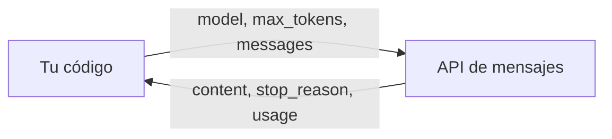

Una llamada a la API de mensajes es una petición HTTP con **un modelo, un límite de salida y una lista de mensajes**. El modelo devuelve un mensaje nuevo con rol `assistant`, el motivo por el que dejó de generar y el recuento de [[glosario/token|tokens]] consumidos. Todo lo demás (prompt de sistema, herramientas, razonamiento) son parámetros opcionales sobre esa base.

Si quieres aprenderlo con ejercicios, ve a [[roadmap/00-fundamentos/04-primera-llamada-api]]. Este artículo es la referencia.

## La petición



La API no guarda estado entre llamadas. **Cada petición lleva la conversación entera** que quieres que el modelo vea. Si quieres que recuerde algo, tienes que volver a enviarlo (ver [[docs/fundamentos/03-api-de-mensajes]]).

### Parámetros

| Parámetro | Obligatorio | Tipo | Qué hace |
|---|---|---|---|
| `model` | Sí | string | Identificador del modelo. Ponlo en una constante. |
| `max_tokens` | Sí | int | Límite duro de tokens de salida. Si se alcanza, la respuesta se corta. |
| `messages` | Sí | lista | Conversación: objetos `{"role", "content"}` alternando `user` y `assistant`. |
| `system` | No | string o lista de bloques | Instrucciones fijas. Ver [[docs/prompting/01-prompt-de-sistema]]. |
| `temperature` | No | float | Aleatoriedad del muestreo. Ver [[glosario/temperatura]]. |
| `stop_sequences` | No | lista de strings | Cadenas que detienen la generación. |
| `tools` | No | lista | Herramientas que el modelo puede pedir. Ver [[docs/herramientas/01-uso-de-herramientas]]. |
| `tool_choice` | No | objeto | Cómo elige herramienta. Ver [[glosario/tool-choice]]. |
| `thinking` | No | objeto | Activa el razonamiento. Ver [[docs/prompting/04-razonamiento]]. |
| `output_config` | No | objeto | Esfuerzo y formato de salida. Ver [[docs/prompting/03-salida-estructurada]]. |

Los valores típicos de cada parámetro y sus interacciones están en [[modelos/06-parametros]].

## Ejemplo completo

```python tab="Python" title="primera_llamada.py"
import anthropic

MODEL = "claude-sonnet-5-5"
client = anthropic.Anthropic()

resp = client.messages.create(
    model=MODEL,
    max_tokens=512,
    system="Eres un asistente técnico. Responde en español, en tres frases como máximo.",
    messages=[{"role": "user", "content": "¿Qué es un token?"}],
)

if resp.stop_reason == "max_tokens":
    print("Aviso: respuesta cortada; sube max_tokens o pide algo más breve.")

texto = "".join(b.text for b in resp.content if b.type == "text")
print(texto)
print(resp.usage.input_tokens, resp.usage.output_tokens)
```

```ts tab="TypeScript" title="primera_llamada.ts"
import Anthropic from "@anthropic-ai/sdk";

const MODEL = "claude-sonnet-5-5";
const client = new Anthropic();

const resp = await client.messages.create({
  model: MODEL,
  max_tokens: 512,
  system: "Eres un asistente técnico. Responde en español, en tres frases como máximo.",
  messages: [{ role: "user", content: "¿Qué es un token?" }],
});

if (resp.stop_reason === "max_tokens") {
  console.warn("Aviso: respuesta cortada; sube max_tokens o pide algo más breve.");
}

const texto = resp.content
  .filter((b) => b.type === "text")
  .map((b) => (b.type === "text" ? b.text : ""))
  .join("");
console.log(texto);
console.log(resp.usage.input_tokens, resp.usage.output_tokens);
```

Fíjate en dos detalles. Se concatena el texto de **todos** los bloques `text`, porque `content` es una lista y no tiene por qué tener un solo elemento. Y se comprueba `stop_reason` antes de dar la respuesta por buena.

## La respuesta

| Campo | Contenido |
|---|---|
| `id` | Identificador del mensaje. Guárdalo en tus trazas. |
| `role` | Siempre `assistant`. |
| `content` | Lista de bloques: `text`, `tool_use`, `thinking`. |
| `stop_reason` | Por qué paró (tabla siguiente). |
| `usage` | Tokens de entrada, salida y caché. |

### `stop_reason`

| Valor | Significa | Qué haces |
|---|---|---|
| `end_turn` | El modelo terminó de forma natural. | Usa la respuesta. |
| `max_tokens` | Se alcanzó el límite de salida. | La respuesta está incompleta: sube el límite, pide menos o continúa. |
| `stop_sequence` | Apareció una de tus `stop_sequences`. | Esperado si las configuraste. |
| `tool_use` | El modelo pide ejecutar una herramienta. | Ejecútala y devuelve un `tool_result`. |
| `pause_turn` | Se pausó un turno largo (p. ej. con herramientas del servidor). | Reenvía la conversación con la respuesta incluida para continuar. |
| `refusal` | El modelo se negó por motivos de seguridad. | No reintentes igual; trata el caso en tu interfaz. |

Más detalle en [[glosario/stop-reason]].

### `usage`

| Campo | Qué cuenta |
|---|---|
| `input_tokens` | Tokens de entrada que no salen de caché. |
| `output_tokens` | Tokens generados, incluido el razonamiento si lo hay. |
| `cache_creation_input_tokens` | Tokens escritos en caché en esta llamada. |
| `cache_read_input_tokens` | Tokens leídos de caché. |

Registra estos cuatro números en cada llamada desde el primer día. Son la base de [[roadmap/00-fundamentos/05-coste-y-latencia]] y de [[docs/contexto/02-prompt-caching]].

Para saber cuánto ocupa una petición antes de enviarla, usa `client.messages.count_tokens(model=MODEL, messages=...)` y lee `.input_tokens`.

## Errores de la API

El SDK convierte los errores HTTP en excepciones y reintenta automáticamente algunos de ellos (límites de tasa, sobrecarga, fallos de red). El número de reintentos se configura con `max_retries` al crear el cliente.

| HTTP | Causa típica | Reintentar |
|---|---|---|
| 400 | Petición mal formada: roles que no alternan, `tool_result` sin su `tool_use`, parámetro inválido. | No. Corrige la petición. |
| 401 | Clave ausente o inválida. | No. |
| 403 | La clave no tiene permiso para ese recurso. | No. |
| 404 | Modelo o recurso inexistente. | No. Revisa `MODEL`. |
| 413 | Petición demasiado grande. | No. Recorta el contexto. |
| 429 | Límite de tasa superado. | Sí, con espera exponencial. |
| 500 / 529 | Error interno o sobrecarga temporal. | Sí, con espera. |

```python title="errores.py"
try:
    resp = client.messages.create(model=MODEL, max_tokens=256, messages=mensajes)
except anthropic.RateLimitError:
    ...  # espera y reintenta, o encola
except anthropic.APIStatusError as e:
    print(e.status_code, e.message)  # 4xx: corrige la petición
except anthropic.APIConnectionError:
    ...  # red: reintenta
```

La receta [[recetas/reintentos-y-limites-de-tasa]] tiene una implementación completa con espera exponencial.

## Errores frecuentes

- **Leer solo `content[0].text`.** Falla cuando el primer bloque es `thinking` o `tool_use`. Filtra por tipo.
- **No mirar `stop_reason`.** Una respuesta cortada por `max_tokens` parece válida hasta que el JSON no parsea.
- **`max_tokens` demasiado bajo con razonamiento activado.** El razonamiento consume salida; la respuesta visible se queda sin espacio.
- **Nombres de modelo repartidos por el código.** Cuando cambie el modelo, cambiarás un sitio y olvidarás tres.
- **Esperar que la API recuerde.** No guarda estado: reenvía el historial.

## Ver también

- [[docs/fundamentos/03-api-de-mensajes]]: roles, bloques y conversaciones.
- [[docs/fundamentos/04-streaming]]: recibir la respuesta mientras se genera.
- [[modelos/06-parametros]]: valores típicos de cada parámetro.
- [[glosario/max-tokens]] y [[glosario/stop-reason]].
