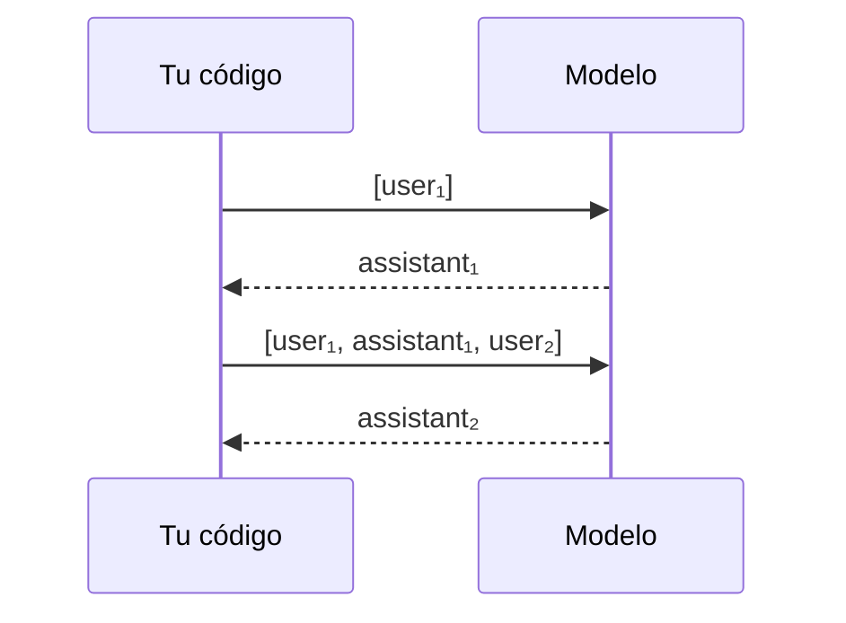

La API de mensajes representa una conversación como **una lista de mensajes con rol**, y cada mensaje como **una lista de bloques de contenido con tipo**. Los roles principales son `user` y `assistant` (más `system` para cambiar instrucciones a mitad de conversación) y hay un puñado de tipos de bloque (`text`, `image`, `document`, `tool_use`, `tool_result`, `thinking`). Con esas dos piezas se construye desde un chat hasta un [[glosario/agente|agente]] con herramientas.

## Roles

| Rol | Quién lo escribe | Qué bloques puede llevar |
|---|---|---|
| `user` | Tu aplicación (lo que escribe la persona, documentos, resultados de herramientas) | `text`, `image`, `tool_result` |
| `assistant` | El modelo (o tú, si reenvías una respuesta suya) | `text`, `tool_use`, `thinking`, `redacted_thinking` y los bloques de herramientas del servidor |
| `system` | Tu aplicación, a mitad de conversación | `text` (instrucciones que cambian a partir de ese punto) |

El [[glosario/prompt-de-sistema|prompt de sistema]] principal va en el parámetro `system`, fuera de `messages`. Ver [[docs/prompting/01-prompt-de-sistema]]. Desde la versión `2026-10-21`, los modelos 5.x (salvo Sonnet 5) aceptan además mensajes `{"role": "system", …}` dentro de `messages`: cambian las instrucciones desde ese punto sin invalidar la caché del prefijo. Tienen reglas de posición propias (van justo después de un turno `user` y nunca entre un `tool_use` y su `tool_result`); ver [[docs/contexto/06-mensajes-de-sistema-a-mitad-de-conversacion]].

### Reglas de la lista `messages`

1. **Empieza por `user`.**
2. **Alterna** `user` y `assistant` (los mensajes `system` intermedios no cuentan como turno). Si envías dos mensajes seguidos del mismo rol, la API los combina en un solo turno; mantener la alternancia explícita hace tu historial más fácil de depurar.
3. **El último mensaje suele ser `user`**: es lo que el modelo contesta.
4. **Cada `tool_use` de un mensaje `assistant` exige su `tool_result`** en el mensaje `user` inmediatamente posterior, con el mismo `id`.

Romper la regla 4 devuelve un error 400. Es el fallo más común al escribir el primer bucle de herramientas.

## `content`: texto o lista de bloques

`content` acepta dos formas. Una cadena es un atajo para un solo bloque de texto.

```python
{"role": "user", "content": "Hola"}
# equivale a
{"role": "user", "content": [{"type": "text", "text": "Hola"}]}
```

Usa la forma de lista en cuanto necesites mezclar tipos (texto más imagen, varios `tool_result`) o marcar un bloque con `cache_control` para [[docs/contexto/02-prompt-caching|prompt caching]].

## Tipos de bloque

| Tipo | Rol | Campos | Para qué |
|---|---|---|---|
| `text` | ambos | `text` | Texto normal. |
| `image` | `user` | `source: {type, media_type, data}` | Imagen en base64 (o por URL, o `file_id` de la Files API). |
| `document` | `user` | `source` (PDF, texto o `file_id`) | Documentos; admite citas. En un mensaje `assistant` da 400. |
| `tool_use` | `assistant` | `id`, `name`, `input` | El modelo pide ejecutar una herramienta. |
| `tool_result` | `user` | `tool_use_id`, `content`, `is_error` | Tu respuesta a un `tool_use`. |
| `thinking` | `assistant` | `thinking` y `signature` | Razonamiento del modelo. En los modelos 5.x es adaptativo por defecto y llega vacío (`display: "omitted"`) salvo que pidas `"summarized"`. |
| `redacted_thinking` | `assistant` | `data` cifrado | Razonamiento cifrado. Se reenvía igual que `thinking`. |

```python title="bloques.py"
import base64, pathlib

imagen = base64.standard_b64encode(pathlib.Path("factura.png").read_bytes()).decode()

mensaje = {
    "role": "user",
    "content": [
        {"type": "image", "source": {"type": "base64", "media_type": "image/png", "data": imagen}},
        {"type": "text", "text": "Extrae el total y la fecha de esta factura."},
    ],
}
```

Pon la imagen o el documento **antes** de la pregunta. El modelo rinde mejor con el material arriba y la instrucción al final; ver [[modelos/07-documentos-largos]].

### Bloques en la respuesta

La respuesta del modelo también es una lista. Puede traer bloques `thinking`, uno o varios `text`, uno o varios `tool_use` y, si usas herramientas del servidor, bloques como `server_tool_use` y `web_search_tool_result`, en cualquier combinación. Recorre siempre la lista por tipo:

```python
for bloque in resp.content:
    if bloque.type == "text":
        print(bloque.text)
    elif bloque.type == "tool_use":
        print("pide", bloque.name, bloque.input)
```

## Ejemplo completo: una conversación con memoria

La API no guarda estado. Para que el modelo «recuerde», añades su respuesta al historial y lo reenvías entero en la siguiente llamada.



```python tab="Python" title="chat.py"
import anthropic

MODEL = "claude-sonnet-5-5"
client = anthropic.Anthropic()
historial = []

def turno(texto_usuario: str) -> str:
    historial.append({"role": "user", "content": texto_usuario})
    resp = client.messages.create(
        model=MODEL,
        max_tokens=1024,
        system="Eres un tutor de Python. Respuestas breves.",
        messages=historial,
    )
    # Guarda los bloques tal cual: si hay thinking o tool_use, deben volver intactos.
    historial.append({"role": "assistant", "content": resp.content})
    return "".join(b.text for b in resp.content if b.type == "text")

print(turno("¿Qué es una lista por comprensión?"))
print(turno("Dame un ejemplo con la anterior."))
```

```ts tab="TypeScript" title="chat.ts"
import Anthropic from "@anthropic-ai/sdk";

const MODEL = "claude-sonnet-5-5";
const client = new Anthropic();
const historial: Anthropic.MessageParam[] = [];

async function turno(textoUsuario: string): Promise<string> {
  historial.push({ role: "user", content: textoUsuario });
  const resp = await client.messages.create({
    model: MODEL,
    max_tokens: 1024,
    system: "Eres un tutor de Python. Respuestas breves.",
    messages: historial,
  });
  historial.push({ role: "assistant", content: resp.content });
  return resp.content.map((b) => (b.type === "text" ? b.text : "")).join("");
}

console.log(await turno("¿Qué es una lista por comprensión?"));
console.log(await turno("Dame un ejemplo con la anterior."));
```

El historial crece en cada turno y con él el coste y la [[glosario/latencia|latencia]]. En conversaciones largas tendrás que recortar, resumir o [[glosario/compactacion|compactar]]; ver [[docs/contexto/01-ventana-de-contexto]].

## Casos límite

| Situación | Qué pasa | Qué hacer |
|---|---|---|
| Último mensaje con rol `assistant` | El modelo continúa ese texto (*prefill*). | Haiku 5.5 lo rechaza con 400 y no es compatible con salidas estructuradas. Para forzar formato, usa [[docs/prompting/03-salida-estructurada]]. |
| Varios `tool_use` en una respuesta | El modelo pide herramientas en paralelo. | Devuelve todos los `tool_result` en **un único** mensaje `user`. |
| `tool_result` con texto detrás | Válido si el texto va después de todos los `tool_result`. | Nunca pongas texto antes de ellos. |
| Bloques `thinking` en el historial | Llevan una firma que la API verifica. | Reenvíalos sin modificar mientras dure un ciclo de herramientas. |
| `content` vacío | Error de validación. | No envíes mensajes sin contenido. |
| `text` con `citations` en un mensaje `user` | 400 desde la versión `2026-10-21`. | Las citas solo vuelven en mensajes `assistant`, tal cual las devolvió el modelo. |

## Errores frecuentes

- **Guardar solo el texto de la respuesta** en el historial. Pierdes los `tool_use` y los `thinking`, y la siguiente llamada falla o el modelo pierde el hilo.
- **Meter las instrucciones fijas como primer mensaje `user`.** Funcionan peor que en `system` y se mezclan con lo que dice la persona.
- **Construir mensajes concatenando cadenas de distintas fuentes** sin delimitarlas. Usa bloques separados o etiquetas XML para que el modelo distinga instrucción de dato; es la primera defensa ante la [[glosario/inyeccion-de-prompt|inyección de prompt]].

## Ver también

- [[docs/fundamentos/02-tu-primera-llamada]]: parámetros y respuesta.
- [[docs/herramientas/01-uso-de-herramientas]]: el ciclo `tool_use` → `tool_result` en detalle.
- [[docs/contexto/06-mensajes-de-sistema-a-mitad-de-conversacion]]: el rol `system` dentro de `messages`.
- [[problemas/tool-result-sin-tool-use]]: el 400 más común al romper la regla 4.
- [[glosario/tool-result]] y [[glosario/tool-use]].
- [[roadmap/00-fundamentos/03-ventana-de-contexto]]: por qué el historial tiene un límite.
