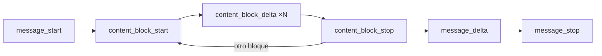

El [[glosario/streaming|streaming]] devuelve la respuesta del modelo **por fragmentos a medida que se genera**, en lugar de esperar al mensaje completo. El tiempo total de generación es el mismo; lo que cambia es que la persona ve el primer texto en cuanto existe. Técnicamente es una respuesta HTTP con eventos del servidor (*server-sent events*) que el SDK convierte en un iterador.

## Cuándo usarlo

| Caso | ¿Streaming? | Por qué |
|---|---|---|
| Chat o interfaz donde alguien lee la respuesta | Sí | Baja la [[glosario/latencia]] percibida: el primer token llega antes. |
| Respuestas largas o con `max_tokens` alto | Sí | Evita esperas largas sin señal y tiempos de espera de red. |
| Agente en segundo plano, nadie mirando | Opcional | Solo aporta si quieres ver progreso en trazas. |
| Clasificación o extracción corta para otro programa | No | Necesitas el resultado entero para validarlo. |

La métrica que mejora es el **tiempo hasta el primer token**. Si tu problema es el tiempo total, el streaming no lo arregla: ver [[docs/produccion/03-latencia]].

## Ejemplo completo

El SDK expone un ayudante que acumula el mensaje por ti y te da el texto conforme llega. Al terminar, puedes pedir el mensaje final completo con su `stop_reason` y su `usage`.

```python tab="Python" title="stream.py"
import anthropic

MODEL = "claude-sonnet-5-5"
client = anthropic.Anthropic()

with client.messages.stream(
    model=MODEL,
    max_tokens=1024,
    messages=[{"role": "user", "content": "Explica qué es un embedding en cinco frases."}],
) as stream:
    for texto in stream.text_stream:
        print(texto, end="", flush=True)
    final = stream.get_final_message()

print()
print(final.stop_reason, final.usage.output_tokens)
```

```ts tab="TypeScript" title="stream.ts"
import Anthropic from "@anthropic-ai/sdk";

const MODEL = "claude-sonnet-5-5";
const client = new Anthropic();

const stream = client.messages.stream({
  model: MODEL,
  max_tokens: 1024,
  messages: [{ role: "user", content: "Explica qué es un embedding en cinco frases." }],
});

stream.on("text", (texto) => process.stdout.write(texto));

const final = await stream.finalMessage();
console.log();
console.log(final.stop_reason, final.usage.output_tokens);
```

`get_final_message()` / `finalMessage()` devuelve el mismo objeto que una llamada sin streaming. Úsalo para guardar el mensaje en el historial y para comprobar `stop_reason`: **que el texto haya dejado de llegar no significa que la respuesta esté completa**.

## Eventos del flujo

Debajo del ayudante llegan eventos con tipo. Solo los necesitas si construyes tu propia interfaz de bajo nivel o reenvías el flujo a un navegador.



| Evento | Qué trae |
|---|---|
| `message_start` | El mensaje vacío con su `id` y el `usage` de entrada. |
| `content_block_start` | Comienza un bloque (`text`, `tool_use`, `thinking`) con su índice. |
| `content_block_delta` | Un fragmento del bloque: texto, trozo del JSON de `input` de una herramienta o razonamiento. |
| `content_block_stop` | Termina el bloque. |
| `message_delta` | `stop_reason` y el `usage` de salida acumulado. |
| `message_stop` | Fin del mensaje. |
| `ping` | Mantiene viva la conexión. Ignóralo. |
| `error` | Error a mitad del flujo (p. ej. sobrecarga). |

### Herramientas y razonamiento en streaming

Con `tools`, el `input` de cada `tool_use` llega como **JSON parcial en varios deltas**. No intentes parsearlo hasta el `content_block_stop` de ese bloque; o, más sencillo, espera al mensaje final y ejecuta las herramientas desde ahí.

Con `thinking` activado llegan deltas de razonamiento antes del texto. Decide si los muestras: en una interfaz suelen ir plegados o resumidos.

### Recorrer los eventos

Si necesitas reaccionar a cada tipo de bloque (por ejemplo, mostrar «Buscando pedido…» en cuanto empieza un `tool_use`), itera los eventos en lugar de `text_stream`:

```python title="eventos.py"
with client.messages.stream(model=MODEL, max_tokens=1024, tools=TOOLS, messages=mensajes) as stream:
    for evento in stream:
        if evento.type == "content_block_start" and evento.content_block.type == "tool_use":
            print(f"\n[usando {evento.content_block.name}…]")
        elif evento.type == "content_block_delta" and evento.delta.type == "text_delta":
            print(evento.delta.text, end="", flush=True)
    final = stream.get_final_message()

# Con el mensaje final, el ciclo de herramientas sigue como siempre.
if final.stop_reason == "tool_use":
    ...
```

Los deltas de los argumentos de una herramienta llegan como `input_json_delta` con un trozo de texto en `partial_json`. El ayudante ya los acumula: en `final.content` tendrás el `input` completo y parseado.

## Streaming hasta el navegador

En una aplicación web, tu servidor hace de intermediario: recibe el flujo del proveedor y lo reenvía al navegador, normalmente como *server-sent events* o por un WebSocket. Tres reglas:

1. **La clave de API se queda en el servidor.** Nunca abras el flujo directamente desde el navegador con tu clave.
2. **Reenvía solo lo que la interfaz necesita**: texto y, si acaso, avisos de herramienta. No reenvíes bloques internos sin filtrar.
3. **Cierra el flujo del proveedor si la persona cancela**, para no seguir pagando tokens que nadie va a leer.

La receta [[recetas/streaming-de-respuestas]] tiene una implementación completa.

## Parámetros y opciones

El streaming acepta **los mismos parámetros** que `messages.create`. No hay opciones propias; lo que cambia es cómo consumes la respuesta.

| Forma | Python | TypeScript |
|---|---|---|
| Ayudante con acumulación | `client.messages.stream(...)` como contexto | `client.messages.stream({...})` |
| Solo texto | `stream.text_stream` | `stream.on("text", ...)` |
| Mensaje final | `stream.get_final_message()` | `await stream.finalMessage()` |
| Eventos crudos | iterar `stream` | `for await (const ev of stream)` |

## Errores frecuentes

- **No comprobar `stop_reason` al final.** Una respuesta cortada por `max_tokens` se ve igual que una completa mientras llega.
- **Parsear JSON parcial.** Si pides salida estructurada, valida solo sobre el mensaje final.
- **Errores a mitad del flujo sin manejar.** Un error puede llegar después de haber mostrado texto. Decide qué ve la persona: un aviso y un botón de reintentar suele bastar.
- **Guardar en el historial el texto concatenado** en lugar del mensaje final. Pierdes los bloques `tool_use` y `thinking`.
- **Esperar que acelere un agente.** En un bucle sin interfaz, el streaming no reduce el tiempo de cada paso.

## Ver también

- [[recetas/streaming-de-respuestas]]: llevar el flujo hasta un navegador.
- [[roadmap/100-produccion/03-latencia]]: streaming, modelo adecuado y menos pasos.
- [[docs/fundamentos/02-tu-primera-llamada]]: forma del mensaje final.
- [[glosario/streaming]].
