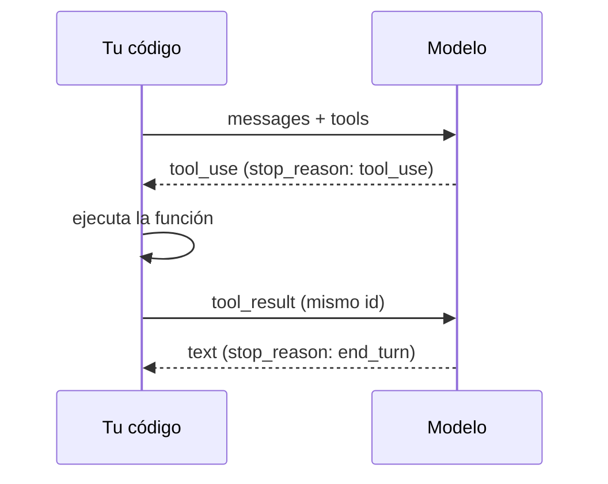

El [[glosario/tool-use|uso de herramientas]] (también *[[glosario/function-calling|function calling]]*) es el mecanismo por el que el modelo **pide a tu aplicación que ejecute una función** y luego usa el resultado para seguir. Tú declaras las herramientas con un nombre, una descripción y un esquema JSON de entrada. El modelo responde con un bloque `tool_use` y `stop_reason == "tool_use"`; tu código ejecuta la función y devuelve un bloque `tool_result`. El modelo nunca ejecuta nada por sí mismo.

Este artículo es la referencia. El recorrido guiado está en el nivel [[roadmap/20-herramientas/index]], empezando por [[roadmap/20-herramientas/01-ciclo-tool-use]].

## El ciclo



El ciclo se repite mientras `stop_reason` sea `tool_use`. Cuando el modelo encadena varias llamadas por su cuenta, ese bucle es un [[glosario/bucle-agentico|bucle agéntico]]: ver [[docs/agentes/01-el-bucle-agentico]].

## Definir una herramienta

| Campo | Obligatorio | Qué es |
|---|---|---|
| `name` | Sí | Identificador. Corto, en `snake_case`, que diga lo que hace: `buscar_pedido`. |
| `description` | Sí en la práctica | Qué hace, cuándo usarla, cuándo no y qué devuelve. Es lo que más influye en que el modelo la use bien. |
| `input_schema` | Sí | JSON Schema del argumento (`type: "object"`, `properties`, `required`). |
| `strict` | No | `true` garantiza que el `input` cumple el esquema. Ver [[docs/prompting/03-salida-estructurada]]. |
| `input_examples` | No | Ejemplos de entrada válidos que orientan al modelo cuando el esquema no basta. |
| `cache_control` | No | Punto de caché al final de las herramientas. Ver [[docs/contexto/02-prompt-caching]]. |
| `defer_loading` | No | `true` deja la herramienta fuera del contexto hasta que una búsqueda la encuentre. Ver [[docs/herramientas/05-busqueda-y-carga-diferida]]. |
| `allowed_callers` | No | Quién puede llamarla: `"direct"` (el modelo) o la ejecución de código. Ver [[docs/herramientas/06-llamada-programatica]]. |
| `eager_input_streaming` | No | Envía los argumentos en *streaming* sin agrupar (pueden llegar incompletos). |

```python
{
    "name": "buscar_pedido",
    "description": (
        "Busca un pedido por su identificador y devuelve estado, fecha y artículos. "
        "Úsala cuando el cliente dé un número de pedido. No sirve para buscar por nombre."
    ),
    "input_schema": {
        "type": "object",
        "properties": {
            "pedido_id": {"type": "string", "description": "Formato P-123456"},
        },
        "required": ["pedido_id"],
    },
}
```

Escribe la descripción como se la explicarías a una persona nueva en el equipo. Las pautas completas están en [[disciplinas/diseno-de-herramientas]] y en [[roadmap/20-herramientas/02-definir-herramientas]].

## Bloques implicados

| Bloque | Rol | Campos |
|---|---|---|
| `tool_use` | `assistant` | `id`, `name`, `input` (dict ya parseado) |
| `tool_result` | `user` | `tool_use_id`, `content` (texto o lista de bloques), `is_error` |

Reglas del [[glosario/tool-result|resultado de herramienta]]:

1. **Un `tool_result` por cada `tool_use`**, con su `tool_use_id`.
2. **Todos en el mismo mensaje `user`**, el inmediatamente posterior.
3. **Antes de cualquier texto** en ese mensaje.

## Ejemplo completo

Un bucle mínimo y correcto, con dos herramientas y límite de pasos.

```python tab="Python" title="herramientas.py"
import json
import anthropic

MODEL = "claude-sonnet-5-5"
MAX_PASOS = 8
client = anthropic.Anthropic()

TOOLS = [
    {
        "name": "buscar_pedido",
        "description": "Devuelve estado y fecha de un pedido a partir de su id (formato P-123456).",
        "input_schema": {
            "type": "object",
            "properties": {"pedido_id": {"type": "string"}},
            "required": ["pedido_id"],
        },
    },
    {
        "name": "consultar_politica",
        "description": "Devuelve el texto de una política de la tienda: envios o devoluciones.",
        "input_schema": {
            "type": "object",
            "properties": {"tema": {"type": "string", "enum": ["envios", "devoluciones"]}},
            "required": ["tema"],
        },
    },
]

PEDIDOS = {"P-100200": {"estado": "entregado", "fecha_entrega": "2026-10-02"}}
POLITICAS = {"envios": "Envío en 48-72 h laborables.", "devoluciones": "30 días desde la entrega."}

def ejecutar(nombre: str, args: dict) -> str:
    if nombre == "buscar_pedido":
        pedido = PEDIDOS.get(args["pedido_id"])
        if pedido is None:
            raise LookupError(f"No existe el pedido {args['pedido_id']}")
        return json.dumps(pedido)
    if nombre == "consultar_politica":
        return POLITICAS[args["tema"]]
    raise ValueError(f"Herramienta desconocida: {nombre}")

def agente(pregunta: str) -> str:
    mensajes = [{"role": "user", "content": pregunta}]
    for _ in range(MAX_PASOS):
        resp = client.messages.create(model=MODEL, max_tokens=1024, tools=TOOLS, messages=mensajes)
        mensajes.append({"role": "assistant", "content": resp.content})

        if resp.stop_reason != "tool_use":
            if resp.stop_reason == "max_tokens":
                return "[respuesta cortada por max_tokens]"
            if resp.stop_reason == "refusal":
                return "[el modelo rechazó la petición]"
            return "".join(b.text for b in resp.content if b.type == "text")

        resultados = []
        for bloque in resp.content:
            if bloque.type != "tool_use":
                continue
            try:
                salida, error = ejecutar(bloque.name, bloque.input), False
            except Exception as e:
                salida, error = f"Error: {e}", True
            resultados.append({
                "type": "tool_result",
                "tool_use_id": bloque.id,
                "content": salida,
                "is_error": error,
            })
        mensajes.append({"role": "user", "content": resultados})
    return "[se alcanzó el límite de pasos]"

print(agente("Mi pedido P-100200, ¿todavía puedo devolverlo?"))
```

```ts tab="TypeScript" title="herramientas.ts"
import Anthropic from "@anthropic-ai/sdk";

const MODEL = "claude-sonnet-5-5";
const MAX_PASOS = 8;
const client = new Anthropic();

const TOOLS: Anthropic.Tool[] = [
  {
    name: "buscar_pedido",
    description: "Devuelve estado y fecha de un pedido a partir de su id (formato P-123456).",
    input_schema: {
      type: "object",
      properties: { pedido_id: { type: "string" } },
      required: ["pedido_id"],
    },
  },
  {
    name: "consultar_politica",
    description: "Devuelve el texto de una política de la tienda: envios o devoluciones.",
    input_schema: {
      type: "object",
      properties: { tema: { type: "string", enum: ["envios", "devoluciones"] } },
      required: ["tema"],
    },
  },
];

const PEDIDOS: Record<string, object> = { "P-100200": { estado: "entregado", fecha_entrega: "2026-10-02" } };
const POLITICAS: Record<string, string> = {
  envios: "Envío en 48-72 h laborables.",
  devoluciones: "30 días desde la entrega.",
};

function ejecutar(nombre: string, args: any): string {
  if (nombre === "buscar_pedido") {
    const pedido = PEDIDOS[args.pedido_id];
    if (!pedido) throw new Error(`No existe el pedido ${args.pedido_id}`);
    return JSON.stringify(pedido);
  }
  if (nombre === "consultar_politica") return POLITICAS[args.tema];
  throw new Error(`Herramienta desconocida: ${nombre}`);
}

async function agente(pregunta: string): Promise<string> {
  const mensajes: Anthropic.MessageParam[] = [{ role: "user", content: pregunta }];
  for (let paso = 0; paso < MAX_PASOS; paso++) {
    const resp = await client.messages.create({ model: MODEL, max_tokens: 1024, tools: TOOLS, messages: mensajes });
    mensajes.push({ role: "assistant", content: resp.content });

    if (resp.stop_reason !== "tool_use") {
      if (resp.stop_reason === "max_tokens") return "[respuesta cortada por max_tokens]";
      if (resp.stop_reason === "refusal") return "[el modelo rechazó la petición]";
      return resp.content.map((b) => (b.type === "text" ? b.text : "")).join("");
    }

    const resultados: Anthropic.ToolResultBlockParam[] = [];
    for (const bloque of resp.content) {
      if (bloque.type !== "tool_use") continue;
      try {
        resultados.push({ type: "tool_result", tool_use_id: bloque.id, content: ejecutar(bloque.name, bloque.input) });
      } catch (e) {
        resultados.push({ type: "tool_result", tool_use_id: bloque.id, content: `Error: ${e}`, is_error: true });
      }
    }
    mensajes.push({ role: "user", content: resultados });
  }
  return "[se alcanzó el límite de pasos]";
}

console.log(await agente("Mi pedido P-100200, ¿todavía puedo devolverlo?"));
```

Tres decisiones del ejemplo que conviene copiar: se guarda `resp.content` entero en el historial (con los bloques `thinking`, que deben volver intactos), los errores se devuelven al modelo con `is_error` en lugar de romper el bucle, y hay un límite de pasos ([[roadmap/40-primer-agente/03-condiciones-de-parada]]). El resto de motivos de parada (`pause_turn`, `model_context_window_exceeded`…) y qué hacer con cada uno están en [[docs/fundamentos/06-motivos-de-parada-y-rechazos]].

### Con LangChain

El mismo agente con `create_agent` de LangChain (MIT). El bucle, la conversión de funciones a esquemas y el reparto de `tool_result` los hace el framework.

```python title="herramientas_lc.py"
import json
from langchain.agents import create_agent
from langchain.agents.middleware import ModelCallLimitMiddleware, ToolErrorMiddleware
from langchain.chat_models import init_chat_model
from langchain.tools import tool

MODEL = "anthropic:claude-sonnet-5-5"  # o "ollama:qwen3.6:27b" con langchain-ollama

PEDIDOS = {"P-100200": {"estado": "entregado", "fecha_entrega": "2026-10-02"}}
POLITICAS = {"envios": "Envío en 48-72 h laborables.", "devoluciones": "30 días desde la entrega."}

@tool(parse_docstring=True)
def buscar_pedido(pedido_id: str) -> str:
    """Devuelve estado y fecha de un pedido a partir de su id.

    Args:
        pedido_id: Identificador con formato P-123456.
    """
    if pedido_id not in PEDIDOS:
        raise LookupError(f"No existe el pedido {pedido_id}")
    return json.dumps(PEDIDOS[pedido_id])

@tool
def consultar_politica(tema: str) -> str:
    """Devuelve el texto de una política de la tienda: envios o devoluciones."""
    return POLITICAS.get(tema, "Tema desconocido: usa envios o devoluciones.")

agente = create_agent(
    init_chat_model(MODEL, max_tokens=1024),
    tools=[buscar_pedido, consultar_politica],
    middleware=[
        ToolErrorMiddleware(on_error=lambda exc, req: f"Error: {exc}"),  # el equivalente a is_error
        ModelCallLimitMiddleware(run_limit=8, exit_behavior="end"),      # el equivalente a MAX_PASOS
    ],
)
salida = agente.invoke({"messages": [{"role": "user", "content": "Mi pedido P-100200, ¿todavía puedo devolverlo?"}]})
print(salida["messages"][-1].text)
```

Lo que esconde y conviene saber: **sin `ToolErrorMiddleware`, una excepción dentro de una herramienta corta el agente** en lugar de volver al modelo como error, y sin un límite explícito el tope de pasos (`recursion_limit`) es demasiado alto para servir de freno. Referencia completa en [[docs/frameworks/04-langchain]]; la tabla de equivalencias con otros frameworks, en [[docs/frameworks/02-equivalencias]].

## `tool_choice`

Controla si el modelo debe usar herramientas. Referencia breve en [[glosario/tool-choice]]; lección en [[roadmap/20-herramientas/04-tool-choice]].

| Valor | Comportamiento |
|---|---|
| `{"type": "auto"}` | Por defecto. El modelo decide si usa alguna y cuál. |
| `{"type": "none"}` | No puede usar herramientas en esta llamada. |
| `{"type": "any"}` | Debe usar al menos una, la que elija. **400 en los modelos de la tabla siguiente.** |
| `{"type": "tool", "name": "buscar_pedido"}` | Debe usar esa herramienta concreta. **400 en los modelos de la tabla siguiente.** |

Añade `"disable_parallel_tool_use": True` dentro del objeto para que pida como máximo una herramienta por respuesta (con `auto`) o exactamente una (con `any` o `tool`, donde se admitan). Útil cuando las llamadas dependen unas de otras o tienen efectos.

### Qué modelos admiten forzar una herramienta

| Modelo | `auto` / `none` | `any` / `tool` |
|---|---|---|
| Opus 5.5 | Sí | **No: 400** |
| Sonnet 5.5 | Sí | **No: 400** |
| Fable 5.1 (y Mythos 5.1) | Sí | **No: 400** |
| Cualquier modelo con `thinking` manual (`budget_tokens`) | Sí | No: 400 |
| Haiku 5.5, Opus 5 y anteriores sin razonamiento manual | Sí | Sí |

Estado a octubre de 2026; compruébalo en la [documentación oficial](https://platform.claude.com/docs). El patrón que rompe es el clásico «fuerza la herramienta `entregar` en el último paso». Las alternativas, de más a menos recomendada:

1. **`output_config.format` en la última llamada**: sin herramientas, con el esquema de entrega. El resultado llega como JSON válido en el bloque `text` ([[docs/prompting/03-salida-estructurada]]).
2. **Dejar disponible solo la herramienta de entrega** (quitando las demás con `defer_loading` o con un cambio de herramientas a mitad de conversación) y pedirlo en un mensaje `system` de un solo turno ([[docs/contexto/06-mensajes-de-sistema-a-mitad-de-conversacion]]).
3. **Usar un modelo que sí admita forzar**, si la tarea lo permite.

La receta [[recetas/entregar-resultado-sin-forzar-herramienta]] tiene el código. En LangChain, la misma trampa aparece en `with_structured_output` y en `bind_tools(tool_choice=…)`; en Ollama y otros servidores locales `tool_choice` ni siquiera se implementa.

### Muchas herramientas o llamadas en cadena

Dos funciones de la API cambian el ciclo cuando crece el número de herramientas o de llamadas:

- **Carga diferida y búsqueda de herramientas**: con cientos de herramientas, marca las menos usadas con `defer_loading: true` y deja que el modelo las busque. No ocupan contexto ni rompen la caché. Ver [[docs/herramientas/05-busqueda-y-carga-diferida]].
- **Llamada programática**: el modelo escribe código que llama a tus herramientas dentro de un contenedor, y los resultados intermedios no pasan por el contexto. Ver [[docs/herramientas/06-llamada-programatica]].

## Errores de herramienta

Cuando la función falla, **no lances la excepción hacia fuera del bucle**: devuélvela como `tool_result` con `is_error: True` y un mensaje que ayude a corregir («No existe el pedido P-1002; el formato es P- seguido de 6 dígitos»). El modelo suele reintentar con argumentos corregidos o explicar el problema. Detalle en [[roadmap/20-herramientas/03-errores-e-is-error]].

| Fallo | Qué devolver |
|---|---|
| Argumento inválido | `is_error: True` con el formato esperado. |
| Recurso no encontrado | `is_error: True` con lo que sí existe o cómo buscarlo. |
| Error transitorio (red, tiempo de espera) | Reintenta en tu código; si persiste, `is_error: True`. |
| Acción que requiere permiso | No la ejecutes; pide aprobación ([[docs/agentes/03-humano-en-el-bucle]]). |

## Errores frecuentes

- **Falta un `tool_result`** para alguno de los `tool_use` de una respuesta con varias llamadas. Error 400.
- **Resultados en mensajes separados** o con texto delante. Van todos juntos y primero.
- **Bucle sin límite de pasos.** Un modelo confundido puede llamar herramientas sin parar.
- **Resultados enormes.** Un `tool_result` de 50 000 tokens llena la [[glosario/ventana-de-contexto]]. Pagina, filtra o resume.
- **Forzar `tool_choice` con Opus 5.5, Sonnet 5.5 o Fable 5.1.** Error 400. Usa `output_config.format` en el último paso.
- **Confiar en el contenido de los resultados.** Lo que devuelve una herramienta (una web, un correo) puede contener instrucciones maliciosas: [[docs/seguridad/01-prompt-injection]].

## Ver también

- [[roadmap/20-herramientas/01-ciclo-tool-use]]: la lección.
- [[docs/herramientas/02-mcp]]: herramientas servidas por un protocolo estándar.
- [[disciplinas/diseno-de-herramientas]]: diseñar herramientas que el modelo usa bien.
- [[patrones/02-llamada-aumentada]]: herramientas como bloque básico de un agente.
- [[problemas/tool-result-sin-tool-use]] y [[problemas/el-agente-repite-la-misma-herramienta]]: dos fallos frecuentes y su arreglo.
- [[docs/modelos-abiertos/01-ollama]]: herramientas con un modelo local.
