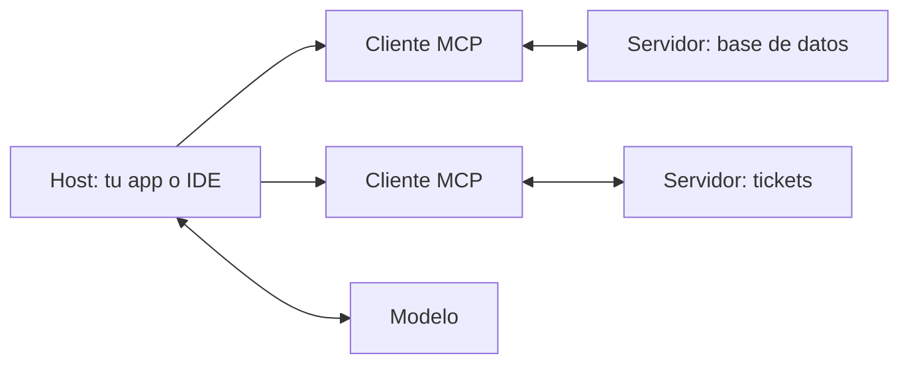

El [[glosario/mcp|Model Context Protocol (MCP)]] es un **estándar abierto para conectar aplicaciones de IA con herramientas y datos**. En lugar de programar cada integración dentro de cada aplicación, alguien escribe un [[glosario/servidor-mcp|servidor MCP]] una vez (para GitHub, una base de datos, tu sistema interno) y cualquier aplicación compatible puede usarlo. La especificación vive en [modelcontextprotocol.io](https://modelcontextprotocol.io).

MCP no cambia cómo razona el modelo. Por debajo, las herramientas de un servidor MCP acaban siendo herramientas normales con su ciclo `tool_use` → `tool_result` ([[docs/herramientas/01-uso-de-herramientas]]). Lo que estandariza es **cómo se descubren, describen e invocan**.

Para aprenderlo paso a paso: [[roadmap/20-herramientas/05-mcp-conectar-un-servidor]] y el curso [[cursos/mcp-de-cero-a-servidor/index]].

## Arquitectura



| Pieza | Qué es | Ejemplo |
|---|---|---|
| *Host* | La aplicación que usa el modelo y decide qué servidores conecta | Un asistente de escritorio, un IDE, tu agente |
| *Cliente* | Componente dentro del host que mantiene una conexión con **un** servidor | Una instancia de `ClientSession` |
| *Servidor* | Proceso que expone capacidades a través del protocolo | Un servidor de solo lectura sobre tu base de datos |

## Primitivas de un servidor

| Primitiva | Quién decide usarla | Qué es | Ejemplo |
|---|---|---|---|
| *Tools* | El modelo | Funciones invocables con argumentos | `buscar_cliente(email)` |
| *Resources* | La aplicación | Datos de solo lectura identificados por URI | `libros://catalogo` |
| *Prompts* | La persona usuaria | Plantillas de prompt reutilizables | «Resume esta incidencia» |

La mayoría de integraciones empiezan solo con *tools*. Añade *resources* cuando quieras que la aplicación cargue contexto sin pasar por una decisión del modelo.

## Transportes

| Transporte | Cuándo | Cómo funciona |
|---|---|---|
| `stdio` | Servidor local en la misma máquina | El host lanza el servidor como subproceso y se comunican por entrada y salida estándar. |
| *Streamable HTTP* | Servidor remoto, compartido por varios usuarios | El servidor escucha en una URL; admite respuestas en streaming. |

> [!aviso] En `stdio`, nada a la salida estándar
> Con transporte `stdio`, la salida estándar es el canal del protocolo. Un `print()` de depuración en el servidor rompe la comunicación. Escribe los logs en la salida de errores o en un archivo.

## Ejemplo completo: un servidor

Un servidor con una herramienta y un recurso. SDK de Python: paquete `mcp` (serie 2.x; en la 1.x la clase `MCPServer` se llamaba `FastMCP`). SDK de TypeScript: `@modelcontextprotocol/sdk`.

```python tab="Python" title="servidor.py"
from mcp.server.mcpserver import MCPServer

mcp = MCPServer("biblioteca")

CATALOGO = {
    "978-84-376-0494-7": {"titulo": "Cien años de soledad", "disponible": True},
    "978-84-206-3311-2": {"titulo": "La Regenta", "disponible": False},
}

@mcp.tool()
def buscar_libro(texto: str) -> str:
    """Busca libros cuyo título contenga el texto. Devuelve ISBN, título y disponibilidad."""
    hallados = [
        f"{isbn} | {d['titulo']} | {'disponible' if d['disponible'] else 'prestado'}"
        for isbn, d in CATALOGO.items()
        if texto.lower() in d["titulo"].lower()
    ]
    return "\n".join(hallados) or "Sin resultados."

@mcp.resource("libros://catalogo")
def catalogo() -> str:
    """Lista completa del catálogo."""
    return "\n".join(f"{isbn} | {d['titulo']}" for isbn, d in CATALOGO.items())

if __name__ == "__main__":
    mcp.run()  # stdio por defecto
```

```ts tab="TypeScript" title="servidor.ts"
import { McpServer } from "@modelcontextprotocol/sdk/server/mcp.js";
import { StdioServerTransport } from "@modelcontextprotocol/sdk/server/stdio.js";
import { z } from "zod";

const CATALOGO: Record<string, { titulo: string; disponible: boolean }> = {
  "978-84-376-0494-7": { titulo: "Cien años de soledad", disponible: true },
  "978-84-206-3311-2": { titulo: "La Regenta", disponible: false },
};

const server = new McpServer({ name: "biblioteca", version: "1.0.0" });

server.registerTool(
  "buscar_libro",
  {
    description: "Busca libros cuyo título contenga el texto. Devuelve ISBN, título y disponibilidad.",
    inputSchema: { texto: z.string() },
  },
  async ({ texto }) => {
    const hallados = Object.entries(CATALOGO)
      .filter(([, d]) => d.titulo.toLowerCase().includes(texto.toLowerCase()))
      .map(([isbn, d]) => `${isbn} | ${d.titulo} | ${d.disponible ? "disponible" : "prestado"}`);
    return { content: [{ type: "text", text: hallados.join("\n") || "Sin resultados." }] };
  },
);

await server.connect(new StdioServerTransport());
```

En Python, `MCPServer` genera el esquema de entrada a partir de las anotaciones de tipo y la descripción a partir del *docstring*. Escríbelo con el mismo cuidado que la descripción de cualquier herramienta: [[disciplinas/diseno-de-herramientas]].

## Ejemplo completo: conectar el servidor a tu agente

El cliente lista las herramientas del servidor, se las pasa al modelo en `tools` y reenvía cada `tool_use` al servidor.

```python title="cliente.py"
import asyncio
import anthropic
from mcp import ClientSession, StdioServerParameters
from mcp.client.stdio import stdio_client

MODEL = "claude-sonnet-5-5"
MAX_PASOS = 8
client = anthropic.AsyncAnthropic()
servidor = StdioServerParameters(command="python", args=["servidor.py"])

async def main(pregunta: str) -> str:
    async with stdio_client(servidor) as (leer, escribir):
        async with ClientSession(leer, escribir) as sesion:
            await sesion.initialize()
            lista = await sesion.list_tools()
            tools = [
                {"name": t.name, "description": t.description or "", "input_schema": t.input_schema}
                for t in lista.tools
            ]
            mensajes = [{"role": "user", "content": pregunta}]
            for _ in range(MAX_PASOS):
                resp = await client.messages.create(
                    model=MODEL, max_tokens=1024, tools=tools, messages=mensajes
                )
                mensajes.append({"role": "assistant", "content": resp.content})
                if resp.stop_reason != "tool_use":
                    return "".join(b.text for b in resp.content if b.type == "text")
                resultados = []
                for b in resp.content:
                    if b.type == "tool_use":
                        r = await sesion.call_tool(b.name, b.input)
                        texto = "".join(c.text for c in r.content if c.type == "text")
                        resultados.append({
                            "type": "tool_result", "tool_use_id": b.id,
                            "content": texto, "is_error": bool(r.is_error),
                        })
                mensajes.append({"role": "user", "content": resultados})
            return "[límite de pasos]"

print(asyncio.run(main("¿Está disponible La Regenta?")))
```

Algunas aplicaciones y la propia API del proveedor pueden conectarse a servidores MCP remotos sin que escribas este puente. Consulta la [documentación oficial](https://platform.claude.com/docs) para las opciones vigentes.

## Casos límite

| Situación | Qué hacer |
|---|---|
| Varios servidores con herramientas del mismo nombre | Añade un prefijo por servidor (`tickets_buscar`, `db_buscar`) al construir `tools`. |
| Servidor con decenas de herramientas | Expón solo las que necesita esta tarea; muchas herramientas parecidas confunden al modelo y ocupan contexto. |
| Resultado con imágenes u otros tipos | `r.content` puede traer bloques no textuales; conviértelos al bloque equivalente o descártalos explícitamente. |
| Servidor caído | `call_tool` lanza excepción: devuélvela como `tool_result` con `is_error`. |

## Errores frecuentes

- **Instalar servidores de terceros sin revisarlos.** Un servidor ejecuta código en tu máquina y sus descripciones y resultados entran en el contexto del modelo, donde pueden traer [[glosario/inyeccion-de-prompt|inyecciones]]. Ver [[cursos/mcp-de-cero-a-servidor/04-seguridad-y-despliegue]].
- **Dar permisos de escritura por defecto.** Empieza por solo lectura: [[recetas/servidor-mcp-de-solo-lectura]].
- **Herramientas que traducen la API interna una a una.** Diseña pensando en las tareas del modelo, no en tus *endpoints*.
- **Logs por la salida estándar** con `stdio`.

## Ver también

- [[cursos/mcp-de-cero-a-servidor/03-tu-primer-servidor]]: escribir un servidor paso a paso.
- [[sistemas/asistente-de-datos-con-mcp]]: un sistema completo sobre una base de datos.
- [[glosario/mcp]] y [[glosario/servidor-mcp]].
- [[radar/2026-09-08-mcp-forma-estandar]] y [[blog/2026-07-30-por-que-mcp-importa]].
