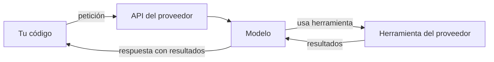

Las herramientas del lado del servidor son herramientas que **ejecuta el proveedor de la API, no tu código**. Las declaras en `tools` igual que las tuyas, pero cuando el modelo decide usarlas, la llamada, la ejecución y el resultado ocurren dentro de la misma petición. Tú recibes la respuesta final con los resultados ya incorporados. El ejemplo más habitual es la **búsqueda web**: el modelo busca, lee los resultados y responde citando las fuentes, sin que tú montes un buscador.

Las herramientas que defines tú se llaman *de cliente* para distinguirlas. Su ciclo está en [[docs/herramientas/01-uso-de-herramientas]].

## Cliente frente a servidor

| | Herramienta de cliente | Herramienta del servidor |
|---|---|---|
| Quién la ejecuta | Tu código | El proveedor |
| Cómo se declara | `name`, `description`, `input_schema` | Un identificador de tipo versionado que publica el proveedor, más opciones propias |
| Qué devuelve el modelo | `tool_use` y `stop_reason == "tool_use"` | Bloques de llamada y de resultado propios, ya resueltos |
| Quién manda el resultado | Tú, con `tool_result` | Nadie: ya viene dentro de la respuesta |
| Coste | Tokens; la ejecución corre de tu cuenta | Tokens y, en algunas, un coste por uso |
| Control | Total: validas, registras, limitas | El que exponen sus opciones |



## Qué tipos hay

El catálogo depende del proveedor y cambia con frecuencia. Las categorías habituales son la búsqueda web, la lectura de páginas web y la ejecución de código en un entorno aislado gestionado por el proveedor.

Cada herramienta se declara con un **tipo versionado** (un identificador que incluye una fecha o versión) y sus opciones, como un límite de usos por petición o listas de dominios permitidos y bloqueados en la búsqueda web. **No copies esos identificadores de memoria ni de artículos antiguos**: tómalos de la [documentación oficial](https://platform.claude.com/docs), donde también figuran los modelos compatibles y el precio por uso.

## Cómo aparecen en la respuesta

Cuando el modelo usa una herramienta del servidor, `resp.content` incluye, además de `text`:

- un bloque que representa la **llamada** (con la consulta o el código que el modelo decidió ejecutar);
- un bloque con el **resultado** (por ejemplo, la lista de páginas encontradas).

Sus `type` son propios de cada herramienta y **no son `tool_use` ni `tool_result`**. En la búsqueda web, el texto final suele llevar **citas** que apuntan a las fuentes usadas, útiles para el [[glosario/grounding|grounding]] y para mostrar enlaces a la persona.

Dos consecuencias para tu código:

1. **Filtra por `type == "tool_use"`** cuando busques qué ejecutar. Si recorres todos los bloques y ejecutas «lo que parezca una herramienta», acabarás intentando ejecutar algo que ya ejecutó el proveedor.
2. **Guarda `resp.content` entero** en el historial. Los bloques de llamada y resultado forman parte de la conversación.

## `pause_turn`

Un turno con varias búsquedas o ejecuciones puede ser largo. La API puede **pausarlo** y devolver `stop_reason == "pause_turn"` con lo hecho hasta ese momento. Para continuar, reenvía la conversación con esa respuesta añadida como mensaje `assistant`, sin añadir nada más. El modelo retoma donde lo dejó.

## Ejemplo completo

Bucle que mezcla una herramienta del servidor con una de cliente y gestiona `pause_turn`. La definición de la herramienta del servidor se deja como marcador: cópiala de la documentación oficial.

```python tab="Python" title="busqueda.py"
import anthropic

MODEL = "claude-sonnet-5-5"
MAX_PASOS = 10
client = anthropic.Anthropic()

# Copia aquí la definición exacta (tipo versionado, nombre y opciones) de la documentación oficial.
BUSQUEDA_WEB = {"type": "<tipo de la documentación>", "name": "<nombre de la documentación>"}

GUARDAR_NOTA = {
    "name": "guardar_nota",
    "description": "Guarda un resumen en la libreta del usuario. Úsala solo si el usuario lo pide.",
    "input_schema": {
        "type": "object",
        "properties": {"texto": {"type": "string"}},
        "required": ["texto"],
    },
}

def guardar_nota(texto: str) -> str:
    with open("notas.txt", "a", encoding="utf-8") as f:
        f.write(texto + "\n")
    return "Nota guardada."

def preguntar(pregunta: str) -> str:
    mensajes = [{"role": "user", "content": pregunta}]
    for _ in range(MAX_PASOS):
        resp = client.messages.create(
            model=MODEL, max_tokens=2048, tools=[BUSQUEDA_WEB, GUARDAR_NOTA], messages=mensajes
        )
        mensajes.append({"role": "assistant", "content": resp.content})

        if resp.stop_reason == "pause_turn":
            continue  # reenvía tal cual para que el modelo siga

        if resp.stop_reason == "tool_use":
            resultados = [
                {"type": "tool_result", "tool_use_id": b.id, "content": guardar_nota(**b.input)}
                for b in resp.content
                if b.type == "tool_use"  # solo las de cliente; las del servidor ya están resueltas
            ]
            mensajes.append({"role": "user", "content": resultados})
            continue

        return "".join(b.text for b in resp.content if b.type == "text")
    return "[límite de pasos]"

print(preguntar("¿Qué dice la especificación de MCP sobre transportes? Guárdame un resumen."))
```

```ts tab="TypeScript" title="busqueda.ts"
import { appendFileSync } from "node:fs";
import Anthropic from "@anthropic-ai/sdk";

const MODEL = "claude-sonnet-5-5";
const MAX_PASOS = 10;
const client = new Anthropic();

// Copia aquí la definición exacta (tipo versionado, nombre y opciones) de la documentación oficial.
const BUSQUEDA_WEB: any = { type: "<tipo de la documentación>", name: "<nombre de la documentación>" };

const GUARDAR_NOTA: Anthropic.Tool = {
  name: "guardar_nota",
  description: "Guarda un resumen en la libreta del usuario. Úsala solo si el usuario lo pide.",
  input_schema: { type: "object", properties: { texto: { type: "string" } }, required: ["texto"] },
};

function guardarNota(texto: string): string {
  appendFileSync("notas.txt", texto + "\n", "utf-8");
  return "Nota guardada.";
}

async function preguntar(pregunta: string): Promise<string> {
  const mensajes: Anthropic.MessageParam[] = [{ role: "user", content: pregunta }];
  for (let paso = 0; paso < MAX_PASOS; paso++) {
    const resp = await client.messages.create({
      model: MODEL,
      max_tokens: 2048,
      tools: [BUSQUEDA_WEB, GUARDAR_NOTA],
      messages: mensajes,
    });
    mensajes.push({ role: "assistant", content: resp.content });

    if (resp.stop_reason === "pause_turn") continue;

    if (resp.stop_reason === "tool_use") {
      const resultados: Anthropic.ToolResultBlockParam[] = [];
      for (const b of resp.content) {
        if (b.type !== "tool_use") continue;
        const args = b.input as { texto: string };
        resultados.push({ type: "tool_result", tool_use_id: b.id, content: guardarNota(args.texto) });
      }
      mensajes.push({ role: "user", content: resultados });
      continue;
    }

    return resp.content.map((b) => (b.type === "text" ? b.text : "")).join("");
  }
  return "[límite de pasos]";
}

console.log(await preguntar("¿Qué dice la especificación de MCP sobre transportes? Guárdame un resumen."));
```

## Cuándo usarlas y cuándo no

| Usa una herramienta del servidor si… | Usa una tuya si… |
|---|---|
| Necesitas información pública y reciente (búsqueda web) | Los datos son privados o internos |
| No quieres mantener la infraestructura (buscador, entorno de ejecución) | Necesitas registrar, filtrar o validar cada llamada |
| Te sirven las opciones que ofrece el proveedor | Necesitas lógica propia (permisos, cuotas por usuario) |
| La latencia de una petición más larga es aceptable | Necesitas controlar el tiempo de cada paso |

## Errores frecuentes

- **No tratar `pause_turn`.** Tu bucle lo interpreta como respuesta final y devuelve un texto a medias.
- **Ejecutar bloques que no son `tool_use`.** Filtra siempre por tipo.
- **Identificadores de versión copiados de un ejemplo antiguo.** La petición falla o usa una versión retirada.
- **Olvidar el coste por uso.** Una búsqueda por pregunta multiplicada por miles de usuarios se nota. Limita los usos por petición.
- **Confiar en el contenido web.** Las páginas que lee el modelo pueden traer instrucciones ocultas: es inyección indirecta, ver [[docs/seguridad/01-prompt-injection]] y [[radar/2026-10-20-inyeccion-por-herramientas]].

## Ver también

- [[docs/herramientas/01-uso-de-herramientas]]: herramientas de cliente.
- [[docs/herramientas/04-uso-del-ordenador]]: otra herramienta definida por el proveedor, pero ejecutada por ti.
- [[sistemas/investigacion-multiagente]]: búsqueda a escala con subagentes.
- [[glosario/stop-reason]].
