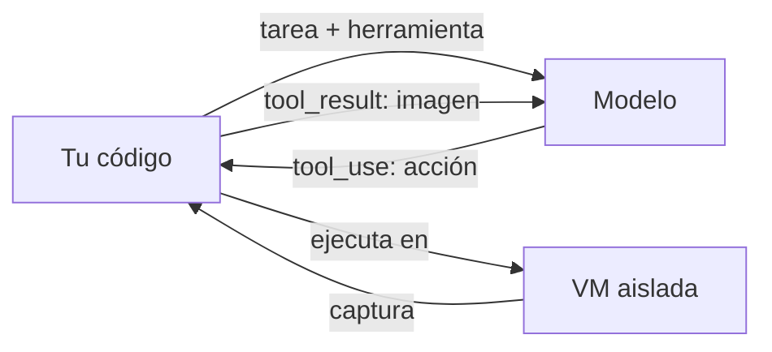

El [[glosario/uso-del-ordenador|uso del ordenador]] es una herramienta que permite al modelo **operar una interfaz gráfica como lo haría una persona**: recibe capturas de pantalla, decide una acción (mover el ratón, hacer clic, escribir, pulsar una tecla) y la pide con un `tool_use`. Tu código ejecuta esa acción en una máquina, toma una captura nueva y la devuelve como `tool_result`. El esquema de la herramienta lo define el proveedor; la ejecución corre de tu cuenta.

Sirve para automatizar aplicaciones que no tienen API. Es más lento, más caro y menos fiable que una API, así que úsalo cuando no haya otra vía: ver [[cursos/uso-del-ordenador/02-navegador-o-api]]. El curso completo empieza en [[cursos/uso-del-ordenador/index]].

> [!peligro] Siempre en una máquina aislada
> Ejecuta el uso del ordenador en una máquina virtual o un contenedor aislado, sin tus credenciales, sin acceso a datos sensibles y con la red restringida. Lo que aparece en pantalla (una web, un correo) puede contener instrucciones que el modelo intente seguir.

## Cómo funciona



El bucle es el de cualquier herramienta ([[docs/herramientas/01-uso-de-herramientas]]). Cambian dos cosas: el `input` del `tool_use` describe una **acción de interfaz**, y el `tool_result` lleva una **imagen** en lugar de texto.

## Declarar la herramienta

Al contrario que tus herramientas, esta no lleva `description` ni `input_schema` escritos por ti. Se declara con un **identificador de tipo versionado** que publica el proveedor, más las dimensiones de la pantalla virtual. Algunas versiones requieren además activar una cabecera beta en la petición.

**Toma el identificador, los parámetros y la cabecera de la [documentación oficial](https://platform.claude.com/docs)**. Cambian entre versiones de la herramienta y de modelo, y una versión equivocada hace fallar la petición. Suele haber herramientas complementarias del mismo estilo para editar archivos o ejecutar comandos en la máquina.

## Acciones

El conjunto exacto depende de la versión. Estas categorías están siempre:

| Categoría | Ejemplos de acción | Qué ejecutas |
|---|---|---|
| Observar | captura de pantalla | Tomar una captura y devolverla como imagen |
| Ratón | mover, clic izquierdo o derecho, doble clic, arrastrar | Mover el puntero a `coordinate` `[x, y]` y pulsar |
| Teclado | escribir texto, pulsar una tecla o combinación | Teclear `text` o enviar `ctrl+s`, `Return`… |
| Desplazamiento | desplazar en una dirección | Rueda del ratón en el punto indicado |
| Espera | esperar | Dormir un momento y capturar de nuevo |

## Ejemplo completo

Bucle mínimo. El ejecutor usa `xdotool` y `scrot`, y **debe correr dentro de la máquina aislada**. Los nombres de acción siguen la forma habitual de la herramienta; compruébalos con la versión que uses.

```python tab="Python" title="ordenador.py"
import base64, subprocess, time
import anthropic

MODEL = "claude-sonnet-5-5"
MAX_PASOS = 30
client = anthropic.Anthropic()

# Copia la definición exacta de la documentación oficial (tipo versionado, nombre, dimensiones).
HERRAMIENTA_ORDENADOR = {"type": "<tipo de la documentación>", "name": "<nombre>"}

def captura() -> dict:
    subprocess.run(["scrot", "-o", "/tmp/pantalla.png"], check=True)
    datos = base64.standard_b64encode(open("/tmp/pantalla.png", "rb").read()).decode()
    return {"type": "image", "source": {"type": "base64", "media_type": "image/png", "data": datos}}

def ejecutar(accion: dict) -> list[dict]:
    tipo = accion.get("action")
    if tipo == "left_click":
        x, y = accion["coordinate"]
        subprocess.run(["xdotool", "mousemove", str(x), str(y), "click", "1"], check=True)
    elif tipo == "type":
        subprocess.run(["xdotool", "type", "--delay", "40", accion["text"]], check=True)
    elif tipo == "key":
        subprocess.run(["xdotool", "key", accion["text"]], check=True)
    elif tipo != "screenshot":
        raise ValueError(f"Acción no soportada por este ejecutor: {tipo}")
    time.sleep(0.5)  # deja que la interfaz reaccione
    return [captura()]

def tarea(instruccion: str) -> str:
    mensajes = [{"role": "user", "content": instruccion}]
    for _ in range(MAX_PASOS):
        resp = client.messages.create(
            model=MODEL, max_tokens=2048, tools=[HERRAMIENTA_ORDENADOR], messages=mensajes
        )
        mensajes.append({"role": "assistant", "content": resp.content})
        if resp.stop_reason != "tool_use":
            return "".join(b.text for b in resp.content if b.type == "text")
        resultados = []
        for b in resp.content:
            if b.type != "tool_use":
                continue
            try:
                resultados.append({"type": "tool_result", "tool_use_id": b.id, "content": ejecutar(b.input)})
            except Exception as e:
                resultados.append({"type": "tool_result", "tool_use_id": b.id,
                                   "content": f"Error: {e}", "is_error": True})
        mensajes.append({"role": "user", "content": resultados})
    return "[límite de pasos]"

print(tarea("Abre el editor de texto, escribe 'hola' y guarda el archivo como hola.txt en el escritorio."))
```

```ts tab="TypeScript" title="ordenador.ts"
import { execFileSync } from "node:child_process";
import { readFileSync } from "node:fs";
import Anthropic from "@anthropic-ai/sdk";

const MODEL = "claude-sonnet-5-5";
const MAX_PASOS = 30;
const client = new Anthropic();

// Copia la definición exacta de la documentación oficial (tipo versionado, nombre, dimensiones).
const HERRAMIENTA_ORDENADOR: any = { type: "<tipo de la documentación>", name: "<nombre>" };

function captura(): Anthropic.ImageBlockParam {
  execFileSync("scrot", ["-o", "/tmp/pantalla.png"]);
  const data = readFileSync("/tmp/pantalla.png").toString("base64");
  return { type: "image", source: { type: "base64", media_type: "image/png", data } };
}

function ejecutar(accion: any): Anthropic.ImageBlockParam[] {
  if (accion.action === "left_click") {
    const [x, y] = accion.coordinate;
    execFileSync("xdotool", ["mousemove", String(x), String(y), "click", "1"]);
  } else if (accion.action === "type") {
    execFileSync("xdotool", ["type", "--delay", "40", accion.text]);
  } else if (accion.action === "key") {
    execFileSync("xdotool", ["key", accion.text]);
  } else if (accion.action !== "screenshot") {
    throw new Error(`Acción no soportada por este ejecutor: ${accion.action}`);
  }
  execFileSync("sleep", ["0.5"]);
  return [captura()];
}

async function tarea(instruccion: string): Promise<string> {
  const mensajes: Anthropic.MessageParam[] = [{ role: "user", content: instruccion }];
  for (let paso = 0; paso < MAX_PASOS; paso++) {
    const resp = await client.messages.create({
      model: MODEL,
      max_tokens: 2048,
      tools: [HERRAMIENTA_ORDENADOR],
      messages: mensajes,
    });
    mensajes.push({ role: "assistant", content: resp.content });
    if (resp.stop_reason !== "tool_use") {
      return resp.content.map((b) => (b.type === "text" ? b.text : "")).join("");
    }
    const resultados: Anthropic.ToolResultBlockParam[] = [];
    for (const b of resp.content) {
      if (b.type !== "tool_use") continue;
      try {
        resultados.push({ type: "tool_result", tool_use_id: b.id, content: ejecutar(b.input) });
      } catch (e) {
        resultados.push({ type: "tool_result", tool_use_id: b.id, content: `Error: ${e}`, is_error: true });
      }
    }
    mensajes.push({ role: "user", content: resultados });
  }
  return "[límite de pasos]";
}

console.log(await tarea("Abre el editor de texto, escribe 'hola' y guarda el archivo como hola.txt en el escritorio."));
```

Este ejecutor cubre tres acciones para mantener el ejemplo corto. Si el modelo pide otra, recibe un `is_error` y suele intentar una alternativa. En producción, implementa todas las de la versión que declares.

## Parámetros y decisiones

| Decisión | Recomendación |
|---|---|
| Resolución de la pantalla | Moderada. Capturas grandes cuestan más tokens y no mejoran la precisión. Si reduces la imagen, escala las coordenadas de vuelta. |
| Límite de pasos | Obligatorio. Una tarea que no converge puede repetir acciones indefinidamente. |
| Historial | Las capturas ocupan mucho. Conserva las últimas y sustituye las antiguas por una nota de texto. Ver [[docs/contexto/01-ventana-de-contexto]]. |
| Confirmaciones | Antes de enviar, pagar, borrar o aceptar condiciones, para y pide aprobación: [[docs/agentes/03-humano-en-el-bucle]]. |
| Verificación | Comprueba el resultado por otra vía (¿existe el archivo?) en vez de fiarte del «hecho» del modelo: [[cursos/uso-del-ordenador/03-fiabilidad]]. |

## Errores frecuentes

- **Ejecutarlo en tu máquina de trabajo.** Un clic equivocado o una inyección desde una web afectan a tus datos reales. Siempre en [[glosario/sandbox|sandbox]].
- **Usarlo cuando hay API.** Si la aplicación tiene API o hay un [[docs/herramientas/02-mcp|servidor MCP]], úsalo: más rápido, barato y fiable.
- **No esperar a que la interfaz reaccione.** Capturar justo después del clic devuelve la pantalla anterior y el modelo repite la acción.
- **Historial con decenas de capturas.** La [[glosario/ventana-de-contexto]] se llena y el coste se dispara.
- **Copiar el identificador de la herramienta de un tutorial antiguo.** Usa el de la documentación vigente.

## Ver también

- [[cursos/uso-del-ordenador/01-como-funciona]]: la lección de base.
- [[cursos/uso-del-ordenador/04-seguridad-y-aislamiento]]: cómo montar el aislamiento.
- [[docs/seguridad/01-prompt-injection]]: la pantalla como vía de inyección.
- [[radar/2026-07-02-uso-del-ordenador-en-sandbox]].
