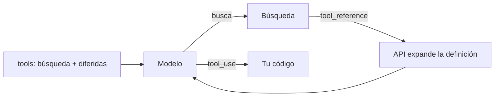

La [[glosario/carga-diferida-de-herramientas|carga diferida de herramientas]] consiste en declarar herramientas con `defer_loading: true` para que **no entren en el contexto** del modelo hasta que hagan falta. El modelo empieza viendo solo unas pocas herramientas y una **herramienta de búsqueda**; cuando necesita otra, la busca, la API devuelve una referencia (`tool_reference`) y en ese momento expande su definición completa. Así un agente puede tener a mano miles de herramientas pagando en cada llamada solo las que usa.

Es GA en la API de Claude y no necesita cabecera beta. El caso práctico, con medición antes y después, está en [[recetas/carga-diferida-de-herramientas]].

## Por qué existe

Cada definición de herramienta ocupa tokens en **todas** las llamadas, se use o no. Con varios [[glosario/servidor-mcp|servidores MCP]] conectados es fácil pasar de decenas de miles de tokens solo en definiciones, y además el modelo elige peor cuantas más opciones parecidas tiene delante.

Anthropic publicó en su artículo [*Introducing advanced tool use on the Claude Developer Platform*](https://www.anthropic.com/engineering/advanced-tool-use) (nov. 2025) una reducción del 85 % en tokens de definiciones (el contexto previo al trabajo pasa de unos 77.000 a unos 8.700 tokens; el artículo da las dos cifras, aunque juntas salen cerca de un 89 %) y una mejora de precisión en sus evals de MCP (Opus 4: de 49 % a 74 %; Opus 4.5: de 79,5 % a 88,1 %). Son cifras de sus evals internas con modelos anteriores: mide las tuyas.

**Cuándo compensa**, según la documentación: 10 o más herramientas, definiciones que suman más de 10.000 tokens, varios servidores MCP agregados o una biblioteca de herramientas que crece. **Cuándo no**: menos de 10 herramientas, todas usadas en cada petición, o definiciones pequeñas.

## Cómo funciona



1. Declaras todas las herramientas en `tools`. Las que no quieres cargar llevan `defer_loading: true`.
2. Añades una herramienta de búsqueda **sin diferir**: la del servidor o una tuya.
3. El modelo busca. La búsqueda devuelve bloques `{"type": "tool_reference", "tool_name": "…"}`.
4. La API sustituye cada referencia por la definición completa y el modelo ya puede llamar a esa herramienta con un `tool_use` normal.

**Efecto en la caché.** Las herramientas diferidas quedan fuera del prefijo que se cachea: la referencia se inserta en la conversación y la API la expande allí. El prefijo `tools` → `system` no cambia, así que el [[docs/contexto/02-prompt-caching|prompt caching]] se conserva aunque el modelo descubra herramientas nuevas a mitad de tarea. Una herramienta diferida **no puede llevar `cache_control`** (400): pon el punto de corte en una herramienta no diferida.

## La búsqueda del servidor

Dos variantes, que buscan en el nombre, la descripción y los nombres y descripciones de los argumentos de cada herramienta:

| `type` | `name` | Qué escribe el modelo | Límite |
|---|---|---|---|
| `tool_search_tool_regex_20251119` | `tool_search_tool_regex` | Un patrón de `re.search()` de Python (`pattern`), sin distinguir mayúsculas | 200 caracteres |
| `tool_search_tool_bm25_20251119` | `tool_search_tool_bm25` | Una consulta en lenguaje natural (`query`) | 500 caracteres |

Hay alias sin fecha (`tool_search_tool_regex`, `tool_search_tool_bm25`). Cada búsqueda devuelve hasta 5 herramientas por defecto; el modelo puede pedir otro `limit` (de 1 a 10.000) en su entrada.

En la respuesta aparecen tres bloques:

```json
[
  {"type": "server_tool_use", "id": "srvtoolu_01", "name": "tool_search_tool_bm25",
   "input": {"query": "anular factura"}},
  {"type": "tool_search_tool_result", "tool_use_id": "srvtoolu_01",
   "content": {"type": "tool_search_tool_search_result",
               "tool_references": [{"type": "tool_reference", "tool_name": "anular_factura"}]}},
  {"type": "tool_use", "id": "toolu_01", "name": "anular_factura", "input": {"numero": "F-2026-0042"}}
]
```

Los dos primeros ya están resueltos por el servidor: **no devuelvas `tool_result` para un id `srvtoolu_…`** y guárdalos en el historial tal cual. Solo el `tool_use` es tuyo. Una búsqueda sin coincidencias devuelve `tool_references` vacío, no un error.

```python title="busqueda_servidor.py"
import anthropic
from busqueda_propia import CATALOGO, MODEL, ejecutar

client = anthropic.Anthropic()
BUSQUEDA = {"type": "tool_search_tool_bm25_20251119", "name": "tool_search_tool_bm25"}  # o la variante regex

mensajes = [{"role": "user", "content": "Anula la factura F-2026-0042"}]
while True:
    resp = client.messages.create(model=MODEL, max_tokens=2048, tools=[BUSQUEDA, *CATALOGO], messages=mensajes)
    mensajes.append({"role": "assistant", "content": resp.content})
    for b in resp.content:
        if b.type == "tool_search_tool_result":
            print("encontradas:", [r.tool_name for r in b.content.tool_references])
    if resp.stop_reason == "pause_turn":
        continue
    if resp.stop_reason != "tool_use":
        break
    # solo los tool_use son tuyos; server_tool_use y tool_search_tool_result ya están resueltos
    mensajes.append({"role": "user", "content": [
        {"type": "tool_result", "tool_use_id": b.id, "content": ejecutar(b.name, b.input)}
        for b in resp.content if b.type == "tool_use"
    ]})
print("".join(b.text for b in resp.content if b.type == "text"))
```

## Una búsqueda propia

La búsqueda del servidor es léxica. Si quieres buscar con *[[glosario/embeddings|embeddings]]*, con permisos por usuario o con tu propio ranking, escribe una herramienta de cliente que devuelva **bloques `tool_reference` dentro de un `tool_result`**. Cada herramienta referenciada debe estar declarada en `tools`, normalmente con `defer_loading: true`.

El ejemplo usa [[glosario/bm25|BM25]] con la biblioteca abierta `rank-bm25` (licencia Apache 2.0). Cambiar BM25 por una búsqueda vectorial solo toca `buscar_herramientas`.

```python tab="Python" title="busqueda_propia.py"
import json
import anthropic
from rank_bm25 import BM25Okapi

MODEL = "claude-sonnet-5-5"
MAX_PASOS = 10
client = anthropic.Anthropic()

def herramienta(nombre: str, descripcion: str, props: dict) -> dict:
    return {"name": nombre, "description": descripcion, "defer_loading": True,
            "input_schema": {"type": "object", "properties": props, "required": list(props)}}

# Catálogo grande: en producción, cientos de herramientas generadas desde tu registro
CATALOGO = [
    herramienta("crear_factura", "Crea una factura para un cliente con importe en euros.",
                {"cliente_id": {"type": "string"}, "importe": {"type": "number"}}),
    herramienta("anular_factura", "Anula una factura emitida por su número.", {"numero": {"type": "string"}}),
    herramienta("buscar_cliente", "Busca un cliente por nombre o NIF y devuelve su id.", {"texto": {"type": "string"}}),
    herramienta("listar_pedidos", "Lista los pedidos de un cliente en un rango de fechas.",
                {"cliente_id": {"type": "string"}, "desde": {"type": "string"}}),
]

BUSCAR = {  # la única que el modelo ve desde el principio
    "name": "buscar_herramientas",
    "description": ("Busca en el catálogo de herramientas de la empresa (facturas, clientes, pedidos...). "
                    "Úsala antes de actuar si no tienes la herramienta que necesitas."),
    "input_schema": {"type": "object", "properties": {"consulta": {"type": "string"}}, "required": ["consulta"]},
}
TOOLS = [BUSCAR, *CATALOGO]

def tokens(t: str) -> list[str]:
    return t.lower().replace(".", " ").replace("_", " ").split()

INDICE = BM25Okapi([tokens(h["name"] + " " + h["description"]) for h in CATALOGO])

def buscar_herramientas(consulta: str, limite: int = 3) -> list[dict]:
    puntos = INDICE.get_scores(tokens(consulta))
    mejores = sorted(range(len(CATALOGO)), key=lambda i: -puntos[i])[:limite]
    return [{"type": "tool_reference", "tool_name": CATALOGO[i]["name"]} for i in mejores if puntos[i] > 0]

def ejecutar(nombre: str, args: dict) -> str:
    return json.dumps({"ok": True, "herramienta": nombre, "args": args})  # tu implementación real

def agente(pregunta: str) -> str:
    mensajes = [{"role": "user", "content": pregunta}]
    for _ in range(MAX_PASOS):
        resp = client.messages.create(model=MODEL, max_tokens=2048, tools=TOOLS, messages=mensajes)
        mensajes.append({"role": "assistant", "content": resp.content})
        if resp.stop_reason != "tool_use":
            return "".join(b.text for b in resp.content if b.type == "text")
        resultados = []
        for b in resp.content:
            if b.type != "tool_use":
                continue
            if b.name == "buscar_herramientas":
                refs = buscar_herramientas(b.input["consulta"])
                contenido = refs or "Ninguna herramienta encaja. Reformula la consulta."
            else:
                contenido = ejecutar(b.name, b.input)
            resultados.append({"type": "tool_result", "tool_use_id": b.id, "content": contenido})
        mensajes.append({"role": "user", "content": resultados})
    raise RuntimeError("Sin terminar")
```

Con el simulador, para «Hazle una factura de 120 € al cliente C-7», la búsqueda devuelve `crear_factura`, `buscar_cliente` y `listar_pedidos` como referencias, el modelo llama a `crear_factura` y la primera petición lleva `defer_loading` en las cuatro herramientas del catálogo y no en la de búsqueda. Fíjate en el caso vacío: devolver texto («Ninguna herramienta encaja») ayuda al modelo a reformular en vez de rendirse.

## Qué dejar sin diferir

- **La herramienta de búsqueda, siempre.** Nunca lleva `defer_loading: true`.
- **Las 3 a 5 que más se usan** (recomendación de la documentación): así el caso frecuente no paga una búsqueda previa.
- **Herramientas que el modelo debe conocer para entender la tarea**, como la de entregar el resultado final.
- Al menos una herramienta no diferida en total: si todas están diferidas, la API devuelve 400.

Ayuda mucho nombrar por familias (`facturas_crear`, `facturas_anular`, `clientes_buscar`) y escribir descripciones con las palabras que usaría quien pide la tarea, porque eso es lo que se busca. Puedes resumir las familias disponibles en el [[glosario/prompt-de-sistema|prompt de sistema]] sin listar cada herramienta.

## Con servidores MCP

Si las herramientas llegan por el [[docs/herramientas/07-mcp-desde-la-api|conector MCP]], no marcas cada definición: pones `defer_loading` en el `default_config` del `mcp_toolset` para todo el servidor, o por herramienta en `configs`:

```json
{
  "type": "mcp_toolset",
  "mcp_server_name": "calendario",
  "default_config": {"enabled": true, "defer_loading": true},
  "configs": {"buscar_eventos": {"defer_loading": false}}
}
```

Las herramientas diferidas también se pueden hacer aparecer a mitad de conversación con un bloque `tool_addition` dentro de un mensaje `system`: ver [[docs/contexto/06-mensajes-de-sistema-a-mitad-de-conversacion]].

## Límites y errores

| Caso | Resultado |
|---|---|
| Más de 10.000 herramientas diferidas en una petición | 400 |
| Todas las herramientas diferidas | 400: al menos una debe tener `defer_loading: false` |
| `defer_loading` y `cache_control` en la misma herramienta | 400 |
| `tool_reference` a un nombre que no está en `tools` | 400 (`Tool reference '…' not found in available tools`) |
| Patrón regex inválido o demasiado largo | HTTP 200 con un `tool_search_tool_result_error` (`invalid_tool_input`) que el modelo lee y corrige |
| Modelos | Todos los actuales; no Opus 4.1 ni anteriores |

## Errores frecuentes

- **Diferir sin medir.** Con pocas herramientas añades una búsqueda en cada tarea y no ahorras nada. Cuenta los tokens de `tools` con `client.messages.count_tokens` antes de decidir.
- **Descripciones pobres.** La búsqueda solo encuentra lo que está escrito.
- **Responder al `server_tool_use` de la búsqueda.** Ya está resuelto; un `tool_result` para un `srvtoolu_…` rompe la petición.
- **Generar `CATALOGO` en un orden distinto cada vez.** Aunque las diferidas no cuentan en el prefijo, las no diferidas sí: ordena siempre igual.

## Ver también

- [[recetas/carga-diferida-de-herramientas]]: el procedimiento completo con medición.
- [[docs/herramientas/06-llamada-programatica]]: la otra técnica para ahorrar contexto con muchas herramientas.
- [[disciplinas/diseno-de-herramientas]]: nombres y descripciones que se encuentran.
- [[cursos/context-engineering/02-que-meter-y-que-no]]: el criterio general.
