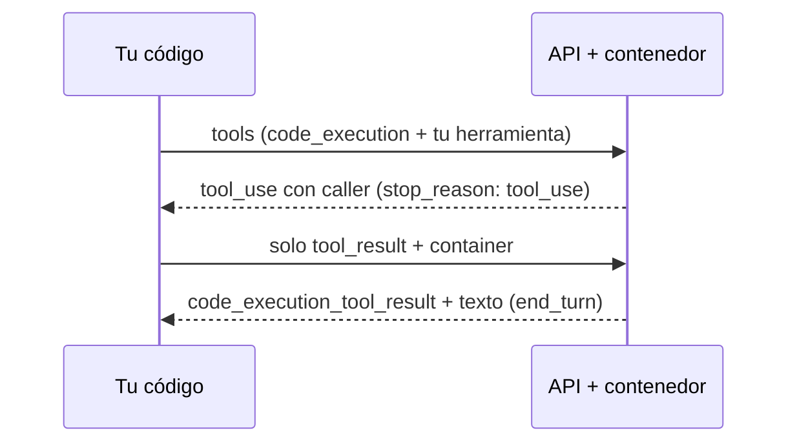

La [[glosario/llamada-programatica|llamada programática a herramientas]] permite que el modelo **escriba un programa que llama a tus herramientas** en lugar de pedirlas una a una. El código corre en el contenedor de la herramienta de ejecución de código de Anthropic; cada herramienta marcada con `allowed_callers` aparece allí como una función `async` de Python. Cuando el programa llama a una, la API pausa la ejecución y te envía un `tool_use` normal; tú lo ejecutas y devuelves el resultado, que va **al programa y no al contexto del modelo**. Solo la salida final del código entra en la conversación.

Es GA y no necesita cabecera beta. Las herramientas del servidor en general están en [[docs/herramientas/03-herramientas-del-servidor]].

## Qué resuelve

Con el ciclo normal ([[docs/herramientas/01-uso-de-herramientas]]), cada llamada es una ida y vuelta al modelo y cada resultado entra entero en el contexto. Si la tarea es «compara las ventas de 30 días en 12 tiendas», eso son 12 resultados de 30 filas que el modelo lee para quedarse con una suma.

Con la llamada programática, el modelo escribe un bucle que llama 12 veces, suma en Python e imprime una línea. Ganas en dos cosas:

- **Menos idas y vueltas**: varias llamadas por cada pasada del modelo, incluso en paralelo con `asyncio.gather`.
- **Resultados intermedios fuera del contexto**: los tokens de los resultados no se facturan como entrada; solo la salida final del código y la respuesta del modelo.

Anthropic midió un 37 % menos de tokens (de 43.588 a 27.297) en tareas de investigación complejas en [*Introducing advanced tool use*](https://www.anthropic.com/engineering/advanced-tool-use) (nov. 2025). Su recomendación: úsala con **3 o más llamadas dependientes** o con resultados grandes que solo necesitas resumidos, filtrados o agregados. En flujos estrictamente secuenciales de una llamada por paso, o cuando necesitas la opinión del usuario entre llamadas, no ganas nada.



## Declarar las herramientas

Hacen falta dos cosas en `tools`: la herramienta de ejecución de código en versión `code_execution_20260120` o posterior, y tus herramientas con `allowed_callers`.

| Valor de `allowed_callers` | Efecto |
|---|---|
| Omitido o `["direct"]` | Llamada normal (por defecto) |
| `["code_execution_20260120"]` | El modelo la llama solo desde su código |
| `["direct", "code_execution_20260120"]` | Ambas. La documentación recomienda elegir una por herramienta: el modelo decide mejor |

`code_execution_20260120` y `code_execution_20260521` son intercambiables dentro de `allowed_callers`; en las respuestas, el `caller` siempre llega etiquetado como `code_execution_20260120`.

Escribe la descripción pensando en código: di **qué forma tiene lo que devuelve** («lista JSON de objetos `{fecha, importe}`»). El modelo va a parsearlo sin verlo antes.

## El ciclo, bloque a bloque

Cuando el programa llama a tu herramienta, la respuesta trae `stop_reason: "tool_use"`, un bloque `server_tool_use` con el código y un `tool_use` con el campo `caller`:

```json
{
  "content": [
    {"type": "server_tool_use", "id": "srvtoolu_abc", "name": "code_execution",
     "input": {"code": "import asyncio, json\n..."}},
    {"type": "tool_use", "id": "toolu_def", "name": "ventas_de_tienda",
     "input": {"tienda": "madrid", "mes": "2026-09"},
     "caller": {"type": "code_execution_20260120", "tool_id": "srvtoolu_abc"}}
  ],
  "container": {"id": "container_xyz", "expires_at": "2026-10-29T14:30:00Z"},
  "stop_reason": "tool_use"
}
```

`caller.tool_id` es el `id` del `server_tool_use` cuyo código hizo la llamada. Una llamada directa trae `"caller": {"type": "direct"}`.

Para continuar, tu siguiente petición debe cumplir **tres reglas**:

1. **El mensaje `user` lleva solo bloques `tool_result`**, uno por cada llamada pendiente. Ningún texto, ni antes ni después. Es más estricto que la regla general.
2. **Pasas `container` con el id de la respuesta pausada.** Sin él, la API rechaza la continuación: el código está esperando dentro de ese contenedor.
3. **Envías las mismas `tools`**, con la herramienta de ejecución incluida.

El contenido de cada `tool_result` debe ser texto (cadena o bloques `text`); imágenes y documentos se rechazan. Cada llamada pendiente expira a los 4 minutos aproximadamente y lanza `TimeoutError` dentro del código: si tu herramienta es lenta, esta técnica no le sirve. Cuando el programa termina, llega un bloque `code_execution_tool_result` con `stdout`, `stderr` y `return_code`, seguido del texto del modelo y `end_turn`.

## Ejemplo completo

```python tab="Python" title="programatica.py"
import json
import anthropic

MODEL = "claude-sonnet-5-5"
MAX_PASOS = 20
client = anthropic.Anthropic()

EJECUCION = {"type": "code_execution_20260120", "name": "code_execution"}
VENTAS = {
    "name": "ventas_de_tienda",
    "description": ("Devuelve las ventas diarias de una tienda en un mes como lista JSON de "
                    "objetos {fecha, importe}. Formato de mes: AAAA-MM."),
    "input_schema": {
        "type": "object",
        "properties": {"tienda": {"type": "string"}, "mes": {"type": "string"}},
        "required": ["tienda", "mes"],
    },
    "allowed_callers": ["code_execution_20260120"],  # el modelo la llama desde su código
}
TOOLS = [EJECUCION, VENTAS]

def ventas_de_tienda(tienda: str, mes: str) -> str:
    return json.dumps([{"fecha": f"{mes}-{d:02d}", "importe": 100 + d} for d in range(1, 31)])

def agente(pregunta: str) -> str:
    mensajes = [{"role": "user", "content": pregunta}]
    contenedor = None
    for _ in range(MAX_PASOS):
        resp = client.messages.create(
            model=MODEL, max_tokens=4096, tools=TOOLS, messages=mensajes,
            **({"container": contenedor} if contenedor else {}),
        )
        if resp.container:
            contenedor = resp.container.id          # el código pausado vive en este contenedor
        mensajes.append({"role": "assistant", "content": resp.content})

        if resp.stop_reason == "pause_turn":
            continue
        if resp.stop_reason != "tool_use":
            return "".join(b.text for b in resp.content if b.type == "text")

        resultados = []
        for b in resp.content:
            if b.type != "tool_use":
                continue
            desde_codigo = b.caller is not None and b.caller.type != "direct"
            try:
                salida = ventas_de_tienda(**b.input)
            except Exception as e:
                salida = f"Error: {e}"   # desde código, el error llega como texto a su función
            resultados.append({"type": "tool_result", "tool_use_id": b.id, "content": salida,
                               **({} if desde_codigo else {"is_error": salida.startswith("Error")})})
        mensajes.append({"role": "user", "content": resultados})   # solo tool_result, sin texto
    raise RuntimeError("Sin terminar")

print(agente("¿Qué tienda vendió más en septiembre de 2026: madrid, sevilla o bilbao?"))
```

Probado con el simulador en un recorrido de dos llamadas desde código y un final con `code_execution_tool_result`: la primera petición va sin `container`, las dos siguientes llevan `container_xyz`, el mensaje de respuesta contiene solo `tool_result` y el historial conserva el `caller` de cada `tool_use`. El bucle trata igual una llamada directa: aunque declares `allowed_callers`, el modelo podría hacerla (ver abajo).

## Límites y compatibilidad

| Aspecto | Estado |
|---|---|
| Versión de ejecución de código | `code_execution_20260120` o posterior |
| Modelos | Todos los actuales salvo Haiku 4.5 |
| `strict: true` en la herramienta | No compatible |
| `disable_parallel_tool_use` | No compatible |
| Forzarla con `tool_choice` | No se puede; un `tool_choice` que nombra una herramienta sin `"direct"` da 400 |
| Herramientas del conector MCP | No se pueden llamar desde código |
| *Toolsets* de ordenador y navegador | No (solo admiten `"direct"`) |
| Contenido del `tool_result` | Solo texto |
| Espera por llamada | Unos 4 minutos; después, `TimeoutError` en el código |
| ZDR | No apta (los contenedores retienen datos hasta 30 días) |

El contenedor es el de la ejecución de código: Python 3.11, 5 GiB de RAM, 5 GiB de disco, 1 CPU, **sin internet**, celdas de hasta 90 s en `code_execution_20260521`. Se factura como la ejecución de código (a 29 oct. 2026, 1.550 horas gratis al mes por organización y después $0,05 por hora y contenedor; comprueba la [página de precios](https://platform.claude.com/docs/en/about-claude/pricing) porque cambia). Cada llamada desde el código cuenta para tus límites de tasa por separado.

> [!peligro] allowed_callers no es una barrera de seguridad
> La documentación lo dice expresamente: `allowed_callers` guía al modelo, pero no bloquea una llamada directa. Tu código debe estar preparado para recibir un `tool_use` directo de cualquier herramienta que declares, y los permisos (qué puede hacer cada herramienta, con qué datos) se aplican en tu lado. Ver [[docs/seguridad/02-permisos-y-minimo-privilegio]].

## Llamada programática o búsqueda de herramientas

Atacan problemas distintos y se combinan:

| Problema | Técnica |
|---|---|
| Muchas **definiciones** de herramientas llenan el contexto | [[docs/herramientas/05-busqueda-y-carga-diferida\|Carga diferida]] |
| Muchos **resultados** intermedios llenan el contexto | Llamada programática |
| Ambos | Las dos: diferir el catálogo y permitir llamadas desde código a las herramientas de datos |

La idea de fondo, presentar herramientas como código que el agente ejecuta y del que solo ve la salida, es la misma que Anthropic describe en *Code execution with MCP* (nov. 2025): ver [[cursos/context-engineering/02-que-meter-y-que-no]].

## Errores frecuentes

- **Añadir texto al mensaje de `tool_result`** («aquí tienes los datos»). Con llamadas pendientes, solo bloques `tool_result`.
- **Olvidar el `container`.** El código está esperando en ese contenedor; sin el id no hay continuación.
- **Cambiar `tools` entre peticiones** o quitar la herramienta de ejecución. El código pausado no puede reanudarse.
- **Herramientas lentas.** Pasados unos 4 minutos, la llamada falla dentro del código.
- **Describir mal la salida.** El modelo escribe código que parsea lo que dices que devuelves; si no coincide, el programa falla.

## Ver también

- [[docs/herramientas/03-herramientas-del-servidor]]: el resto de herramientas que ejecuta Anthropic y `pause_turn`.
- [[docs/herramientas/05-busqueda-y-carga-diferida]]: la técnica complementaria.
- [[disciplinas/diseno-de-herramientas]]: descripciones que se pueden programar.
- [[glosario/sandbox]]: por qué el contenedor no tiene red.
