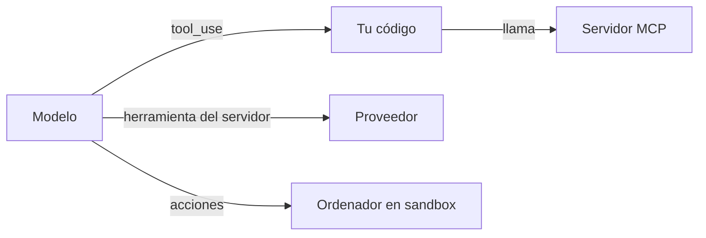

Un modelo solo genera texto. Las herramientas son el mecanismo con el que **pide a algo externo que actúe**: consultar una base de datos, buscar en la web, ejecutar código o mover el ratón. Este grupo documenta las cuatro formas de dárselas, de la más básica a la más arriesgada, y tres técnicas para cuando las herramientas o las llamadas se multiplican.

## Artículos

| Artículo | Quién ejecuta la herramienta | Para qué lo consultas |
|---|---|---|
| [[docs/herramientas/01-uso-de-herramientas]] | Tu código | Definir herramientas, el ciclo `tool_use` → `tool_result`, `tool_choice`, errores. |
| [[docs/herramientas/02-mcp]] | Un servidor MCP que tu aplicación conecta | Arquitectura, primitivas, la revisión sin estado `2026-07-28`, transportes y cómo escribir y conectar un servidor. |
| [[docs/herramientas/03-herramientas-del-servidor]] | El proveedor de la API | Herramientas que ejecuta el proveedor, como la búsqueda web, y cómo se integran en tu bucle. |
| [[docs/herramientas/04-uso-del-ordenador]] | Tu código, sobre una máquina aislada | El modelo ve capturas y controla ratón y teclado con un *toolset* de cliente. |
| [[docs/herramientas/05-busqueda-y-carga-diferida]] | Tu código (o el servidor MCP) | Cientos de herramientas sin llenar el contexto: `defer_loading` y búsqueda de herramientas. |
| [[docs/herramientas/06-llamada-programatica]] | Tu código, llamado desde un contenedor del proveedor | El modelo escribe código que llama a tus herramientas; los resultados intermedios no entran en el contexto. |
| [[docs/herramientas/07-mcp-desde-la-api]] | El proveedor, contra tu servidor MCP remoto | Conectar un servidor MCP en la propia petición con `mcp_servers` y `mcp_toolset`. |

Ojo con `tool_choice`: forzar una herramienta (`any` o `tool`) devuelve 400 en Opus 5.5, Sonnet 5.5 y Fable 5.1. Las alternativas están en [[docs/herramientas/01-uso-de-herramientas]].

## Cómo se relaciona con el resto

- Para **aprender** el ciclo de herramientas con ejercicios, sigue [[roadmap/20-herramientas/index]].
- Para **diseñar** buenas herramientas (nombres, descripciones, granularidad), lee [[disciplinas/diseno-de-herramientas]].
- Las herramientas son la base del [[docs/agentes/01-el-bucle-agentico|bucle agéntico]].
- Para el mismo ciclo en un framework abierto, ve a [[docs/frameworks/04-langchain]]; con un modelo local, a [[cursos/agentes-con-modelos-abiertos/04-herramientas-con-modelos-abiertos]].
- Para el protocolo MCP a fondo y los demás estándares, ve a [[docs/estandares/index]].

> [!peligro] Cada herramienta amplía lo que puede salir mal
> Una herramienta que escribe, borra, paga o envía necesita permisos mínimos y, a menudo, aprobación humana. Ver [[docs/seguridad/02-permisos-y-minimo-privilegio]].
